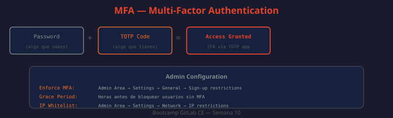

# 02 — Seguridad de Cuenta: MFA, Tokens y Auditoría

Proteger las cuentas de usuario es la primera línea de defensa en una plataforma DevOps. Un token comprometido o una cuenta sin MFA puede dar acceso a toda la cadena de suministro de software. GitLab ofrece múltiples capas de seguridad a nivel de cuenta que deben activarse de forma proactiva.



---

## Autenticación de Dos Factores (MFA)

GitLab CE soporta MFA mediante TOTP (Time-based One-Time Password). El usuario configura una app autenticadora que genera códigos de 6 dígitos renovados cada 30 segundos según el estándar RFC 6238.

Apps compatibles: Google Authenticator, Authy, Bitwarden, 1Password, Microsoft Authenticator.

### Configuración por usuario

```
Settings → Account → Two-Factor Authentication → Enable two-factor authentication
```

1. Escanear el código QR con la app autenticadora
2. Ingresar el código TOTP para confirmar
3. Guardar los 10 backup codes de emergencia en un gestor de contraseñas

### Forzar MFA desde Admin Area

```
Admin Area → Settings → General → Sign-up restrictions
→ Enforce two-factor authentication: ✅
→ Two-factor grace period: 48 (horas)
```

Con grace period activo, los usuarios tienen 48 horas para activar MFA. Pasado ese tiempo, se les redirige obligatoriamente a la pantalla de configuración al hacer login.

```bash
# ¿QUÉ HACE?: Lista usuarios sin MFA habilitado
# ¿POR QUÉ?: Permite identificar incumplidores antes del deadline
# ¿PARA QUÉ?: Enviar recordatorio o bloquear cuentas no conformes
curl --header "PRIVATE-TOKEN: $ADMIN_TOKEN" \
  "http://localhost/api/v4/users?two_factor=disabled&per_page=100" | \
  jq '.[] | {id, name, username, email}'
```

### Desbloquear MFA perdida (procedimiento de admin)

Si un usuario pierde su dispositivo MFA y sus backup codes, el admin puede desactivar MFA temporalmente:

```bash
# ¿QUÉ HACE?: Desactiva MFA para un usuario específico (requiere admin)
# ¿POR QUÉ?: Recover access cuando el usuario no puede autenticarse
# ¿PARA QUÉ?: El usuario debe reconfigurar MFA inmediatamente después
curl --request PATCH \
  --header "PRIVATE-TOKEN: $ADMIN_TOKEN" \
  --data "two_factor_enabled=false" \
  "http://localhost/api/v4/users/$USER_ID"
```

**Política recomendada**: antes de desactivar MFA, verificar identidad del usuario por canal alternativo (videollamada, ID corporativo).

---

## Personal Access Tokens (PAT)

Los PAT son la forma principal de autenticar herramientas externas con GitLab. Cada token tiene scopes que limitan exactamente qué puede hacer.

| Scope | Acceso otorgado |
|-------|----------------|
| `api` | Acceso completo a la API REST |
| `read_api` | API en modo solo lectura |
| `read_user` | Perfil del usuario |
| `read_repository` | Clonar y leer repositorios |
| `write_repository` | Push a repositorios |
| `read_registry` | Leer del Container Registry |
| `write_registry` | Subir imágenes al Registry |

```bash
# ¿QUÉ HACE?: Crea un PAT via API con scope y fecha de expiración específicos
# ¿POR QUÉ?: Automatiza creación de tokens con políticas corporativas
# ¿PARA QUÉ?: Onboarding de herramientas CI con el mínimo scope necesario
curl --request POST \
  --header "PRIVATE-TOKEN: $ADMIN_TOKEN" \
  --data "name=ci-pipeline-token&scopes[]=read_repository&scopes[]=read_registry&expires_at=2025-12-31&user_id=$USER_ID" \
  "http://localhost/api/v4/users/$USER_ID/personal_access_tokens"
```

### Política de expiración

Configurar expiración máxima por defecto desde Admin Area:

```
Admin Area → Settings → General → Account and limit settings
→ Maximum allowable lifetime for access tokens: 90 (días)
```

Con esta configuración, cualquier token sin fecha de expiración o con expiración > 90 días es rechazado al crearlo.

```bash
# ¿QUÉ HACE?: Lista todos los tokens activos con su fecha de expiración
# ¿POR QUÉ?: Identificar tokens que expiran pronto o sin expiración definida
# ¿PARA QUÉ?: Rotación proactiva antes de que expiren y rompan integraciones
curl --header "PRIVATE-TOKEN: $ADMIN_TOKEN" \
  "http://localhost/api/v4/personal_access_tokens?state=active" | \
  jq '.[] | {name, user_id, scopes, expires_at, last_used_at}'
```

### Revocar tokens comprometidos

Si se detecta que un token fue comprometido (expuesto en código, logs, etc.):

```bash
# ¿QUÉ HACE?: Revoca inmediatamente un PAT comprometido
# ¿POR QUÉ?: Un token comprometido debe invalidarse en segundos, no en horas
# ¿PARA QUÉ?: Limitar el daño de una filtración de credenciales
curl --request DELETE \
  --header "PRIVATE-TOKEN: $ADMIN_TOKEN" \
  "http://localhost/api/v4/personal_access_tokens/$TOKEN_ID"
```

---

## Claves SSH

Las claves SSH permiten operaciones Git (clone, push, pull) sin contraseña. Se gestionan en Settings → SSH Keys.

### Generación de claves

```bash
# ¿QUÉ HACE?: Genera clave Ed25519 (algoritmo moderno y seguro)
# ¿POR QUÉ?: Ed25519 es más rápido y seguro que RSA 2048/4096
# ¿PARA QUÉ?: Autenticar operaciones Git sin contraseña de forma segura
ssh-keygen -t ed25519 -C "user@company.com" -f ~/.ssh/gitlab_ed25519

# Verificar la clave generada
ssh-keygen -l -f ~/.ssh/gitlab_ed25519.pub
# 256 SHA256:... user@company.com (ED25519)
```

```bash
# ¿QUÉ HACE?: Configura SSH para usar la clave correcta con GitLab
# ¿POR QUÉ?: Si tienes múltiples claves SSH, debes especificar cuál usar
# ¿PARA QUÉ?: Evitar usar la clave default y mezclar identidades
cat >> ~/.ssh/config << 'EOF'
Host gitlab.company.local
  HostName gitlab.company.local
  User git
  IdentityFile ~/.ssh/gitlab_ed25519
  IdentitiesOnly yes
EOF

# Verificar que la conexión funciona
ssh -T git@gitlab.company.local
# Welcome to GitLab, @username!
```

### Expiración de claves SSH (Admin)

```
Admin Area → Settings → General → Account and limit settings
→ Maximum allowable lifetime for SSH keys: 365 (días)
```

```bash
# ¿QUÉ HACE?: Lista claves SSH expiradas o próximas a expirar
# ¿POR QUÉ?: Las claves viejas pueden pertenecer a empleados que ya salieron
# ¿PARA QUÉ?: Auditar y eliminar claves sin propietario activo
EXPIRY_SOON=$(date -d "30 days" +%Y-%m-%d)
curl --header "PRIVATE-TOKEN: $ADMIN_TOKEN" \
  "http://localhost/api/v4/admin/keys" | \
  jq --arg limit "$EXPIRY_SOON" \
  '[.[] | select(.expires_at != null and .expires_at <= $limit)] | 
   .[] | {id, title, user_id, expires_at}'
```

---

## Restricciones de IP

Las restricciones de IP limitan el acceso a GitLab a rangos específicos (intranet, VPN).

```
Admin Area → Settings → Network → IP restriction list
```

Formato de rangos permitidos:
```
192.168.1.0/24     # Toda la subred 192.168.1.x
10.0.0.0/8         # Red privada completa
203.0.113.42/32    # IP específica
```

**Comportamiento**: GitLab responde con `404 Not Found` (no `403 Forbidden`) desde IPs no autorizadas. Esto es intencional — no revela si existe algo en esa URL.

```bash
# ¿QUÉ HACE?: Verifica desde qué IPs llegan peticiones al servidor GitLab
# ¿POR QUÉ?: Antes de activar IP restrictions, confirmar el rango real de la oficina
# ¿PARA QUÉ?: Evitar bloquearse accidentalmente al activar restricciones
sudo grep "remote_addr" /var/log/gitlab/nginx/gitlab_access.log | \
  awk '{print $1}' | sort | uniq -c | sort -rn | head -20
```

**Precaución con trabajo remoto**: las IP restrictions bloquean también a empleados en home office o viaje. Tener un método de acceso de emergencia (acceso directo al servidor) antes de activar.

---

## Audit Events

GitLab registra un log de auditoría de todas las acciones relevantes de seguridad.

```
Admin Area → Monitoring → Audit Events
```

Eventos registrados automáticamente:

| Categoría | Ejemplos |
|-----------|---------|
| Autenticación | Login exitoso, login fallido, activación MFA |
| Membresías | Añadir/remover miembro, cambio de rol |
| Proyecto | Crear/eliminar proyecto, cambio de visibilidad |
| Repositorio | Push a protected branch, cambio de protected branch |
| CI/CD | Cambio de variable, modificación de runner |
| Tokens | Crear/revocar PAT, crear deploy token |
| Seguridad | Cambio de contraseña, cambio de email |

```bash
# ¿QUÉ HACE?: Consulta audit events de los últimos 7 días via API
# ¿POR QUÉ?: El volumen de eventos puede ser grande — filtrar por fecha es esencial
# ¿PARA QUÉ?: Investigar incidentes de seguridad con trazabilidad completa
SINCE=$(date -d "7 days ago" +%Y-%m-%dT%H:%M:%SZ)

curl --header "PRIVATE-TOKEN: $ADMIN_TOKEN" \
  "http://localhost/api/v4/audit_events?created_after=$SINCE&per_page=100" | \
  jq '.[] | {id, created_at, author_name, entity_type, action: .details.action}'
```

```bash
# ¿QUÉ HACE?: Filtra audit events por tipo de acción específico
# ¿POR QUÉ?: Buscar un tipo de evento concreto en un log masivo
# ¿PARA QUÉ?: Detectar patrones sospechosos como múltiples logins fallidos
curl --header "PRIVATE-TOKEN: $ADMIN_TOKEN" \
  "http://localhost/api/v4/audit_events?entity_type=User&per_page=100" | \
  jq '.[] | select(.details.action == "failed_login") | 
    {time: .created_at, ip: .details.ip_address}'
```

---

## Configuración de contraseñas y sesiones

```
Admin Area → Settings → General → Sign-in restrictions
```

| Configuración | Valor recomendado | Descripción |
|--------------|-------------------|-------------|
| Password minimum length | 12 | Contraseñas largas son más seguras |
| Sign-in attempts before lock | 10 | Bloqueo temporal tras intentos fallidos |
| Unlock delay | 10 min | Tiempo de bloqueo tras intentos fallidos |
| Unique passwords | 10 | No reutilizar las últimas 10 contraseñas |
| Session duration | 10080 min (1 semana) | Tiempo máximo de sesión activa |

```bash
# ¿QUÉ HACE?: Actualiza configuración de autenticación via API (requiere admin)
# ¿POR QUÉ?: Permite scriptear la configuración para instancias nuevas o IaC
# ¿PARA QUÉ?: Garantizar consistencia de políticas en múltiples instancias
curl --request PUT \
  --header "PRIVATE-TOKEN: $ADMIN_TOKEN" \
  --header "Content-Type: application/json" \
  --data '{
    "minimum_password_length": 12,
    "login_recaptcha_protection_enabled": true,
    "failed_login_attempts_unlock_period_in_minutes": 10,
    "max_personal_access_token_lifetime": 90
  }' \
  "http://localhost/api/v4/application/settings"
```

---

## Script de auditoría mensual

```bash
#!/bin/bash
# ¿QUÉ HACE?: Auditoría completa de seguridad de la instancia
# ¿POR QUÉ?: Verificar el estado de todas las políticas de seguridad en un comando
# ¿PARA QUÉ?: Ejecutar mensualmente como parte del proceso de compliance

echo "=== AUDITORÍA DE SEGURIDAD GITLAB ==="
echo "Fecha: $(date)"
echo ""

# Usuarios sin MFA
echo "1. Usuarios sin MFA:"
curl -s --header "PRIVATE-TOKEN: $ADMIN_TOKEN" \
  "http://localhost/api/v4/users?two_factor=disabled&per_page=100" | \
  jq -r '.[] | "   - \(.username) (\(.email))"'

# PATs sin fecha de expiración
echo ""
echo "2. PATs sin expiración:"
curl -s --header "PRIVATE-TOKEN: $ADMIN_TOKEN" \
  "http://localhost/api/v4/personal_access_tokens?state=active&per_page=100" | \
  jq -r '.[] | select(.expires_at == null) | "   - \(.name) (user_id: \(.user_id))"'

# Usuarios inactivos (90+ días sin login)
CUTOFF=$(date -d "90 days ago" +%Y-%m-%dT%H:%M:%SZ)
echo ""
echo "3. Usuarios inactivos (90+ días):"
curl -s --header "PRIVATE-TOKEN: $ADMIN_TOKEN" \
  "http://localhost/api/v4/users?active=true&per_page=100" | \
  jq --arg cutoff "$CUTOFF" \
  -r '.[] | select(.last_sign_in_at != null and .last_sign_in_at < $cutoff) | 
      "   - \(.username) (último login: \(.last_sign_in_at))"'

echo ""
echo "=== FIN AUDITORÍA ==="
```

---

## Mejores prácticas

- MFA obligatorio para todos — sin excepciones, ni para admins
- Tokens con el mínimo scope necesario y expiración máxima 90 días
- Revocar tokens sospechosos inmediatamente, no esperar a que expiren
- Claves SSH Ed25519 en lugar de RSA; expiración máxima 1 año
- Revisar audit events semanalmente; exportar a SIEM para alertas automáticas
- Deshabilitar registro público si la instancia es corporativa
- Usar IP restrictions + VPN para acceso desde internet
- Nunca compartir tokens o claves entre personas — credencial por persona
