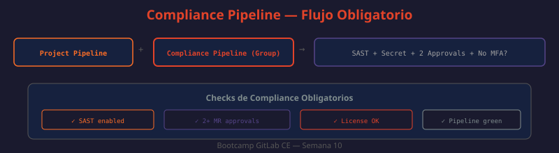

# 04 — Políticas de Cumplimiento (Compliance)

Las políticas de cumplimiento aseguran que los proyectos cumplan con estándares organizacionales o regulatorios (SOC2, ISO 27001, PCI DSS). En GitLab CE las políticas se implementan mediante pipelines de compliance, merge request approvals, protected branches y server hooks — sin necesidad de las Compliance Frameworks de EE.



---

## ¿Por qué compliance en DevOps?

Los marcos regulatorios modernos exigen trazabilidad y control sobre el proceso de desarrollo:

| Marco | Requisitos clave de DevOps |
|-------|---------------------------|
| SOC2 Type II | Aprobaciones documentadas, acceso con mínimo privilegio, logs de auditoría |
| ISO 27001 | Control de cambios, gestión de vulnerabilidades, revisión de código |
| PCI DSS | Separación de entornos, no exposición de datos sensibles en código |
| HIPAA | Audit trail completo, cifrado, control de acceso |
| GDPR | No almacenar PII en logs/código, derecho al olvido |

GitLab CE permite cubrir la mayoría de estos requisitos sin licencia Enterprise.

---

## Compliance Pipelines

Un compliance pipeline es un `.gitlab-ci.yml` definido a nivel de grupo que se inyecta automáticamente en todos los proyectos del grupo. Los desarrolladores no pueden omitirlo ni sobreescribirlo.

```
Admin Area → Groups → [grupo] → Settings → CI/CD → Compliance Pipeline configuration
→ Compliance framework pipeline: group-name/compliance-repo/.gitlab-ci.yml@main
```

### Estructura recomendada

```yaml
# ¿QUÉ HACE?: Compliance pipeline a nivel de grupo — aplica a todos los proyectos
# ¿POR QUÉ?: Garantiza checks de seguridad en todos los proyectos sin depender de cada dev
# ¿PARA QUÉ?: Cumplimiento uniforme: ningún proyecto puede saltarse SAST o MR approvals

stages:
  - compliance-pre    # Antes del pipeline del proyecto
  - build             # Pipeline del proyecto (merge con el del proyecto)
  - test
  - security
  - compliance-post   # Después del pipeline del proyecto

# --- Checks pre-pipeline ---
verify-sast-configured:
  stage: compliance-pre
  image: alpine:3.19
  script:
    - apk add --no-cache grep
    - |
      if grep -q "Security/SAST" .gitlab-ci.yml; then
        echo "✅ SAST: configurado"
      else
        echo "❌ SAST: NO configurado — este proyecto no cumple el requisito de seguridad"
        exit 1
      fi
  rules:
    - if: $CI_PIPELINE_SOURCE == "merge_request_event"

verify-secret-detection:
  stage: compliance-pre
  image: alpine:3.19
  script:
    - |
      if grep -q "Secret-Detection" .gitlab-ci.yml; then
        echo "✅ Secret Detection: configurado"
      else
        echo "❌ Secret Detection: NO configurado"
        exit 1
      fi
  rules:
    - if: $CI_PIPELINE_SOURCE == "merge_request_event"

# --- Reporte post-pipeline ---
compliance-report:
  stage: compliance-post
  image: alpine:3.19
  script:
    - |
      cat > compliance-report.md << EOF
      # Reporte de Compliance
      
      - Fecha: $(date -u +%Y-%m-%dT%H:%M:%SZ)
      - Proyecto: $CI_PROJECT_PATH
      - Pipeline: $CI_PIPELINE_ID
      - Branch: $CI_COMMIT_BRANCH
      - Commit: $CI_COMMIT_SHA
      - Autor: $CI_COMMIT_AUTHOR
      
      ## Resultados
      
      | Check | Estado |
      |-------|--------|
      | SAST configurado | ✅ |
      | Secret Detection configurado | ✅ |
      | Pipeline ejecutado | ✅ |
      EOF
      cat compliance-report.md
  artifacts:
    paths:
      - compliance-report.md
    expire_in: 90 days
  rules:
    - if: $CI_PIPELINE_SOURCE == "merge_request_event"
    - if: $CI_COMMIT_BRANCH == $CI_DEFAULT_BRANCH
```

---

## Merge Request Approvals

Las reglas de aprobación son un control de compliance crítico: ningún código llega a producción sin revisión humana autorizada.

```
Settings → Merge requests → Merge request approvals
```

### Configuración recomendada

| Opción | Valor recomendado | Motivo |
|--------|-------------------|--------|
| Approvals required | 2 | Una revisión puede pasar algo inadvertido |
| Prevent approval by author | ✅ | Separa quién propone de quién aprueba |
| Prevent approvals by users who add commits | ✅ | Invalidar aprobación si se añaden cambios post-aprobación |
| Require all threads to be resolved | ✅ | Sin comentarios sin resolver antes de mergear |
| Remove all approvals when commits are added | ✅ | Revisión fresca si se modifica el MR |

```bash
# ¿QUÉ HACE?: Configura reglas de aprobación de MR via API
# ¿POR QUÉ?: Automatiza la configuración en proyectos nuevos
# ¿PARA QUÉ?: Garantizar que todos los proyectos tienen las mismas políticas de review
curl --request POST \
  --header "PRIVATE-TOKEN: $GITLAB_TOKEN" \
  --header "Content-Type: application/json" \
  --data '{
    "name": "Require 2 approvals",
    "approvals_required": 2
  }' \
  "http://localhost/api/v4/projects/$PROJECT_ID/approval_rules"
```

```bash
# ¿QUÉ HACE?: Actualiza la configuración general de MR approvals del proyecto
# ¿POR QUÉ?: Prevenir auto-aprobación y asegurar review de cambios post-aprobación
# ¿PARA QUÉ?: Compliance SOC2: separación de responsabilidades en cambios de código
curl --request PUT \
  --header "PRIVATE-TOKEN: $GITLAB_TOKEN" \
  --header "Content-Type: application/json" \
  --data '{
    "approvals_before_merge": 2,
    "reset_approvals_on_push": true,
    "disable_overriding_approvers_per_merge_request": true
  }' \
  "http://localhost/api/v4/projects/$PROJECT_ID/approvals"
```

---

## Protected Branches como control de compliance

Las protected branches son el mecanismo de enforcement más robusto disponible en CE:

```bash
# ¿QUÉ HACE?: Configura protección estricta para la rama main
# ¿POR QUÉ?: Sin push directo a main, todo cambio pasa por MR y aprobación
# ¿PARA QUÉ?: Cumplimiento de change management: trazabilidad completa de cada cambio
curl --request POST \
  --header "PRIVATE-TOKEN: $GITLAB_TOKEN" \
  --header "Content-Type: application/json" \
  --data '{
    "name": "main",
    "push_access_level": 0,
    "merge_access_level": 40,
    "allow_force_push": false,
    "code_owner_approval_required": false
  }' \
  "http://localhost/api/v4/projects/$PROJECT_ID/protected_branches"
# push_access_level 0 = nadie puede hacer push directo (ni admins)
```

---

## Push Rules en CE (via server hooks)

Las Push Rules son una feature EE, pero en CE se pueden implementar con `pre-receive` hooks en el servidor GitLab:

```bash
# Ubicación: /opt/gitlab/embedded/service/gitlab-shell/hooks/pre-receive
# O en repositorios específicos: /var/opt/gitlab/git-data/repositories/group/project.git/hooks/pre-receive

# ¿QUÉ HACE?: Verifica que el commit message siga el formato Conventional Commits
# ¿POR QUÉ?: Historial de commits legible y parseable automáticamente
# ¿PARA QUÉ?: Compliance de change management: cada commit tiene tipo y descripción

#!/bin/bash
while read oldrev newrev refname; do
  # Verificar commits entre oldrev y newrev
  git rev-list "$oldrev..$newrev" | while read commit; do
    msg=$(git log -1 --format="%s" "$commit")
    if ! echo "$msg" | grep -qE "^(feat|fix|docs|style|refactor|test|chore|perf)(\(.+\))?: .+"; then
      echo "ERROR: Commit '$commit' no sigue Conventional Commits"
      echo "Formato requerido: type(scope): description"
      echo "Tipos válidos: feat|fix|docs|style|refactor|test|chore|perf"
      exit 1
    fi
  done
done
```

Alternativa sin server hooks: validar en el pipeline:

```yaml
# ¿QUÉ HACE?: Valida formato de commit message desde el pipeline (sin acceso al servidor)
# ¿POR QUÉ?: Feedback rápido al developer sin necesidad de configuración en servidor
# ¿PARA QUÉ?: Misma funcionalidad que un pre-receive hook pero desde CI/CD
commit-lint:
  stage: compliance-pre
  image: node:20-alpine
  before_script:
    - npm install -g @commitlint/cli @commitlint/config-conventional
  script:
    - echo '{"extends":["@commitlint/config-conventional"]}' > commitlint.config.json
    - git log --format="%s" "origin/$CI_MERGE_REQUEST_TARGET_BRANCH_NAME..$CI_COMMIT_SHA" | \
      commitlint --from="" --to=""
  rules:
    - if: $CI_PIPELINE_SOURCE == "merge_request_event"
```

---

## Audit Trail y exportación a SIEM

Para compliance SOC2 e ISO 27001, los audit events deben almacenarse fuera de GitLab y ser inmutables:

```bash
# ¿QUÉ HACE?: Script de exportación diaria de audit events a archivo JSON
# ¿POR QUÉ?: GitLab solo retiene audit events por tiempo limitado en CE
# ¿PARA QUÉ?: Retención de logs de auditoría por 1-7 años según el marco regulatorio

#!/bin/bash
GITLAB_URL="http://localhost"
OUTPUT_DIR="/var/audit-logs/gitlab"
DATE=$(date +%Y-%m-%d)

mkdir -p "$OUTPUT_DIR"

# Exportar todos los audit events del día anterior
SINCE=$(date -d "yesterday 00:00:00" +%Y-%m-%dT%H:%M:%SZ)
UNTIL=$(date -d "today 00:00:00" +%Y-%m-%dT%H:%M:%SZ)

PAGE=1
while true; do
  RESPONSE=$(curl -s --header "PRIVATE-TOKEN: $ADMIN_TOKEN" \
    "$GITLAB_URL/api/v4/audit_events?created_after=$SINCE&created_before=$UNTIL&per_page=100&page=$PAGE")
  
  COUNT=$(echo "$RESPONSE" | jq length)
  [ "$COUNT" -eq 0 ] && break
  
  echo "$RESPONSE" >> "$OUTPUT_DIR/audit-events-$DATE.json"
  ((PAGE++))
done

# Comprimir y calcular checksum para integridad
gzip "$OUTPUT_DIR/audit-events-$DATE.json"
sha256sum "$OUTPUT_DIR/audit-events-$DATE.json.gz" > "$OUTPUT_DIR/audit-events-$DATE.sha256"

echo "Exportados $((PAGE-1)) páginas de audit events para $DATE"
```

Integración con SIEM (Elasticsearch/Splunk):

```bash
# ¿QUÉ HACE?: Envía audit events a Elasticsearch en tiempo real
# ¿POR QUÉ?: Alertas automáticas sobre eventos de seguridad sin esperar al reporte diario
# ¿PARA QUÉ?: Detección de incidentes en tiempo real: brute force, privilege escalation, etc.
curl -s --header "PRIVATE-TOKEN: $ADMIN_TOKEN" \
  "http://localhost/api/v4/audit_events?per_page=100" | \
  jq -c '.[]' | \
  while read event; do
    curl --request POST \
      --header "Content-Type: application/json" \
      --data "$event" \
      "http://elasticsearch:9200/gitlab-audit/_doc"
  done
```

---

## Reportes de cumplimiento automatizados

```bash
#!/bin/bash
# ¿QUÉ HACE?: Genera reporte semanal de cumplimiento de la instancia
# ¿POR QUÉ?: Visibilidad del estado de compliance sin revisión manual de cada proyecto
# ¿PARA QUÉ?: Informe para dirección o auditoría externa

GITLAB_URL="http://localhost"
REPORT_FILE="/tmp/compliance-report-$(date +%Y-%m-%d).md"

cat > "$REPORT_FILE" << 'HEADER'
# Reporte de Compliance GitLab
HEADER
echo "Generado: $(date)" >> "$REPORT_FILE"
echo "" >> "$REPORT_FILE"

# 1. Usuarios sin MFA
echo "## 1. Usuarios sin MFA" >> "$REPORT_FILE"
NO_MFA=$(curl -s --header "PRIVATE-TOKEN: $ADMIN_TOKEN" \
  "$GITLAB_URL/api/v4/users?two_factor=disabled&per_page=100")
echo "Total: $(echo $NO_MFA | jq length)" >> "$REPORT_FILE"
echo "$NO_MFA" | jq -r '.[] | "- \(.username) (\(.email))"' >> "$REPORT_FILE"

# 2. Proyectos sin protected branches
echo "" >> "$REPORT_FILE"
echo "## 2. Proyectos sin Protected Branches" >> "$REPORT_FILE"
curl -s --header "PRIVATE-TOKEN: $ADMIN_TOKEN" \
  "$GITLAB_URL/api/v4/projects?per_page=100&membership=false" | \
  jq -r '.[] | .id' | while read proj_id; do
  BRANCHES=$(curl -s --header "PRIVATE-TOKEN: $ADMIN_TOKEN" \
    "$GITLAB_URL/api/v4/projects/$proj_id/protected_branches" | jq length)
  if [ "$BRANCHES" -eq 0 ]; then
    NAME=$(curl -s --header "PRIVATE-TOKEN: $ADMIN_TOKEN" \
      "$GITLAB_URL/api/v4/projects/$proj_id" | jq -r '.path_with_namespace')
    echo "- $NAME" >> "$REPORT_FILE"
  fi
done

echo "" >> "$REPORT_FILE"
echo "---" >> "$REPORT_FILE"
echo "Fin del reporte." >> "$REPORT_FILE"

cat "$REPORT_FILE"
```

---

## Mapeo de controles CE a SOC2

| Control SOC2 | Implementación en GitLab CE |
|-------------|---------------------------|
| CC6.1 - Acceso lógico con autenticación | MFA obligatorio + IP restrictions |
| CC6.2 - Acceso basado en roles | RBAC con roles mínimos + revisión trimestral |
| CC6.3 - Restricción de acceso a datos | Protected branches + proyectos privados |
| CC7.1 - Detección de vulnerabilidades | SAST + Secret Detection + Dependency Scanning |
| CC7.2 - Gestión de incidentes | Audit events + alertas SIEM |
| CC8.1 - Gestión de cambios | MR approvals + compliance pipeline |
| A1.2 - Disponibilidad y capacidad | (Semana 11: monitoreo y backups) |

---

## Mejores prácticas

- Compliance pipelines a nivel de grupo: los devs no pueden deshabilitarlos
- MR approvals: mínimo 2, prevenir auto-aprobación, reset en cada push
- Audit events: exportar diariamente a almacenamiento externo e inmutable
- Reportes de compliance: automáticos y semanales, con alertas para hallazgos críticos
- Revisar trimestralmente: membresías, tokens, protected branches, variables CI/CD
- Runbook de remediación: procedimientos documentados para hallazgos frecuentes
- No omitir compliance por presión de deadlines — el compliance pipeline debe ser bloqueante
