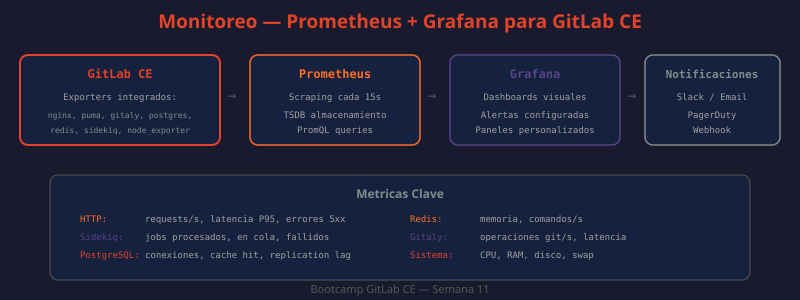

# 01 — Monitoreo de GitLab: Prometheus, Exporters y Grafana

GitLab CE incluye Prometheus integrado y múltiples exporters que exponen métricas de todos los componentes de la plataforma. Este sistema de observabilidad permite detectar problemas antes de que los usuarios los reporten, planificar capacidad y validar el impacto de cambios de configuración.



---

## Prometheus integrado en GitLab CE

GitLab Omnibus empaqueta su propio Prometheus que recolecta métricas de todos los componentes internos. Se habilita en `/etc/gitlab/gitlab.rb`:

```ruby
# ¿QUÉ HACE?: Habilita Prometheus y configura retención de datos
# ¿POR QUÉ?: Prometheus está deshabilitado por defecto para no consumir recursos innecesariamente
# ¿PARA QUÉ?: Acceder a métricas en http://localhost:9090 y alimentar Grafana
prometheus['enable'] = true
prometheus['listen_address'] = 'localhost:9090'
prometheus['storage_path'] = '/var/opt/gitlab/prometheus/data'

# Retención de datos históricos (por defecto 15 días)
prometheus['flags'] = {
  'storage.tsdb.path'             => '/var/opt/gitlab/prometheus/data',
  'storage.tsdb.retention.time'   => '30d',
  'web.listen-address'            => 'localhost:9090',
  'web.enable-admin-api'          => nil
}
```

```bash
# Verificar que Prometheus está escuchando
curl -s http://localhost:9090/api/v1/targets | jq '.data.activeTargets | length'
# → Número de targets siendo escrapeados

# Ver todos los targets activos
curl -s http://localhost:9090/api/v1/targets | jq '.data.activeTargets[] | {job: .labels.job, url: .scrapeUrl, health: .health}'
```

---

## Exporters de cada componente

Cada componente de GitLab expone métricas en un endpoint HTTP. Prometheus los escrapea cada 15 segundos por defecto.

| Componente | Puerto | Métricas principales |
|-----------|--------|---------------------|
| Node Exporter | 9100 | CPU, RAM, disco, red del sistema operativo |
| GitLab Rails | 8080 | Peticiones HTTP, latencia, operaciones Git |
| Puma (web server) | 9235 | Workers activos, peticiones en cola |
| Sidekiq | 8082 | Jobs procesados/fallidos/encolados por cola |
| Gitaly | 9236 | Operaciones RPC, latencia por tipo de operación |
| PostgreSQL Exporter | 9187 | Conexiones, locks, cache hit ratio, query stats |
| Redis Exporter | 9121 | Uso de memoria, comandos/s, conexiones, hit ratio |
| GitLab Workhorse | 9229 | Peticiones HTTP, downloads, uploads |

```bash
# ¿QUÉ HACE?: Consulta directamente el endpoint de métricas de Rails
# ¿POR QUÉ?: Útil para debug cuando Prometheus no está disponible
# ¿PARA QUÉ?: Verificar que el exporter está respondiendo con métricas válidas
curl -s http://localhost:8080/-/metrics | grep "gitlab_rails_requests_total" | head -5
```

---

## PromQL: consultas esenciales para GitLab

PromQL (Prometheus Query Language) permite crear métricas derivadas, tasas y percentiles.

### Métricas de disponibilidad y rendimiento web

```promql
# Tasa de peticiones HTTP por segundo (últimos 5 minutos)
rate(gitlab_rails_requests_total[5m])

# Tasa de errores 5xx (indica problemas de servidor)
rate(gitlab_rails_requests_total{status=~"5.."}[5m])

# Ratio de errores (porcentaje de peticiones con error)
rate(gitlab_rails_requests_total{status=~"5.."}[5m]) /
rate(gitlab_rails_requests_total[5m]) * 100

# Latencia P50, P95, P99 de peticiones Rails
histogram_quantile(0.50, rate(gitlab_rails_request_duration_seconds_bucket[5m]))
histogram_quantile(0.95, rate(gitlab_rails_request_duration_seconds_bucket[5m]))
histogram_quantile(0.99, rate(gitlab_rails_request_duration_seconds_bucket[5m]))
```

### Métricas de Sidekiq (procesamiento asíncrono)

```promql
# Jobs en cola por tipo de cola (alarma si crece constantemente)
sidekiq_queue_size

# Jobs procesados por segundo por cola
rate(sidekiq_jobs_processed_total[5m])

# Jobs fallidos (requieren intervención)
rate(sidekiq_jobs_failed_total[5m])

# Latencia de procesamiento de jobs (tiempo en cola + procesamiento)
sidekiq_queue_latency_seconds

# Jobs en estado retry (fallaron y se reintentarán)
sidekiq_retry_set_size
```

### Métricas de PostgreSQL

```promql
# Conexiones activas por base de datos
pg_stat_database_numbackends

# Cache hit ratio (> 99% es lo esperado; < 95% indica problemas)
pg_stat_database_blks_hit /
(pg_stat_database_blks_hit + pg_stat_database_blks_read) * 100

# Locks activos (valores altos indican contención)
pg_locks_count

# Filas insertadas/actualizadas/eliminadas por segundo
rate(pg_stat_database_tup_inserted[5m])
rate(pg_stat_database_tup_updated[5m])
rate(pg_stat_database_tup_deleted[5m])

# Tamaño de las bases de datos
pg_database_size_bytes
```

### Métricas de Redis

```promql
# Uso de memoria
redis_memory_used_bytes
redis_memory_used_bytes / redis_memory_max_bytes * 100

# Comandos por segundo
rate(redis_commands_processed_total[5m])

# Hit ratio de caché (> 90% es normal)
redis_keyspace_hits_total / (redis_keyspace_hits_total + redis_keyspace_misses_total) * 100

# Conexiones activas
redis_connected_clients
```

### Métricas de sistema (Node Exporter)

```promql
# Uso de CPU (0-1, multiplicar por 100 para porcentaje)
1 - avg(rate(node_cpu_seconds_total{mode="idle"}[5m]))

# Uso de memoria RAM
(node_memory_MemTotal_bytes - node_memory_MemAvailable_bytes) / node_memory_MemTotal_bytes * 100

# Uso de disco (critico si supera 85%)
(node_filesystem_size_bytes - node_filesystem_avail_bytes) / node_filesystem_size_bytes * 100

# I/O de disco
rate(node_disk_read_bytes_total[5m])
rate(node_disk_written_bytes_total[5m])
```

---

## Grafana: despliegue y configuración

GitLab CE no incluye Grafana, pero se despliega fácilmente como contenedor:

```yaml
# docker-compose.monitoring.yml
# ¿QUÉ HACE?: Despliega Grafana + Prometheus externo para GitLab
# ¿POR QUÉ?: Grafana proporciona visualización superior a la UI de Prometheus
# ¿PARA QUÉ?: Dashboard operacional en tiempo real con alertas y anotaciones
version: '3.8'

services:
  grafana:
    image: grafana/grafana:10.4.2
    container_name: grafana
    ports:
      - "3000:3000"
    environment:
      - GF_SECURITY_ADMIN_USER=admin
      - GF_SECURITY_ADMIN_PASSWORD=cambiar-en-produccion
      - GF_SERVER_ROOT_URL=http://grafana.company.local:3000
      - GF_SMTP_ENABLED=true
      - GF_SMTP_HOST=smtp.company.local:587
      - GF_SMTP_FROM_ADDRESS=grafana@company.local
    volumes:
      - grafana-data:/var/lib/grafana
      - ./grafana/provisioning:/etc/grafana/provisioning
    restart: unless-stopped
    extra_hosts:
      - "host.docker.internal:host-gateway"

volumes:
  grafana-data:
```

Configuración de datasource automática:

```yaml
# grafana/provisioning/datasources/prometheus.yml
# ¿QUÉ HACE?: Configura automáticamente el datasource de Prometheus en Grafana
# ¿POR QUÉ?: Sin esto, hay que configurar el datasource manualmente cada vez que se crea el contenedor
# ¿PARA QUÉ?: Grafana pueda consultar métricas de GitLab sin configuración manual
apiVersion: 1
datasources:
  - name: Prometheus-GitLab
    type: prometheus
    access: proxy
    url: http://host.docker.internal:9090
    isDefault: true
    jsonData:
      timeInterval: "15s"
      httpMethod: GET
    editable: true
```

### Dashboards recomendados (importar por ID en Grafana)

| ID | Nombre | Contenido |
|----|--------|-----------|
| 20916 | GitLab Omnibus | Overview completo de todos los componentes |
| 17614 | GitLab Performance | Métricas de rendimiento Rails y Sidekiq |
| 9628 | PostgreSQL Database | Métricas detalladas de PostgreSQL |
| 763 | Redis Dashboard | Uso de Redis, comandos, memoria |
| 1860 | Node Exporter Full | CPU, RAM, disco, red del servidor |

```bash
# ¿QUÉ HACE?: Importa dashboards automáticamente via API de Grafana
# ¿POR QUÉ?: Más rápido que importar uno por uno desde la UI
# ¿PARA QUÉ?: Setup inicial de Grafana reproducible y scripteable
GRAFANA_URL="http://localhost:3000"
GRAFANA_AUTH="admin:cambiar-en-produccion"

for DASHBOARD_ID in 20916 17614 9628 763 1860; do
  curl -s -X POST \
    --header "Content-Type: application/json" \
    --user "$GRAFANA_AUTH" \
    --data "{\"dashboard\": {\"id\": $DASHBOARD_ID, \"uid\": null}, \"folderId\": 0, \"overwrite\": false}" \
    "$GRAFANA_URL/api/dashboards/import"
  echo "Dashboard $DASHBOARD_ID importado"
done
```

---

## Reglas de alerta con Prometheus

Las alertas se definen en archivos YAML que Prometheus carga:

```ruby
# En gitlab.rb: agregar archivo de reglas personalizadas
prometheus['scrape_configs'] = [
  {
    'job_name' => 'gitlab',
    'static_configs' => [{ 'targets' => ['localhost:8080'] }]
  }
]
```

```yaml
# /etc/gitlab/prometheus/rules/gitlab-alerts.yml
# ¿QUÉ HACE?: Define reglas de alerta para los componentes críticos de GitLab
# ¿POR QUÉ?: Detección automática de problemas sin necesidad de revisar dashboards manualmente
# ¿PARA QUÉ?: Notificación proactiva antes de que el problema impacte a los usuarios
groups:
  - name: gitlab-availability
    rules:
      # Alerta si GitLab no está respondiendo
      - alert: GitLabDown
        expr: up{job="gitlab"} == 0
        for: 2m
        labels:
          severity: critical
        annotations:
          summary: "GitLab Rails no responde"
          description: "GitLab Rails no ha respondido en más de 2 minutos. URL: {{ $labels.instance }}"

      # Alerta si la tasa de errores supera el 5%
      - alert: HighErrorRate
        expr: |
          rate(gitlab_rails_requests_total{status=~"5.."}[5m]) /
          rate(gitlab_rails_requests_total[5m]) > 0.05
        for: 5m
        labels:
          severity: warning
        annotations:
          summary: "Tasa de errores elevada en GitLab"
          description: "{{ $value | humanizePercentage }} de peticiones están retornando errores 5xx"

      # Alerta si la latencia P95 supera 2 segundos
      - alert: HighP95Latency
        expr: |
          histogram_quantile(0.95,
            rate(gitlab_rails_request_duration_seconds_bucket[5m])
          ) > 2
        for: 10m
        labels:
          severity: warning
        annotations:
          summary: "Latencia P95 alta en GitLab"
          description: "La latencia P95 es {{ $value }}s (umbral: 2s)"

  - name: gitlab-resources
    rules:
      # Alerta de disco
      - alert: DiskSpaceCritical
        expr: |
          (node_filesystem_size_bytes{mountpoint="/var/opt/gitlab"} -
           node_filesystem_avail_bytes{mountpoint="/var/opt/gitlab"}) /
          node_filesystem_size_bytes{mountpoint="/var/opt/gitlab"} > 0.85
        for: 5m
        labels:
          severity: critical
        annotations:
          summary: "Disco GitLab al {{ $value | humanizePercentage }}"
          description: "El disco de GitLab superó el 85% de uso. Limpiar artifacts o ampliar disco."

      # Cola de Sidekiq creciendo
      - alert: SidekiqQueueBacklog
        expr: sidekiq_queue_size > 100
        for: 10m
        labels:
          severity: warning
        annotations:
          summary: "Cola Sidekiq con {{ $value }} jobs pendientes"
          description: "La cola {{ $labels.name }} tiene más de 100 jobs pendientes por más de 10 minutos"

      # PostgreSQL: conexiones cercanas al límite
      - alert: PostgreSQLConnectionsHigh
        expr: |
          pg_stat_database_numbackends /
          pg_settings_max_connections * 100 > 80
        for: 5m
        labels:
          severity: warning
        annotations:
          summary: "PostgreSQL al {{ $value | humanizePercentage }} de conexiones máximas"
```

---

## Configuración de Alertmanager

```yaml
# /etc/gitlab/alertmanager.yml
# ¿QUÉ HACE?: Configura routing de alertas a múltiples destinos
# ¿POR QUÉ?: Las alertas críticas deben notificarse por múltiples canales
# ¿PARA QUÉ?: Asegurar que alguien reciba la alerta incluso si un canal falla
global:
  smtp_from: 'alertmanager@company.local'
  smtp_smarthost: 'smtp.company.local:587'
  slack_api_url: 'https://hooks.slack.com/services/T.../B.../XXXX'

route:
  group_by: ['alertname', 'severity']
  group_wait: 30s
  group_interval: 5m
  repeat_interval: 12h
  receiver: 'team-ops'
  routes:
    - match:
        severity: critical
      receiver: 'pagerduty-critical'
      repeat_interval: 30m
    - match:
        severity: warning
      receiver: 'slack-warnings'

receivers:
  - name: 'team-ops'
    email_configs:
      - to: 'ops-team@company.local'

  - name: 'slack-warnings'
    slack_configs:
      - channel: '#gitlab-alerts'
        title: '{{ .GroupLabels.alertname }}'
        text: '{{ range .Alerts }}{{ .Annotations.description }}{{ end }}'

  - name: 'pagerduty-critical'
    pagerduty_configs:
      - routing_key: 'tu-integration-key'
```

---

## Health checks y endpoints útiles

```bash
# ¿QUÉ HACE?: Verifica el estado de todos los servicios de GitLab
# ¿POR QUÉ?: Diagnóstico rápido de problemas sin entrar al servidor
# ¿PARA QUÉ?: Integrar en load balancers y sistemas de monitoreo externos
curl -s http://localhost/-/health        # Liveness check (200 = OK)
curl -s http://localhost/-/readiness     # Readiness check (200 = todos los servicios listos)
curl -s http://localhost/-/liveness      # Kubernetes liveness probe compatible

# Respuesta de /-/readiness:
# {
#   "master_check":[{"status":"ok"}],
#   "db_check":[{"status":"ok"}],
#   "redis_check":[{"status":"ok"}],
#   "sidekiq_check":[{"status":"ok"}],
#   "gitaly_check":[{"status":"ok"}]
# }
```

```bash
# ¿QUÉ HACE?: Verifica el estado interno de todos los servicios Omnibus
# ¿POR QUÉ?: Diferente de los health checks HTTP — verifica procesos del sistema
# ¿PARA QUÉ?: Diagnóstico en el servidor cuando el HTTP no responde
sudo gitlab-ctl status

# Output esperado:
# run: alertmanager: (pid 1234) 3600s; run: log: (pid 1235) 3600s
# run: gitaly: (pid 1236) 3600s; run: log: (pid 1237) 3600s
# run: gitlab-exporter: (pid 1238) 3600s; ...
# run: postgresql: (pid 1239) 3600s; ...
# run: prometheus: (pid 1240) 3600s; ...
# run: puma: (pid 1241) 3600s; ...
# run: redis: (pid 1242) 3600s; ...
# run: sidekiq: (pid 1243) 3600s; ...
```

---

## Mejores prácticas de monitoreo

- Habilitar Prometheus desde el primer día — los datos históricos son valiosos para diagnóstico
- Retención mínima de 30 días para detectar patrones semanales y tendencias mensuales
- Dashboards separados: operacional (tiempo real, alertas) y ejecutivo (tendencias, SLA)
- Alertas en dos niveles: `warning` (equipo toma nota) y `critical` (acción inmediata, puede page)
- Latencia P95 y P99 son más informativas que el promedio — el promedio oculta los casos lentos
- Monitorear el monitoreo: alertar si Prometheus no puede escrapearse a sí mismo
- Documentar cada alerta con un runbook de respuesta (qué hacer cuando suena)
