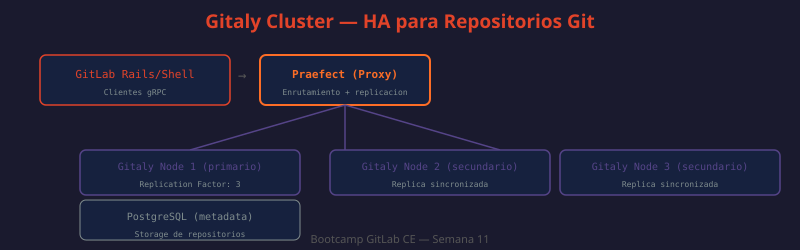

# 05 — Gitaly Cluster: HA para Repositorios Git

Gitaly es el servicio de GitLab que maneja todas las operaciones de git (clone, push, pull, blame, diff, etc.). En un setup de single-node, Gitaly es un SPOF crítico — si falla, ningún repositorio es accesible. Gitaly Cluster proporciona HA con replicación de repositorios entre múltiples nodos usando Praefect como proxy inteligente.



---

## Arquitectura de Gitaly Cluster

```
[GitLab Rails]
      │
      ↓ gRPC
[Praefect]           ← Proxy y coordinador de replicación
  │    │    │
  ↓    ↓    ↓ gRPC
[Gitaly-1] [Gitaly-2] [Gitaly-3]   ← Nodos de almacenamiento
  /repos   /repos     /repos        ← Cada nodo tiene copias de los repositorios
      │
      ↓
[PostgreSQL Praefect] ← Metadata: qué nodos tienen qué repos, estado de replicación
```

**Flujo de escritura (push)**:
1. GitLab Rails → Praefect (gRPC)
2. Praefect → Gitaly primario del repositorio (escribe)
3. Praefect encola la replicación a los otros Gitaly nodes (asíncrono)
4. Praefect confirma la escritura a Rails cuando el primario confirma
5. Los nodos secundarios replican en background

**Flujo de lectura (clone/pull)**:
1. GitLab Rails → Praefect
2. Praefect → cualquier Gitaly que tenga el repositorio (puede ser secundario)
3. Las lecturas no requieren ir al nodo primario del repo

---

## Componentes en detalle

### Praefect

Praefect es el punto de entrada para todas las operaciones Gitaly. Sus responsabilidades:

- **Routing**: determina qué Gitaly node es el primario de cada repositorio
- **Replication**: encola y monitorea la replicación entre nodos
- **Health checking**: detecta nodos Gitaly caídos y los excluye temporalmente
- **Reconciliation**: detecta divergencias entre réplicas y las corrige
- **Metadata**: almacena el estado de todas las réplicas en PostgreSQL

Praefect en sí no almacena repositorios — es un proxy que puede ejecutarse en múltiples instancias detrás de un balanceador para eliminar su propio SPOF.

### Gitaly Nodes

Cada nodo Gitaly almacena repositorios en su disco local. Un repositorio puede existir en múltiples nodos (según el `replication_factor`). El nodo considerado "primario" de un repositorio puede cambiar si el nodo actual falla.

### PostgreSQL de Praefect

Praefect requiere su propia instancia de PostgreSQL (separada de la de GitLab) para almacenar:
- Mapa de repositorios → nodos
- Estado de replicación (qué copias están actualizadas)
- Cola de trabajos de replicación pendientes
- Historial de operaciones

---

## Configuración de Praefect

```ruby
# /etc/gitlab/gitlab.rb en el nodo Praefect
# ¿QUÉ HACE?: Configura el proxy Praefect con los 3 nodos Gitaly y su base de datos
# ¿POR QUÉ?: Praefect necesita saber la ubicación de todos los Gitaly para enrutar
# ¿PARA QUÉ?: Punto de entrada único que gestiona la replicación entre nodos

# Deshabilitar componentes no necesarios en el nodo Praefect
gitaly['enable'] = false
postgresql['enable'] = false
redis['enable'] = false
puma['enable'] = false
sidekiq['enable'] = false
gitlab_workhorse['enable'] = false
nginx['enable'] = false

# Habilitar Praefect
praefect['enable'] = true
praefect['listen_addr'] = '0.0.0.0:2305'

# Base de datos de Praefect (PostgreSQL separado)
praefect['database_host'] = '192.168.1.30'
praefect['database_port'] = 5432
praefect['database_user'] = 'praefect'
praefect['database_password'] = 'praefect-db-password'
praefect['database_dbname'] = 'praefect_production'

# Configuración de los nodos Gitaly backend
praefect['virtual_storages'] = {
  'default' => {
    'default_replication_factor' => 3,  # Cada repo en los 3 nodos
    'nodes' => {
      'gitaly-1' => {
        'address' => 'tcp://192.168.1.21:8075',
        'token'   => 'gitaly-auth-token-secreto'
      },
      'gitaly-2' => {
        'address' => 'tcp://192.168.1.22:8075',
        'token'   => 'gitaly-auth-token-secreto'
      },
      'gitaly-3' => {
        'address' => 'tcp://192.168.1.23:8075',
        'token'   => 'gitaly-auth-token-secreto'
      }
    }
  }
}
```

---

## Configuración de cada nodo Gitaly

```ruby
# /etc/gitlab/gitlab.rb en CADA nodo Gitaly (cambiar la IP en connect_address)
# ¿QUÉ HACE?: Configura Gitaly para aceptar conexiones de Praefect
# ¿POR QUÉ?: Los nodos Gitaly deben autenticarse mutuamente con Praefect
# ¿PARA QUÉ?: Almacenamiento de repositorios con replicación gestionada por Praefect

# Deshabilitar componentes no necesarios en nodos Gitaly
postgresql['enable'] = false
redis['enable'] = false
puma['enable'] = false
sidekiq['enable'] = false
gitlab_workhorse['enable'] = false
nginx['enable'] = false
prometheus_monitoring['enable'] = false

# Habilitar solo Gitaly
gitaly['enable'] = true
gitaly['listen_addr'] = '0.0.0.0:8075'
gitaly['auth_token'] = 'gitaly-auth-token-secreto'

# Directorio de almacenamiento de repositorios
gitaly['storage'] = [
  {
    'name' => 'default',                        # Nombre que Praefect conoce
    'path' => '/var/opt/gitlab/git-data/repositories'
  }
]

# Configurar IP del nodo para que Praefect lo identifique
gitlab_rails['internal_api_url'] = 'http://192.168.1.21'  # IP de este nodo
```

---

## Configuración de GitLab Rails para usar Praefect

```ruby
# /etc/gitlab/gitlab.rb en los nodos Rails
# ¿QUÉ HACE?: Configura GitLab Rails para conectar a Praefect en lugar de Gitaly directamente
# ¿POR QUÉ?: Rails no debe conocer los nodos Gitaly — Praefect abstrae esa complejidad
# ¿PARA QUÉ?: Toda operación git va a través del cluster con HA automática
git_data_dirs({
  'default' => {
    'gitaly_address' => 'tcp://192.168.1.10:2305',  # IP del nodo Praefect (o VIP)
    'gitaly_token'   => 'gitaly-auth-token-secreto'
  }
})
```

---

## Replication Factor y tolerancia a fallos

El `default_replication_factor` determina cuántas copias de cada repositorio existen:

| Factor | Copias | Tolera fallo de | Espacio usado |
|--------|--------|-----------------|--------------|
| 1 | 1 | 0 nodos | 1x |
| 2 | 2 | 1 nodo | 2x |
| 3 | 3 | 2 nodos | 3x |

```bash
# ¿QUÉ HACE?: Verifica el replication factor y estado de réplicas via API de Praefect
# ¿POR QUÉ?: Detectar repositorios que no tienen el número esperado de réplicas
# ¿PARA QUÉ?: Auditoría de salud del cluster Gitaly

# Via praefect CLI
sudo /opt/gitlab/embedded/bin/praefect \
  -config /var/opt/gitlab/praefect/config.toml \
  dataloss

# Output esperado cuando todo está replicado:
# No dataloss for virtual storage 'default'

# Output cuando hay problemas:
# Virtual storage: default
#   Outdated repositories:
#     @hashed/ab/cd/abcd1234.git:
#       Primary: gitaly-1 (latest)
#       Replica: gitaly-2 (outdated by 1 changes)
```

---

## Reconciliación de réplicas

Praefect puede detectar y corregir réplicas desactualizadas:

```bash
# ¿QUÉ HACE?: Verifica y repara réplicas desactualizadas
# ¿POR QUÉ?: Después de un fallo de red, algunos repos pueden quedar desactualizados
# ¿PARA QUÉ?: Garantizar que el replication_factor se mantiene en todos los repos

# Ver estado de replicación
sudo /opt/gitlab/embedded/bin/praefect \
  -config /var/opt/gitlab/praefect/config.toml \
  accept-dataloss \
  -virtual-storage default \
  -repository "@hashed/ab/cd/abcd1234.git" \
  -authoritative-storage gitaly-1

# Iniciar reconciliación de todo el cluster (fuerza resincronización)
sudo /opt/gitlab/embedded/bin/praefect \
  -config /var/opt/gitlab/praefect/config.toml \
  reconcile \
  -virtual-storage default
```

---

## Monitoreo de Gitaly Cluster

```bash
# ¿QUÉ HACE?: Verifica que todos los nodos Gitaly están respondiendo
# ¿POR QUÉ?: Un nodo Gitaly caído reduce el replication factor efectivo
# ¿PARA QUÉ?: Detectar nodos fallidos antes de que impacten la disponibilidad
sudo /opt/gitlab/embedded/bin/praefect \
  -config /var/opt/gitlab/praefect/config.toml \
  ping-nodes
```

```promql
# Métricas de Prometheus para Gitaly
# Operaciones por tipo (clone, push, pull)
rate(gitaly_service_client_requests_total[5m])

# Latencia de operaciones Git
histogram_quantile(0.95, rate(gitaly_service_client_requests_seconds_bucket[5m]))

# Errores en operaciones
rate(gitaly_service_client_requests_total{grpc_code!="OK"}[5m])

# Estado de replicación
praefect_replication_queue_jobs_in_flight

# Lag de replicación por storage
praefect_replication_delay_seconds
```

---

## Migración de Gitaly single-node a Gitaly Cluster

Si ya tienes GitLab con Gitaly en modo single-node y quieres migrar a Gitaly Cluster:

```bash
# ¿QUÉ HACE?: Migra repositorios del almacenamiento single-node al Gitaly Cluster
# ¿POR QUÉ?: El cluster no se activa automáticamente al configurar Praefect
# ¿PARA QUÉ?: Mover todos los repos existentes al nuevo almacenamiento con HA

# 1. Verificar cuántos repositorios existen
sudo gitlab-rails runner "puts Repository.count"

# 2. Iniciar migración (puede tardar horas en instancias grandes)
sudo gitlab-rake gitlab:gitaly:check    # Verificar conectividad primero
sudo gitlab-rake gitlab:git:fsck        # Verificar integridad de repos

# 3. Mover repositories al nuevo storage via API
# (requiere GitLab 16.0+ con la funcionalidad de repository moves)
curl --request PUT \
  --header "PRIVATE-TOKEN: $ADMIN_TOKEN" \
  --header "Content-Type: application/json" \
  --data '{"repository_storage": "default"}' \
  "http://localhost/api/v4/projects/$PROJECT_ID"
```

---

## Limitaciones de Gitaly Cluster en GitLab CE

| Feature | CE | EE |
|---------|:--:|:--:|
| Replicación básica con Praefect | ✅ | ✅ |
| Failover automático | ✅ | ✅ |
| Balanceo de carga de lecturas distribuidas | Limitado | ✅ |
| Repositorio geo-replicado (Geo) | ❌ | ✅ |
| Métricas avanzadas de replicación | Básico | ✅ |

### ¿Qué es GitLab Geo?

Geo mantiene **réplicas de solo lectura de la instancia completa de GitLab** (no solo los repositorios Git) en ubicaciones geográficas distintas — por ejemplo, un site primario en Bogotá y un site secundario Geo en Frankfurt. Sirve para dos casos que Gitaly Cluster/Praefect no cubren:

- **Disaster Recovery entre datacenters/regiones**: si el datacenter primario completo queda inaccesible (no solo un nodo), el site Geo secundario puede promoverse a primario y seguir sirviendo el equipo.
- **Latencia de lectura para equipos distribuidos geográficamente**: un equipo en otro continente puede leer (clone, pull, navegar el proyecto) contra el site Geo más cercano en vez de cruzar el océano en cada petición.

La diferencia clave con la replicación ya vista en esta semana (Praefect/Gitaly Cluster para repos, Patroni/Repmgr para PostgreSQL en `04-postgresql-ha.md`) es el **alcance**: esas soluciones replican *dentro* de un mismo cluster/datacenter para tolerar la caída de un nodo. Geo replica la *instancia entera* — base de datos, repositorios, uploads, CI artifacts — entre sites separados geográficamente, pensado para que sobreviva la caída de un datacenter completo, no de un nodo individual.

Como muestra la tabla, **Geo es una feature EE-only** — no está disponible en GitLab CE. Se documenta aquí solo para que el concepto quede claro; su implementación queda fuera del alcance de este bootcamp (basado en CE self-managed).

---

## Mejores prácticas

- Mínimo 3 nodos Gitaly con `replication_factor: 3` — sin quorum no hay HA real
- Praefect también puede correr en múltiples instancias detrás de un LB para eliminar su SPOF
- La PostgreSQL de Praefect debe tener HA propia — si falla, Praefect no puede enrutar
- Monitorear `praefect_replication_queue_jobs_in_flight` — si crece indefinidamente, hay un nodo con problemas
- Ejecutar `praefect dataloss` semanalmente como parte del runbook de operaciones
- Los discos de los nodos Gitaly deben tener suficiente espacio para `replication_factor * tamaño total repos`
- Separar la red de replicación de Gitaly del tráfico de usuarios para evitar interferencia
