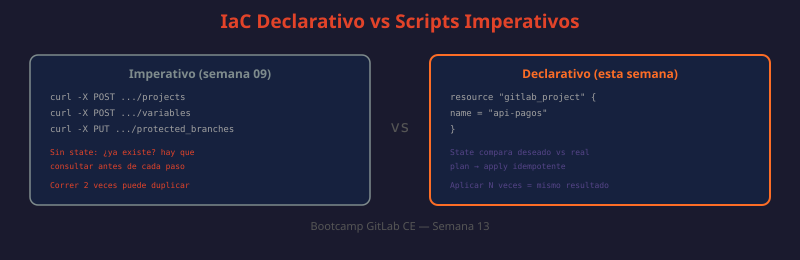

# 01 — Introducción a Infrastructure as Code aplicada a GitLab

Durante el bootcamp has creado proyectos, grupos, branch protection, variables CI/CD y runners de forma manual (semana 03) y luego los has automatizado con scripts contra la API REST y GraphQL (semana 09, con `python-gitlab` y `curl`). Esta semana damos el siguiente paso: en lugar de scripts imperativos que ejecutan pasos, describimos el **estado deseado** de la infraestructura y dejamos que una herramienta calcule cómo llegar a él. Eso es Infrastructure as Code (IaC), y Terraform es la herramienta de referencia para practicarlo contra GitLab.



---

## Por qué Terraform y no seguir con scripts contra la API

Los scripts de la semana 09 (`python-gitlab`, `curl` + `jq`) automatizan **acciones**: "crear este proyecto", "proteger esta rama", "agregar esta variable". Funcionan bien para tareas puntuales o para reaccionar a eventos (webhooks), pero tienen limitaciones cuando se usan para gestionar infraestructura completa:

| Problema con scripts imperativos | Cómo lo resuelve Terraform |
|---|---|
| No saben si el recurso ya existe — hay que verificar antes de crear (`GET` antes de `POST`) | Terraform mantiene un **state** que sabe qué existe y compara contra lo declarado |
| Ejecutar el script dos veces puede duplicar recursos o fallar | Terraform es **idempotente**: aplicar el mismo plan dos veces no cambia nada la segunda vez |
| No hay forma de saber qué cambiará antes de ejecutar | `terraform plan` muestra el diff exacto antes de tocar nada |
| El "código fuente" de la infraestructura vive disperso en múltiples scripts con lógica distinta | Un conjunto de archivos `.tf` describe el estado completo en un solo lugar |
| Revertir un cambio requiere escribir el script inverso | Revertir es volver al commit anterior del `.tf` y hacer `apply` |
| No hay registro de quién cambió qué y cuándo a nivel de infraestructura | El historial de Git del código Terraform **es** el historial de cambios de infraestructura |

```bash
# Enfoque imperativo (semana 09): "hacer esto"
# ¿QUÉ HACE?: Crea un proyecto llamado "api-pagos" si no existe
# ¿POR QUÉ?: No hay garantía de idempotencia — si el script corre dos veces sin chequeo, falla o duplica
# ¿PARA QUÉ?: Comparar contra el enfoque declarativo de abajo
curl --request POST --header "PRIVATE-TOKEN: $GITLAB_TOKEN" \
  --data "name=api-pagos&visibility=private" \
  "http://localhost/api/v4/projects"
```

```hcl
# Enfoque declarativo (esta semana): "esto debe existir así"
# ¿QUÉ HACE?: Declara el estado deseado de un proyecto GitLab
# ¿POR QUÉ?: Terraform verifica el state, calcula el diff y aplica solo lo necesario
# ¿PARA QUÉ?: Ejecutar `terraform apply` cien veces produce el mismo resultado que ejecutarlo una vez
resource "gitlab_project" "api_pagos" {
  name       = "api-pagos"
  visibility_level = "private"
}
```

No se trata de que los scripts de la API queden obsoletos — siguen siendo la herramienta correcta para automatizar **reacciones a eventos** (un webhook que crea un canal de Slack cuando se abre un MR, por ejemplo). Terraform es la herramienta correcta para gestionar el **estado estructural** de la instancia: qué proyectos, grupos, variables y protecciones deben existir.

---

## Declarativo vs imperativo

Esta distinción es la base conceptual de todo IaC y también de GitOps (teoría 03):

- **Imperativo**: describes los *pasos* a ejecutar — "crea el proyecto, luego agrega la variable, luego protege la rama main". El orden importa y el resultado depende de qué pasos se ejecutaron antes.
- **Declarativo**: describes el *resultado final* — "el proyecto X debe existir con esta variable y esta rama protegida". La herramienta decide qué pasos ejecutar (o ninguno, si ya está así).

```hcl
# Ejemplo mínimo de HCL (HashiCorp Configuration Language) declarativo
# ¿QUÉ HACE?: Declara un grupo y un proyecto dentro de él
# ¿POR QUÉ?: El orden de declaración en el archivo NO determina el orden de creación —
#             Terraform construye un grafo de dependencias a partir de las referencias
# ¿PARA QUÉ?: Cambiar cualquiera de los dos valores y volver a aplicar actualiza solo lo que cambió
resource "gitlab_group" "plataforma" {
  name = "plataforma"
  path = "plataforma"
}

resource "gitlab_project" "billing" {
  name         = "billing-service"
  namespace_id = gitlab_group.plataforma.id  # referencia = dependencia implícita
}
```

Terraform detecta que `billing` depende de `plataforma` porque referencia `gitlab_group.plataforma.id`, y por lo tanto crea el grupo primero, sin que el instructor tenga que ordenar manualmente los pasos.

---

## Terraform state: qué es y por qué es crítico

El **state** (`terraform.tfstate`) es un archivo JSON que Terraform usa para mapear los recursos declarados en el código contra los recursos reales que existen en GitLab (identificados por su ID). Sin state, Terraform no tendría forma de saber si `gitlab_project.api_pagos` ya fue creado o si debe crearlo de nuevo.

```json
{
  "resources": [
    {
      "type": "gitlab_project",
      "name": "api_pagos",
      "instances": [
        {
          "attributes": {
            "id": "142",
            "name": "api-pagos",
            "visibility_level": "private",
            "http_url_to_repo": "http://localhost/plataforma/api-pagos.git"
          }
        }
      ]
    }
  ]
}
```

```bash
# ¿QUÉ HACE?: Lista todos los recursos que Terraform está gestionando según el state
# ¿POR QUÉ?: Antes de tocar infraestructura manualmente, hay que saber qué está bajo control de Terraform
# ¿PARA QUÉ?: Evitar drift accidental — modificar en la UI algo que Terraform "cree" que administra
terraform state list

# gitlab_group.plataforma
# gitlab_project.api_pagos
# gitlab_project.billing
```

### Por qué el state NUNCA debe vivir en local para trabajo en equipo

Si el `terraform.tfstate` vive en el disco de un desarrollador:

- Nadie más puede hacer `terraform plan` con información actualizada
- Dos personas aplicando en paralelo pueden corromper el state (no hay locking)
- El state contiene, en texto plano, atributos sensibles de los recursos (tokens, valores de variables no marcadas como sensibles)
- Si se pierde el archivo, Terraform "olvida" que gestiona esos recursos

Por eso la teoría 02 de esta semana cubre el **remote state** en GitLab, que resuelve estos tres problemas con locking nativo.

---

## El flujo `init` → `plan` → `apply`

Todo trabajo con Terraform sigue el mismo ciclo, sin importar el proveedor:

```bash
# Paso 1: init — descarga el provider y configura el backend
# ¿QUÉ HACE?: Descarga el plugin del provider (gitlab) y prepara el backend de state
# ¿POR QUÉ?: Terraform Core no incluye providers — cada uno se distribuye por separado
# ¿PARA QUÉ?: Dejar el directorio listo para plan/apply; se ejecuta una vez por proyecto (o tras cambiar backend/providers)
terraform init

# Initializing the backend...
# Initializing provider plugins...
# - Finding gitlabhq/gitlab versions matching "~> 17.0"...
# - Installing gitlabhq/gitlab v17.2.0...
# Terraform has been successfully initialized!

# Paso 2: plan — calcula el diff entre state y código, sin aplicar nada
# ¿QUÉ HACE?: Compara lo declarado en los .tf contra el state actual y contra la API real
# ¿POR QUÉ?: Nunca se debe aplicar un cambio de infraestructura sin ver antes qué va a cambiar
# ¿PARA QUÉ?: Revisar el plan (en local o en un MR con pipeline) antes de aprobar el apply
terraform plan -out=tfplan

# Terraform will perform the following actions:
#   # gitlab_project.api_pagos will be created
#   + resource "gitlab_project" "api_pagos" {
#       + id                = (known after apply)
#       + name              = "api-pagos"
#       + visibility_level  = "private"
#     }
# Plan: 1 to add, 0 to change, 0 to destroy.

# Paso 3: apply — ejecuta el plan y actualiza el state
# ¿QUÉ HACE?: Llama a la API de GitLab para crear/actualizar/destruir los recursos del plan
# ¿POR QUÉ?: Aplicar el plan exacto guardado (tfplan) evita que el estado cambie entre plan y apply
# ¿PARA QUÉ?: Dejar la infraestructura real igual a lo declarado en el código
terraform apply tfplan

# gitlab_project.api_pagos: Creating...
# gitlab_project.api_pagos: Creation complete after 2s [id=142]
# Apply complete! Resources: 1 added, 0 changed, 0 destroyed.
```

| Comando | Modifica infraestructura | Modifica state | Uso típico |
|---|---|---|---|
| `terraform init` | No | No (crea el archivo, vacío) | Una vez por checkout / al cambiar providers o backend |
| `terraform validate` | No | No | Sintaxis y coherencia interna del HCL, sin llamar a la API |
| `terraform plan` | No | No (solo lee) | Antes de todo apply, o en el pipeline de un MR |
| `terraform apply` | Sí | Sí | Después de revisar y aprobar un plan |
| `terraform destroy` | Sí (elimina) | Sí | Desmontar un entorno completo (ej. staging temporal) |

---

## `terraform.lock.hcl`: fijar las versiones del provider

Junto al `init`, Terraform genera (o actualiza) `terraform.lock.hcl`, que fija las versiones exactas de los providers usados y sus checksums. Este archivo **sí se versiona en Git** (a diferencia del state), porque garantiza que todo el equipo y el pipeline de CI usan exactamente el mismo provider.

```hcl
# terraform.lock.hcl (generado automáticamente, no editar a mano)
provider "registry.terraform.io/gitlabhq/gitlab" {
  version     = "17.2.0"
  constraints = "~> 17.0"
  hashes = [
    "h1:AbCdEf1234567890...",
  ]
}
```

---

## Qué NO cubre esta semana

Terraform gestiona la **estructura** de GitLab: proyectos, grupos, variables, protecciones, webhooks, miembros. No gestiona:

- El contenido del código dentro de los repositorios (eso sigue siendo `git push`)
- El propio motor de GitLab CE (instalación/actualización de la instancia — eso se vio en semana 02)
- Los pipelines `.gitlab-ci.yml` de cada proyecto individual (aunque sí puede crear las variables que esos pipelines consumen)

La combinación de las dos capas —Terraform para la estructura, `.gitlab-ci.yml` para el comportamiento de cada proyecto— es el patrón real que usan los equipos de plataforma en producción.

---

## Organización recomendada de archivos `.tf`

No existe una regla impuesta por Terraform sobre cómo nombrar o dividir los archivos `.tf` dentro de un directorio — todos los `.tf` de un mismo directorio se combinan en un solo espacio de nombres. La convención de la comunidad (y la que se usa en las prácticas de esta semana) separa por responsabilidad:

| Archivo | Contenido |
|---|---|
| `providers.tf` | Bloque `terraform {}` y configuración de `provider "gitlab" {}` |
| `variables.tf` | Todas las `variable` de entrada, con `description` y `type` |
| `main.tf` | Los `resource` y `module` principales |
| `outputs.tf` | Todos los `output` que expone el proyecto/módulo |
| `backend.tf` | Configuración del backend remoto (teoría 02) |
| `terraform.tfvars` | Valores concretos de las variables — **no se versiona si contiene secretos** |

```bash
# ¿QUÉ HACE?: Formatea automáticamente todos los archivos .tf según el estilo canónico de HCL
# ¿POR QUÉ?: Evita discusiones de estilo en code review — un solo formato posible, aplicado automáticamente
# ¿PARA QUÉ?: Integrarlo como hook de pre-commit o como primer job del pipeline (teoría 05)
terraform fmt -recursive
```

```gitignore
# .gitignore — nunca versionar el state local ni archivos con secretos
.terraform/
*.tfstate
*.tfstate.backup
*.tfvars
!*.tfvars.example
.terraform.lock.hcl  # excepción: SÍ se versiona (ver sección siguiente), no debe estar en .gitignore
```

> Nota: `terraform.lock.hcl` **sí** debe versionarse (se explica más abajo) — el ejemplo de `.gitignore` de arriba lo excluye explícitamente de la exclusión para dejarlo claro.

---

## Terraform frente a otras herramientas de IaC

El bootcamp elige Terraform por ser el estándar de facto con soporte oficial de GitLab, pero vale ubicarlo frente a alternativas que probablemente aparezcan en el mundo real:

| Herramienta | Enfoque | Por qué no se usa esta semana |
|---|---|---|
| **Ansible** | Imperativo con idempotencia (tareas, no state file) | Excelente para configurar servidores/paquetes; no mantiene un grafo de dependencias de recursos como Terraform |
| **Pulumi** | Declarativo, pero usando lenguajes de programación reales (Python, TypeScript) en vez de HCL | Mismo modelo de state que Terraform; se elige HCL aquí porque es más simple para infraestructura pura, sin lógica de programación compleja |
| **CloudFormation / ARM / GDT** | Declarativo, mismo modelo | Específicos de un solo proveedor cloud (AWS/Azure/GCP); no aplican a GitLab como plataforma |

Terraform no es la única forma de hacer IaC, pero sí la que tiene el provider oficial más completo para GitLab y la integración de remote state nativa vista en la teoría 02 — por eso es la elegida para esta semana.
