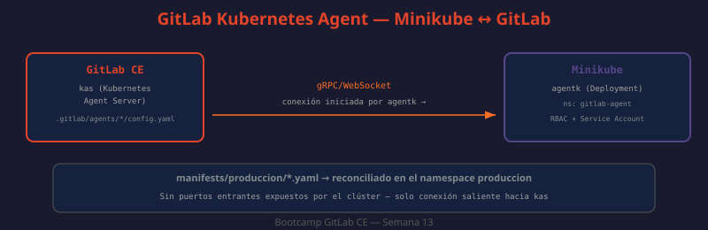

# 04 — GitLab Kubernetes Agent: instalación, autorización y despliegue GitOps

El **GitLab Kubernetes Agent** (`agentk`) es el componente que implementa el modelo pull descrito en la teoría anterior: un proceso que corre **dentro** del clúster Kubernetes, se conecta hacia GitLab (nunca al revés) y sincroniza manifiestos declarados en un repositorio. En la semana 07 ya desplegaste un GitLab Runner dentro de un clúster Minikube usando Helm — reutilizamos ese mismo entorno Minikube aquí, pero el Agent cumple un rol distinto: el Runner ejecuta *jobs de CI como pods*, el Agent *sincroniza el estado del clúster con Git*.



---

## Arquitectura: `agentk` y `kas`

El Agent tiene dos mitades:

| Componente | Dónde corre | Rol |
|---|---|---|
| `agentk` | Dentro del clúster Kubernetes (como Deployment) | Se conecta hacia GitLab, extrae manifiestos, los aplica al clúster |
| `kas` (GitLab Kubernetes Agent Server) | Dentro de la instancia GitLab (ya incluido en GitLab CE Omnibus) | Recibe la conexión de `agentk`, sirve la configuración y los manifiestos |

La conexión siempre la **inicia `agentk`** hacia `kas` (gRPC sobre WebSocket), nunca al revés. Esto es lo que permite que el clúster no necesite exponer ningún puerto entrante — coherente con la ventaja de seguridad de GitOps vista en la teoría 03.

```bash
# ¿QUÉ HACE?: Verifica que kas está habilitado en la instancia GitLab CE (Omnibus)
# ¿POR QUÉ?: kas viene deshabilitado por defecto, igual que Prometheus (semana 11)
# ¿PARA QUÉ?: Confirmar antes de registrar ningún agente que el servidor está listo para recibir conexiones
sudo gitlab-ctl status gitlab-kas
# run: gitlab-kas: (pid 5821) 120s
```

```ruby
# /etc/gitlab/gitlab.rb — habilitar kas si no está activo
# ¿QUÉ HACE?: Habilita el servidor del Kubernetes Agent dentro de la instancia GitLab
# ¿POR QUÉ?: Sin kas corriendo, agentk no tiene con quién establecer la conexión gRPC
# ¿PARA QUÉ?: Que la instancia GitLab pueda registrar y comunicarse con agentes en clústeres externos
gitlab_kas['enable'] = true
gitlab_kas['api_secret_key'] = File.read('/etc/gitlab/gitlab-kas-api-secret')
```

---

## Paso 1: registrar el Agent en un proyecto GitLab

El Agent se registra siempre asociado a un **proyecto GitLab**, que actúa como su repositorio de configuración.

```bash
# ¿QUÉ HACE?: Crea el directorio de configuración del agent dentro del repositorio
# ¿POR QUÉ?: GitLab busca la configuración en la ruta convencional .gitlab/agents/<nombre-del-agent>/
# ¿PARA QUÉ?: Un mismo proyecto puede alojar la configuración de varios agentes (uno por clúster)
mkdir -p .gitlab/agents/minikube-bootcamp
```

```yaml
# .gitlab/agents/minikube-bootcamp/config.yaml
# ¿QUÉ HACE?: Configura qué proyectos puede sincronizar el agent y con qué permisos
# ¿POR QUÉ?: Sin esta configuración explícita, el agent no sincroniza nada — es "seguro por defecto"
# ¿PARA QUÉ?: Definir el alcance exacto de lo que el agent puede leer y aplicar en el clúster
gitops:
  manifest_projects:
    - id: plataforma/gitops-manifiestos
      default_namespace: produccion
      paths:
        - glob: '/manifests/**/*.yaml'
      reconcile_timeout: 60s
```

```bash
# ¿QUÉ HACE?: Registra el agent contra el proyecto y obtiene el token de conexión
# ¿POR QUÉ?: El token es lo único que agentk necesita para autenticarse ante kas
# ¿PARA QUÉ?: Usar este token al desplegar agentk en el clúster (paso 2)
curl --silent --request POST \
  --header "PRIVATE-TOKEN: $GITLAB_TOKEN" \
  --data "name=minikube-bootcamp" \
  "http://localhost/api/v4/projects/${CI_PROJECT_ID}/cluster_agents" | jq

# {
#   "id": 7,
#   "name": "minikube-bootcamp",
#   "config_project": { "id": 142, "path_with_namespace": "plataforma/gitops-manifiestos" },
#   "created_at": "2026-07-09T10:00:00Z"
# }
```

En la UI, el mismo flujo está en **Operate → Kubernetes clusters → Connect a cluster** dentro del proyecto: se elige el nombre del agent y GitLab genera el token de registro.

---

## Paso 2: instalar `agentk` en Minikube con Helm

Reutilizamos el clúster Minikube ya iniciado en la semana 07 (`minikube start`).

```bash
# ¿QUÉ HACE?: Verifica que Minikube está corriendo antes de instalar el agent
# ¿POR QUÉ?: agentk necesita un clúster activo con kubectl configurado apuntando a él
# ¿PARA QUÉ?: Reutilizar el mismo entorno de la práctica de runner en K8s (semana 07)
minikube status
# minikube: Running
# kubelet:  Running
# apiserver: Running

kubectl config current-context
# minikube
```

```bash
# ¿QUÉ HACE?: Instala agentk en el namespace dedicado usando el chart oficial de GitLab
# ¿POR QUÉ?: Helm gestiona el ciclo de vida del agent, igual que se usó para el Runner en K8s
# ¿PARA QUÉ?: Que el clúster empiece a reportarse ante GitLab y a extraer manifiestos
KAS_ADDRESS="grpc://$(minikube ip):30051"   # Minikube: dirección interna del servidor kas
AGENT_TOKEN="glagent-XXXXXXXXXXXXXXXXXXXX"   # token del registro del paso 1

helm repo add gitlab https://charts.gitlab.io
helm repo update

kubectl create namespace gitlab-agent --dry-run=client -o yaml | kubectl apply -f -

helm upgrade --install minikube-bootcamp gitlab/gitlab-agent \
  --namespace gitlab-agent \
  --set image.tag=v17.2.0 \
  --set config.token="$AGENT_TOKEN" \
  --set config.kasAddress="$KAS_ADDRESS" \
  --wait --timeout 120s
```

```bash
# ¿QUÉ HACE?: Verifica que el pod de agentk está Running y conectado
# ¿POR QUÉ?: Un pod en CrashLoopBackOff casi siempre indica token inválido o kasAddress inalcanzable
# ¿PARA QUÉ?: Confirmar la conexión antes de intentar sincronizar manifiestos
kubectl get pods -n gitlab-agent
# NAME                                READY   STATUS    RESTARTS   AGE
# minikube-bootcamp-7d9f8c6b5-x2k9p   1/1     Running   0          45s

kubectl logs -n gitlab-agent deployment/minikube-bootcamp --tail 20
# time="2026-07-09T10:02:11Z" level=info msg="Configuration sent" agent_id=7
# time="2026-07-09T10:02:11Z" level=info msg="Synced GitOps manifests" project=plataforma/gitops-manifiestos
```

En la UI, **Operate → Kubernetes clusters** del proyecto muestra el agent con estado "Connected" y la última vez que reportó actividad — equivalente al `run: prometheus:` de `gitlab-ctl status` visto en semana 11, pero para el agent.

---

## Autorización: qué puede sincronizar el Agent

Por defecto, un agent solo puede leer manifiestos del **proyecto donde está configurado**. Para autorizar que sincronice manifiestos de otros proyectos (patrón común: un repo de manifiestos separado del código de la app), se declara explícitamente:

```yaml
# .gitlab/agents/minikube-bootcamp/config.yaml
# ¿QUÉ HACE?: Autoriza al agent a leer manifiestos de proyectos adicionales, no solo el suyo propio
# ¿POR QUÉ?: Separar código de aplicación (api-pagos) de manifiestos de despliegue (gitops-manifiestos)
#             es una práctica común que reduce quién puede modificar qué desplegado en producción
# ¿PARA QUÉ?: El equipo de la app no necesita permisos de escritura sobre el repo de manifiestos, y viceversa
gitops:
  manifest_projects:
    - id: plataforma/gitops-manifiestos
      default_namespace: produccion
    - id: plataforma/gitops-manifiestos-staging
      default_namespace: staging
```

---

## Impersonation: el Agent actúa con identidad controlada

Cuando `agentk` aplica manifiestos al clúster, no lo hace con permisos de administrador irrestrictos: usa **impersonation** de Kubernetes, actuando bajo una identidad configurable en `user_access` o restringida al RBAC del Service Account con el que se instaló vía Helm.

```yaml
# .gitlab/agents/minikube-bootcamp/config.yaml
# ¿QUÉ HACE?: Restringe qué usuarios/grupos GitLab pueden ejecutar kubectl a través del agent (CI/CD Tunnel)
# ¿POR QUÉ?: Sin esta sección, el uso interactivo del agent (ej. kubectl desde un pipeline usando el context del agent)
#             no está limitado por rol de GitLab, solo por RBAC de Kubernetes
# ¿PARA QUÉ?: Que solo el grupo "plataforma" pueda usar el agent para depurar el clúster desde CI
user_access:
  access_as:
    agent: {}
  projects:
    - id: plataforma/gitops-manifiestos
  groups:
    - id: plataforma
```

```yaml
# RBAC del lado de Kubernetes — limita lo que el Service Account de agentk puede hacer
# ¿QUÉ HACE?: Otorga permisos de solo lectura/escritura sobre recursos específicos, no cluster-admin
# ¿POR QUÉ?: El principio de mínimo privilegio aplica al agent igual que a cualquier Service Account
# ¿PARA QUÉ?: Que un manifiesto malicioso en el repo (o un token de agent filtrado) tenga impacto acotado
apiVersion: rbac.authorization.k8s.io/v1
kind: Role
metadata:
  name: gitops-deployer
  namespace: produccion
rules:
  - apiGroups: ["apps"]
    resources: ["deployments"]
    verbs: ["get", "list", "watch", "create", "update", "patch"]
  - apiGroups: [""]
    resources: ["services", "configmaps"]
    verbs: ["get", "list", "watch", "create", "update", "patch"]
---
apiVersion: rbac.authorization.k8s.io/v1
kind: RoleBinding
metadata:
  name: gitops-deployer-binding
  namespace: produccion
subjects:
  - kind: ServiceAccount
    name: minikube-bootcamp
    namespace: gitlab-agent
roleRef:
  kind: Role
  name: gitops-deployer
  apiGroup: rbac.authorization.k8s.io
```

---

## Despliegue de manifiestos: el ciclo completo

```
1. Un desarrollador hace merge de un cambio en manifests/api-pagos/deployment.yaml
2. agentk, en su próximo ciclo (default: cada ~30s-1min), detecta el nuevo commit
3. agentk descarga los manifiestos actualizados vía kas
4. agentk aplica el diff contra el clúster (equivalente interno a kubectl apply)
5. El estado del clúster ahora coincide con el repositorio
```

```bash
# ¿QUÉ HACE?: Fuerza una reconciliación inmediata sin esperar al próximo ciclo automático
# ¿POR QUÉ?: Útil para verificar un cambio recién mergeado sin esperar el intervalo de poll
# ¿PARA QUÉ?: Depuración durante la práctica — en producción no suele ser necesario
kubectl rollout restart deployment/minikube-bootcamp -n gitlab-agent
```

```bash
# ¿QUÉ HACE?: Verifica que el manifiesto se aplicó correctamente al clúster
# ¿POR QUÉ?: Confirmar que la imagen desplegada coincide con la declarada en Git
# ¿PARA QUÉ?: Validar el ciclo GitOps completo, de commit a clúster
kubectl get deployment api-pagos -n produccion -o jsonpath='{.spec.template.spec.containers[0].image}'
# registry.local/plataforma/api-pagos:v1.4.2
```

---

## Diferencia con lo visto en semana 07

| | Runner en K8s (semana 07) | Kubernetes Agent (esta semana) |
|---|---|---|
| Instalado con | Helm chart `gitlab-runner` | Helm chart `gitlab-agent` |
| Rol | Ejecuta jobs de pipeline como pods efímeros | Sincroniza manifiestos de despliegue de forma continua |
| Dirección de conexión | El runner hace polling de jobs hacia GitLab | El agent extrae manifiestos y reconcilia hacia el clúster |
| Vida del proceso | Pods efímeros, uno por job | Deployment persistente de larga duración |
| Relación con GitOps | Ninguna — es CI/CD tradicional | Es el mecanismo pull que implementa GitOps para GitLab |

Ambos pueden convivir en el mismo clúster Minikube sin conflicto: el Runner ejecuta el `build`/`test`/`package` del pipeline, y el Agent sincroniza el `deploy` — exactamente el patrón combinado descrito al final de la teoría 03.

---

## Troubleshooting: problemas comunes al registrar el Agent

| Síntoma | Causa probable | Diagnóstico |
|---|---|---|
| Pod en `CrashLoopBackOff` | Token de registro inválido o expirado | `kubectl logs -n gitlab-agent deployment/<nombre>` — buscar `unauthenticated` o `PermissionDenied` |
| Pod en `Running` pero UI muestra "Never connected" | `kasAddress` inalcanzable desde el pod (URL/puerto incorrectos en Minikube) | `kubectl exec -n gitlab-agent deployment/<nombre> -- wget -qO- $KAS_ADDRESS` |
| Agent conectado pero no sincroniza manifiestos | `config.yaml` mal formado o `manifest_projects` apunta a un proyecto sin permisos | Revisar `Operate → Kubernetes clusters → <agent> → Activity` en la UI |
| `Import successful` pero drift inmediato tras importar | El HCL no refleja todos los atributos reales del recurso importado | `terraform state show` y comparar atributo por atributo contra el `.tf` |

```bash
# ¿QUÉ HACE?: Verifica que kas es alcanzable en red desde dentro del pod de agentk
# ¿POR QUÉ?: En Minikube, la IP del host cambia entre reinicios — kasAddress debe apuntar a la IP actual
# ¿PARA QUÉ?: Descartar un problema de red antes de sospechar de la configuración del agent
kubectl exec -n gitlab-agent deployment/minikube-bootcamp -- \
  wget -qO- --timeout=3 "http://$(minikube ip):30051" || echo "kas inalcanzable desde el pod"
```

```bash
# ¿QUÉ HACE?: Reobtiene un token de registro nuevo si el anterior expiró o se revocó
# ¿POR QUÉ?: Los tokens de registro del Agent pueden revocarse desde Operate → Kubernetes clusters → Revoke
# ¿PARA QUÉ?: Volver a instalar/actualizar el Helm release con credenciales válidas
curl --silent --request POST \
  --header "PRIVATE-TOKEN: $GITLAB_TOKEN" \
  "http://localhost/api/v4/projects/${CI_PROJECT_ID}/cluster_agents/7/tokens" | jq -r '.token'
```

---

## Ciclo de vida del Agent: actualización y desinstalación

```bash
# ¿QUÉ HACE?: Actualiza la versión de agentk desplegada, manteniendo la misma configuración
# ¿POR QUÉ?: agentk sigue el ciclo de versiones de GitLab — conviene mantenerlo alineado con la versión de GitLab CE
# ¿PARA QUÉ?: Evitar incompatibilidades de protocolo gRPC entre agentk y kas
helm upgrade minikube-bootcamp gitlab/gitlab-agent \
  --namespace gitlab-agent \
  --reuse-values \
  --set image.tag=v17.3.0

# ¿QUÉ HACE?: Desinstala el agent del clúster y revoca su acceso desde el lado de GitLab
# ¿POR QUÉ?: Un agent desinstalado en el clúster pero no revocado en GitLab sigue apareciendo como "registrado"
# ¿PARA QUÉ?: Limpieza completa al finalizar la práctica o al retirar un clúster de la plataforma
helm uninstall minikube-bootcamp --namespace gitlab-agent

curl --silent --request DELETE \
  --header "PRIVATE-TOKEN: $GITLAB_TOKEN" \
  "http://localhost/api/v4/projects/${CI_PROJECT_ID}/cluster_agents/7"
```
