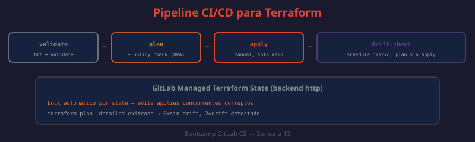

# 05 — CI/CD con Terraform: pipeline, state locking, drift detection y policy-as-code

Escribir código Terraform en local y ejecutar `apply` manualmente funciona para aprender, pero en un equipo real ese flujo debe pasar por el mismo proceso de revisión que cualquier otro cambio: un Merge Request con pipeline. Esta teoría cierra la semana integrando todo lo anterior — provider (teoría 02), remote state (teoría 02), GitOps (teoría 03) — en un pipeline `.gitlab-ci.yml` que valida, planea y aplica Terraform de forma segura y auditable.



---

## Anatomía del pipeline

```yaml
# .gitlab-ci.yml
# ¿QUÉ HACE?: Define un pipeline de 4 stages para gestionar infraestructura con Terraform
# ¿POR QUÉ?: Cada stage corresponde a un paso del flujo init→plan→apply visto en la teoría 01,
#             pero ahora ejecutado en el runner de CI en vez de en la laptop de un desarrollador
# ¿PARA QUÉ?: Que todo cambio de infraestructura pase por revisión en un MR antes de aplicarse
stages:
  - validate
  - plan
  - apply
  - drift-check

variables:
  TF_ROOT: ${CI_PROJECT_DIR}
  TF_STATE_NAME: produccion
  TF_ADDRESS: "${CI_API_V4_URL}/projects/${CI_PROJECT_ID}/terraform/state/${TF_STATE_NAME}"

default:
  image: hashicorp/terraform:1.9
  before_script:
    - cd $TF_ROOT
    - terraform init
        -backend-config="address=${TF_ADDRESS}"
        -backend-config="lock_address=${TF_ADDRESS}/lock"
        -backend-config="unlock_address=${TF_ADDRESS}/lock"
        -backend-config="username=terraform-bot"
        -backend-config="password=${TF_STATE_TOKEN}"
        -backend-config="lock_method=POST"
        -backend-config="unlock_method=DELETE"
        -backend-config="retry_wait_min=5"

fmt_and_validate:
  stage: validate
  script:
    - terraform fmt -check -recursive
    - terraform validate

plan:
  stage: plan
  script:
    - terraform plan -out=tfplan
    - terraform show -json tfplan > tfplan.json
  artifacts:
    paths:
      - tfplan
      - tfplan.json
    expire_in: 1 week
  rules:
    - if: $CI_PIPELINE_SOURCE == "merge_request_event"
    - if: $CI_COMMIT_BRANCH == "main"

apply:
  stage: apply
  script:
    - terraform apply tfplan
  dependencies:
    - plan
  environment:
    name: produccion
  rules:
    - if: $CI_COMMIT_BRANCH == "main"
      when: manual
```

| Variable | Origen | Propósito |
|---|---|---|
| `TF_STATE_TOKEN` | Variable CI/CD protegida (Settings → CI/CD → Variables) | Autentica al pipeline contra el backend HTTP del state (teoría 02) |
| `CI_API_V4_URL`, `CI_PROJECT_ID` | Predefinidas por GitLab | Construyen la URL del state remoto sin hardcodear el proyecto |
| `TF_STATE_NAME` | Definida en el pipeline | Un state por entorno — separa `produccion` de `staging` |

---

## `terraform validate` vs `terraform plan` en el pipeline

`fmt -check` y `validate` corren en **todos** los MRs y no requieren credenciales de GitLab (no llaman al backend con permisos de escritura más allá del lock de lectura implícito del init). `plan` sí requiere acceso al state real, porque necesita comparar contra los recursos existentes — por eso es un stage separado y solo se ejecuta en MRs o en `main`, nunca en ramas de feature sin revisión.

```bash
# Salida esperada de terraform validate en el pipeline
Success! The configuration is valid.

# Salida esperada de terraform fmt -check (falla el pipeline si hay diferencias de formato)
main.tf
variables.tf
# → exit code 3, el job falla — hay que correr `terraform fmt` localmente y commitear
```

---

## Publicar el plan como comentario del MR

GitLab CE puede mostrar el plan de Terraform directamente en la vista del Merge Request si el job produce el reporte en el formato esperado:

```yaml
plan:
  stage: plan
  script:
    - terraform plan -out=tfplan
    - terraform show -json tfplan > tfplan.json
  artifacts:
    reports:
      terraform: tfplan.json   # GitLab renderiza el plan en el widget del MR
    paths:
      - tfplan
    expire_in: 1 week
```

Con `artifacts.reports.terraform`, el MR muestra un widget con el resumen del plan ("Terraform report: 2 to add, 1 to change, 0 to destroy") sin que nadie tenga que abrir logs del pipeline — el mismo tipo de integración nativa que ya viste con reportes de SAST y Container Scanning en la semana 10.

---

## State locking: qué pasa si dos pipelines corren a la vez

El backend HTTP de GitLab implementa locking automático (visto en teoría 02): cuando un job hace `terraform apply`, adquiere el lock; si otro pipeline intenta aplicar al mismo state mientras el lock está activo, falla con un error claro en vez de corromper el state:

```
Error: Error acquiring the state lock

Lock Info:
  ID:        8f3a2b1c-...
  Path:      produccion
  Operation: OperationTypeApply
  Who:       terraform-bot@runner-7f8c
  Created:   2026-07-09 10:15:03 UTC

Terraform acquires a state lock to protect the state from being written
by multiple users at the same time. Please resolve the issue above and try
again.
```

```bash
# ¿QUÉ HACE?: Libera un lock atascado (ej. si un pipeline murió sin liberar el lock)
# ¿POR QUÉ?: Un runner cancelado abruptamente puede dejar el lock activo indefinidamente
# ¿PARA QUÉ?: Desbloquear manualmente solo cuando se confirmó que ningún apply está realmente en curso
terraform force-unlock 8f3a2b1c-...
```

---

## Drift detection: un job programado que compara sin aplicar

El drift ocurre cuando alguien modifica un recurso manualmente en GitLab (por ejemplo, cambia la visibilidad de un proyecto desde la UI) sin pasar por Terraform. Un job programado (`schedule`) que corre `plan` sin `apply` detecta esta divergencia:

```yaml
# .gitlab-ci.yml — job adicional, disparado por un Pipeline Schedule diario
# ¿QUÉ HACE?: Ejecuta terraform plan sin aplicar, y falla el job si detecta cambios pendientes
# ¿POR QUÉ?: Un plan con diferencias significa que la infraestructura real divergió de lo declarado en Git
# ¿PARA QUÉ?: Alertar al equipo de drift antes de que se acumule y complique el próximo apply intencional
drift_check:
  stage: drift-check
  script:
    - terraform plan -detailed-exitcode -out=tfplan
  rules:
    - if: $CI_PIPELINE_SOURCE == "schedule"
  allow_failure:
    exit_codes: 0   # solo exit code 0 (sin cambios) se considera éxito real
```

`terraform plan -detailed-exitcode` devuelve códigos de salida distintos según el resultado:

| Exit code | Significado |
|---|---|
| `0` | Sin diferencias — no hay drift, el state coincide con la infraestructura real |
| `1` | Error al ejecutar el plan |
| `2` | Hay diferencias — hay drift o cambios pendientes de aplicar |

Configurar un **Pipeline Schedule** (Build → Pipeline schedules, visto conceptualmente en semana 06) para correr `drift_check` diariamente convierte la detección de drift en una alerta automática, en vez de descubrir la divergencia semanas después cuando un `apply` normal produce un plan sorprendentemente grande.

---

## Introducción a policy-as-code

Un `plan` puede ser técnicamente válido y aun así violar una regla de negocio: "ningún proyecto debe ser público", "toda variable con `PASSWORD` en el nombre debe estar enmascarada". **Policy-as-code** valida el plan contra estas reglas de forma automática, antes del `apply`, usando **Open Policy Agent (OPA)** con su lenguaje de políticas Rego, o su envoltorio orientado a Terraform, **Conftest**.

```rego
# policy/gitlab-no-public.rego
# ¿QUÉ HACE?: Define una política Rego que rechaza cualquier plan que cree un proyecto público
# ¿POR QUÉ?: Una regla de negocio del equipo (nada público por defecto) no está garantizada solo
#             por convención — hay que hacerla cumplir automáticamente en el pipeline
# ¿PARA QUÉ?: Que un plan con visibility_level = "public" falle el pipeline antes del apply,
#             sin depender de que un revisor humano lo note en el MR
package main

deny[msg] {
  resource := input.resource_changes[_]
  resource.type == "gitlab_project"
  resource.change.after.visibility_level == "public"
  msg := sprintf("Proyecto '%s' no puede ser público — visibility_level=public prohibido", [resource.name])
}
```

```yaml
# .gitlab-ci.yml — job que valida el plan contra las políticas antes de permitir el apply
# ¿QUÉ HACE?: Corre Conftest contra el JSON del plan usando las políticas Rego del directorio policy/
# ¿POR QUÉ?: Conftest interpreta terraform show -json y evalúa cada política contra los recursos declarados
# ¿PARA QUÉ?: Bloquear el stage apply si cualquier política deny[] se dispara
policy_check:
  stage: plan
  image: openpolicyagent/conftest:0.55.0
  script:
    - conftest test tfplan.json --policy policy/
  needs:
    - plan
  rules:
    - if: $CI_PIPELINE_SOURCE == "merge_request_event"
```

```
$ conftest test tfplan.json --policy policy/
FAIL - tfplan.json - main - Proyecto 'app_publica' no puede ser público — visibility_level=public prohibido

1 test, 0 passed, 0 warnings, 1 failure, 0 exceptions
```

A nivel conceptual, HashiCorp ofrece un mecanismo equivalente para Terraform Cloud/Enterprise llamado **Sentinel**, con su propio lenguaje de políticas. Para GitLab CE self-hosted, Conftest/OPA es la ruta accesible sin depender de un producto comercial adicional, integrándose como un job más del pipeline.

---

## El pipeline completo, de MR a producción

```
MR abierto
  → fmt_and_validate (siempre)
  → plan (genera tfplan + comentario en el MR)
  → policy_check (bloquea si viola reglas)
  → [revisión humana del plan en el MR]
  → merge a main
  → plan (re-genera tfplan actualizado sobre main)
  → apply (manual — un maintainer aprueba explícitamente)
  ⋯ (diario, vía schedule)
  → drift_check (alerta si algo cambió fuera de Terraform)
```

Este es el mismo patrón "cambio propuesto → pipeline valida → revisión humana → merge → acción" que ya aplicaste a código de aplicación durante todo el bootcamp (semana 04) — la diferencia es que ahora el "código" que se revisa es la infraestructura misma.
