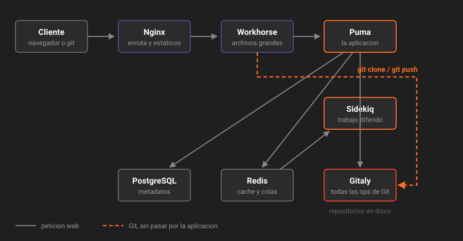

# Los procesos por dentro

> GitLab no es un programa: son siete procesos que se reparten el trabajo. Saber cuál hace qué es la diferencia entre diagnosticar y adivinar.

## 🎯 Objetivos

- Nombrar los siete procesos principales y decir qué hace cada uno
- Saber cuál se satura ante cada síntoma
- Entender por qué Gitaly existe y por qué nada más toca el disco de los repositorios
- Leer la salida de `gitlab-ctl status` sin perderte

---

## 1. Qué problema resuelve esta separación

Podrías imaginar GitLab como un único proceso que atiende peticiones web, ejecuta Git, guarda datos y manda correos. Sería más simple y sería inservible:

- Un clon de un repositorio de 2 GB bloquearía el proceso durante minutos, y con él toda la interfaz web
- Mandar un correo de notificación haría esperar al usuario que acaba de comentar
- No podrías escalar la parte que se satura sin escalar todo lo demás
- No podrías replicar los repositorios sin replicar la base de datos

La separación en procesos existe para que **el trabajo lento no bloquee al trabajo rápido**, y para que cada pieza escale y se replique por su cuenta.



---

## 2. Los siete procesos

### Nginx — la puerta

Es lo primero que toca cualquier petición. Escucha en el puerto público (8888 en tu laboratorio), termina la conexión y decide a quién se la pasa.

No sabe nada de GitLab: solo enruta. También sirve directamente los archivos estáticos (CSS, JavaScript, imágenes de la interfaz) sin molestar a nadie más.

**Síntoma típico**: si Nginx está caído no responde absolutamente nada, ni siquiera un error de GitLab. El navegador dice "conexión rechazada".

### Workhorse — el portero que filtra

Se sienta entre Nginx y Puma, y existe por una razón muy concreta: **Rails es malísimo moviendo archivos grandes**.

Cuando subes un artefacto de 500 MB o clonas un repositorio, mantener ocupado un hilo de Rails durante todo el trasiego sería un desperdicio. Workhorse intercepta ese tipo de peticiones y las atiende él, hablando directamente con Gitaly o con el disco.

Lo que sí pasa a Puma: todo lo que requiere lógica de negocio (¿tiene permiso este usuario?, ¿qué issues hay en este tablero?).

| Tipo de petición | Quién la atiende |
|---|---|
| Cargar la página de un merge request | Puma |
| `git clone` / `git push` por HTTP | Workhorse ↔ Gitaly |
| Descargar un artefacto de CI | Workhorse |
| Subir un adjunto | Workhorse |
| Consultar la API v4 | Puma |
| Descargar un archivo del repositorio | Workhorse |

**Síntoma típico**: si Workhorse falla, la interfaz web puede seguir funcionando pero los clones y las descargas se rompen.

### Puma — la aplicación

Es el servidor web que ejecuta GitLab Rails, la aplicación propiamente dicha. Todo lo que ves en la interfaz y todo lo que devuelve la API v4 sale de aquí.

Trabaja con un número fijo de **workers** (procesos) y **threads** (hilos por proceso). En tu laboratorio:

```ruby
puma['worker_processes'] = 2
puma['max_threads'] = 4
```

Eso son 8 peticiones simultáneas como máximo. La novena espera.

**Síntoma típico**: la interfaz va lenta o devuelve 502 mientras el resto de procesos están bien. Casi siempre es falta de workers o falta de memoria: cada worker de Puma come alrededor de 1 GB.

### Sidekiq — el trabajo que no puede esperar en la cola

Todo lo que no tiene que ocurrir **mientras el usuario espera** se encola en Redis y lo ejecuta Sidekiq:

- Mandar correos y notificaciones
- Disparar webhooks
- Crear los pipelines cuando llega un push
- Calcular estadísticas del repositorio
- Ejecutar las políticas de limpieza del registry
- Las migraciones en segundo plano tras una actualización

Sidekiq procesa varios trabajos a la vez; en el laboratorio, diez:

```ruby
sidekiq['concurrency'] = 10
```

**Síntoma típico, y el más engañoso de todos**: "hice push y no aparece el pipeline". El push funcionó, Gitaly guardó el commit, pero el trabajo que crea el pipeline está esperando en la cola. Si las colas de Sidekiq crecen, GitLab parece funcionar y en realidad no está haciendo nada.

Se mira en `Admin → Monitoring → Background jobs`.

### Gitaly — el único que toca los repositorios

**Ningún otro proceso lee ni escribe directamente en el disco de los repositorios.** Ni Puma, ni Sidekiq, ni Workhorse. Todos le piden a Gitaly, por gRPC, que haga la operación de Git por ellos.

Esta regla es la más importante de toda la arquitectura, y no es un capricho:

- Permite que los repositorios vivan en máquinas distintas de la aplicación
- Permite replicarlos (Gitaly Cluster con Praefect, Semana 23)
- Concentra en un solo sitio el acceso al recurso más caro y frágil

Cuando en la Semana 23 montes alta disponibilidad, lo que replicarás es exactamente esto.

**Síntoma típico**: la interfaz carga, los issues funcionan, pero no puedes ver archivos ni clonar. Eso es Gitaly.

### PostgreSQL — los metadatos

Guarda todo menos el contenido de los repositorios: usuarios, proyectos, issues, merge requests, comentarios, pipelines, permisos, tokens.

Un dato que sorprende: **la base de datos no contiene ni un byte de tu código**. El código está en el disco, servido por Gitaly. PostgreSQL guarda que existe un proyecto llamado `app`, quién puede verlo, y qué SHA es su rama por defecto.

**Síntoma típico**: si PostgreSQL cae, GitLab no arranca. Es la dependencia más dura de todas.

### Redis — caché y colas

Hace dos cosas distintas que conviene no mezclar:

1. **Caché**: resultados de consultas caras, sesiones de usuario, permisos calculados.
2. **Colas**: la lista de trabajos pendientes de Sidekiq.

La primera se puede perder sin consecuencias: se recalcula. La segunda no: si pierdes Redis, pierdes los trabajos encolados y **el pipeline que estaba a punto de crearse no se crea nunca**.

En el laboratorio Redis está limitado y con política de expulsión:

```ruby
redis['maxmemory'] = '256mb'
redis['maxmemory_policy'] = 'allkeys-lru'
```

---

## 3. El resumen que hay que memorizar

| Proceso | Hace | Se satura cuando | Síntoma |
|---|---|---|---|
| **Nginx** | Enruta y sirve estáticos | Casi nunca | No responde nada |
| **Workhorse** | Archivos grandes y Git por HTTP | Muchos clones grandes a la vez | Clones y descargas fallan, la web va bien |
| **Puma** | La aplicación web y la API | Muchos usuarios concurrentes | 502 y lentitud en la interfaz |
| **Sidekiq** | Trabajo diferido | Muchos eventos encolados | Pipelines que no arrancan, correos que no llegan |
| **Gitaly** | Todas las operaciones de Git | Repositorios grandes, muchos clones | No se ven archivos, no se puede clonar |
| **PostgreSQL** | Metadatos | Consultas pesadas, poca memoria | GitLab no arranca |
| **Redis** | Caché y colas | Se llena | Se pierden trabajos encolados |

> [!TIP]
> Ante cualquier problema, la primera pregunta útil no es "¿está GitLab caído?" sino **"¿qué parte de GitLab está caída?"**. Esta tabla convierte un síntoma en un proceso concreto que mirar.

---

## 4. Cómo verlos

`gitlab-ctl status` los lista todos:

```bash
docker compose exec gitlab gitlab-ctl status
```

```
run: gitaly: (pid 512) 3212s; run: log: (pid 400) 3230s
run: gitlab-workhorse: (pid 530) 3210s; run: log: (pid 410) 3230s
run: logrotate: (pid 545) 1200s; run: log: (pid 420) 3230s
run: nginx: (pid 560) 3208s; run: log: (pid 430) 3230s
run: postgresql: (pid 480) 3220s; run: log: (pid 390) 3230s
run: puma: (pid 590) 3205s; run: log: (pid 440) 3230s
run: redis: (pid 460) 3225s; run: log: (pid 380) 3230s
run: sidekiq: (pid 610) 3200s; run: log: (pid 450) 3230s
```

Cómo se lee cada línea:

- `run:` — el proceso está arriba. `down:` sería el problema
- `(pid 512)` — identificador del proceso dentro del contenedor
- `3212s` — lleva 3212 segundos arriba. **Un número mucho más bajo que los demás significa que ese proceso se reinició**, y eso casi siempre indica que se murió

Ese último detalle es el que más veces resuelve un diagnóstico: si Puma lleva 40 segundos y todo lo demás lleva una hora, Puma se está reiniciando en bucle.

Hay más procesos de los siete principales: `logrotate` rota los logs, `gitlab-exporter` expone métricas, `node-exporter` mide el sistema. No son parte de la lógica de GitLab.

---

## 5. Antipatrones

| Antipatrón | Por qué duele | Qué hacer en su lugar |
|---|---|---|
| Reiniciar GitLab entero ante cualquier fallo | Cinco minutos de caída para arreglar un proceso | `gitlab-ctl restart <proceso>` |
| Ignorar las colas de Sidekiq | GitLab parece sano y no está procesando nada | Mirar `Admin → Monitoring → Background jobs` cuando algo "no ocurre" |
| Buscar el código en la base de datos | No está ahí y nunca estuvo | El código lo sirve Gitaly desde el disco |
| Tocar los repositorios directamente en el disco | Te saltas a Gitaly y corrompes su estado | Todo pasa por Gitaly, siempre |
| Subir los workers de Puma sin mirar la memoria | Cada worker ronda 1 GB; el sistema empieza a matar procesos | Calcula la memoria antes de subir el número |

---

## 6. Trucos

**Ver el árbol de procesos real dentro del contenedor:**

```bash
docker compose exec gitlab ps aux --sort=-%mem | head -15
```

Ordenado por memoria, te dice al instante quién se la está comiendo. Casi siempre son los workers de Puma o PostgreSQL.

**Seguir los logs de un solo proceso** en vez de leer todo:

```bash
docker compose exec gitlab gitlab-ctl tail sidekiq
docker compose exec gitlab gitlab-ctl tail gitaly
```

**Reiniciar un solo proceso:**

```bash
docker compose exec gitlab gitlab-ctl restart puma
```

Tarda segundos en vez de minutos, y no tira el resto de la instancia.

**Ver cuánto lleva arriba cada uno de un vistazo:**

```bash
docker compose exec gitlab gitlab-ctl status | awk '{print $2, $4}'
```

---

## 📚 Recursos Adicionales

- [Arquitectura de GitLab](https://docs.gitlab.com/ee/development/architecture.html) — el diagrama oficial completo, con todos los componentes, no solo los siete principales
- [Documentación de Gitaly](https://docs.gitlab.com/ee/administration/gitaly/) — por qué existe y cómo se replica. Volverás aquí en la Semana 23
- [GitLab Workhorse](https://docs.gitlab.com/ee/development/workhorse/) — qué peticiones intercepta y por qué
- [Sidekiq en GitLab](https://docs.gitlab.com/ee/administration/sidekiq/) — colas, concurrencia y diagnóstico

---

## ✅ Checklist de Verificación

- [ ] Puedes nombrar los siete procesos y qué hace cada uno, sin mirar
- [ ] Sabes qué proceso mirar si "el pipeline no arranca"
- [ ] Sabes qué proceso mirar si "no puedo clonar pero la web va"
- [ ] Entiendes por qué nada excepto Gitaly toca el disco de los repositorios
- [ ] Sabes leer el tiempo de actividad en `gitlab-ctl status` y detectar un reinicio

---

| Anterior | Siguiente |
|---|---|
| [← 01 — Qué es GitLab CE](01-que-es-gitlab-ce.md) | [03 — Omnibus y `gitlab.rb` →](03-omnibus-y-gitlab-rb.md) |

[← Volver a la Semana 01](../README.md)
