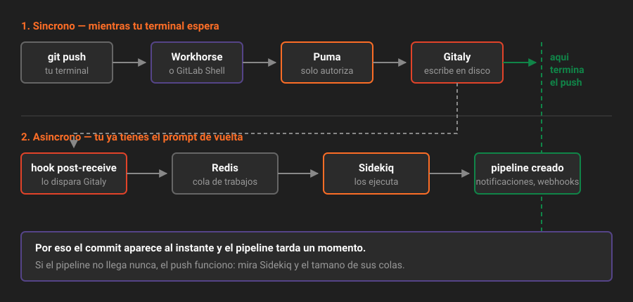

# Anatomía de una petición

> Seguir una petición de punta a punta convierte siete procesos sueltos en un sistema que entiendes.

## 🎯 Objetivos

- Trazar una petición web desde el navegador hasta la respuesta
- Trazar un `git clone` y saber por qué no pasa por Puma
- Trazar un `git push` y entender por qué el pipeline aparece un segundo después
- Usar ese recorrido para localizar dónde se rompe algo

---

## 1. Qué problema resuelve saber esto

Un 502 no te dice nada. "El pipeline no arranca" tampoco. Lo que convierte un síntoma en un diagnóstico es saber **por dónde pasa** la operación que falló: si conoces las cinco paradas de un `git push`, puedes preguntarte en cuál se quedó.

Vamos a seguir tres recorridos: una página web, un clon y un push.



---

## 2. Caso 1: abrir la página de un merge request

Escribes `http://localhost:8888/plataforma-biblioteca/app/-/merge_requests/3`.

**1. Nginx recibe la petición.** Termina la conexión TCP y mira la ruta. No es un archivo estático, así que la pasa hacia dentro.

**2. Workhorse la inspecciona.** ¿Es una operación de Git? No. ¿Es una descarga de archivo grande? Tampoco. Es una página: la reenvía a Puma.

**3. Puma la coge.** Uno de sus hilos ejecuta el controlador de Rails correspondiente, que hace tres cosas:

- Consulta **PostgreSQL**: ¿existe el proyecto?, ¿este usuario puede verlo?, ¿qué merge request es el 3?, ¿qué comentarios tiene?
- Consulta **Redis**: ¿tengo cacheados los permisos de este usuario? ¿y el resultado de esta consulta?
- Pide a **Gitaly** el diff: qué cambió entre la rama de origen y la de destino. Puma no lee el repositorio, se lo pregunta a Gitaly por gRPC

**4. Puma renderiza el HTML** y lo devuelve por el mismo camino: Workhorse, Nginx, tu navegador.

**5. El navegador pide el CSS y el JavaScript.** Esos sí son estáticos: los sirve Nginx directamente y no molesta a nadie más.

Tiempo total: entre 100 y 500 ms. Si tarda cinco segundos, el culpable casi siempre es la consulta a PostgreSQL o el diff de Gitaly, no la red.

---

## 3. Caso 2: `git clone` por HTTP

```bash
git clone http://localhost:8888/plataforma-biblioteca/app.git
```

Aquí el recorrido cambia y esa es toda la gracia.

**1. Nginx recibe la petición** y ve una ruta que acaba en `.git/info/refs`. La pasa a Workhorse.

**2. Workhorse reconoce que es Git.** En vez de mandársela a Puma, hace algo más listo: le pregunta a Puma **solo por la autorización** —"¿este usuario puede clonar este repositorio?"— y Puma le responde con un permiso, no con datos.

**3. Con ese permiso, Workhorse habla directamente con Gitaly.** Gitaly ejecuta el `git upload-pack` real contra el disco y devuelve el packfile.

**4. Workhorse hace de tubería** entre Gitaly y tu terminal, transmitiendo megabytes sin que Rails intervenga.

> [!IMPORTANT]
> Este es el motivo de existir de Workhorse. Si el clon pasara por Puma, un repositorio de 2 GB tendría ocupado un hilo de Rails durante minutos. Con solo 8 hilos en el laboratorio, tres clones simultáneos dejarían la interfaz web inservible.
>
> Puma decide **si puedes**. Workhorse y Gitaly hacen **el trabajo**.

### Por SSH el recorrido es distinto

```bash
git clone git@gitlab-lab:plataforma-biblioteca/app.git
```

Aquí no hay Nginx ni Workhorse. Entra por el servidor SSH del contenedor (puerto 22 dentro, 2224 fuera), que identifica al usuario por su clave pública y se lo pasa a **GitLab Shell**. GitLab Shell consulta la autorización por la API interna y luego habla con Gitaly.

| | HTTP | SSH |
|---|---|---|
| Puerta | Nginx → Workhorse | Servidor SSH → GitLab Shell |
| Autenticación | Token o contraseña | Clave pública |
| Autorización | Workhorse pregunta a Rails | GitLab Shell pregunta a la API interna |
| Quién hace el Git | Gitaly | Gitaly |

Las dos rutas convergen en Gitaly. **Siempre convergen en Gitaly.**

---

## 4. Caso 3: `git push` y el pipeline que aparece después

Este es el recorrido que más veces vas a necesitar entender, porque es donde ocurre el retardo que desconcierta a todo el mundo.

```bash
git push origin feat/late-fee
```

**1-3. Igual que el clon**, pero al revés: la petición llega, se autoriza, y Gitaly recibe el packfile.

**4. Gitaly escribe los objetos en el disco** y actualiza la referencia de la rama. En este punto **el push ya ha terminado**: tu terminal devuelve el prompt.

**5. Gitaly dispara un hook `post-receive`.** Ese hook avisa a GitLab de que algo cambió.

**6. GitLab encola trabajos en Redis.** No los ejecuta: los encola. Entre ellos:
   - Crear el pipeline, si hay `.gitlab-ci.yml`
   - Actualizar la actividad del proyecto
   - Mandar notificaciones
   - Disparar webhooks
   - Cerrar issues si el mensaje decía `Closes #42`

**7. Sidekiq los saca de la cola y los ejecuta**, cada uno cuando le toca.

### Por qué el pipeline tarda un segundo en aparecer

Porque el paso 4 y el paso 7 son independientes. Tu push terminó en el 4. El pipeline nace en el 7.

Eso explica un síntoma que parece un fallo y no lo es:

> "Hice push, el commit está en la interfaz, pero el pipeline no aparece."

El commit está porque Gitaly lo escribió. El pipeline no está porque el trabajo de Sidekiq sigue en la cola. Si las colas están saturadas, puede tardar minutos.

Dónde mirarlo: `Admin → Monitoring → Background jobs`.

Y si tras esperar sigue sin aparecer, el orden de sospecha es:

1. ¿Hay `.gitlab-ci.yml` en esa rama?
2. ¿Sidekiq está vivo? (`gitlab-ctl status`)
3. ¿Las colas crecen sin bajar?
4. ¿Las `rules` del pipeline excluyen esa rama? — eso lo verás en la Semana 10

---

## 5. La tabla de diagnóstico

Une los tres recorridos en una sola herramienta de trabajo:

| Síntoma | Paradas que funcionaron | Dónde mirar |
|---|---|---|
| No responde nada, "conexión rechazada" | Ninguna | ¿El contenedor está arriba? ¿El puerto publicado? |
| 502 en el navegador | Nginx | Puma: ¿arrancó?, ¿memoria? |
| La web va, pero no puedo clonar por HTTP | Nginx, Puma | Workhorse y Gitaly |
| No puedo clonar por SSH, pero por HTTP sí | Todo lo web | Puerto 2224, clave registrada, GitLab Shell |
| Los issues cargan, los archivos no | Nginx, Puma, PostgreSQL | Gitaly |
| Push correcto, pipeline ausente | Todo hasta Gitaly | Sidekiq y las colas de Redis |
| Todo va, pero no llegan correos | Todo | Sidekiq (y el correo está desactivado en el laboratorio) |
| GitLab no arranca en absoluto | Ninguna | PostgreSQL: es la dependencia más dura |

---

## 6. Antipatrones

| Antipatrón | Por qué duele | Qué hacer en su lugar |
|---|---|---|
| Reiniciar todo ante cualquier síntoma | A veces funciona, y no aprendes nada; la próxima vez estás igual | Localiza la parada que falló y reinicia solo eso |
| Creer que un push fallido significa Git roto | El push pudo funcionar y fallar el trabajo posterior | Comprueba si el commit está en la interfaz: si está, el problema es Sidekiq |
| Buscar en los logs de Puma un problema de clonado | El clon no pasa por Puma más que para la autorización | Logs de Workhorse y de Gitaly |
| Confundir "lento" con "caído" | Se reinicia una instancia que solo estaba encolada | Mira primero las colas de Sidekiq |

---

## 7. Trucos

**Ver la petición pasar en tiempo real.** Abre dos terminales:

```bash
# Terminal 1
docker compose exec gitlab gitlab-ctl tail nginx

# Terminal 2
curl -s -o /dev/null -w '%{http_code}\n' http://localhost:8888/-/health
```

**Distinguir si un problema es de autorización o de Git.** Si `curl` a la API responde bien y el clon falla, la autorización va: el problema está más adentro.

```bash
curl -s -o /dev/null -w '%{http_code}\n' \
  -H "PRIVATE-TOKEN: $GITLAB_TOKEN" "$GITLAB_URL/api/v4/user"
# 200 → tu token y Puma funcionan
```

**Comprobar que Gitaly responde**, sin pasar por la web:

```bash
docker compose exec gitlab gitlab-rake gitlab:gitaly:check
```

**Ver el hook que dispara todo tras un push:**

```bash
docker compose exec gitlab ls /opt/gitlab/embedded/service/gitaly-ruby/git-hooks/
```

---

## 📚 Recursos Adicionales

- [Arquitectura de GitLab](https://docs.gitlab.com/ee/development/architecture.html) — incluye los diagramas de secuencia oficiales de cada tipo de petición
- [GitLab Workhorse](https://docs.gitlab.com/ee/development/workhorse/) — qué intercepta exactamente y por qué
- [GitLab Shell](https://docs.gitlab.com/ee/development/gitlab_shell/) — el camino del SSH, que casi nadie conoce
- [Comprobaciones de estado](https://docs.gitlab.com/ee/administration/monitoring/health_check.html) — los endpoints que usarás para localizar la parada rota

---

## ✅ Checklist de Verificación

- [ ] Puedes describir las cinco paradas de una petición web
- [ ] Sabes por qué un `git clone` no ocupa un hilo de Puma
- [ ] Sabes en qué paso termina un `git push` y en cuál nace el pipeline
- [ ] Ante "el pipeline no aparece", sabes qué mirar y en qué orden
- [ ] Sabes qué tienen en común la ruta HTTP y la ruta SSH

---

| Anterior | Siguiente |
|---|---|
| [← 04 — GitLab en Docker](04-gitlab-en-docker.md) | [06 — Dónde viven los datos →](06-donde-viven-los-datos.md) |

[← Volver a la Semana 01](../README.md)
