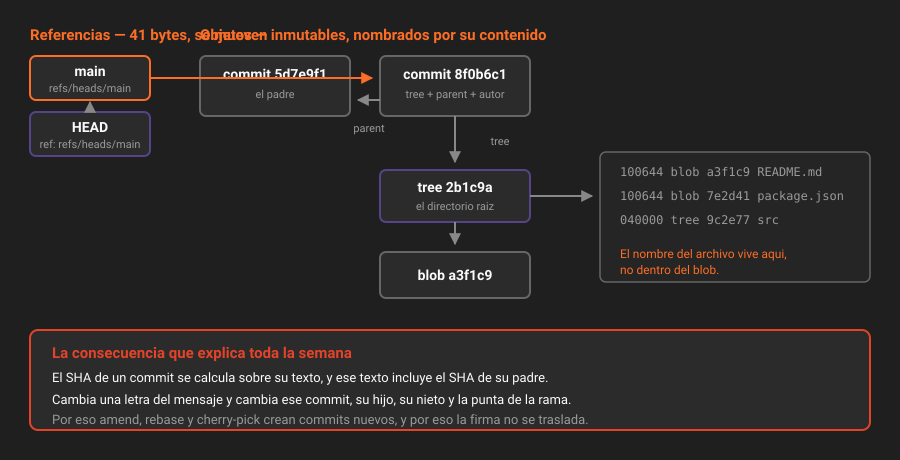

# El modelo de objetos de Git

> Git no guarda cambios: guarda fotos completas, direccionadas por su contenido. Entender eso convierte media docena de comandos "mágicos" en consecuencias obvias.

## 🎯 Objetivos

- Nombrar los cuatro tipos de objeto de Git y qué contiene cada uno
- Explicar por qué el SHA de un commit cambia si cambia cualquier cosa de su historia
- Distinguir un objeto de una referencia, y por qué crear una rama cuesta 41 bytes
- Leer el interior de tu repositorio con `git cat-file` y `git rev-parse`

---

## 1. Qué problema resuelve

Un sistema de control de versiones tiene que responder a dos preguntas que se contradicen: *¿cómo estaba el proyecto entero el martes?* y *¿qué cambió exactamente?*.

Guardar solo los cambios (lo que hacían CVS y Subversion) responde bien a la segunda y fatal a la primera: reconstruir el estado del martes obliga a aplicar en orden todos los parches desde el principio. Con diez años de historia, eso es lento y frágil.

Git hace lo contrario: **guarda el estado completo en cada commit**, y consigue que no ocupe una barbaridad porque los archivos que no cambian **se comparten**. Dos commits que tocan un archivo de mil apuntan al mismo objeto para los otros novecientos noventa y nueve.

Y aquí está la decisión que lo explica todo lo demás: **cada objeto se identifica por el hash de su propio contenido**. No hay un número de versión asignado por nadie. El nombre *es* el contenido.

---

## 2. Los cuatro objetos

Todo lo que Git almacena es uno de estos cuatro:

| Objeto | Qué contiene | Analogía |
|---|---|---|
| **blob** | El contenido de un archivo. Sin nombre, sin permisos, sin fecha | El texto de una página |
| **tree** | Una lista de nombres → (blob o tree), con sus permisos | Un directorio |
| **commit** | Un tree raíz, cero o más padres, autor, committer, mensaje y (si la hay) la firma | La foto, con quién y por qué |
| **tag anotado** | Un objeto apuntado, más autor, mensaje y firma | Una etiqueta con dedicatoria |

Fíjate en lo que **no** está en el blob: su nombre. `README.md` y `LEEME.md` con el mismo texto son **el mismo blob**. El nombre vive en el tree que lo referencia.

```
commit  ──▶  tree (raíz)
                ├── README.md   ──▶ blob
                ├── package.json ──▶ blob
                └── src/        ──▶ tree
                                     ├── prestamos.ts      ──▶ blob
                                     └── prestamos.test.ts ──▶ blob
```



### Verlo con tus propios ojos

```bash
# El SHA del commit actual.
git rev-parse HEAD
# 8f0b6c1e1c3f9b0e5a2d4c7e9f1a3b5d7e9f1a3b

# El tipo de un objeto y su contenido.
git cat-file -t HEAD     # commit
git cat-file -p HEAD     # el commit entero, en texto plano
```

```
tree 2b1c9a...            <- la foto del directorio
parent 5d7e9f...          <- el commit anterior
author  Ana <ana@ejemplo.com> 1755950400 -0500
committer Ana <ana@ejemplo.com> 1755950400 -0500

feat(prestamos): calcular la multa por retraso
```

Un commit es **texto**. Nada más. Y su SHA es el hash de ese texto.

```bash
# Bajar un nivel: el tree raíz de ese commit.
git cat-file -p HEAD^{tree}
# 100644 blob a3f1...    README.md
# 040000 tree 9c2e...    src
```

---

## 3. Por qué el SHA lo cambia todo

El SHA de un commit se calcula sobre su texto completo, y ese texto **incluye el SHA de su padre**. La consecuencia es una cadena:

> Cambia cualquier cosa —una letra del mensaje, la fecha, el autor, un byte de un archivo— y cambia el SHA de ese commit. Y como su hijo lo nombraba, cambia también el SHA del hijo. Y del nieto. Hasta la punta de la rama.

Eso es exactamente lo que ocurre cuando reescribes la historia: `commit --amend`, `rebase`, `cherry-pick` y `filter-repo` **no modifican** commits. Crean commits nuevos y mueven la referencia. Los viejos siguen ahí, huérfanos, hasta que el recolector de basura pase.

De ahí salen tres hechos que valen la semana entera:

1. **La historia de Git es inmutable.** "Reescribirla" es fabricar una historia paralela y dejar de mirar la vieja.
2. **Los SHA viejos siguen siendo válidos** mientras el objeto exista. Por eso `git reflog` puede rescatarte (teoría 04).
3. **Una firma cubre un SHA concreto.** Reescribe el commit y la firma no se traslada: hay que volver a firmar (teoría 06).

> [!IMPORTANT]
> Git usa SHA-1 por defecto. Desde 2017 se conocen colisiones de SHA-1 provocadas y Git incorpora una detección que aborta la operación al detectarlas. Git admite además SHA-256 (`git init --object-format=sha256`), y GitLab 19.2 puede crear proyectos así: la API acepta `repository_object_format=sha256` al crear el proyecto, y el campo aparece luego en la respuesta de `projects/:id`.
>
> No lo uses todavía: un repositorio SHA-256 **no puede clonar ni intercambiar objetos** con uno SHA-1, y buena parte del ecosistema (herramientas, imágenes de CI, integraciones) aún asume 40 caracteres. Este bootcamp trabaja en SHA-1. Y en cualquier caso, lo que impide que alguien te cuele un commit no es el algoritmo del hash: es la **firma**, que es de lo que va esta semana.

---

## 4. Referencias: lo que sí se mueve

Los objetos son inmutables. Lo que se mueve son las **referencias**: archivos diminutos que contienen un SHA.

```bash
cat .git/refs/heads/main
# 8f0b6c1e1c3f9b0e5a2d4c7e9f1a3b5d7e9f1a3b   <- 41 bytes: 40 + salto de línea
```

| Referencia | Dónde vive | Qué es |
|---|---|---|
| Rama | `.git/refs/heads/<nombre>` | Un puntero **móvil**: avanza solo con cada commit |
| Tag ligero | `.git/refs/tags/<nombre>` | Un puntero **fijo** a un objeto |
| Tag anotado | `.git/refs/tags/<nombre>` | Un puntero a un **objeto tag**, que a su vez apunta al commit |
| Rama remota | `.git/refs/remotes/origin/<nombre>` | Dónde estaba esa rama del remoto la última vez que hablaste con él |
| `HEAD` | `.git/HEAD` | Dónde estás. Normalmente `ref: refs/heads/main` |

Por eso crear una rama es instantáneo: **escribe 41 bytes**. No copia archivos, no duplica historia. Una rama en Git no es una copia del proyecto; es una nota adhesiva sobre un commit.

Y por eso `HEAD` "desprendido" (*detached HEAD*) no es un error: es `HEAD` conteniendo un SHA directamente en vez del nombre de una rama. Estás en un commit sin que ninguna rama te siga; si haces commits ahí y te vas, nada los referencia.

```bash
git rev-parse HEAD          # el SHA
git rev-parse --abbrev-ref HEAD   # main, o "HEAD" si está desprendido
git symbolic-ref HEAD       # refs/heads/main, o error si está desprendido
```

---

## 5. La sintaxis de revisiones que sí se usa

`git rev-parse` entiende un lenguaje pequeño para nombrar commits. Estas son las formas que aparecen en el trabajo real:

| Forma | Qué nombra |
|---|---|
| `HEAD` | Donde estás |
| `HEAD~3` | Tres commits atrás por la **primera** línea de padres |
| `HEAD^2` | El **segundo padre** (solo tiene sentido en un merge) |
| `main@{2}` | Donde estaba `main` hace dos movimientos, según el reflog |
| `main@{yesterday}` | Donde estaba `main` ayer |
| `HEAD^{tree}` | El tree raíz de ese commit |
| `:/multa` | El commit más reciente cuyo mensaje contiene "multa" |
| `A..B` | Commits alcanzables desde `B` y no desde `A` |
| `A...B` | Los de uno u otro, pero no de los dos |

```bash
# Comprobar antes de operar: rev-parse resuelve, no ejecuta.
git rev-parse --short HEAD~3
git log --oneline main~5..main
```

> [!TIP]
> `~` y `^` se confunden constantemente. `~` sube por la **primera** línea de padres, es lo que quieres el 95% de las veces. `^` elige **qué padre**, y solo importa en merges. `HEAD~2` = el bisabuelo por la línea principal; `HEAD^2` = el segundo padre del commit actual.

---

## 6. Dónde vive todo esto

```bash
ls .git
# HEAD  config  hooks/  index  objects/  refs/  logs/
```

| Ruta | Qué guarda |
|---|---|
| `objects/` | Los cuatro tipos de objeto, sueltos o empaquetados en `.pack` |
| `refs/` | Las referencias |
| `HEAD` | La referencia actual |
| `index` | El índice, o *staging area*. Binario. Es el tema de la teoría 02 |
| `logs/` | El reflog: el histórico de dónde ha estado cada referencia |
| `config` | La configuración de **este** repositorio |
| `hooks/` | Los hooks locales, que no viajan en el clon |

```bash
# Cuántos objetos tienes y cuánto ocupan.
git count-objects -vH
```

Cuando `objects/` acumula miles de objetos sueltos, `git gc` los empaqueta y, ahí sí, comprime por deltas: dentro del `.pack` los objetos parecidos se guardan como diferencias. **La compresión por deltas es un detalle de almacenamiento, no el modelo de datos.** Conceptualmente, cada commit sigue siendo una foto completa.

---

## 7. Antipatrones

| Antipatrón | Por qué duele | Qué hacer en su lugar |
|---|---|---|
| Creer que un commit guarda un diff | Lleva a esperar que `revert` y `cherry-pick` "muevan cambios" sin efectos | Un commit es una foto; el diff se calcula contra el padre al mostrarlo |
| Editar algo dentro de `.git/objects` | Los objetos son inmutables por construcción; lo corrompes | Los comandos de porcelana ya hacen lo que quieres |
| `rm -rf .git` para "empezar limpio" | Pierdes el reflog, que es la red de seguridad de toda reescritura | `git reset`, `git restore`, `git reflog` |
| Usar `HEAD^2` creyendo que es "dos atrás" | Falla o apunta a otra rama del merge | `HEAD~2` |
| Fiarte de un SHA corto en un script | Con el repositorio grande, 7 caracteres colisionan | `git rev-parse` completo, o `--short=12` |

---

## 8. Trucos

**Ver el grafo de verdad, con las referencias en su sitio:**

```bash
git log --oneline --graph --decorate --all
```

Alias para no volver a escribirlo:

```bash
git config --global alias.grafo "log --oneline --graph --decorate --all"
```

**Encontrar el commit que introdujo un texto, sin saber el archivo:**

```bash
git log -S "calcularMulta" --oneline
```

**Ver qué objetos ocupan tu repositorio, de mayor a menor:**

```bash
git rev-list --objects --all \
  | git cat-file --batch-check='%(objecttype) %(objectname) %(objectsize) %(rest)' \
  | awk '$1 == "blob" {print $3, $4}' | sort -rn | head -10
```

Este es el comando con el que se descubre que alguien versionó un binario de 80 MB en 2023 y sigue en la historia de todos los clones.

**Comprobar la integridad de todo el grafo:**

```bash
git fsck --full
```

---

## 📚 Recursos Adicionales

- [Pro Git — capítulo 10, Git Internals](https://git-scm.com/book/es/v2/Git-Internals-Plumbing-and-Porcelain) — el capítulo que explica exactamente esto, con las manos dentro de `.git`
- [`git cat-file`](https://git-scm.com/docs/git-cat-file) — la navaja para leer objetos
- [`gitrevisions(7)`](https://git-scm.com/docs/gitrevisions) — la referencia completa de `~`, `^`, `@{}` y los rangos
- [Detección de colisiones SHA-1 en Git](https://github.blog/2017-03-20-sha-1-collision-detection-on-github-com/) — por qué el hash no es lo que protege tu historia

---

## ✅ Checklist de Verificación

- [ ] Sabes leer un commit con `git cat-file -p` y reconocer sus campos
- [ ] Puedes explicar por qué cambiar un mensaje cambia el SHA de todos los descendientes
- [ ] Distingues objeto de referencia, y sabes dónde vive cada uno dentro de `.git`
- [ ] Sabes cuándo usar `~` y cuándo `^`
- [ ] Has listado los diez blobs más grandes de tu repositorio

---

| Anterior | Siguiente |
|---|---|
| — | [02 — El índice y el commit quirúrgico →](02-el-indice-y-el-commit-quirurgico.md) |

[← Volver a la Semana 02](../README.md)
