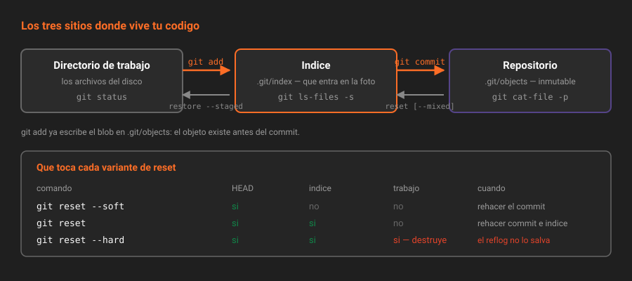

# El índice y el commit quirúrgico

> El índice no es "la lista de archivos que voy a subir": es una tercera copia del proyecto, y es la que convierte un commit en una unidad de significado en vez de en un volcado de la tarde.

## 🎯 Objetivos

- Explicar qué es el índice y por qué existe entre el directorio de trabajo y el repositorio
- Partir un cambio grande en varios commits con `git add -p`
- Deshacer con precisión: distinguir `restore`, `restore --staged` y `reset`
- Aparcar trabajo con `git stash` sin perder el rastro de qué contenía

---

## 1. Qué problema resuelve

Trabajas dos horas. Arreglas un bug, de paso renombras una variable, añades un test, y ya que estabas corriges una falta en el README. Cuatro cosas.

Si haces `git add . && git commit -m "cambios"`, acabas de destruir información que no vuelve: cuál de los cuatro cambios fue el que arregló el bug. Dentro de tres meses, cuando `git bisect` (teoría 08) señale ese commit, tendrás que leer los cuatro y adivinar.

El índice existe precisamente para que eso no pase. Es una **zona de montaje**: eliges qué entra en la foto **antes** de sacarla. No es un detalle burocrático de Git, es la herramienta que separa una historia legible de un vertedero cronológico.

---

## 2. Los tres sitios donde vive tu código

| Sitio | Qué es | Cómo se ve |
|---|---|---|
| **Directorio de trabajo** | Los archivos reales del disco | Los abres con el editor |
| **Índice** (*staging area*) | Un archivo binario, `.git/index`, con la lista de rutas → blob + permisos | `git ls-files -s` |
| **Repositorio** | Los objetos de `.git/objects` | `git cat-file` |

```
directorio de trabajo  ──git add──▶  índice  ──git commit──▶  repositorio
        ◀── git restore ────           ◀── git restore --staged ──
```



El detalle que casi nadie sabe: **`git add` ya escribe el blob en la base de datos de objetos**. El objeto existe desde ese momento; el commit solo lo referencia. Por eso un archivo añadido y luego borrado del índice sigue recuperable hasta que pase el recolector.

```bash
git ls-files -s
# 100644 a3f1c9... 0    README.md
# 100644 9c2e77... 0    src/prestamos.ts
```

Esos SHA son blobs reales. Compruébalo:

```bash
git cat-file -p $(git ls-files -s README.md | awk '{print $2}') | head -3
```

---

## 3. El commit quirúrgico: `git add -p`

`git add -p` recorre tu cambio **trozo a trozo** (*hunk*) y pregunta por cada uno.

```bash
git add -p src/prestamos.ts
```

```
@@ -1,4 +1,8 @@
 export const MULTA_POR_DIA = 500;
+
+export function calcularMulta(dias: number): number {
+  return dias <= 0 ? 0 : dias * MULTA_POR_DIA;
+}
(1/2) Stage this hunk [y,n,q,a,d,s,e,?]?
```

Las respuestas que se usan de verdad:

| Tecla | Qué hace |
|---|---|
| `y` | Añade este trozo |
| `n` | No lo añade |
| `s` | **Parte** el trozo en trozos más pequeños |
| `e` | Abre el trozo en el editor: eliges **línea por línea** |
| `q` | Sale y deja lo ya decidido |
| `?` | La ayuda, que también lista `a`, `d`, `g`, `/` |

`s` y `e` son los que hacen el trabajo fino. Con `e`, en el editor, borras las líneas `+` que no quieres incluir y conviertes en espacio la marca `-` de las líneas que no quieres borrar todavía.

> [!TIP]
> Antes de escribir el mensaje, mira **exactamente** lo que vas a comprometer:
>
> ```bash
> git diff --cached
> ```
>
> `git diff` a secas enseña lo que **no** está en el índice. Los dos son útiles y se confunden todo el tiempo: `git diff` = trabajo vs índice; `git diff --cached` = índice vs último commit; `git diff HEAD` = trabajo vs último commit.

Y para escribir el mensaje con el diff delante:

```bash
git commit -v
```

`-v` mete el diff del índice como comentario en el editor. Es la mejor forma de no escribir un mensaje que no se corresponde con el cambio.

---

## 4. Deshacer con precisión

Aquí es donde se pierde media hora por usar el comando de al lado. La pregunta que decide es **qué sitio quieres tocar**.

| Quiero… | Comando | Qué toca |
|---|---|---|
| Descartar cambios del archivo en el disco | `git restore <archivo>` | Directorio de trabajo. **Destructivo, sin red** |
| Sacar del índice sin perder el cambio | `git restore --staged <archivo>` | Índice |
| Traer un archivo tal como estaba en otro commit | `git restore --source=HEAD~3 <archivo>` | Trabajo (y con `--staged`, el índice) |
| Mover la rama a otro commit, conservando trabajo e índice | `git reset --soft <commit>` | Solo `HEAD` |
| Ídem, vaciando el índice | `git reset <commit>` (mixed, por defecto) | `HEAD` + índice |
| Ídem, y tirar también el trabajo | `git reset --hard <commit>` | Los tres. **Destructivo** |

> [!WARNING]
> `git restore <archivo>` y `git reset --hard` **borran trabajo que nunca estuvo en un commit**. El reflog (teoría 04) rescata commits, no cambios sin comprometer. Antes de cualquiera de los dos, si dudas: `git stash`.

El caso más común de todos, y el que conviene tener en los dedos:

```bash
# "He comprometido de más y quiero rehacer el commit con otro contenido"
git reset --soft HEAD~1      # deshace el commit, deja todo en el índice
git restore --staged src/otro.ts   # saca lo que no tocaba
git commit -c ORIG_HEAD      # reutiliza el mensaje original, editable
```

`ORIG_HEAD` es una referencia que Git escribe automáticamente antes de las operaciones peligrosas (`reset`, `rebase`, `merge`). Es un "deshacer" gratis que casi nadie usa.

---

## 5. `git stash`: aparcar, no esconder

```bash
git stash push -m "multa: a medias, falta el caso de dias negativos"
```

El `-m` no es opcional en la práctica: un `stash` sin mensaje es `WIP on main: 8f0b6c1`, que dentro de tres días no significa nada.

| Comando | Qué hace |
|---|---|
| `git stash push -m "<qué es>"` | Aparca cambios del trabajo y del índice |
| `git stash push -p` | Aparca **solo los trozos que elijas** |
| `git stash push -u` | Incluye los archivos sin seguimiento |
| `git stash list` | Lista lo aparcado |
| `git stash show -p stash@{1}` | El diff de una entrada concreta |
| `git stash apply stash@{1}` | Lo aplica y **lo conserva** en la lista |
| `git stash pop` | Lo aplica y lo borra de la lista |
| `git stash branch <rama>` | Crea una rama desde donde se guardó y lo aplica ahí |

`git stash branch` es el que resuelve el caso feo: aparcaste algo, la rama avanzó, y ahora `pop` da conflictos. Con `branch` vuelves al commit original y aplicas limpio.

> [!NOTE]
> Un `stash` **no viaja en un push**. Vive solo en tu clon, bajo `refs/stash`. Aparcar algo importante en el stash y formatear el portátil es una forma conocida de perder trabajo. Si el cambio importa, es un commit en una rama, aunque sea feo.

---

## 6. Qué no debería entrar nunca al índice

| Qué | Por qué |
|---|---|
| `node_modules/`, `dist/`, `build/` | Se regeneran. Engordan el clon para siempre, porque la historia no se limpia sola |
| `.env`, credenciales, claves privadas | Si entran, el secreto está quemado aunque lo borres después (teoría 08) |
| Archivos del editor (`.idea/`, `.vscode/` propios) | Ruido en cada MR de todo el equipo |
| Binarios grandes | Van a LFS, que es tema de la Semana 04 |

El instrumento es `.gitignore`, y tiene una trampa clásica:

> [!IMPORTANT]
> **`.gitignore` no afecta a lo que ya está versionado.** Añadir `node_modules/` cuando ya lo comprometiste no hace nada. Hay que sacarlo del índice **sin borrarlo del disco**:
>
> ```bash
> git rm -r --cached node_modules
> git commit -m "chore: dejar de versionar node_modules"
> ```
>
> Y aun así sigue en la historia. Sacarlo de ahí es cirugía mayor: teoría 08.

Para saber por qué se ignora (o por qué no) un archivo concreto:

```bash
git check-ignore -v node_modules/foo/index.js
# .gitignore:2:node_modules/	node_modules/foo/index.js
```

---

## 7. Antipatrones

| Antipatrón | Por qué duele | Qué hacer en su lugar |
|---|---|---|
| `git add .` por costumbre | Mete `.env`, basura del editor y tres cambios sin relación en un commit | `git add -p`, o rutas concretas |
| `git commit -am "cambios"` | Salta el índice **y** el mensaje. El peor de los dos mundos | `git add -p` + `git commit -v` |
| `git checkout .` para descartar | Comando sobrecargado, hace cinco cosas distintas según el contexto | `git restore` para archivos, `git switch` para ramas |
| `git reset --hard` como reflejo | Borra trabajo sin commit, que el reflog no recupera | `git stash` primero, `reset` después |
| Stash como almacén a largo plazo | No viaja, no se firma, no se revisa, y `pop` acaba en conflicto | Una rama con commits, aunque sean provisionales |
| Ignorar tarde | `.gitignore` no borra lo ya versionado | `git rm --cached` + entrada en `.gitignore` |

---

## 8. Trucos

**Ver el estado en una línea por archivo, con las dos columnas (índice y trabajo):**

```bash
git status -sb
# ## main...origin/main [ahead 1]
# M  src/prestamos.ts     <- modificado y en el índice
#  M README.md            <- modificado, no añadido
# ?? notas.txt            <- sin seguimiento
```

La primera columna es el índice, la segunda el directorio de trabajo. Con eso se lee el estado de un vistazo.

**Comprometer solo una parte de un archivo, desde el editor:** `git add -p`, `e`, y editar el trozo. Es la única forma de partir un cambio que se solapa en las mismas líneas.

**Recuperar un archivo de un commit antiguo sin cambiar de rama:**

```bash
git restore --source=main~5 src/prestamos.ts
```

**Ver qué se aparcó en un stash sin aplicarlo:**

```bash
git stash show -p stash@{0} | less
```

**Limpiar archivos sin seguimiento, mirando antes:**

```bash
git clean -nd      # -n: enseña qué borraría
git clean -fd      # -f: lo borra de verdad
```

> [!WARNING]
> `git clean -fd` borra archivos que Git **nunca ha visto**. No hay reflog para eso. Ejecuta siempre `-nd` antes.

---

## 📚 Recursos Adicionales

- [Pro Git — Reset desmitificado](https://git-scm.com/book/es/v2/Herramientas-de-Git-Reset-Desmitificado) — la mejor explicación que existe de `reset` sobre los tres árboles
- [`git add` — modo interactivo](https://git-scm.com/docs/git-add#_interactive_mode) — todas las teclas de `-p`, incluida `s` y `e`
- [`git restore`](https://git-scm.com/docs/git-restore) y [`git switch`](https://git-scm.com/docs/git-switch) — los dos comandos que sustituyen los usos de `checkout`
- [`gitignore(5)`](https://git-scm.com/docs/gitignore) — el orden de precedencia de los patrones, que no es obvio

---

## ✅ Checklist de Verificación

- [ ] Sabes qué enseña `git diff` y qué enseña `git diff --cached`
- [ ] Has partido un cambio en dos commits con `git add -p`
- [ ] Sabes cuál de los tres sitios toca cada variante de `reset`
- [ ] Puedes sacar del índice un directorio ya versionado sin borrarlo del disco
- [ ] Tu `.gitignore` cubre `node_modules/` y `.env` antes del primer `npm install`

---

| Anterior | Siguiente |
|---|---|
| [← 01 — El modelo de objetos](01-el-modelo-de-objetos.md) | [03 — Reescribir la historia →](03-reescribir-la-historia.md) |

[← Volver a la Semana 02](../README.md)
