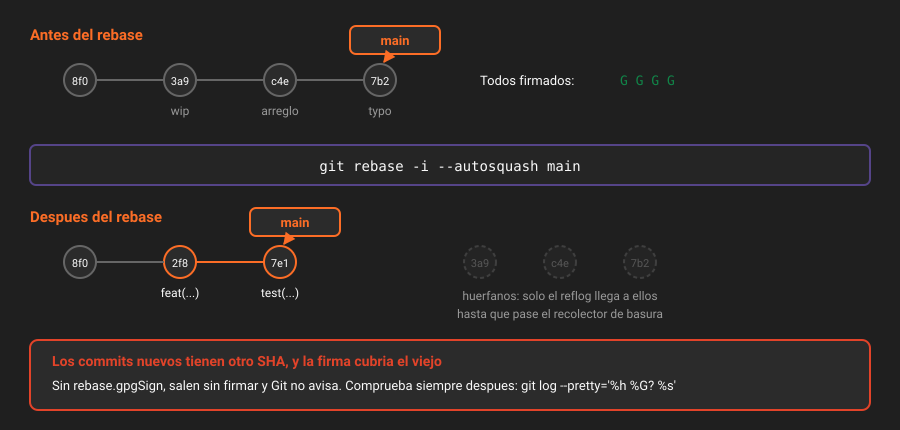

# Reescribir la historia

> Reescribir no modifica commits: fabrica commits nuevos y abandona los viejos. Todo lo que sorprende de `rebase` sale de ahí.

## 🎯 Objetivos

- Usar `git rebase -i` para reordenar, unir, dividir y reescribir mensajes
- Automatizar la limpieza con `--fixup` y `--autosquash`
- Trasplantar una rama a otra base con `rebase --onto`
- Saber cuándo reescribir es legítimo y cuándo rompe el trabajo de otros

---

## 1. Qué problema resuelve

La historia que escribes mientras trabajas y la historia que otro necesita leer no son la misma. Mientras trabajas: `wip`, `arreglo el test`, `ahora sí`, `typo`. Lo que hace falta después: tres commits, cada uno con un propósito, cada uno con sus tests en verde.

Reescribir es el paso de traducción entre las dos. No es cosmética: un `git bisect` (teoría 08) sobre una historia de `wip` y `ahora sí` no sirve para nada, porque la mitad de los commits ni siquiera compilan.

La regla que gobierna todo el capítulo:

> **Reescribe libremente lo que solo existe en tu clon. No reescribas lo que otros ya tienen.**

Esta semana estás en el caso fácil: tu repositorio no lo usa nadie más. Es el único momento del bootcamp en que se permite reescribir `main`, y por eso la cirugía se practica ahora.

---

## 2. `commit --amend`: el caso de un solo commit

```bash
git commit --amend                 # cambia el mensaje del último commit
git add src/prestamos.ts
git commit --amend --no-edit       # añade lo del índice al último commit, mismo mensaje
```

`--amend` **no edita** el commit. Construye uno nuevo con el mismo padre y mueve la rama. El anterior queda huérfano.

```bash
git rev-parse HEAD          # 8f0b6c1...
git commit --amend --no-edit
git rev-parse HEAD          # 3a9d2f7...  <- otro commit
git rev-parse HEAD@{1}      # 8f0b6c1...  <- el viejo, todavía alcanzable por el reflog
```

> [!WARNING]
> `--amend` sobre un commit **ya empujado** deja tu rama y la remota divergidas. Empujar eso requiere `--force-with-lease` (sección 6), y si alguien había clonado, le rompes su historia. Con la rama en solitario es gratis; en equipo tiene coste.

---

## 3. `git rebase -i`: la mesa de operaciones

```bash
git rebase -i HEAD~5        # los últimos 5 commits
git rebase -i --root        # toda la historia, desde el primer commit
```

Git abre una lista **del más antiguo al más reciente** —al revés que `git log`— y espera que cambies la palabra de la izquierda:

```
pick 8f0b6c1 feat(prestamos): calcular multa
pick 3a9d2f7 wip
pick c4e8b1a arreglo el test
pick 9d1f3c5 feat(socios): comprobar si puede prestar
pick 7b2a4e6 typo
```

| Palabra | Qué hace |
|---|---|
| `pick` | Lo deja como está |
| `reword` | Conserva el cambio, abre el editor para el mensaje |
| `edit` | Se para **en** ese commit para que lo modifiques o lo dividas |
| `squash` | Lo funde con el anterior y **combina los dos mensajes** |
| `fixup` | Lo funde con el anterior y **descarta su mensaje** |
| `drop` | Lo elimina |
| `exec <comando>` | Ejecuta un comando después de ese commit |
| `break` | Se para ahí sin hacer nada, para que mires |

Borrar una línea equivale a `drop`. Mover una línea reordena el commit.

`exec` es el que menos se conoce y el que más vale: comprueba que **cada** commit del resultado está sano.

```bash
git rebase -i --exec "npm test" HEAD~5
```

Si un commit intermedio rompe los tests, el rebase se detiene ahí y te lo dice. Eso es lo que hace que `bisect` funcione seis meses después.

### Dividir un commit en dos

Con `edit` en la línea del commit:

```bash
git rebase -i HEAD~3
# marca 'edit' en el commit a dividir; el rebase se para en él

git reset HEAD~              # deshace el commit, deja los cambios en el trabajo
git add -p                   # elige la primera mitad
git commit -m "feat(prestamos): calcular la multa por retraso"
git add -p                   # la segunda
git commit -m "test(prestamos): cubrir el caso de dias negativos"

git rebase --continue
```

### Salir de un rebase que se tuerce

| Situación | Qué hacer |
|---|---|
| Hay conflicto | Resolver, `git add <archivo>`, `git rebase --continue` |
| Ese commit ya no aporta nada | `git rebase --skip` |
| Quiero salir y dejarlo como estaba | `git rebase --abort` |
| Ya terminó y quiero deshacerlo | `git reset --hard ORIG_HEAD` |



---

## 4. `--fixup` y `--autosquash`: la limpieza sin editor

Es el flujo que más tiempo ahorra de toda la semana. Mientras trabajas, cuando corriges algo de un commit anterior, en vez de un commit `arreglo lo de antes`:

```bash
git add -p
git commit --fixup 8f0b6c1
# crea un commit titulado: fixup! feat(prestamos): calcular multa
```

Al terminar, un solo comando coloca cada `fixup!` justo detrás de su commit y lo marca como `fixup`:

```bash
git rebase -i --autosquash HEAD~10
```

Se abre la lista **ya ordenada**. Compruebas y guardas.

Y para no escribir `--autosquash` nunca más:

```bash
git config --global rebase.autosquash true
```

Variantes que conviene conocer:

| Comando | Resultado |
|---|---|
| `git commit --fixup <sha>` | Funde el cambio, descarta el mensaje |
| `git commit --squash <sha>` | Funde el cambio y **conserva** el mensaje para combinarlo |
| `git commit --fixup=reword:<sha>` | No cambia el contenido: solo reescribe **el mensaje** de ese commit |
| `git commit --fixup=amend:<sha>` | Funde el cambio **y** abre el mensaje para reescribirlo |

> [!TIP]
> ¿Cuál es el `<sha>` correcto? El del commit que introdujo la línea que estás corrigiendo:
>
> ```bash
> git log -1 --format=%h -S "calcularMulta" -- src/prestamos.ts
> ```

---

## 5. `rebase --onto`: trasplantar

La forma de tres argumentos es la que resuelve los casos raros:

```bash
git rebase --onto <nueva-base> <base-vieja> <rama>
```

Se lee así: *coge los commits que hay entre `base-vieja` y `rama`, y ponlos encima de `nueva-base`*.

Caso típico: ramificaste `feat/multas` desde `feat/socios` por error, y `feat/socios` todavía no está integrada.

```
antes:   main ─── A ─── B (feat/socios) ─── C ─── D (feat/multas)
después: main ─── A ─── B (feat/socios)
            └──── C' ── D' (feat/multas)
```

```bash
git rebase --onto main feat/socios feat/multas
```

Y para tirar los primeros commits de una rama:

```bash
git rebase --onto HEAD~5 HEAD~3    # descarta HEAD~5..HEAD~3, conserva el resto
```

> [!NOTE]
> `git pull --rebase` es esta misma operación en pequeño: en vez de fusionar lo que traes del remoto, reaplica tus commits locales encima. Es lo que mantiene la historia lineal, y por eso [setup-entorno](../../../docs/setup-entorno.md) recomienda `pull.rebase true`.

---

## 6. Empujar historia reescrita

Tras reescribir, tu rama y la del servidor tienen commits distintos. Un `push` normal se rechaza, y es lo correcto: te está avisando.

```bash
git push --force-with-lease
```

| Opción | Qué hace |
|---|---|
| `--force` | Sobrescribe la rama remota **pase lo que pase**. Si alguien empujó mientras tanto, su trabajo desaparece |
| `--force-with-lease` | Sobrescribe **solo si** el remoto sigue donde tú creías. Si alguien empujó, falla |

> [!WARNING]
> **Usa siempre `--force-with-lease`.** Y aun así, antes de forzar sobre una rama compartida:
>
> ```bash
> git fetch origin                       # actualiza tu idea del remoto
> git log --oneline origin/main..main    # qué vas a añadir
> git log --oneline main..origin/main    # qué hay allí que no tienes: si sale algo, PARA
> ```
>
> `--force-with-lease` protege del caso "alguien empujó después de mi último fetch". No protege del caso "alguien ya clonó y va a tener que rehacer su copia".

En la Semana 07 `main` queda protegida y el forzado deja de ser posible por diseño. Esta semana todavía puedes, y por eso es el momento de aprender a hacerlo bien.

---

## 7. Antipatrones

| Antipatrón | Por qué duele | Qué hacer en su lugar |
|---|---|---|
| Reescribir una rama que otros ya tienen | Sus clones divergen y hay que reconstruirlos a mano | Reescribe antes de empujar, o abre una rama nueva |
| `git push --force` a secas | Borra el trabajo que alguien empujó entre medias | `--force-with-lease`, tras `git fetch` |
| `rebase -i` sobre 200 commits para tocar uno | Conflictos en cadena que no tienen nada que ver contigo | `git rebase -i <sha-del-padre>`, el rango mínimo |
| Commits `arreglo lo de antes` | El ruido llega a la historia definitiva | `git commit --fixup` + `--autosquash` |
| Reescribir sin comprobar cada commit | Quedan commits intermedios que no compilan y `bisect` deja de servir | `git rebase -i --exec "npm test"` |
| Resolver el mismo conflicto en cada intento | Media hora repetida | `git config --global rerere.enabled true` (teoría 08) |

---

## 8. Trucos

**Ver qué va a cambiar antes de forzar** — `range-diff` compara dos versiones de la misma serie de commits:

```bash
git range-diff origin/main...main
```

Enseña, commit a commit, qué se conservó, qué se fundió y qué cambió de contenido. Es la revisión de tu propia cirugía.

**Marcar el punto de partida antes de operar:**

```bash
git branch respaldo/antes-del-rebase
```

Una rama cuesta 41 bytes. Si el rebase sale mal, `git reset --hard respaldo/antes-del-rebase` y a empezar.

**Reordenar sin abrir el editor** (útil en scripts y para el `--autosquash`):

```bash
GIT_SEQUENCE_EDITOR=true git rebase -i --autosquash HEAD~10
```

`true` acepta la lista tal cual viene. Con `--autosquash` ya viene ordenada.

**Ver la historia como la va a ver quien revise:**

```bash
git log --oneline --reverse origin/main..HEAD
```

De más antiguo a más nuevo, que es como se lee una serie de commits.

---

## 📚 Recursos Adicionales

- [Pro Git — Reescribiendo la historia](https://git-scm.com/book/es/v2/Herramientas-de-Git-Reescribiendo-la-Historia) — el capítulo de referencia
- [`git rebase`](https://git-scm.com/docs/git-rebase) — la documentación de `--onto`, `--exec` y `--autosquash`, con ejemplos gráficos
- [`git range-diff`](https://git-scm.com/docs/git-range-diff) — cómo leer su salida, que no es obvia la primera vez
- [`git push --force-with-lease`](https://git-scm.com/docs/git-push#Documentation/git-push.txt---no-force-with-lease) — qué garantiza exactamente y qué no

---

## ✅ Checklist de Verificación

- [ ] Sabes que `--amend` y `rebase` crean commits nuevos, no modifican los viejos
- [ ] Has unido dos commits con `fixup` y reescrito un mensaje con `reword`
- [ ] Sabes dividir un commit en dos con `edit` + `reset HEAD~`
- [ ] Entiendes qué hace `--force-with-lease` que `--force` no hace
- [ ] Puedes abortar un rebase a medias y volver al punto de partida

---

| Anterior | Siguiente |
|---|---|
| [← 02 — El índice y el commit quirúrgico](02-el-indice-y-el-commit-quirurgico.md) | [04 — Mover y recuperar cambios →](04-mover-y-recuperar-cambios.md) |

[← Volver a la Semana 02](../README.md)
