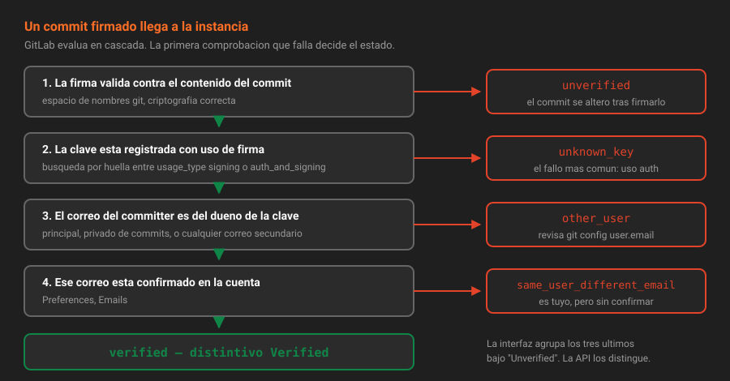

# Cómo verifica GitLab una firma

> Que Git diga `Good signature` no basta. GitLab hace tres comprobaciones más, y cada una tiene su propio estado de fallo. Saber cuál te ha tocado ahorra la tarde.

## 🎯 Objetivos

- Describir las cuatro comprobaciones que GitLab hace sobre una firma SSH
- Interpretar cada valor de `verification_status` y saber qué lo arregla
- Consultar la firma de un commit por la API v4
- Saber qué parte de esto es Free y con qué se sustituye lo que no lo es

---

## 1. Qué problema resuelve

Tu commit está firmado, `git verify-commit` dice que la firma es buena, lo empujas… y GitLab no muestra el distintivo **Verified**. O muestra **Unverified**.

No es un fallo de GitLab. Git y GitLab responden a preguntas distintas:

| | Pregunta que responde |
|---|---|
| **Git** | ¿La firma corresponde a este contenido y a esta clave? |
| **GitLab** | Además: ¿de quién es esa clave, y esa persona es la que dice el commit? |

Git verifica **matemáticas**. GitLab verifica **identidad dentro de la instancia**. Por eso hace falta registrar la clave, y por eso el correo importa.

---

## 2. Las cuatro comprobaciones, en orden

GitLab evalúa la firma SSH en cascada. La primera que falla decide el estado:

1. **¿La firma es criptográficamente válida** para el contenido del commit y con el espacio de nombres `git`? Si no: `unverified`.
2. **¿La clave que firmó está registrada en la instancia como clave de firma?** Se busca por huella SHA-256 entre las claves con uso `signing` o `auth_and_signing`. Si no aparece: `unknown_key`.
3. **¿El correo del committer pertenece al dueño de esa clave?** Se comparan el correo principal, el correo privado de commits y los correos secundarios. Si no coincide: `other_user`.
4. **¿Ese correo está confirmado?** Si el correo es suyo pero no está verificado: `same_user_different_email`.

Si pasa las cuatro: **`verified`**.



> [!IMPORTANT]
> El paso 2 es donde tropieza casi todo el mundo. Una clave SSH registrada **solo para autenticación** (`usage_type: auth`) no verifica firmas: GitLab ni siquiera la mira. Es la misma clave, el mismo archivo, y el resultado es `unknown_key`. El uso se elige **al registrar** la clave y no se puede cambiar después: hay que borrarla y volver a registrarla.

---

## 3. La tabla de estados

Estos son los valores que devuelve la API. Los seis primeros son los que puedes provocar con firma SSH:

| `verification_status` | Qué pasó | Cómo se arregla |
|---|---|---|
| `verified` | Todo correcto | — |
| `unverified` | La firma no valida contra el contenido, o falta algún dato | Vuelve a firmar el commit: `git commit --amend -S` |
| `unknown_key` | La clave no está registrada **con uso de firma** | Registra la clave con `usage_type=signing` |
| `other_user` | La clave es de otra persona de la instancia | El correo del commit y el dueño de la clave no son el mismo: revisa `git config user.email` |
| `same_user_different_email` | La clave es tuya, pero el correo del commit no está confirmado | Confirma ese correo en `Preferences → Emails`, o usa el principal |
| `verified_system` | Lo firmó la propia instancia (Web IDE, cambios desde la interfaz) | Es correcto: GitLab firma con su clave lo que se hace desde la interfaz |
| `multiple_signatures` | El commit trae más de una firma | Vuelve a firmarlo una sola vez |
| `revoked_key` | La clave fue revocada | Genera otra clave y refirma |
| `expired_key` | La clave caducó | Ídem, y registra la nueva |
| `unverified_key` / `unverified_author_email` | Estados de GPG y X.509 | No aplican a firma SSH |

> [!NOTE]
> `verified_system` merece un párrafo: cuando editas un archivo desde la interfaz web o desde el Web IDE, el commit lo construye el servidor y lo firma **GitLab** con su propia clave. Es una firma legítima, pero dice "esto lo hizo la instancia a petición de este usuario autenticado", no "esto lo firmó Ana con su clave". Para la mayoría de las políticas cuenta como firmado; para una cadena de suministro estricta, no es lo mismo.

---

## 4. Consultarlo por la API

El endpoint existe desde hace tiempo y es el que usa el autograding de esta semana:

```
GET /api/v4/projects/:id/repository/commits/:sha/signature
```

`:sha` admite también un nombre de rama o de tag, que es lo cómodo:

```bash
source ~/.bc-gitlab
P=plataforma-biblioteca%2Fapp

curl -s -H "PRIVATE-TOKEN: $GITLAB_TOKEN" \
  "$GITLAB_URL/api/v4/projects/$P/repository/commits/main/signature" | jq
```

```json
{
  "signature_type": "SSH",
  "verification_status": "verified",
  "key": {
    "id": 3,
    "title": "firma-bootcamp",
    "created_at": "2026-08-23T09:12:44.000Z",
    "expires_at": null,
    "usage_type": "signing"
  },
  "commit_source": "gitaly"
}
```

| Campo | Qué dice |
|---|---|
| `signature_type` | `SSH`, `PGP` o `X509` |
| `verification_status` | La tabla de la sección 3 |
| `key` | Solo en firmas SSH: la clave registrada que casó con la huella |
| `commit_source` | De dónde salió el commit. Siempre `gitaly` |

> [!IMPORTANT]
> **Un commit sin firma devuelve `404`, no un estado**. Es correcto según la documentación —*"For unsigned commits, it results in a 404 response"*— y hay que tenerlo en cuenta al escribir cualquier automatización: un 404 aquí significa "sin firmar", no "el commit no existe".

Auditar una rama entera es un bucle de dos líneas. Es lo que hace la práctica 04:

```bash
for sha in $(curl -s -H "PRIVATE-TOKEN: $GITLAB_TOKEN" \
    "$GITLAB_URL/api/v4/projects/$P/repository/commits?ref_name=main&per_page=100" | jq -r '.[].id'); do
  estado=$(curl -s -H "PRIVATE-TOKEN: $GITLAB_TOKEN" \
    "$GITLAB_URL/api/v4/projects/$P/repository/commits/$sha/signature" | jq -r '.verification_status // "sin-firma"')
  printf '%s %s\n' "${sha:0:8}" "$estado"
done
```

También está en GraphQL, útil cuando quieres la firma y otros campos del commit en una sola consulta:

```bash
curl -s -X POST "$GITLAB_URL/api/graphql" \
  -H "PRIVATE-TOKEN: $GITLAB_TOKEN" -H "Content-Type: application/json" \
  -d '{"query":"query($fullPath:ID!){ project(fullPath:$fullPath){ repository { tree(ref:\"main\"){ lastCommit { sha signature { verificationStatus } } } } } }",
       "variables":{"fullPath":"plataforma-biblioteca/app"}}' | jq
```

---

## 5. Dónde se ve en la interfaz

| Sitio | Qué muestra |
|---|---|
| Lista de commits | Un distintivo **Verified** / **Unverified** junto a cada uno |
| Un commit concreto | El distintivo, y al pulsarlo, la huella de la clave y el correo |
| `Preferences → SSH Keys` | Tus claves, con su uso (`Authentication`, `Signing`, o ambos) |
| `Admin → Users → SSH keys` | Las claves de cualquier usuario, para el administrador |

Un detalle que confunde: GitLab muestra **Unverified** tanto para `unknown_key` como para `other_user` y `same_user_different_email`. La interfaz no distingue; **la API sí**. Por eso, cuando el distintivo no sale y no sabes por qué, la respuesta está en el endpoint de la sección 4, no en la pantalla.

---

## 6. Obligar a que todo venga firmado: lo que cuesta y lo que no

Aquí aparece la primera feature de pago de verdad del bootcamp:

| Mecanismo | Tier | Qué hace |
|---|---|---|
| Push rule *Reject unsigned commits* | **Premium** | Rechaza en el servidor cualquier push con commits sin firmar |
| **Server hook `pre-receive`** | **Free** | Lo mismo, escrito por ti. Es lo que usa este bootcamp (Semana 07) |
| **Job de pipeline** | **Free** | Comprueba las firmas por API y falla el pipeline. Detecta, no bloquea. En `app` no hace falta: el hook de la Semana 07 ya rechaza lo que empuja una persona sin firmar |
| Distintivo *Verified* | **Free** | La verificación en sí, y su API, están en CE |

Comprobado en agosto de 2026: las *push rules* completas siguen siendo Premium. Que la **verificación** sea gratis y solo el **bloqueo automático** sea de pago es la forma habitual del reparto, y también la razón de que el server hook merezca la pena: son treinta líneas de bash y hacen exactamente lo mismo, en el mismo sitio del recorrido.

> [!NOTE]
> **Las ramas protegidas sí son Free** y son la otra mitad de la respuesta: sin poder empujar directo a `main`, todo pasa por una merge request, y ahí es donde el pipeline comprueba las firmas. Semanas 06 y 07.

---

## 7. Antipatrones

| Antipatrón | Por qué duele | Qué hacer en su lugar |
|---|---|---|
| Registrar la clave solo con uso `auth` | `unknown_key` en todos los commits, sin ninguna pista en la interfaz | `usage_type=signing` al registrarla |
| Cambiar `user.email` sin registrarlo en GitLab | `other_user` o `same_user_different_email` | El correo del commit tiene que ser uno confirmado de tu cuenta |
| Diagnosticar por el distintivo de la interfaz | Agrupa tres fallos distintos bajo "Unverified" | El endpoint `/signature` |
| Tratar el `404` como error del script | Es la respuesta normal a un commit sin firma | Interpretar 404 como "sin firmar" |
| Confiar solo en el hábito para firmar | Un despiste y entra un commit sin firma que nadie ve | Server hook (S07) |
| Dar por hecho que la verificación es de pago | Se acaba pagando Premium por algo que CE ya hace | Verificación y API son Free; solo la push rule es Premium |

---

## 8. Trucos

**Saber por qué un commit sale Unverified, en una línea:**

```bash
curl -s -H "PRIVATE-TOKEN: $GITLAB_TOKEN" \
  "$GITLAB_URL/api/v4/projects/$P/repository/commits/main/signature" \
  | jq -r '.verification_status'
```

**Ver el uso de todas tus claves, que es el fallo número uno:**

```bash
curl -s -H "PRIVATE-TOKEN: $GITLAB_TOKEN" "$GITLAB_URL/api/v4/user/keys" \
  | jq -r '.[] | "\(.usage_type)\t\(.title)"'
# auth	laboratorio-bootcamp
# signing	firma-bootcamp
```

**Comprobar qué correos tiene confirmados tu cuenta:**

```bash
curl -s -H "PRIVATE-TOKEN: $GITLAB_TOKEN" "$GITLAB_URL/api/v4/user/emails" | jq
```

**Registrar una clave de firma sin salir de la terminal:**

```bash
curl -s --request POST "$GITLAB_URL/api/v4/user/keys" \
  -H "PRIVATE-TOKEN: $GITLAB_TOKEN" \
  --data-urlencode "title=firma-bootcamp" \
  --data-urlencode "usage_type=signing" \
  --data-urlencode "key=$(cat ~/.ssh/id_ed25519_firma.pub)" | jq '{id, title, usage_type}'
```

---

## 📚 Recursos Adicionales

- [Commits firmados en GitLab](https://docs.gitlab.com/ee/user/project/repository/signed_commits/) — el índice de los tres formatos
- [API de commits — obtener la firma](https://docs.gitlab.com/ee/api/commits.html#get-signature-of-a-commit) — la respuesta completa por tipo de firma
- [API de usuarios — claves SSH](https://docs.gitlab.com/ee/api/user_keys.html) — `usage_type` y el resto de parámetros
- [Push rules](https://docs.gitlab.com/ee/user/project/repository/push_rules.html) — qué incluye exactamente la feature Premium
- [Server hooks](https://docs.gitlab.com/ee/administration/server_hooks.html) — el sustituto libre, que se monta en la Semana 07

---

## ✅ Checklist de Verificación

- [ ] Sabes enumerar las cuatro comprobaciones y qué estado produce cada fallo
- [ ] Has consultado `/repository/commits/main/signature` en tu instancia
- [ ] Tus claves salen con el `usage_type` correcto en `/user/keys`
- [ ] Sabes por qué un commit sin firma devuelve 404 en ese endpoint
- [ ] Sabes qué parte de "obligar a firmar" es Premium y con qué se sustituye

---

| Anterior | Siguiente |
|---|---|
| [← 06 — Firmar commits con SSH](06-firmar-commits-con-ssh.md) | [08 — Arqueología y cirugía de emergencia →](08-arqueologia-y-cirugia-de-emergencia.md) |

[← Volver a la Semana 02](../README.md)
