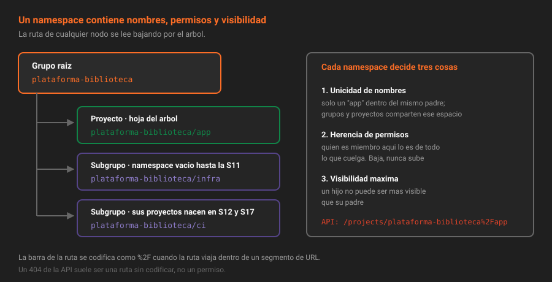

# Namespaces y rutas

> Todo lo que existe en GitLab vive dentro de un namespace, y su ruta completa es su identidad. Entenderlo evita el 90% de los 404 de la API.

## 🎯 Objetivos

- Explicar qué es un namespace y qué tipos hay
- Distinguir el **nombre** de un grupo de su **ruta**, y saber cuál usa la API
- Escribir la ruta de un proyecto como identificador válido en cualquier endpoint
- Comprobar si una ruta está libre antes de crear nada

---

## 1. Qué problema resuelve

Dos equipos de la misma empresa quieren un proyecto llamado `api`. En un sistema plano, el segundo pierde: el nombre está cogido. La solución de GitLab es que **ningún proyecto existe suelto**: cada uno cuelga de un contenedor de nombres —un *namespace*— y la unicidad se exige dentro de ese contenedor, no en toda la instancia.

Así conviven `plataforma-biblioteca/api` y `plataforma-cine/api` sin colisión. El precio es que a partir de ahora un proyecto ya no se identifica por su nombre, sino por **su ruta completa**, y eso cambia cómo se le habla a la API.

Un namespace no es una carpeta: es el punto donde se deciden tres cosas a la vez.

| Decide | Ejemplo |
|---|---|
| **Unicidad de nombres** | Dentro de `plataforma-biblioteca` solo puede haber un `app` |
| **Herencia de permisos** | Quien es Developer del namespace lo es de todo lo que cuelga |
| **Visibilidad máxima** | Un namespace privado no puede contener un proyecto público |

---

## 2. Cómo funciona

### 2.1 Los tres tipos de namespace

| Tipo | Qué es | Ejemplo de ruta |
|---|---|---|
| **Personal** (*user namespace*) | El espacio de tu usuario. Se crea contigo y no se puede compartir con roles | `tu-usuario/prueba` |
| **Grupo** (*group namespace*) | Un contenedor con miembros, roles y ajustes propios. Puede anidarse | `plataforma-biblioteca/app` |
| **De proyecto** (*project namespace*) | Namespace interno que GitLab crea por cada proyecto. No se ve en la interfaz | — |

El tercero es un detalle de implementación que aparece en la base de datos y en algunas respuestas de la API; no se administra.

> [!IMPORTANT]
> **Un proyecto en tu espacio personal no tiene miembros con roles de grupo.** No hay nadie a quien heredar permisos, no hay subgrupos y no se puede compartir con un grupo. Por eso la Semana 01 insistió en crear `app` dentro de un grupo: la alternativa habría sido rehacerlo esta semana.

### 2.1.1 El árbol de tu plataforma



El grupo raíz es un namespace. Cada subgrupo es otro namespace **dentro** del anterior. El proyecto es lo único que no puede contener nada: es siempre una hoja. Y la ruta de cualquier nodo se lee bajando por el árbol, separando con barras.

### 2.2 Nombre contra ruta

Son dos campos distintos y se confunden constantemente:

| Campo | Qué es | Ejemplo |
|---|---|---|
| `name` | La etiqueta que se ve en la interfaz. Admite espacios, mayúsculas y acentos | `Plataforma Biblioteca` |
| `path` | El segmento de URL. Minúsculas, sin espacios, sin acentos | `plataforma-biblioteca` |
| `full_path` | La ruta completa desde la raíz | `plataforma-biblioteca/ci` |
| `full_name` | Los nombres concatenados, para mostrar | `Plataforma Biblioteca / CI` |

**La API trabaja con `path` y `full_path`.** El `name` solo sirve para leerlo. Cambiar el nombre es cosmético; cambiar la ruta rompe URLs (teoría [07](07-mover-y-renombrar-sin-romper.md)).

### 2.3 El `%2F` que aparece en todas partes

La API v4 acepta como ID de un proyecto o de un grupo **su ID numérico o su ruta completa**. Pero la ruta lleva barras, y una barra dentro de un segmento de URL significa otra cosa, así que hay que codificarla: `/` se escribe `%2F`.

```bash
source ~/.bc-gitlab

# Por ID numérico: funciona, pero el ID no lo sabes de memoria.
curl -s -H "PRIVATE-TOKEN: $GITLAB_TOKEN" "$GITLAB_URL/api/v4/projects/2" | jq -r '.path_with_namespace'
# "plataforma-biblioteca/app"

# Por ruta: legible, y es la forma que usa el autograding.
curl -s -H "PRIVATE-TOKEN: $GITLAB_TOKEN" \
  "$GITLAB_URL/api/v4/projects/plataforma-biblioteca%2Fapp" | jq -r '.id'
# 2
```

Si te olvidas del `%2F` la API responde `404 Project Not Found`, porque está buscando un proyecto cuyo ID es `plataforma-biblioteca` dentro de una ruta que no existe. **Un 404 en la API casi siempre es una ruta mal codificada, no un permiso.** El caso de permisos también devuelve 404 —GitLab no confirma la existencia de lo que no puedes ver— y por eso conviene descartar primero el `%2F`.

Para no escribirlo a mano:

```bash
# jq codifica rutas sin sorpresas
RUTA=$(printf '%s' "$PROYECTO" | jq -sRr @uri)
echo "$RUTA"
# plataforma-biblioteca%2Fapp
```

### 2.4 El endpoint de namespaces

`/namespaces` mezcla grupos y espacios personales, que es justo lo que quieres cuando la pregunta es "¿qué contenedores veo?".

```bash
curl -s -H "PRIVATE-TOKEN: $GITLAB_TOKEN" "$GITLAB_URL/api/v4/namespaces" \
  | jq -r '.[] | "\(.kind)\t\(.full_path)"'
# group	plataforma-biblioteca
# user	root
```

El campo `kind` vale `group` o `user`. Con `full_path_search=true` la búsqueda se hace contra la ruta completa en vez de contra el nombre, que es lo que quieres cuando buscas `plataforma-biblioteca/ci` y no `ci`.

### 2.5 Dónde aparece la ruta, además de en la URL

Cambiar una ruta parece un detalle de estética hasta que se ve la lista de sitios donde está incrustada. Con `plataforma-biblioteca/app`:

| Dónde | Qué queda escrito |
|---|---|
| Remoto de Git | `git@localhost:plataforma-biblioteca/app.git` |
| Clonado por HTTP | `http://localhost:8888/plataforma-biblioteca/app.git` |
| Imagen del registry (S13) | `localhost:5050/plataforma-biblioteca/app:1.0.0` |
| Paquete del registry (S13) | `.../api/v4/projects/plataforma-biblioteca%2Fapp/packages/...` |
| Insignia de pipeline (S04) | `.../plataforma-biblioteca/app/badges/main/pipeline.svg` |
| GitLab Pages (S14) | `http://plataforma-biblioteca.pages.localhost/app/` |
| Componente CI/CD (S12) | `include: component: localhost:8888/plataforma-biblioteca/ci/componentes/test@1.0.0` |
| Tu `~/.bc-gitlab` | `PROYECTO=plataforma-biblioteca/app` |

Ninguna de esas referencias se actualiza sola en el sitio donde la escribiste. Algunas siguen funcionando por redirección —la teoría [07](07-mover-y-renombrar-sin-romper.md) dice cuáles—, pero la referencia escrita se queda apuntando al pasado.

La conclusión práctica es incómoda y útil: **la ruta se decide una vez, al crear, pensando en cómo se leerá dentro de seis meses**. Es la parte más barata de acertar y la más cara de corregir.

---

## 3. Cómo se comprueba una ruta antes de usarla

Crear un grupo cuya ruta ya existe devuelve `400 Bad Request` con `"path": ["has already been taken"]`. Antes de crear —sobre todo desde un script— pregunta:

**Con la API**:

```bash
# ¿Está libre "infra" dentro del grupo cuyo ID es 5?
curl -s -H "PRIVATE-TOKEN: $GITLAB_TOKEN" \
  "$GITLAB_URL/api/v4/namespaces/infra/exists?parent_id=5" | jq
```

```json
{ "exists": false, "suggests": [] }
```

Sin `parent_id` la pregunta es sobre rutas de primer nivel. Cuando `exists` es `true`, `suggests` trae alternativas (`infra1`, `infra2`…) que conviene ignorar: un nombre con número es una decisión tomada por cansancio.

**Con la interfaz**: el formulario de creación valida la ruta en cuanto sales del campo, con el mismo endpoint por debajo.

> [!NOTE]
> Las rutas de grupo y de proyecto comparten el mismo espacio de nombres dentro de un padre. Si tienes el proyecto `plataforma-biblioteca/ci`, **no puedes** crear el subgrupo `plataforma-biblioteca/ci`. Es el error que se descubre a mitad de la práctica 01 si en la Semana 01 se creó un proyecto con uno de estos nombres.

---

### 3.1 Rutas reservadas

GitLab se reserva una lista de palabras para sus propias URLs. Intentar usarlas devuelve un error de validación que parece arbitrario si no sabes de dónde viene.

```bash
curl -s --request POST "$GITLAB_URL/api/v4/groups" \
  -H "PRIVATE-TOKEN: $GITLAB_TOKEN" \
  --data-urlencode "name=Admin" --data-urlencode "path=admin" | jq -r '.message'
```

```json
{ "path": ["admin is a reserved name"] }
```

Están reservadas en la raíz palabras como `admin`, `api`, `groups`, `projects`, `users`, `help`, `dashboard`, `explore`, `-` y unas cuantas más; y dentro de un grupo, las que chocan con las rutas de la propia interfaz. La lista completa está en la [documentación de nombres reservados](https://docs.gitlab.com/ee/user/reserved_names.html), y cambia entre versiones: la regla operativa es no usar nunca como ruta una palabra que también podría ser una sección de GitLab.

El prefijo `-` que ves en URLs como `/groups/plataforma-biblioteca/-/group_members` existe justo por esto: separa la ruta del namespace de la ruta de la interfaz, para que un grupo llamado `settings` no tape la página de ajustes.

## 4. Antipatrones

| Antipatrón | Por qué duele | Qué hacer en su lugar |
|---|---|---|
| Guardar IDs numéricos en scripts y documentación | El ID no dice nada al leerlo y no sobrevive a una reinstalación del laboratorio | Guarda la ruta; resuelve el ID en el momento si hace falta |
| Rutas con mayúsculas o acentos "porque queda mejor" | La ruta acaba en URLs, remotos de Git, imágenes de contenedor y rutas de paquetes | El `name` lleva la estética; el `path` es kebab-case y ASCII |
| Un proyecto en el espacio personal "de momento" | No hay roles que heredar ni grupo que compartir; moverlo después cambia todas las URLs | Nace dentro del grupo desde el primer commit |
| Rutas genéricas: `app`, `infra`, `test` en la raíz de la instancia | Se agotan enseguida y no dicen de quién son | Lo genérico va **dentro** de un namespace que lo cualifica |
| Codificar la ruta a mano y a medias (`plataforma%2Fapp/sub`) | El 404 resultante parece un problema de permisos y se depura en la dirección equivocada | Codifica con `jq -sRr @uri` |

---

## 5. Trucos

- **Ver el árbol completo de una vez**: `GET /groups/:id/descendant_groups` devuelve todos los descendientes, a cualquier profundidad, no solo los hijos directos.
- **`?top_level_only=true`** en `/groups` responde a "¿cuántas organizaciones hay de verdad en esta instancia?" sin el ruido de los subgrupos.
- **El ID de un grupo, sin buscarlo en la interfaz**: `curl ... "/api/v4/groups/$(printf '%s' "$RUTA" | jq -sRr @uri)" | jq .id`.
- **La ruta va en las cabeceras de paginación**: cuando una respuesta trae `X-Total: 200`, la lista está paginada y `jq length` te está mintiendo. Añade `?per_page=100` y mira `X-Next-Page`.

---

## 📚 Recursos Adicionales

- [Namespaces](https://docs.gitlab.com/ee/user/namespace/) — la referencia de los dos tipos administrables
- [API de namespaces](https://docs.gitlab.com/ee/api/namespaces.html) — incluye `exists` y `full_path_search`
- [Rutas reservadas](https://docs.gitlab.com/ee/user/reserved_names.html) — los nombres que GitLab no te dejará usar, y por qué

---

## ✅ Checklist de Verificación

- [ ] Sabes decir la ruta completa de tu proyecto `app` sin mirar la interfaz
- [ ] Has consultado tu proyecto por ruta codificada y te ha devuelto el mismo `id` que por número
- [ ] Sabes qué campo cambia la URL (`path`) y cuál no (`name`)
- [ ] Has comprobado con `namespaces/:id/exists` que `infra` y `ci` están libres dentro de tu grupo

---

[← Volver a la Semana 03](../README.md) · [Siguiente: Grupos y subgrupos →](02-grupos-y-subgrupos.md)
