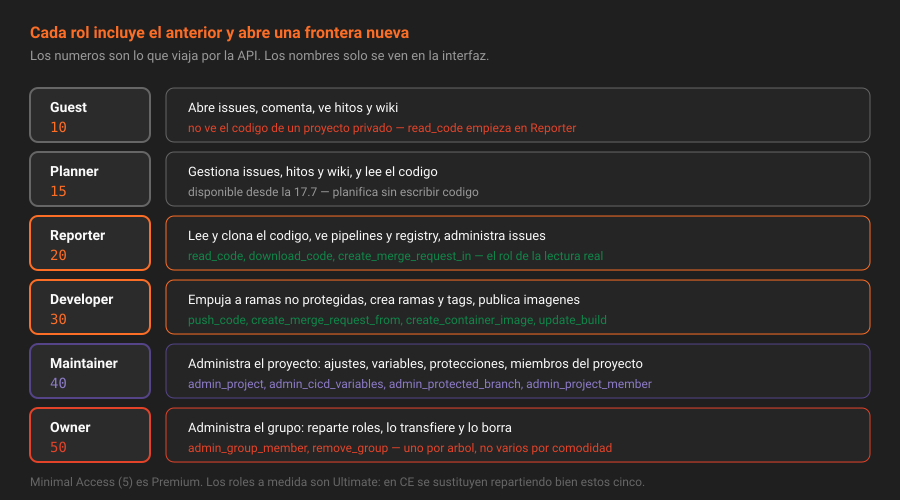

# Los roles y qué puede cada uno

> Cinco roles cubren el 99% de los casos. Lo que separa a quien los reparte bien de quien los reparte por miedo es saber dónde está exactamente la frontera de cada uno.

## 🎯 Objetivos

- Enumerar los niveles de acceso de GitLab y su valor numérico en la API
- Decir qué desbloquea cada rol respecto del anterior, con permisos concretos
- Consultar en tu propia instancia la lista exacta de permisos de un rol
- Distinguir lo que es Free de lo que es Premium o Ultimate, y con qué se sustituye

---

## 1. Qué problema resuelve

"Dale acceso" no es una instrucción: es una pregunta sin responder. ¿Acceso a leer el código? ¿A empujar? ¿A cambiar los ajustes del proyecto? ¿A borrarlo?

GitLab responde con una escala fija de niveles numéricos. Cada nivel incluye todo lo del anterior y añade lo suyo, y la API habla siempre en números, no en nombres.



---

## 2. Cómo funciona

### 2.1 La escala completa

| Valor | Rol | Disponible en | Para qué sirve |
|:--:|---|---|---|
| `0` | **None** | CE | No es un rol asignable: es lo que queda cuando se comparte un proyecto con el compartir desactivado |
| `5` | **Minimal Access** | Premium | Miembro del grupo raíz sin acceso a nada de dentro. Existe para las integraciones con directorios corporativos |
| `10` | **Guest** | CE | Ve el proyecto y participa en issues. **No ve el código de un proyecto privado** |
| `15` | **Planner** | CE (desde 17.7) | Gestiona issues, hitos y wiki. Ve el código, pero no lo escribe |
| `20` | **Reporter** | CE | Lee el código, los pipelines y el registry. No empuja nada |
| `25` | **Security Manager** | Ver nota | Rol nuevo, orientado a las features de seguridad de los tiers de pago |
| `30` | **Developer** | CE | Empuja código, abre merge requests, ejecuta y cancela pipelines |
| `40` | **Maintainer** | CE | Administra el proyecto: ajustes, variables, protecciones, miembros |
| `50` | **Owner** | CE | Administra el grupo: lo borra, lo transfiere y reparte los demás roles |

> [!NOTE]
> El nivel 25 aparece en el enumerado de la versión 19.2 y se puede desactivar con la variable de entorno `GITLAB_SECURITY_MANAGER_ROLE`. Gobierna features de seguridad que en CE no existen, así que en este laboratorio no se usa: se menciona para que no te sorprenda al leer una respuesta de la API.

**Los números son la interfaz real.** `access_level=30` es lo que se envía y lo que se lee; el nombre es cosmético y se traduce en la interfaz. Si trabajas con la API una semana, acabas pensando en números, y conviene: `10, 20, 30, 40, 50` se memorizan en un minuto y aparecen en cada comprobación del autograding.

### 2.2 Dónde está la frontera de cada rol

La tabla siguiente no es una lista de todo lo que puede cada rol —son cientos de permisos—, sino de **lo primero que desbloquea**, que es lo que decide qué rol dar.

| Permiso interno | Aparece en | Qué significa en la práctica |
|---|---|---|
| `create_issue`, `create_note` | **Guest** | Abrir issues y comentar |
| `read_code`, `download_code` | **Reporter** (y Planner) | Clonar el repositorio de un proyecto privado |
| `admin_issue`, `admin_milestone` | **Reporter** (y Planner) | Cerrar, etiquetar y reasignar el trabajo ajeno |
| `create_merge_request_in` | **Reporter** | Abrir una merge request desde una rama **que ya existe** |
| `read_container_image` | **Reporter** | Descargar imágenes del registry del proyecto (S13) |
| `push_code` | **Developer** | Empujar a una rama no protegida |
| `create_merge_request_from` | **Developer** | Crear la rama y abrir la merge request desde ella |
| `create_container_image` | **Developer** | Publicar imágenes en el registry (S13) |
| `update_build`, `cancel_build` | **Developer** | Reintentar y cancelar jobs (S09) |
| `admin_tag` | **Developer** | Crear y borrar tags no protegidos (los `v*` están protegidos desde la S07 y los crea un Maintainer) |
| `create_projects` | **Developer** | Crear proyectos en el grupo, **si el grupo lo permite** (teoría 02) |
| `admin_project` | **Maintainer** | Cambiar los ajustes del proyecto |
| `admin_protected_branch` | **Maintainer** | Proteger ramas y decidir quién empuja (S07) |
| `admin_cicd_variables` | **Maintainer** | Ver y editar las variables de CI/CD (S10) |
| `admin_project_member` | **Maintainer** | Añadir y quitar miembros **del proyecto** |
| `admin_environment` | **Maintainer** | Crear y detener entornos (S14) |
| `transfer_projects` | **Maintainer** | Mover el proyecto a otro namespace |
| `admin_group_member` | **Owner** | Añadir y quitar miembros **del grupo** |
| `remove_group`, `remove_project` | **Owner** | Borrar el grupo o el proyecto |

Dos fronteras se olvidan siempre y las dos causan incidentes:

1. **Guest no ve el código de un proyecto privado.** Ve el proyecto, los issues y las wikis, pero `read_code` empieza en Reporter. Quien pide "acceso de solo lectura al repositorio" está pidiendo Reporter, no Guest.
2. **Maintainer administra el proyecto; Owner administra el grupo.** Un Maintainer de proyecto no puede añadir a nadie al grupo, y un Owner de grupo lo puede todo en todos sus proyectos. Dar Owner "para que pueda invitar a alguien" es dar también borrar el grupo entero.

Y una que sorprende: **Reporter puede abrir merge requests**, pero solo desde ramas que ya existen (`create_merge_request_in`). Empujar la rama requiere Developer. Es la combinación que permite que alguien externo revise y proponga sin poder escribir en el repositorio.

### 2.3 La lista exacta, en tu versión

La documentación de permisos es larga y va por detrás del código. En una instancia autohospedada tienes la fuente original: GitLab declara los permisos de cada rol en archivos YAML dentro del contenedor.

```bash
docker compose exec gitlab \
  ls /opt/gitlab/embedded/service/gitlab-rails/config/authz/roles/
```

```
admin.yml   developer.yml  guest.yml     maintainer.yml  owner.yml
auditor.yml planner.yml    reporter.yml  minimal_access.yml  ...
```

Cada archivo lista **lo que ese rol añade**, no lo que acumula. Por eso `owner.yml` es más corto que `maintainer.yml`: el Owner hereda todo lo del Maintainer y suma lo suyo.

Cada archivo lo dice de sí mismo en su cabecera:

```bash
docker compose exec gitlab head -6 \
  /opt/gitlab/embedded/service/gitlab-rails/config/authz/roles/developer.yml
```

```yaml
---
name: developer
description: Push code to non-protected branches, create merge requests, and run CI/CD
  pipelines. Cannot manage project settings.
inherits_from:
- reporter
```

Para comparar dos roles hay que quedarse con las líneas de permiso y ordenarlas: los archivos empiezan por esa cabecera y `comm` exige entrada ordenada.

```bash
# ¿Qué añade exactamente Developer respecto de Reporter?
docker compose exec gitlab bash -c 'cd /opt/gitlab/embedded/service/gitlab-rails/config/authz/roles &&
  comm -13 <(grep "^  - " reporter.yml | sort -u) <(grep "^  - " developer.yml | sort -u)' \
  | grep -E 'push_code$|create_projects|create_container_image|create_merge_request_from|update_build'
```

```
  - build_push_code
  - create_container_image
  - create_merge_request_from
  - create_projects
  - push_code
  - update_build
```

Sin el filtro salen unas cuantas decenas de líneas, muchas con nombres de features que en CE no existen: los archivos describen el modelo de permisos completo del producto, y CE simplemente no expone parte de él.

```bash
# ¿Este permiso, en qué rol aparece?
docker compose exec gitlab bash -c \
  'cd /opt/gitlab/embedded/service/gitlab-rails/config/authz/roles && grep -l "^  - push_code$" *.yml'
```

```
dependency_management_service_account.yml
developer.yml
```

El segundo archivo no es un rol que puedas asignar: es una identidad interna de servicio. Los roles asignables son los seis con nombre de persona (`guest`, `planner`, `reporter`, `developer`, `maintainer`, `owner`); el resto —`admin`, `auditor`, `security_manager`, `public_anonymous`— describen situaciones, no invitaciones.

Es la respuesta más rápida y más fiable a "¿puede un Reporter hacer X?" en **tu** versión, sin selector de versión ni suposiciones. La práctica 03 hace la comprobación por el otro extremo: con un token real y un código HTTP.

### 2.4 Roles de grupo y roles de proyecto

El mismo número significa cosas distintas según dónde se dé:

| Se da en | Alcanza a | Ejemplo |
|---|---|---|
| **Grupo** | El grupo, sus subgrupos y todos sus proyectos, presentes y futuros | Developer en `plataforma-biblioteca` es Developer en `app` y en lo que nazca |
| **Proyecto** | Solo ese proyecto | Maintainer en `app` no da nada sobre `ci/componentes` |

De ahí la regla de reparto de este bootcamp: **el acceso general va en el grupo, la excepción va en el proyecto**. Y la excepción se documenta, porque un rol directo en un proyecto es invisible desde la página de miembros del grupo.

---

## 3. Cómo se asigna

**Con la interfaz**: `Grupo → Manage → Members → Invite members`, elegir usuario, rol y, si procede, fecha de caducidad.

**Con la API**:

```bash
curl -s --request POST "$GITLAB_URL/api/v4/groups/$GID/members" \
  -H "PRIVATE-TOKEN: $GITLAB_TOKEN" \
  --data-urlencode "user_id=7" \
  --data-urlencode "access_level=30" \
  | jq '{username: .username, access_level, expires_at}'
```

Cambiar un rol es un `PUT` sobre el mismo recurso; quitarlo, un `DELETE`:

```bash
curl -s --request PUT "$GITLAB_URL/api/v4/groups/$GID/members/7" \
  -H "PRIVATE-TOKEN: $GITLAB_TOKEN" --data-urlencode "access_level=20" | jq '.access_level'

curl -s --request DELETE "$GITLAB_URL/api/v4/groups/$GID/members/7" -H "PRIVATE-TOKEN: $GITLAB_TOKEN"
```

> [!IMPORTANT]
> No puedes dar un rol más alto que el tuyo. Un Maintainer que intenta nombrar a alguien Owner recibe `403 Forbidden`, y el mensaje no siempre lo explica. Si un `POST /members` falla con 403 y el token parece correcto, mira qué rol tiene **quien** hace la llamada.

---

## 4. Antipatrones

| Antipatrón | Por qué duele | Qué hacer en su lugar |
|---|---|---|
| Dar Maintainer "para que no moleste" | Incluye variables de CI/CD, protecciones de rama y borrar miembros | Developer, y una elevación puntual documentada cuando haga falta |
| Varios Owners "por si acaso" | Cada Owner puede borrar el grupo y quitar a los demás. Diluye la responsabilidad | Un Owner, y un segundo solo con procedimiento de relevo escrito |
| Guest para "solo lectura del código" | Guest no ve el código: la persona pide ayuda y alguien acaba subiéndole a Developer | Reporter |
| Roles directos en cada proyecto | La página de miembros del grupo deja de contar la verdad | El acceso general en el grupo; la excepción, documentada |
| Repartir roles por cargo en la empresa | El jefe de área no necesita `push_code` y acaba teniéndolo | Repartir por lo que la persona **hace** en el repositorio esta semana |
| Suponer permisos en vez de comprobarlos | La documentación va por detrás de la versión que corres | `config/authz/roles/*.yml` y un token de prueba |

---

## 5. Trucos

- **De número a nombre, sin tabla**: `10 Guest · 15 Planner · 20 Reporter · 30 Developer · 40 Maintainer · 50 Owner`. Los saltos de diez dejan hueco para los roles que GitLab va intercalando.
- **Dónde soy al menos Developer**: `GET /groups?min_access_level=30` y `GET /projects?min_access_level=30`.
- **Rol efectivo de alguien aquí**: `GET /projects/:id/members/all/:user_id` devuelve el máximo entre lo directo y lo heredado; `members/:user_id` solo mira lo directo y devuelve 404 si el rol viene de arriba.
- **Contar Owners del árbol**: `GET /groups/:id/members/all | jq '[.[]|select(.access_level==50)]|length'`. Si sale más de uno, hay una conversación pendiente.
- **Qué añade un rol, sin leer documentación**: `comm -13 reporter.yml developer.yml` dentro de `config/authz/roles/`.

---

## 📚 Recursos Adicionales

- [Permisos y roles](https://docs.gitlab.com/ee/user/permissions.html) — la tabla oficial, con el tier de cada fila
- [API de miembros](https://docs.gitlab.com/ee/api/members.html) — `members`, `members/all` y los parámetros de invitación
- [Roles personalizados](https://docs.gitlab.com/ee/user/custom_roles.html) — qué resuelven y por qué son Ultimate

---

## ✅ Checklist de Verificación

- [ ] Puedes decir de memoria los cinco números de rol que usa la API
- [ ] Sabes desde qué rol se puede clonar un repositorio privado
- [ ] Sabes qué rol añade miembros al grupo y cuál solo al proyecto
- [ ] Has ejecutado `comm -13 reporter.yml developer.yml` en tu instancia y has leído la diferencia

---

[← Anterior: Grupos y subgrupos](02-grupos-y-subgrupos.md) · [Volver a la Semana 03](../README.md) · [Siguiente: Herencia de membresía →](04-herencia-de-membresia.md)
