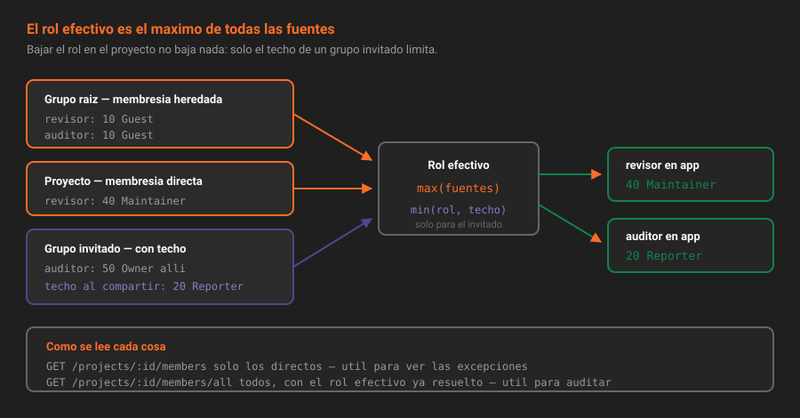

# Herencia de membresía

> Casi nadie es miembro de un proyecto: la mayoría lo son de un grupo, tres niveles más arriba. Saber leer eso es la diferencia entre auditar accesos y adivinarlos.

## 🎯 Objetivos

- Distinguir membresía directa, heredada y por grupo invitado
- Predecir el rol efectivo de una persona en un proyecto concreto
- Usar `members` y `members/all` sabiendo qué responde cada uno
- Poner caducidad a una membresía y saber qué ocurre cuando llega
- Gestionar solicitudes de acceso sin abrir el grupo entero

---

## 1. Qué problema resuelve

Alguien pregunta: *"¿por qué Ana puede empujar a `app`?"*. Abres los miembros del proyecto y Ana no está. Y sin embargo puede.

La respuesta está en que un proyecto reúne accesos de **cuatro sitios distintos**, y solo uno de ellos se ve en su página de miembros:

1. Membresía **directa** en el proyecto
2. Membresía **heredada** de cualquier grupo antepasado
3. Membresía a través de un **grupo invitado** al proyecto (teoría [05](05-compartir-grupos-y-proyectos.md))
4. Membresía a través de un **grupo invitado a un grupo antepasado**

Saber sumar esas cuatro fuentes es lo que hace posible responder la pregunta con datos en lugar de con teorías.



---

## 2. Cómo funciona

### 2.1 Gana el rol más alto, nunca el más cercano

Cuando una persona recibe acceso por varias vías, **el rol efectivo es el mayor de todos**. No manda el más específico ni el más reciente: manda el más alto.

| Rol en el grupo raíz | Rol directo en `app` | Rol efectivo en `app` |
|---|---|---|
| Developer (30) | — | Developer (30) |
| Guest (10) | Maintainer (40) | **Maintainer (40)** |
| Maintainer (40) | Guest (10) | **Maintainer (40)** |
| — | Reporter (20) | Reporter (20) |

La tercera fila es la que rompe expectativas: **bajar el rol en el proyecto no baja nada**. Si alguien es Maintainer del grupo y quieres que en un proyecto concreto solo lea, la única solución es quitarle el Maintainer del grupo. Por eso la teoría [08](08-disenar-el-arbol-con-menor-privilegio.md) insiste en que la raíz del árbol es el sitio donde menos se reparte.

> [!NOTE]
> Hay una excepción y llega en la [teoría 05](05-compartir-grupos-y-proyectos.md): el acceso que llega por un **grupo invitado** sí tiene techo, el que se fijó al compartir. Es el único mecanismo de CE que limita hacia abajo, y por eso los grupos invitados son la herramienta correcta para el acceso externo.

### 2.2 `members` contra `members/all`

Dos endpoints que se parecen y responden preguntas distintas:

| Endpoint | Devuelve | La pregunta que responde |
|---|---|---|
| `GET /groups/:id/members` | Solo los **directos** | "¿A quién invité **aquí**?" |
| `GET /groups/:id/members/all` | Directos **+ heredados + de grupos invitados** | "¿Quién tiene acceso a esto, venga de donde venga?" |
| `GET /projects/:id/members` | Solo los directos del proyecto | "¿Qué excepciones tiene este proyecto?" |
| `GET /projects/:id/members/all` | Todo lo que alcanza al proyecto | "¿Quién puede tocar esto?" |

```bash
source ~/.bc-gitlab
P=$(printf '%s' "$PROYECTO" | jq -sRr @uri)

# Los directos del proyecto: normalmente pocos, y son las excepciones
curl -s -H "PRIVATE-TOKEN: $GITLAB_TOKEN" "$GITLAB_URL/api/v4/projects/$P/members" \
  | jq -r '.[] | "\(.access_level)\t\(.username)"'
# 40	revisor-biblioteca

# Todos los que alcanzan al proyecto
curl -s -H "PRIVATE-TOKEN: $GITLAB_TOKEN" "$GITLAB_URL/api/v4/projects/$P/members/all" \
  | jq -r '.[] | "\(.access_level)\t\(.username)"'
# 50	root
# 40	revisor-biblioteca
# 30	dev-biblioteca
# 10	auditor-biblioteca
```

**`members/all` ya devuelve el máximo**: si alguien tiene dos accesos, aparece una vez y con el rol efectivo. Es lo que convierte una auditoría en una consulta, y es lo que comprueba el autograding de esta semana.

Para una sola persona:

```bash
# El rol efectivo de un usuario concreto, herencia incluida
curl -s -H "PRIVATE-TOKEN: $GITLAB_TOKEN" "$GITLAB_URL/api/v4/projects/$P/members/all/7" | jq '{username, access_level}'
```

Si preguntas por `members/7` a secas y el acceso venía heredado, la respuesta es `404`. No significa que no tenga acceso: significa que no es miembro **directo**. Es el 404 que más veces se interpreta al revés.

### 2.3 De dónde viene un acceso

`members/all` dice **quién** y con **qué rol**, pero no **por qué**. Para el porqué hay dos caminos:

```bash
# 1. Todo lo que toca una persona en la instancia (solo administradores)
curl -s -H "PRIVATE-TOKEN: $GITLAB_TOKEN" "$GITLAB_URL/api/v4/users/7/memberships" \
  | jq -r '.[] | "\(.source_type)\t\(.access_level)\t\(.source_name)"'
# Namespace	30	Plataforma Biblioteca
```

```bash
# 2. Comparar directos contra efectivos: lo que sobra en el segundo, es herencia
comm -13 \
  <(curl -s -H "PRIVATE-TOKEN: $GITLAB_TOKEN" "$GITLAB_URL/api/v4/projects/$P/members"     | jq -r '.[].username' | sort) \
  <(curl -s -H "PRIVATE-TOKEN: $GITLAB_TOKEN" "$GITLAB_URL/api/v4/projects/$P/members/all" | jq -r '.[].username' | sort)
```

**Con la interfaz**: `Proyecto → Manage → Members` tiene un filtro *Membership* con los valores *Direct* e *Inherited*, y la columna *Source* enlaza al grupo del que viene el acceso. Es la vista más rápida cuando alguien pregunta en persona.

### 2.4 Caducidad de la membresía

Toda membresía admite `expires_at`. El día indicado, GitLab **elimina la membresía**; no la degrada ni la suspende.

```bash
curl -s --request POST "$GITLAB_URL/api/v4/groups/$GID/members" \
  -H "PRIVATE-TOKEN: $GITLAB_TOKEN" \
  --data-urlencode "user_id=9" \
  --data-urlencode "access_level=10" \
  --data-urlencode "expires_at=2026-12-31" \
  | jq '{username, access_level, expires_at}'
```

```json
{ "username": "auditor-biblioteca", "access_level": 10, "expires_at": "2026-12-31" }
```

Detalles que evitan sorpresas:

- La fecha es **día completo**, formato `YYYY-MM-DD`. No hay hora.
- La expiración la ejecuta una tarea periódica de Sidekiq: puede tardar minutos en aplicarse tras la medianoche del servidor.
- Al caducar, el usuario **pierde el acceso pero no lo que hizo**: sus commits, issues y merge requests siguen ahí y siguen siendo suyos.
- Para renovar, `PUT` sobre la membresía con una fecha nueva; para volverla permanente, `expires_at=` vacío.

Es la herramienta que convierte "le doy acceso mientras dure el proyecto" en algo que se cumple aunque nadie se acuerde. Cualquier acceso concedido a alguien externo debería llevarla.

### 2.5 Solicitudes de acceso

Si `request_access_enabled` está activo, quien vea el grupo puede pedir entrar, y la solicitud espera aprobación.

```bash
# Ver quién ha pedido acceso
curl -s -H "PRIVATE-TOKEN: $GITLAB_TOKEN" "$GITLAB_URL/api/v4/groups/$GID/access_requests" | jq -r '.[].username'

# Aprobar con un rol concreto. Sin access_level, el valor por defecto es 30 (Developer)
curl -s --request PUT "$GITLAB_URL/api/v4/groups/$GID/access_requests/9/approve" \
  -H "PRIVATE-TOKEN: $GITLAB_TOKEN" --data-urlencode "access_level=20" | jq '{username, access_level}'

# Denegar
curl -s --request DELETE "$GITLAB_URL/api/v4/groups/$GID/access_requests/9" -H "PRIVATE-TOKEN: $GITLAB_TOKEN"
```

> [!WARNING]
> **El valor por defecto de `access_level` al aprobar es `30`, Developer.** Aprobar una solicitud sin pensar no da el acceso mínimo: da permiso para empujar código. Es el comportamiento documentado del endpoint en 19.2, y la razón por la que aprobar solicitudes desde un script sin indicar rol es un agujero silencioso.

Y una solicitud aprobada **no** lleva caducidad: si el acceso era temporal, hay que ponérsela después con un `PUT` sobre la membresía.

---

## 3. Cómo se decide dónde poner una membresía

La pregunta operativa, cada vez que alguien necesita acceso, tiene tres respuestas posibles:

| Situación | Dónde va la membresía | Por qué |
|---|---|---|
| Trabaja en todo lo de la plataforma | Grupo raíz | Una operación, y cubre lo que nazca mañana |
| Trabaja solo en un área | Subgrupo | El resto del árbol le queda invisible |
| Necesita más rol en un proyecto concreto | Proyecto, como excepción documentada | Es la única forma de subir sin subir en todo |
| Es alguien externo, por tiempo limitado | Grupo invitado con caducidad (teoría 05) | Tiene techo y fecha de fin |

Y una que no está en la tabla porque no es una respuesta: dar el rol en el grupo raíz "para no complicarse" cuando la persona solo necesita un proyecto. Es cómodo hoy y es lo que hace imposible la auditoría de la práctica 04.

---

## 4. Antipatrones

| Antipatrón | Por qué duele | Qué hacer en su lugar |
|---|---|---|
| Auditar con `members` a secas | Deja fuera a todos los heredados, que suelen ser la mayoría | `members/all`, siempre, para auditar |
| Intentar "bajar" un rol en el subgrupo | No existe: el rol efectivo es el máximo | Quitarlo arriba y darlo donde toque |
| Interpretar el 404 de `members/:id` como "no tiene acceso" | La respuesta solo dice que no es miembro directo | `members/all/:id` |
| Acceso externo sin `expires_at` | Sigue vivo años después de que el contrato acabara | Fecha de fin en toda invitación externa |
| Aprobar solicitudes sin `access_level` | Entran como Guest y vuelven a pedirlo en dos días | Aprobar con el rol que se pretendía dar |
| Dejar `request_access_enabled` en un grupo con datos sensibles | Convierte cada visitante en una notificación que alguien acabará aprobando por inercia | Desactivarlo y dar acceso por invitación |

---

## 5. Trucos

- **Quién tiene acceso y por qué, en una línea**: `GET /projects/:id/members/all | jq -r '.[] | "\(.access_level)\t\(.username)"' | sort -rn`.
- **Membresías que caducan pronto**: `GET /groups/:id/members | jq -r '.[] | select(.expires_at) | "\(.expires_at)\t\(.username)"' | sort`.
- **Buscar un miembro sin saber su ID**: `GET /groups/:id/members?query=revisor`.
- **La vista de la interfaz que más ahorra**: `Members` → filtro *Membership: Inherited* → columna *Source*.
- **Todo lo que toca una persona antes de darla de baja**: `GET /users/:id/memberships` (solo administradores). Es el paso previo obligatorio de cualquier salida.

---

## 📚 Recursos Adicionales

- [Miembros de un grupo](https://docs.gitlab.com/ee/user/group/manage.html#members) — herencia y filtros en la interfaz
- [API de miembros](https://docs.gitlab.com/ee/api/members.html) — `members/all`, `expires_at` y los códigos de error
- [API de solicitudes de acceso](https://docs.gitlab.com/ee/api/access_requests.html) — aprobar, denegar y con qué rol

---

## ✅ Checklist de Verificación

- [ ] Sabes qué rol efectivo tiene alguien que es Guest en el grupo y Maintainer en el proyecto
- [ ] Has comparado la salida de `members` y `members/all` en tu proyecto
- [ ] Sabes qué devuelve `members/:user_id` cuando el acceso es heredado
- [ ] Has puesto una membresía con `expires_at` y la ves en la respuesta de la API

---

[← Anterior: Los roles](03-los-roles-y-que-puede-cada-uno.md) · [Volver a la Semana 03](../README.md) · [Siguiente: Compartir grupos y proyectos →](05-compartir-grupos-y-proyectos.md)
