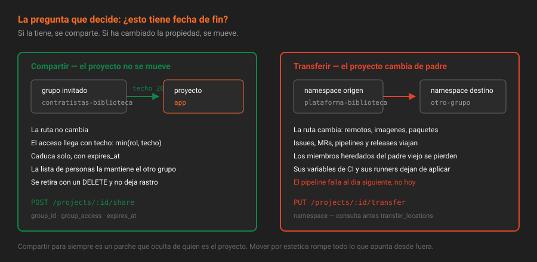

# Compartir grupos y proyectos

> Invitar a un grupo entero es la única forma que tiene CE de dar acceso **con techo**. Es la herramienta correcta para todo lo que sea temporal o externo.

## 🎯 Objetivos

- Compartir un proyecto con un grupo y un grupo con otro grupo
- Calcular el acceso resultante sin abrir la interfaz
- Elegir entre compartir, invitar persona a persona, o mover el proyecto
- Cortar el reparto con `share_with_group_lock` y retirar lo compartido

---

## 1. Qué problema resuelve

Llega una auditoría externa de tres semanas: cuatro personas necesitan leer `app` y nada más.

Con membresías individuales son cuatro altas, cuatro fechas de caducidad que vigilar y cuatro bajas. Y cuando el año que viene vuelvan, otras cuatro. Con un **grupo invitado** es una sola operación: existe el grupo `auditoria-externa`, se comparte `app` con él en modo Reporter y con fecha de fin, y quien administre ese grupo decide quién está dentro.

Lo que hace único a este mecanismo en CE es que **el acceso compartido tiene un máximo**. Todo lo demás en el modelo de permisos suma; esto acota.



---

## 2. Cómo funciona

### 2.1 Las dos formas de compartir

| Operación | Endpoint | Qué consigue |
|---|---|---|
| Invitar un grupo a un **proyecto** | `POST /projects/:id/share` | Los miembros del grupo invitado acceden a ese proyecto |
| Invitar un grupo a un **grupo** | `POST /groups/:id/share` | Acceden a ese grupo y a todo lo que cuelga de él |

El vocabulario de la interfaz es *Invite a group*; el de la API, *share*; el de la base de datos, *group link*. Son la misma cosa y conviene reconocer los tres nombres al leer errores.

### 2.2 El acceso resultante es el mínimo de dos

Cuando se comparte, se fija un `group_access`: el techo. El acceso real de cada persona del grupo invitado es:

> **acceso efectivo = mínimo( su rol en el grupo invitado , el techo de la compartición )**

| Rol en el grupo invitado | Techo al compartir | Acceso efectivo en el proyecto |
|---|---|---|
| Owner (50) | Reporter (20) | **Reporter (20)** |
| Developer (30) | Reporter (20) | **Reporter (20)** |
| Guest (10) | Reporter (20) | **Guest (10)** |
| Maintainer (40) | Developer (30) | **Developer (30)** |

Ser Owner de tu propio grupo no te da nada extra en lo que te compartan: el techo manda. Esa es la propiedad que permite dar acceso a gente cuya lista de miembros **no** administras tú.

> [!IMPORTANT]
> El techo no rebaja el acceso que alguien ya tuviera por otra vía. Si un miembro del grupo invitado **también** es Developer del grupo raíz de tu plataforma, sigue siendo Developer: el mínimo se aplica a lo que llega por la compartición, y luego se toma el máximo entre todas las fuentes (teoría [04](04-herencia-de-membresia.md)).

### 2.3 Compartir un proyecto con un grupo

**Con la interfaz**: `Proyecto → Manage → Members → Invite a group`, elegir grupo, rol máximo y fecha de caducidad.

**Con la API**:

```bash
source ~/.bc-gitlab
P=$(printf '%s' "$PROYECTO" | jq -sRr @uri)
GID_INVITADO=$(curl -s -H "PRIVATE-TOKEN: $GITLAB_TOKEN" \
  "$GITLAB_URL/api/v4/groups/contratistas-biblioteca" | jq -r '.id')

curl -s --request POST "$GITLAB_URL/api/v4/projects/$P/share" \
  -H "PRIVATE-TOKEN: $GITLAB_TOKEN" \
  --data-urlencode "group_id=$GID_INVITADO" \
  --data-urlencode "group_access=20" \
  --data-urlencode "expires_at=2026-12-31" | jq '.'
```

Se lee en el propio proyecto:

```bash
curl -s -H "PRIVATE-TOKEN: $GITLAB_TOKEN" "$GITLAB_URL/api/v4/projects/$P" \
  | jq '.shared_with_groups'
```

```json
[
  {
    "group_id": 8,
    "group_name": "Contratistas Biblioteca",
    "group_full_path": "contratistas-biblioteca",
    "group_access_level": 20,
    "expires_at": "2026-12-31"
  }
]
```

El campo se llama `group_access` al escribir y `group_access_level` al leer. No es un error de la documentación: son dos entidades distintas, y el autograding de esta semana comprueba el segundo.

Para retirar la compartición:

```bash
curl -s --request DELETE "$GITLAB_URL/api/v4/projects/$P/share/$GID_INVITADO" \
  -H "PRIVATE-TOKEN: $GITLAB_TOKEN" -o /dev/null -w '%{http_code}\n'
# 204
```

### 2.4 Compartir un grupo con otro grupo

Mismo mecanismo, un nivel más arriba, y por tanto con más alcance: llega a todos los proyectos actuales y futuros del grupo compartido.

```bash
curl -s --request POST "$GITLAB_URL/api/v4/groups/$GID/share" \
  -H "PRIVATE-TOKEN: $GITLAB_TOKEN" \
  --data-urlencode "group_id=$GID_INVITADO" \
  --data-urlencode "group_access=10" \
  --data-urlencode "expires_at=2026-12-31" | jq '.shared_with_groups'
```

Y se consulta con:

```bash
curl -s -H "PRIVATE-TOKEN: $GITLAB_TOKEN" \
  "$GITLAB_URL/api/v4/groups/$GID/invited_groups?relation=direct,inherited" \
  | jq -r '.[].full_path'
```

`relation=inherited` es la parte que se olvida: un proyecto puede estar alcanzado por un grupo invitado **a su abuelo**, y eso no aparece en su propia página de miembros invitados.

### 2.5 Qué se puede compartir con qué

- **No** se puede invitar a un grupo **antepasado** del proyecto: sus miembros ya tienen acceso por herencia, y GitLab rechaza la operación.
- Sí se puede invitar a un grupo de otra parte del árbol, o de otro árbol completamente distinto.
- Quien comparte necesita rol suficiente en **los dos lados**: administrar el proyecto o grupo que comparte, y ser miembro del grupo invitado (o que ese grupo sea visible para él).
- `share_with_group_lock=true` en un grupo impide compartir sus proyectos con otros grupos. Es un cierre estructural: se activa cuando la política es "aquí no entra nadie de fuera" y se quiere que no dependa de que nadie se despiste.

### 2.6 Cómo se ve un acceso compartido, y qué no da

Los miembros que llegan por un grupo invitado **no aparecen** en `GET /projects/:id/members`: ahí solo están los directos. Aparecen en `members/all`, ya con el acceso efectivo calculado.

```bash
curl -s -H "PRIVATE-TOKEN: $GITLAB_TOKEN" "$GITLAB_URL/api/v4/projects/$P/members/all" \
  | jq -r '.[] | "\(.access_level)\t\(.username)"' | sort -rn
# 50	root
# 40	revisor-biblioteca
# 30	dev-biblioteca
# 20	auditor-biblioteca      ← llega por el grupo invitado, con techo 20
```

Lo que un grupo invitado **no** da, por alto que sea el techo:

- No convierte a nadie en miembro del grupo raíz de tu plataforma; el resto del árbol sigue invisible.
- No permite administrar miembros de tu proyecto: eso es `admin_project_member`, y viene del rol propio.
- No sobrevive a la salida del grupo invitado: quien deje de estar en él pierde el acceso en cuanto se recalculan las autorizaciones, sin que tú toques nada.

Ese último punto es el que hace barata la gestión: **la lista de personas la mantiene quien la conoce**, y tú mantienes la relación entre organizaciones. Es delegar sin ceder control, porque el techo sigue siendo tuyo.

---

## 3. Cómo se elige: compartir, invitar o mover

| Situación | Qué hacer | Por qué |
|---|---|---|
| Cuatro externos, tres semanas, solo lectura | **Compartir** con un grupo invitado y `expires_at` | Una operación, techo garantizado y fecha de fin |
| Una persona del equipo necesita más rol en un proyecto | **Invitar** a la persona al proyecto | Es una excepción individual, no una relación entre organizaciones |
| El proyecto pertenece de verdad a otro equipo | **Mover** el proyecto (teoría [07](07-mover-y-renombrar-sin-romper.md)) | Compartir para siempre es un parche que oculta dónde vive el proyecto |
| Un equipo entero necesita acceso permanente a todo | **Compartir grupo con grupo** | Es una relación estable entre dos organizaciones |

La pregunta que resuelve el empate: **¿esto tiene fecha de fin?** Si la tiene, se comparte. Si no la tiene y la propiedad ha cambiado, se mueve.

---

## 4. Antipatrones

| Antipatrón | Por qué duele | Qué hacer en su lugar |
|---|---|---|
| Compartir con techo Maintainer | El techo deja de ser un techo: quien mande en el grupo invitado administra tu proyecto | Reporter para leer, Developer si de verdad tienen que empujar |
| Compartir sin `expires_at` | El acceso externo sobrevive al contrato, al proyecto y a la persona | Fecha de fin siempre en accesos externos |
| Usar compartir como sustituto de mover | Nadie sabe de quién es el proyecto y el árbol miente | Transferir el proyecto a su namespace real |
| Invitar uno a uno a los ocho miembros de un equipo | Ocho altas y ocho bajas que nadie hará | Un grupo invitado, y que su Owner gestione la lista |
| Olvidar `relation=inherited` al auditar | Se pasan por alto los accesos que vienen del abuelo | `invited_groups?relation=direct,inherited` |
| Activar `share_with_group_lock` sin avisar | Los intentos de compartir fallan con un error que no explica la causa | Documentarlo en `docs/organizacion.md` del proyecto |

---

## 5. Trucos

- **Quién está invitado a este proyecto**: `GET /projects/:id | jq '.shared_with_groups'`. No hace falta endpoint aparte.
- **Los invitados de un grupo, herencia incluida**: `GET /groups/:id/invited_groups?relation=direct,inherited`.
- **Lo que me han compartido a mí**: `GET /groups/:id/projects/shared` y `GET /groups/:id/groups/shared`.
- **Inventario limpio**: `GET /groups/:id/projects?with_shared=false` deja fuera lo que solo está compartido y responde "¿qué es mío de verdad?".
- **Comprobar el techo de todas las comparticiones**: `jq '[.shared_with_groups[].group_access_level] | max'` sobre el proyecto. Si sale más de 20, hay una conversación pendiente.

---

## 📚 Recursos Adicionales

- [Compartir un proyecto con un grupo](https://docs.gitlab.com/ee/user/project/members/sharing_projects_groups.html) — la operación y sus límites
- [API de proyectos — share](https://docs.gitlab.com/ee/api/projects.html#share-project-with-group) — parámetros exactos y respuestas
- [API de grupos — share](https://docs.gitlab.com/ee/api/groups.html#share-groups-with-groups) — la variante grupo a grupo

---

## ✅ Checklist de Verificación

- [ ] Sabes calcular el acceso efectivo de un Owner de un grupo invitado con techo Reporter
- [ ] Has leído `shared_with_groups` en la respuesta de tu proyecto
- [ ] Sabes qué endpoint retira una compartición y qué código devuelve
- [ ] Puedes decir cuándo compartir y cuándo mover, con un criterio que no sea "depende"

---

[← Anterior: Herencia de membresía](04-herencia-de-membresia.md) · [Volver a la Semana 03](../README.md) · [Siguiente: Visibilidad →](06-visibilidad-quien-ve-que.md)
