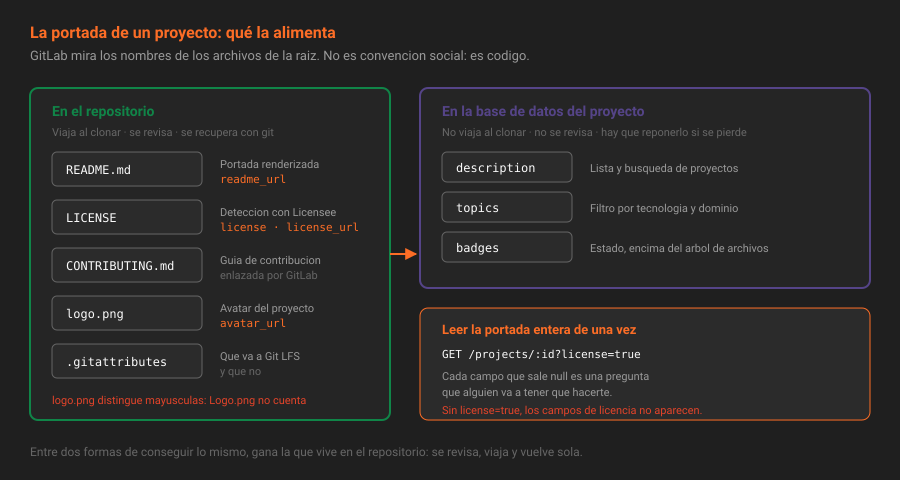

# El repositorio como producto

> Un repositorio tiene dos usuarios: el que lo escribió y el que llega después. Todo lo de esta semana existe para el segundo.

## 🎯 Objetivos

- Medir el coste de arranque de un repositorio y saber qué lo baja
- Enumerar los archivos que GitLab reconoce **por nombre** y qué cambia cuando existen
- Distinguir lo que vive en el repositorio de lo que vive en los ajustes del proyecto
- Leer por API la portada de un proyecto y decir qué le falta

---

## 1. Qué problema resuelve

Entras a una empresa. Te dan acceso a un repositorio con 4 000 commits, 60 archivos y ningún README. Para saber si es una librería o un servicio abres el `package.json`. Para saber cómo se arranca lees el `Dockerfile`. Para saber si puedes tocar `main` preguntas por chat. Para saber por qué usan PostgreSQL y no SQLite, preguntas a alguien que llevaba dos años y ya no está.

Eso es **coste de arranque**: el tiempo entre clonar y hacer algo útil. En un repositorio sin documentación se paga entero, y se paga **una vez por persona**. Con tres incorporaciones al año durante cinco años son quince veces el mismo día perdido.

La documentación no es un favor que le haces a nadie: es la única forma de que ese coste se pague una sola vez, por quien ya sabe la respuesta.

Y hay un segundo usuario que se olvida: **tú, dentro de ocho meses**. La diferencia entre él y un desconocido es más pequeña de lo que parece.

### Lo que no es

Documentar no es escribir mucho. Un README de 3 000 palabras que nadie termina es peor que uno de 40 líneas que se lee entero, porque además da la sensación de que el problema está resuelto. El objetivo no es cobertura: es que **la primera pregunta de un recién llegado tenga respuesta en la primera pantalla**.

---

## 2. Cómo funciona

### 2.1 Un proyecto es más que un repositorio

En GitLab el proyecto es la unidad: contiene el repositorio Git, y alrededor de él una docena de subsistemas que comparten permisos, ruta y ciclo de vida.

| Componente | Qué guarda | Semana en que aparece |
|---|---|---|
| Repositorio Git | Código e historia | S01-S02 |
| Wiki | Un **segundo** repositorio Git, aparte | S04 |
| Snippets | Fragmentos con su propio repositorio cada uno | S04 |
| Issues y tableros | Trabajo pendiente | S05 |
| Merge requests | Revisión del cambio | S06 |
| Pipelines | Automatización | S09 |
| Registry de contenedores y de paquetes | Binarios versionados | S13 |
| Entornos y despliegues | Dónde corre y con qué versión | S14 |
| Releases | Versiones publicadas con sus adjuntos | S08 |

Esta semana toca las tres primeras filas. Lo que las une es que **ninguna necesita CI, permisos especiales ni infraestructura**: se pueden dejar bien hoy y siguen bien dentro de un año.

### 2.2 Los archivos que GitLab reconoce por nombre

Aquí está la parte que sorprende: GitLab **mira los nombres de los archivos de la raíz** y cambia su comportamiento según lo que encuentra. No es una convención social, es código. La lista vive en `Gitlab::FileDetector` y en la versión fijada incluye, entre otros:

| Patrón en la raíz | Qué activa |
|---|---|
| `README`, `README.md`, `readme.txt`… | Se renderiza bajo el árbol de archivos en la portada del proyecto. Expone `readme_url` en la API |
| `LICENSE`, `LICENCE`, `COPYING`, `UNLICENSE` (con o sin extensión) | Detección de licencia: aparece en la portada y en `license` y `license_url` de la API |
| `CONTRIBUTING`, `CONTRIBUTING.md` | GitLab lo enlaza como guía de contribución del proyecto |
| `CHANGELOG`, `HISTORY`, `CHANGES`, `NEWS` | Se reconoce como registro de cambios. Lo genera la Semana 08 |
| `logo.png`, `logo.jpg`, `logo.gif` | **Se convierte en el avatar del proyecto**, sin subir nada por la interfaz |
| `.gitignore` | Reconocido; la interfaz ofrece plantillas |
| `.gitlab-ci.yml` | Configuración de pipeline (S09) |
| `.gitlab/issue_templates/*.md` | Plantillas de issue (S05) |
| `.gitlab/merge_request_templates/*.md` | Plantillas de merge request (S06) |

> [!NOTE]
> El patrón del avatar es sensible a mayúsculas: `logo.png` funciona, `Logo.png` no. Los demás no lo son.



Verlo desde la API deja clara la diferencia entre "el archivo está" y "GitLab lo ha reconocido":

```bash
source ~/.bc-gitlab
H="PRIVATE-TOKEN: $GITLAB_TOKEN"; API="$GITLAB_URL/api/v4"
P=$(printf '%s' "$PROYECTO" | jq -sRr @uri)

curl -s -H "$H" "$API/projects/$P?license=true" \
  | jq '{readme_url, license: .license.key, license_url, avatar_url, topics, description}'
```

```json
{
  "readme_url": "http://localhost:8888/plataforma-biblioteca/app/-/blob/main/README.md",
  "license": "mit",
  "license_url": "http://localhost:8888/plataforma-biblioteca/app/-/blob/main/LICENSE",
  "avatar_url": "http://localhost:8888/plataforma-biblioteca/app/-/avatar",
  "topics": ["biblioteca", "typescript", "bootcamp-gitlab"],
  "description": "Cálculo de multas y disponibilidad de préstamos de la biblioteca"
}
```

Un `null` en cualquiera de esos campos es una pregunta que alguien va a tener que hacerte.

> [!IMPORTANT]
> `license` y `license_url` **solo se exponen si se pide `?license=true`**. Sin ese parámetro no salen, y no significa que no haya licencia. Es el error más común al escribir una comprobación de esta semana.

### 2.3 Lo que vive en el repositorio y lo que vive en los ajustes

Hay dos almacenes y conviene saber cuál se está usando, porque tienen ciclos de vida distintos:

| Dato | Dónde vive | Viaja al clonar | Se revisa en un merge request |
|---|---|:--:|:--:|
| README, LICENSE, CONTRIBUTING, `docs/` | Repositorio | Sí | Sí |
| `logo.png` como avatar | Repositorio | Sí | Sí |
| Descripción del proyecto | Base de datos | No | No |
| Temas (*topics*) | Base de datos | No | No |
| Avatar subido por la interfaz | Almacenamiento de la instancia | No | No |
| Insignias | Base de datos | No | No |
| Wiki | Un repositorio Git **aparte** | No con `git clone` | No |

Lo que vive en el repositorio se revisa, se versiona y se recupera con un `git checkout`. Lo que vive en la base de datos hay que volver a ponerlo si se pierde. Por eso, **entre dos formas de conseguir lo mismo, gana la que vive en el repositorio**: es la razón por la que esta semana el avatar sale de `logo.png` y no de un archivo subido a mano.

### 2.4 Descripción y temas

Son los dos campos que más rinden por lo poco que cuestan.

La **descripción** es lo que se lee en la lista de proyectos, en los resultados de búsqueda y en la API. Una línea. Tiene que decir **qué hace**, no cómo se llama: "app" no es una descripción, "cálculo de multas y disponibilidad de préstamos" sí.

Los **temas** (*topics*) son etiquetas del proyecto entero, no de los issues. Sirven para dos cosas: encontrar proyectos por tecnología dentro de la instancia, y decir de un vistazo qué es esto sin abrir el código. Tres o cuatro bastan: dominio, lenguaje y encaje. Diez son ruido.

```bash
curl -s --request PUT "$API/projects/$P" -H "$H" \
  --data-urlencode "description=Calculo de multas y disponibilidad de prestamos de la biblioteca" \
  --data-urlencode "topics=biblioteca,typescript,bootcamp-gitlab" \
  | jq '{description, topics}'
```

**Con la interfaz**: `Settings → General → Naming, topics, avatar`.

---

## 3. Cómo se configura: el orden que funciona

El orden importa, porque cada paso hace más barato el siguiente:

1. **Descripción y temas** — un minuto, y ya se sabe qué es el proyecto desde fuera.
2. **README** — la portada. Todo lo demás se enlaza desde aquí.
3. **Licencia** — define qué puede hacer con esto quien lo lea.
4. **CONTRIBUTING** — cómo se propone un cambio, con el flujo real, no el ideal.
5. **`logo.png`** — identidad visual sin subir nada.
6. **Wiki y ADR** — lo que no envejece con el código.
7. **Snippets e insignias** — lo accesorio, que solo tiene sentido cuando lo anterior existe.

Hacerlo al revés es la trampa clásica: insignias bonitas en un README que no dice qué hace el proyecto.

---

### 3.1 La prueba del clon limpio

La forma de saber si funcionó no es releer el README: es hacer lo que hará un tercero.

```bash
cd $(mktemp -d)
git clone http://localhost:8888/plataforma-biblioteca/app.git
cd app
```

Y a partir de ahí, **solo lo que dice el README**. Sin usar nada que sepas de memoria. Si en algún punto tienes que abrir otro archivo para averiguar el siguiente comando, ahí está el hueco.

Tres preguntas que la prueba responde y la lectura no:

| Pregunta | Qué la falla revela |
|---|---|
| ¿El primer comando funciona tal cual está escrito? | Falta un prerrequisito que tú ya tenías instalado |
| ¿Sé si ha ido bien? | Falta la salida esperada |
| ¿Sé qué hacer después? | Falta el enlace a `CONTRIBUTING.md` o a la wiki |

Es el mismo principio que el autograding de este bootcamp: **lo que no se comprueba, no está**. Un README se comprueba clonando en un directorio vacío, y no cuesta más de cinco minutos.

> [!TIP]
> Hazla en un contenedor limpio si puedes: `docker run --rm -it node:22-alpine sh`. Ahí no está instalado lo que llevas años arrastrando en tu máquina, y los huecos salen todos de golpe.

---

## 4. Antipatrones

| Antipatrón | Por qué duele | Qué hacer en su lugar |
|---|---|---|
| README generado por la plantilla y nunca tocado | Ocupa el sitio de la documentación real y aparenta que existe | Cinco secciones propias son suficientes; ver teoría [02](02-escribir-el-readme.md) |
| Documentación solo en la wiki, README vacío | La portada es lo primero que se ve, y está en blanco | README con lo mínimo y un enlace a la wiki |
| Descripción igual al nombre del proyecto | No informa y ocupa el sitio de algo que sí | Una frase con el qué, no el cómo |
| Avatar subido por la interfaz | No viaja al clonar, no se revisa, se pierde en una restauración parcial | `logo.png` en la raíz |
| Diez temas, incluidos `app`, `code` y `project` | El filtro deja de filtrar | Tres o cuatro: dominio, lenguaje y encaje |
| Documentar en un Google Doc enlazado | Se pierde el control de acceso y el historial | Wiki o `docs/`, dentro de la plataforma |
| README con capturas de la interfaz de hace dos versiones | Envejece peor que el texto y nadie lo actualiza | Texto y diagramas Mermaid, que se editan en una línea |

---

## 5. Trucos

- **El avatar más barato**: `logo.png` de 128×128 en la raíz. Cero clics, y viaja con el repositorio.
- **Ver lo que ve la API de tu portada** en una línea: `curl -s -H "$H" "$API/projects/$P?license=true" | jq '{readme_url, license: .license.key, avatar_url, topics, description}'`. Los `null` son la lista de tareas.
- **La lista real de nombres reconocidos**, en tu versión exacta: `docker compose exec gitlab cat /opt/gitlab/embedded/service/gitlab-rails/lib/gitlab/file_detector.rb`. Es la fuente, no la documentación.
- **Buscar proyectos por tema** en toda la instancia: `GET /projects?topic=typescript`.
- **Cuánto ocupa cada parte del proyecto**: `GET /projects/:id?statistics=true | jq '.statistics'` separa repositorio, wiki, LFS, artefactos y paquetes.

---

## 📚 Recursos Adicionales

- [Ajustes generales de un proyecto](https://docs.gitlab.com/ee/user/project/settings/) — dónde está cada campo de la portada
- [Temas de proyecto](https://docs.gitlab.com/ee/user/project/project_topics.html) — qué son y cómo se buscan
- [API de proyectos](https://docs.gitlab.com/ee/api/projects.html) — los parámetros exactos de `PUT /projects/:id`

---

## ✅ Checklist de Verificación

- [ ] Sabes nombrar cinco archivos que GitLab reconoce por su nombre y qué activa cada uno
- [ ] Has leído la portada de tu proyecto por API y sabes qué campos salen `null`
- [ ] Sabes por qué `?license=true` cambia la respuesta
- [ ] Puedes decir qué de la portada viaja al clonar y qué no

---

[Volver a la Semana 04](../README.md) · [Siguiente: Escribir el README →](02-escribir-el-readme.md)
