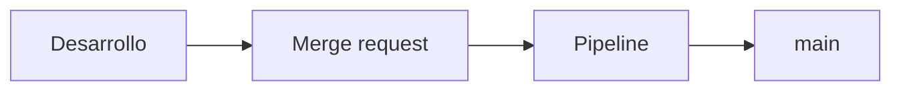

# Escribir el README

> El README no es una descripción del proyecto: es el guion de los primeros quince minutos de quien llega.

## 🎯 Objetivos

- Escribir un README con las secciones que de verdad se leen, y en el orden en que se leen
- Usar el Markdown de GitLab: índice automático, alertas, tareas y diagramas que se renderizan solos
- Enlazar archivos e imágenes de forma que los enlaces sigan funcionando dentro de un año
- Saber qué de GitLab Flavored Markdown funciona en tu instancia y qué necesita configuración

---

## 1. Qué problema resuelve

Un recién llegado hace siempre las mismas cuatro preguntas, en este orden:

1. **¿Qué es esto?** — en una frase, sin jerga interna
2. **¿Cómo lo arranco?** — comandos que se copian y funcionan
3. **¿Cómo sé que lo he arrancado bien?** — una salida esperada
4. **¿Cómo propongo un cambio?** — o el enlace a `CONTRIBUTING.md`

Un README que responda esas cuatro cosas en una pantalla ya es mejor que el 90 % de los que hay. Todo lo demás —arquitectura, decisiones, referencia de la API— es una quinta pregunta que se responde **enlazando**, no metiendo más texto en la portada.

El fallo típico no es escribir poco: es escribir mucho en el orden equivocado. Un README que empieza con la historia del proyecto y la lista de contribuidores obliga a bajar tres pantallas para llegar a `npm install`.

---

## 2. Cómo funciona

### 2.1 Las secciones que se leen

| Sección | Qué contiene | Longitud sana |
|---|---|---|
| Título y una frase | Qué es y para quién | 1 línea |
| Insignias | Estado del pipeline, versión, licencia | 1 línea |
| `[[_TOC_]]` | Índice generado por GitLab | 1 línea |
| Qué resuelve | El problema, con un ejemplo del dominio | 5-10 líneas |
| Arranque rápido | Los comandos exactos, sin variantes | 10-15 líneas |
| Verificar que funciona | Un comando y su salida esperada | 5 líneas |
| Estructura | Árbol comentado, solo los directorios que importan | 10 líneas |
| Cómo contribuir | Dos líneas y un enlace a `CONTRIBUTING.md` | 3 líneas |
| Documentación | Enlaces a la wiki y a `docs/` | 5 líneas |
| Licencia | Una línea y el enlace | 1 línea |

Alrededor de 80 líneas. Si el tuyo pasa de 150, casi siempre hay dentro un manual de referencia que debería ser una página de `docs/`.

### 2.2 GitLab Flavored Markdown

GitLab renderiza Markdown con extensiones propias. Las que rinden en un README:

**Índice automático.** En una línea suya, en cualquier punto del archivo:

```markdown
[[_TOC_]]
```

Genera el índice a partir de los encabezados. Funciona igual en las páginas de la wiki, y se actualiza solo: no hay que mantener una lista de enlaces a mano.

**Alertas.** Cinco tipos, con estilo propio, sin HTML:

```markdown
> [!NOTE]
> Un dato que ayuda pero no es obligatorio.

> [!TIP]
> Un atajo.

> [!IMPORTANT]
> Algo que si se salta, se rompe.

> [!WARNING]
> Algo que puede perder datos.

> [!CAUTION]
> Consecuencias graves o irreversibles.
```

> [!TIP]
> Úsalas con cuentagotas. Un README con siete alertas no destaca nada: destacar todo es no destacar.

**Tareas.** Se renderizan como casillas marcables en issues y descripciones de merge request; en un archivo del repositorio se ven como casillas, pero no se pulsan:

```markdown
- [x] Hecho
- [ ] Pendiente
```

**Diagramas Mermaid.** Nativos, sin instalar nada y sin subir imágenes:

````markdown

````

Que sea texto es la mitad de la ventaja: un diagrama Mermaid se revisa en un merge request línea a línea. Una captura de pantalla no.

**Lo que no está garantizado.** PlantUML y Kroki tienen filtro en GitLab, pero **necesitan un servidor configurado en la instancia** y en la configuración por defecto de este laboratorio no lo hay. Si escribes un bloque `plantuml` en tu instancia, verás el código sin renderizar. Mermaid es la opción que funciona en cualquier GitLab sin tocar nada.

### 2.3 Enlaces que no se pudren

| Qué enlazas | Cómo | Por qué |
|---|---|---|
| Otro archivo del repositorio | Ruta relativa: `docs/organizacion.md` | Funciona en la interfaz, en el editor y en un clon |
| Una imagen del repositorio | Ruta relativa: `assets/diagrama.svg` | Igual, y se ve en el renderizado |
| Una línea concreta de código | Enlace permanente al SHA, no a la rama | En `main` esa línea se mueve; en un SHA no |
| Una página de la wiki | URL completa a `/-/wikis/<slug>` | La wiki es otro repositorio: las rutas relativas no la alcanzan |
| Un issue o un merge request | `#12`, `!34` | GitLab los convierte en enlaces con su título y estado |

El atajo del enlace permanente merece un párrafo. En cualquier vista de archivo, la tecla `y` cambia la URL de la barra de direcciones de `blob/main/src/multa.ts#L42` a `blob/<sha>/src/multa.ts#L42`. La primera apunta a "la línea 42 de lo que haya hoy"; la segunda, a la línea que estás mirando. En documentación, casi siempre quieres la segunda.

> [!IMPORTANT]
> Las rutas absolutas del tipo `/plataforma-biblioteca/app/-/blob/main/...` funcionan hoy y se rompen el día que el proyecto cambie de ruta (Semana 03, teoría 07). Las relativas sobreviven a la transferencia.

### 2.4 Un README que se copia y funciona

El bloque de arranque rápido es el que más se usa y el que más falla. Tres reglas:

- **Sin variantes.** Un solo camino. Si hay dos formas de arrancar, la segunda va en `docs/`.
- **Con la salida esperada.** Un comando sin salida no se puede verificar:

  ```bash
  npm test
  # Tests 12 passed (12)
  ```

- **Sin placeholders que parezcan reales.** `<TU-TOKEN>` no se copia por error; `glpat-xxxxx` sí, y además dispara la detección de secretos de la propia instancia.

---

## 3. Cómo se configura

El README es un archivo del repositorio: se escribe con el editor de siempre y entra por un commit. Dos formas de comprobar cómo queda antes de empujarlo:

**Con la interfaz**: el Web IDE (tecla `.` en cualquier vista del proyecto) tiene vista previa con el renderizado real de tu instancia.

**Con la API**, que renderiza el Markdown igual que la interfaz:

```bash
source ~/.bc-gitlab
H="PRIVATE-TOKEN: $GITLAB_TOKEN"; API="$GITLAB_URL/api/v4"

curl -s --request POST "$API/markdown" -H "$H" \
  --data-urlencode 'text=> [!TIP]
> Se renderiza como alerta.' \
  --data-urlencode "gfm=true" | jq -r '.html'
```

Es la forma rápida de responder "¿esto lo renderiza mi versión?" sin hacer un commit para averiguarlo.

> [!NOTE]
> Sin `gfm=true` la API usa Markdown estándar y las extensiones de GitLab no se aplican. Es la causa habitual de "en la API se ve distinto que en la interfaz".

Y para leer el README ya publicado, tal cual está en la rama:

```bash
P=$(printf '%s' "$PROYECTO" | jq -sRr @uri)
curl -s -H "$H" "$API/projects/$P/repository/files/README%2Emd/raw?ref=main" | head -20
```

---

## 4. Antipatrones

| Antipatrón | Por qué duele | Qué hacer en su lugar |
|---|---|---|
| README de 400 líneas con toda la referencia | Nadie lo lee entero, y lo importante queda enterrado | Portada corta y `docs/` para el detalle |
| Índice escrito a mano | Se desincroniza al primer encabezado nuevo | `[[_TOC_]]` |
| Capturas de la interfaz | Envejecen a la siguiente versión y no se revisan | Texto o Mermaid |
| Bloques `plantuml` en una instancia sin servidor | Se ve el código fuente del diagrama, no el diagrama | Mermaid, que es nativo |
| Comandos sin salida esperada | Nadie sabe si funcionó | Comando y su salida en el mismo bloque |
| Enlaces absolutos a la ruta del proyecto | Se rompen al transferir el proyecto | Rutas relativas |
| Insignias antes de la frase que dice qué es | Bonito y sin información | Título, frase, y luego insignias |
| Un README que documenta lo que se va a hacer | Envejece en semanas y desinforma | Documentar lo que hay; lo previsto va a issues |

---

## 5. Trucos

- **`[[_TOC_]]`** también funciona en la wiki y en las descripciones de issues largas.
- **Tecla `.`** en cualquier vista del proyecto abre el Web IDE, con vista previa de Markdown y sin clonar.
- **Tecla `y`** convierte la URL del archivo en un enlace permanente al commit.
- **`POST /markdown` con `gfm=true`** renderiza igual que la interfaz: sirve para probar una alerta o un Mermaid sin hacer commit.
- **`[TOC]` y `[toc]`** hacen lo mismo que `[[_TOC_]]`: el filtro acepta las tres formas, sin distinguir mayúsculas.
- **El botón *Display source*** de la barra de un archivo `.md` alterna entre el renderizado y el fuente con números de línea. El fuente es el que permite enlazar a una línea concreta.
- **El ancla de un encabezado** no hay que adivinarla: al pasar el ratón por encima aparece un icono de enlace a su izquierda; copiarlo da la URL exacta, con su `#ancla`.

---

## 📚 Recursos Adicionales

- [GitLab Flavored Markdown](https://docs.gitlab.com/ee/user/markdown.html) — la referencia completa, con lo que es propio de GitLab marcado
- [Diagramas en Markdown](https://docs.gitlab.com/ee/administration/integration/plantuml.html) — qué hace falta para PlantUML, y por qué Mermaid no lo necesita
- [API de Markdown](https://docs.gitlab.com/ee/api/markdown.html) — renderizar sin hacer commit
- [Awesome README](https://github.com/matiassingers/awesome-readme) — ejemplos reales de READMEs que se leen

---

## ✅ Checklist de Verificación

- [ ] Tu README responde las cuatro preguntas en la primera pantalla
- [ ] Tiene `[[_TOC_]]` y no un índice escrito a mano
- [ ] Tiene al menos un diagrama Mermaid que se renderiza en tu instancia
- [ ] Todos sus enlaces internos son relativos
- [ ] El bloque de arranque incluye la salida esperada

---

[← Anterior: El repositorio como producto](01-el-repositorio-como-producto.md) · [Volver a la Semana 04](../README.md) · [Siguiente: Licencia y procedencia →](03-licencia-y-procedencia.md)
