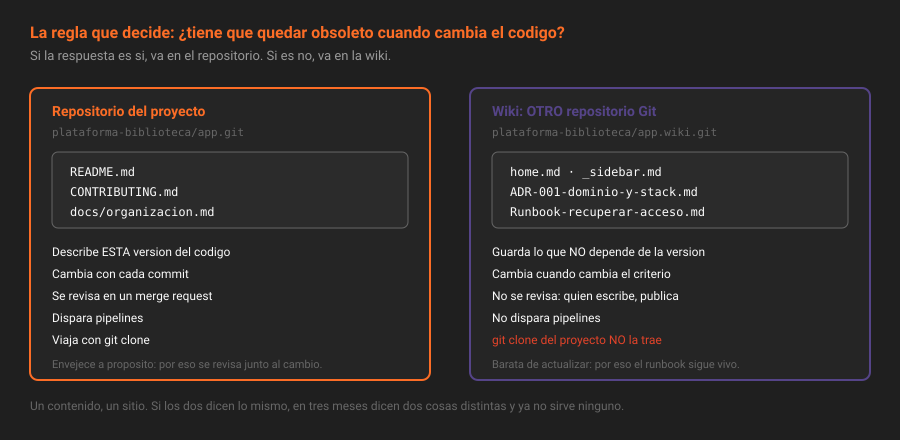

# La wiki del proyecto

> La wiki no es "documentación de segunda". Es un segundo repositorio Git, con otro ciclo de vida a propósito.

## 🎯 Objetivos

- Explicar por qué la wiki es un repositorio Git aparte y qué consecuencias tiene
- Decidir con una sola regla qué va a la wiki y qué va a `docs/` del repositorio
- Crear, leer y borrar páginas por API, y clonar la wiki para escribirla desde tu editor
- Montar portada y barra lateral para que la wiki no se convierta en un cajón
- Saber qué de la wiki es Free en CE y qué es de pago

---

## 1. Qué problema resuelve

Hay documentación que **no debe envejecer con el código**.

El ejemplo que lo aclara: la decisión de usar PostgreSQL en vez de SQLite. Escrita en `docs/base-de-datos.md`, cada merge request que toca la base de datos invita a "actualizarla", y al cabo de un año ya no dice qué se decidió sino qué hay ahora. Escrita en la wiki como ADR con fecha, sigue diciendo lo que se decidió en marzo de 2026, que es lo único que sirve para entender por qué el código es como es.

La wiki resuelve tres tipos de contenido que en el repositorio estorban:

- **Decisiones** — por qué se hizo así, con su fecha y su contexto
- **Procedimientos operativos** — el runbook de "qué hago si esto se cae", que quien está de guardia necesita leer sin clonar nada
- **Contexto compartido** — glosario del dominio, mapa de quién es quién, acuerdos de equipo

Lo que tienen en común: **nadie los quiere revisar en un merge request**. Un cambio de una coma en un runbook no merece un ciclo de revisión, y si lo exige, el runbook deja de actualizarse.

---

## 2. Cómo funciona

### 2.1 Un repositorio Git aparte

La wiki de `plataforma-biblioteca/app` es un repositorio Git independiente, en `plataforma-biblioteca/app.wiki.git`. Comparte permisos y ruta con el proyecto, pero **no comparte historia, ramas ni commits**.

Consecuencias, todas prácticas:

| Hecho | Consecuencia |
|---|---|
| Es un repositorio Git | Se clona, se edita en tu editor y se empuja con `git push` |
| No es *el* repositorio | `git clone` del proyecto **no** trae la wiki |
| No pasa por merge requests | No hay revisión: quien puede escribir, escribe |
| Tiene su propia historia | Cada página guarda versiones, y se comparan como commits |
| Cuenta aparte en el almacenamiento | `statistics.wiki_size`, separado de `repository_size` |
| No dispara pipelines | Un cambio en la wiki no ejecuta CI |

Esa última fila es la razón por la que un runbook en la wiki es cómodo y en el repositorio es caro: no arranca nada, no espera a nadie.



### 2.2 La regla que decide

> **Si tiene que quedar obsoleto cuando cambia el código, va en el repositorio. Si no, va en la wiki.**

| Contenido | Dónde | Por qué |
|---|---|---|
| Cómo se instala y se arranca | Repositorio (`README.md`) | Envejece con las dependencias; se revisa con el cambio que lo rompe |
| Referencia de la API del código | Repositorio (`docs/`) | Cambia con las firmas de las funciones |
| Por qué se eligió esta base de datos | Wiki (ADR) | No envejece: se sustituye por otra decisión |
| Qué hacer si el runner se queda colgado | Wiki (runbook) | Se lee a las tres de la mañana, se corrige sin revisión |
| Glosario del dominio | Wiki | Cambia cuando cambia el negocio, no el código |
| Cómo contribuir | Repositorio (`CONTRIBUTING.md`) | GitLab lo enlaza solo, y se revisa como el resto |

Un test rápido para dudas: **¿este texto tendría que cambiar en el mismo merge request que el código?** Si la respuesta es sí, no es de la wiki.

### 2.3 Títulos, slugs y jerarquía

El título de la página determina el nombre del archivo, y este el slug de la URL. La transformación es simple y conviene conocerla porque no es la que se supone:

- Los espacios se convierten en guiones: `Runbook de despliegue` da el slug `Runbook-de-despliegue`
- **Las mayúsculas se conservan**: el slug de `Runbook` es `Runbook`, no `runbook`
- Una barra crea jerarquía real de carpetas: el título `runbooks/despliegue` crea la página `despliegue` dentro de una carpeta `runbooks`

Dos nombres son especiales y están fijados en el código de GitLab:

| Slug | Qué es |
|---|---|
| `home` | La portada de la wiki. Es lo que se abre al entrar |
| `_sidebar` | La barra lateral personalizada. Sustituye a la lista automática de páginas |

> [!NOTE]
> La portada se crea con el título literal `home`, en minúscula. GitLab la muestra como "Home", pero el archivo se llama `home.md` y el slug es `home`. Crearla con el título `Home` produce una página distinta, con slug `Home`, que no es la portada.

### 2.4 La wiki por API

**Listar** las páginas, con o sin contenido:

```bash
source ~/.bc-gitlab
H="PRIVATE-TOKEN: $GITLAB_TOKEN"; API="$GITLAB_URL/api/v4"
P=$(printf '%s' "$PROYECTO" | jq -sRr @uri)

curl -s -H "$H" "$API/projects/$P/wikis" | jq -r '.[] | "\(.slug)\t\(.title)\t\(.format)"'
```

**Crear** una página. `title` y `content` son obligatorios; `format` acepta `markdown` (por defecto), `rdoc`, `asciidoc` y `org`:

```bash
curl -s --request POST "$API/projects/$P/wikis" -H "$H" \
  --data-urlencode "title=home" \
  --data-urlencode "content=# Documentacion

Indice de la wiki." \
  | jq '{slug, title, format}'
```

**Leer** una página concreta, por slug:

```bash
curl -s -H "$H" "$API/projects/$P/wikis/home" | jq -r '.content'
```

**Actualizar** y **borrar**:

```bash
curl -s --request PUT "$API/projects/$P/wikis/home" -H "$H" \
  --data-urlencode "content=# Documentacion actualizada" | jq '.slug'

curl -s --request DELETE "$API/projects/$P/wikis/una-pagina-vieja" -H "$H" \
  -o /dev/null -w '%{http_code}\n'
# 204
```

> [!WARNING]
> `DELETE` sobre una página de la wiki es **inmediato**: no hay borrado programado como en los grupos, ni papelera. Lo único que queda es la historia del repositorio de la wiki, que sí conserva el contenido borrado y se recupera con `git`. Antes de borrar en serio, clona la wiki.

### 2.5 Clonar la wiki

Es la forma cómoda de trabajar en cuanto hay más de tres páginas: se escriben en el editor de siempre, se ven todas juntas, y se buscan con `grep`.

```bash
git clone http://localhost:8888/plataforma-biblioteca/app.wiki.git wiki-app
cd wiki-app
ls
# home.md  _sidebar.md  ADR-001-dominio-y-stack.md
```

Se edita, se hace commit y se empuja como en cualquier repositorio. La interfaz muestra los cambios inmediatamente.

> [!TIP]
> Al clonar la wiki tienes su historia entera. `git log --oneline -- ADR-001-dominio-y-stack.md` responde "quién cambió esta decisión y cuándo" mucho más rápido que la interfaz de versiones.

### 2.6 Qué es de pago

| Feature | Tier | Qué resuelve | Sustituto en CE (este bootcamp) |
|---|---|---|---|
| Wiki de proyecto | **Free** | Todo lo de esta teoría | — |
| **Wiki de grupo** | **Premium** | Una wiki compartida por todos los proyectos de un grupo | La wiki de `app` hace de wiki de la plataforma, y los demás proyectos enlazan a ella |
| Editor enriquecido de la wiki | **Free** | Escribir sin saber Markdown | — |
| Plantillas de página de wiki | **Free** | Páginas nuevas partiendo de una plantilla, en `templates/` | — |

Que la wiki de grupo sea Premium se comprueba sin fiarse de la documentación: en CE, la API de wikis solo expone el recurso `projects`, no `groups`.

```bash
# En CE devuelve 404: el recurso no existe, no es un problema de permisos
curl -s -o /dev/null -w '%{http_code}\n' -H "$H" "$API/groups/plataforma-biblioteca/wikis"
# 404
```

Comprobado en agosto de 2026 contra la versión fijada `19.2.4-ce.0`.

---

## 3. Cómo se configura

**Activar o restringir la wiki**, que por defecto está activa:

```bash
curl -s --request PUT "$API/projects/$P" -H "$H" \
  --data-urlencode "wiki_access_level=private" | jq '.wiki_access_level'
```

Los tres valores son `disabled`, `private` y `enabled`. En un proyecto privado, `private` significa "solo los miembros"; `enabled` la hace tan visible como el proyecto.

**Con la interfaz**: `Settings → General → Visibility, project features, permissions → Wiki`.

Y el mínimo para que una wiki sirva, en vez de convertirse en un cajón:

1. Una **portada** (`home`) que sea un índice, no un saludo
2. Una **barra lateral** (`_sidebar`) con las secciones fijas
3. Una **convención de nombres** para lo que se repite: `ADR-NNN-...`, `Runbook-...`
4. Una **fecha visible** en cada página que dependa del tiempo

---

## 4. Antipatrones

| Antipatrón | Por qué duele | Qué hacer en su lugar |
|---|---|---|
| Duplicar el README en la wiki | Dos verdades que divergen en la primera semana | Uno de los dos, y el otro enlaza |
| Documentar la instalación en la wiki | Envejece con el código y nadie la revisa al cambiarlo | `README.md` del repositorio |
| Wiki sin portada ni barra lateral | La lista automática ordena alfabéticamente: a las veinte páginas ya no se encuentra nada | `home` y `_sidebar` desde la primera página |
| Páginas sin fecha | Nadie sabe si el runbook sigue siendo válido | Fecha de última revisión en la propia página |
| Un ADR por cada cosa que se hace | Deja de leerse y se convierte en un diario | Solo decisiones caras de revertir |
| Editar la wiki solo por la interfaz | Renombrar tres páginas seguidas es media hora | Clonar la wiki y trabajar en local |
| Borrar una página que sobra | Los enlaces existentes se rompen sin aviso | Marcarla como sustituida y enlazar la nueva |
| Poner secretos en la wiki | La wiki no pasa por la detección de secretos del pipeline | Los secretos van a variables de CI (S10) |

---

## 5. Trucos

- **La wiki se clona**: `git clone <url-del-proyecto>.wiki.git`. Es la diferencia entre escribir documentación y pelearse con un formulario.
- **`[[_TOC_]]`** funciona en las páginas de la wiki igual que en el README.
- **Índice completo en una línea**: `GET /projects/:id/wikis | jq -r '.[].slug'`.
- **Buscar en toda la wiki**: `GET /projects/:id/wikis?with_content=true | jq -r '.[] | select(.content | test("runner")) | .slug'`. También vale un `grep` sobre el clon.
- **Cuánto ocupa la wiki**: `GET /projects/:id?statistics=true | jq '.statistics.wiki_size'`. Se actualiza en segundo plano, así que puede ir unos segundos por detrás.
- **Adjuntar un archivo a la wiki** sin salir de la API: `POST /projects/:id/wikis/attachments` con el archivo en `file`. Devuelve el Markdown ya listo para pegar.
- **Jerarquía de verdad**: un título con `/` crea carpetas. `runbooks/despliegue` y `runbooks/incidencias` se agrupan solos en la barra lateral.

---

## 📚 Recursos Adicionales

- [Wiki de proyecto](https://docs.gitlab.com/ee/user/project/wiki/) — portada, barra lateral, plantillas y edición
- [API de wikis](https://docs.gitlab.com/ee/api/wikis.html) — los cinco endpoints y sus parámetros
- [Comparativa de tiers](https://about.gitlab.com/pricing/feature-comparison/) — dónde se ve que la wiki de grupo es Premium

---

## ✅ Checklist de Verificación

- [ ] Sabes por qué un `git clone` del proyecto no trae la wiki
- [ ] Puedes decidir en un segundo si un texto va a la wiki o a `docs/`
- [ ] Has clonado la wiki de tu proyecto y visto sus archivos
- [ ] Sabes cómo se llaman exactamente la portada y la barra lateral
- [ ] Has comprobado con `curl` que la wiki de grupo no existe en tu instancia

---

[← Anterior: Licencia y procedencia](03-licencia-y-procedencia.md) · [Volver a la Semana 04](../README.md) · [Siguiente: Decisiones como ADR →](05-decisiones-como-adr.md)
