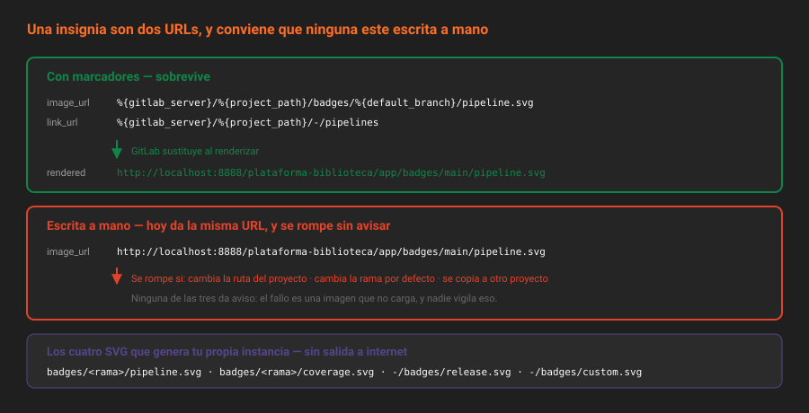

# Insignias

> Una insignia bien hecha responde una pregunta de un vistazo. Una mal hecha es una imagen rota en el README de un proyecto que nadie mantiene.

## 🎯 Objetivos

- Crear insignias de proyecto y entender cómo se heredan las de grupo
- Usar marcadores para que la insignia sobreviva a un cambio de ruta o de rama por defecto
- Generar insignias personalizadas servidas por tu propia instancia, sin depender de internet
- Saber por qué las insignias de servicios externos no cargan en una instancia aislada

---

## 1. Qué problema resuelve

Un README con quince líneas de texto sobre el estado del proyecto no lo lee nadie. Tres imágenes en la primera línea sí: *pipeline: passing*, *coverage: 84 %*, *license: MIT*. La insignia es densidad de información, no decoración.

Y hay una segunda función, menos obvia: **la insignia está viva**. El texto "tenemos tests" envejece en silencio; la insignia de pipeline se pone en rojo sola. Es la diferencia entre documentar un estado y mostrarlo.

El problema real que resuelve GitLab con su sistema de insignias es otro, más aburrido y más útil: **que la URL no haya que escribirla a mano en cada proyecto**. Una insignia con marcadores se define una vez en el grupo y funciona en los cuarenta proyectos que cuelgan de él.

---

## 2. Cómo funciona

### 2.1 Insignia = dos URLs

Una insignia son exactamente dos cosas:

| Campo | Qué es |
|---|---|
| `image_url` | La imagen que se muestra. Normalmente un SVG generado dinámicamente |
| `link_url` | A dónde lleva al pulsarla |
| `name` | Etiqueta interna, opcional, para identificarla en la lista |

Y se muestran, sin tocar el README, encima del árbol de archivos del proyecto. Que no vivan en el repositorio tiene una consecuencia que conviene recordar: **no viajan al clonar y no se revisan en un merge request** (teoría [01](01-el-repositorio-como-producto.md), sección 2.3).

### 2.2 Los marcadores

Aquí está la parte que hace que el sistema valga la pena. Las dos URLs admiten marcadores que GitLab sustituye al renderizar, por proyecto:

| Marcador | Se sustituye por |
|---|---|
| `%{project_path}` | La ruta completa: `plataforma-biblioteca/app` |
| `%{project_id}` | El identificador numérico |
| `%{project_name}` | El nombre corto: `app` |
| `%{project_title}` | El título del proyecto |
| `%{project_namespace}` | El namespace del proyecto |
| `%{group_name}` | El grupo, si el proyecto está en uno |
| `%{default_branch}` | La rama por defecto: `main` |
| `%{commit_sha}` | El último commit de la rama por defecto |
| `%{latest_tag}` | El tag más reciente |
| `%{gitlab_server}` | El host de tu instancia |
| `%{gitlab_pages_domain}` | El dominio de Pages |

Una insignia escrita con marcadores sigue funcionando si el proyecto cambia de ruta, si cambia la rama por defecto o si se copia a otro proyecto. Una escrita a mano se rompe en el primer cambio y nadie se entera, porque una imagen rota en un README no dispara ninguna alerta.



### 2.3 Las insignias que sirve tu propia instancia

GitLab genera cuatro SVG por sí mismo. Son las importantes en una instancia autohospedada, porque **no dependen de ningún servicio externo**:

| Insignia | URL | Qué muestra |
|---|---|---|
| Pipeline | `<host>/<ruta>/badges/<rama>/pipeline.svg` | Estado del último pipeline de esa rama |
| Cobertura | `<host>/<ruta>/badges/<rama>/coverage.svg` | La cobertura extraída del log del job |
| Última versión | `<host>/<ruta>/-/badges/release.svg` | El nombre de la última release |
| Personalizada | `<host>/<ruta>/-/badges/custom.svg` | El texto que tú le pases |

Las tres primeras aceptan parámetros que ajustan lo que se ve:

```
badges/main/pipeline.svg?ignore_skipped=true&key_text=build&key_width=50
badges/main/coverage.svg?job=test&min_good=80&min_acceptable=60
```

La personalizada es la que salva a una instancia sin salida a internet, porque la sirve tu propio GitLab:

```
/-/badges/custom.svg?key_text=docs&key_width=40&value_text=wiki&value_color=blue
```

> [!NOTE]
> Las insignias de pipeline y cobertura seguirán mostrando *unknown* hasta la Semana 09, cuando exista el primer pipeline. Crearlas hoy no es prematuro: es lo que hará que el día que el pipeline pase a verde, se vea sin tocar nada.

### 2.4 Las que no van a cargar

Servicios como shields.io generan insignias muy vistosas a partir de una URL. En una instancia autohospedada tienen dos problemas:

1. **Si tu instancia no tiene salida a internet, la imagen no carga.** Aparece rota, que es peor que no tenerla.
2. **Si la insignia consulta tu API, tu instancia tiene que ser accesible desde fuera.** Un `localhost:8888` no lo es, y una que sí lo sea está exponiendo datos del proyecto a un tercero para dibujar una imagen.

La regla de este bootcamp: **las insignias las sirve tu instancia**. Para lo que GitLab no genera, `custom.svg`.

### 2.5 Insignias de grupo

Se definen igual, en `groups/:id/badges`, y **las heredan todos los proyectos del grupo y de sus subgrupos**. Es donde los marcadores rinden de verdad: una insignia de pipeline definida una vez en `plataforma-biblioteca` funciona en `app`, en `infra` y en todo lo que nazca después.

Al leer las insignias de un proyecto, la API devuelve **las suyas y las heredadas**, y el campo `kind` las distingue:

```bash
source ~/.bc-gitlab
H="PRIVATE-TOKEN: $GITLAB_TOKEN"; API="$GITLAB_URL/api/v4"
P=$(printf '%s' "$PROYECTO" | jq -sRr @uri)

curl -s -H "$H" "$API/projects/$P/badges" | jq -r '.[] | "\(.kind)\t\(.name)"'
# project	Pipeline
# project	Licencia
# group	Plataforma
```

Borrar una insignia heredada desde el proyecto no se puede: se borra donde se creó.

---

## 3. Cómo se configura

**Con la interfaz**: `Settings → General → Badges`. El formulario tiene vista previa en vivo y sustituye los marcadores mientras escribes.

**Con la API**:

```bash
curl -s --request POST "$API/projects/$P/badges" -H "$H" \
  --data-urlencode "name=Pipeline" \
  --data-urlencode "link_url=%{gitlab_server}/%{project_path}/-/pipelines" \
  --data-urlencode "image_url=%{gitlab_server}/%{project_path}/badges/%{default_branch}/pipeline.svg" \
  | jq '{id, name, rendered_image_url}'
```

```json
{
  "id": 1,
  "name": "Pipeline",
  "rendered_image_url": "http://localhost:8888/plataforma-biblioteca/app/badges/main/pipeline.svg"
}
```

`rendered_image_url` y `rendered_link_url` son la comprobación: son las URLs **ya sustituidas**, tal como se van a pedir. Si ahí ves un `%{` sin sustituir, el marcador está mal escrito.

Y se puede probar una insignia **antes** de crearla:

```bash
curl -s -H "$H" --get "$API/projects/$P/badges/render" \
  --data-urlencode "link_url=%{gitlab_server}/%{project_path}" \
  --data-urlencode "image_url=%{gitlab_server}/%{project_path}/badges/%{default_branch}/pipeline.svg" \
  | jq '{rendered_link_url, rendered_image_url}'
```

Para actualizar o retirar:

```bash
curl -s --request PUT "$API/projects/$P/badges/1" -H "$H" \
  --data-urlencode "name=Estado del pipeline" | jq '.name'

curl -s --request DELETE "$API/projects/$P/badges/1" -H "$H" \
  -o /dev/null -w '%{http_code}\n'
# 204
```

### Cuántas y cuáles

Tres o cuatro. Por orden de utilidad real:

1. **Pipeline** — lo primero que se mira
2. **Licencia** — enlaza al archivo `LICENSE`, con `custom.svg`
3. **Última versión** — `release.svg`, útil desde la Semana 08
4. **Cobertura** — solo cuando el pipeline la publique de verdad (Semana 09)

Una insignia que siempre dice lo mismo no informa: es un adorno con coste de mantenimiento.

---

## 4. Antipatrones

| Antipatrón | Por qué duele | Qué hacer en su lugar |
|---|---|---|
| URL escrita a mano con la ruta del proyecto | Se rompe al transferir el proyecto y nadie lo nota | Marcadores: `%{project_path}` |
| `main` escrito literal en la URL de la insignia | Se rompe el día que cambie la rama por defecto | `%{default_branch}` |
| Insignias de un servicio externo en una instancia aislada | Imagen rota, o datos del proyecto enviados a un tercero | Las que sirve tu instancia, y `custom.svg` para el resto |
| Ocho insignias en el README | Se convierten en ruido y dejan de mirarse | Tres o cuatro que cambian de valor |
| Insignia de cobertura sin pipeline que la publique | Muestra *unknown* para siempre y resta credibilidad | Crearla en la Semana 09, con el job que la genera |
| Insignia sin `link_url` útil | Se pulsa y no lleva a ningún sitio | Al pipeline, al archivo o a la release |
| La misma insignia repetida en cuarenta proyectos | Cuarenta sitios que cambiar | Una insignia de grupo con marcadores |
| Insignia en el README **además** de en los ajustes | Se duplican y una de las dos envejece | Las de los ajustes se muestran solas |

---

## 5. Trucos

- **`GET /projects/:id/badges/render`** prueba una insignia sin crearla. Es el paso que evita crear y borrar tres veces.
- **`rendered_image_url`** de cada insignia es la URL final. Un `%{` sin sustituir ahí es un marcador mal escrito.
- **Insignia de lo que quieras, sin internet**: `/-/badges/custom.svg?key_text=docs&value_text=wiki&value_color=blue`. La sirve tu instancia.
- **Ajustar la insignia de pipeline**: `?ignore_skipped=true` deja de contar los pipelines saltados; `key_text` y `key_width` cambian la etiqueta.
- **Ajustar la de cobertura**: `?job=test` elige de qué job sale el número, y `min_good`, `min_acceptable` y `min_medium` deciden en qué umbral cambia de color.
- **Estilo cuadrado**: `?style=flat-square` en cualquiera de las insignias que genera GitLab.
- **Una vez para todo el grupo**: `POST /groups/:id/badges` con marcadores, y todos los proyectos la heredan. `kind` distingue las propias de las heredadas.

---

## 📚 Recursos Adicionales

- [Insignias de proyecto](https://docs.gitlab.com/ee/user/project/badges.html) — marcadores, insignias de grupo y las que genera GitLab
- [API de insignias de proyecto](https://docs.gitlab.com/ee/api/project_badges.html) — `render` incluido
- [API de insignias de grupo](https://docs.gitlab.com/ee/api/group_badges.html) — la variante que se hereda
- [Insignia de pipeline](https://docs.gitlab.com/ee/ci/pipelines/settings.html#pipeline-status-badge) — parámetros de `pipeline.svg` y `coverage.svg`

---

## ✅ Checklist de Verificación

- [ ] Tus insignias usan marcadores y no rutas escritas a mano
- [ ] Has comprobado `rendered_image_url` y no queda ningún `%{` sin sustituir
- [ ] Sabes qué cuatro insignias genera tu propia instancia
- [ ] Puedes explicar por qué una insignia de shields.io es mala idea aquí
- [ ] Sabes distinguir una insignia propia de una heredada del grupo

---

[← Anterior: Snippets](06-snippets.md) · [Volver a la Semana 04](../README.md) · [Siguiente: Git LFS →](08-git-lfs.md)
