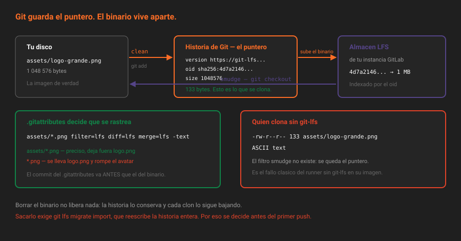

# Git LFS

> Git guarda cada versión de cada archivo para siempre. Con texto es una virtud; con un PNG de 4 MB que cambia cada semana, es una factura.

## 🎯 Objetivos

- Explicar por qué un binario grande envenena un repositorio Git
- Leer un puntero de LFS y decir qué contiene
- Escribir un `.gitattributes` con patrones precisos, y saber por qué los amplios duelen
- Distinguir activar LFS de migrar lo que ya está dentro
- Decidir cuándo LFS **no** es la respuesta

---

## 1. Qué problema resuelve

Git guarda **cada versión completa** de cada archivo binario. Con texto comprime y almacena diferencias; con un PNG, un PDF o un `.psd` no hay diferencia que calcular: cada cambio es una copia entera.

La cuenta, con un logo de 4 MB que se retoca veinte veces en dos años:

| | Sin LFS | Con LFS |
|---|---|---|
| Tamaño del repositorio | 80 MB | 20 versiones × 130 bytes ≈ 3 KB |
| Lo que descarga un `git clone` | 80 MB | 3 KB + solo la versión actual (4 MB) |
| Lo que descarga el runner en cada pipeline | 80 MB | 3 KB, si no necesita el binario |

Y hay un detalle que convierte el problema en permanente: **borrar el archivo no libera nada**. La historia sigue conteniendo las veinte versiones, y seguirá bajándolas en cada clon. Lo único que las quita es reescribir la historia entera, que es caro y afecta a todo el mundo.

Por eso la decisión sobre binarios se toma **antes** del primer `push`. Es de las pocas de este bootcamp que no tiene arreglo barato.

---

## 2. Cómo funciona

### 2.1 El puntero

Git LFS sustituye el archivo binario, dentro del repositorio, por un archivo de texto de unos 130 bytes: el **puntero**.

```
version https://git-lfs.github.com/spec/v1
oid sha256:4d7a214614ab2935c943f9e0ff69d22eadbb8f32b1258daaa5e2ca24d17e2393
size 4194304
```

Tres líneas: la versión del formato, el hash SHA-256 del contenido real y su tamaño. Eso es lo que viaja en la historia de Git. El binario de verdad vive en el almacén de LFS de tu GitLab, indexado por ese `oid`.

Los filtros de Git hacen el cambio en los dos sentidos y por eso no se nota:

| Filtro | Cuándo actúa | Qué hace |
|---|---|---|
| `clean` | Al hacer `git add` | Sube el binario al almacén y guarda el puntero |
| `smudge` | Al hacer `checkout` | Lee el puntero, descarga el binario y lo deja en el disco |



Consecuencia práctica: **quien clone sin `git-lfs` instalado obtiene los punteros**, no los archivos. No es un error del repositorio; es que su Git no sabe interpretar el filtro. Y en un pipeline, es la causa clásica de "la imagen del logo pesa 130 bytes y está corrupta".

### 2.2 `.gitattributes`

El archivo que decide qué se rastrea. Vive en la raíz del repositorio, **se versiona y se revisa como código**:

```gitattributes
assets/*.png   filter=lfs diff=lfs merge=lfs -text
assets/*.pdf   filter=lfs diff=lfs merge=lfs -text
```

Cada parte tiene su función:

| Parte | Qué hace |
|---|---|
| `filter=lfs` | Aplica los filtros `clean` y `smudge` |
| `diff=lfs` | No intenta mostrar diferencias del binario |
| `merge=lfs` | No intenta fusionar el binario línea a línea |
| `-text` | Marca el archivo como binario: sin conversión de saltos de línea |

Se escribe con `git lfs track`, que añade la línea por ti:

```bash
git lfs track "assets/*.png"
git add .gitattributes
```

> [!IMPORTANT]
> El patrón importa mucho más de lo que parece. `*.png` captura **todos** los PNG del repositorio, incluido el `logo.png` de la raíz que GitLab usa como avatar del proyecto (teoría [01](01-el-repositorio-como-producto.md)). Y GitLab lee ese archivo directamente del repositorio: si es un puntero, el avatar sale roto. Un patrón preciso —`assets/*.png`— evita el problema entero.

### 2.3 Activar no es migrar

Son dos cosas distintas y confundirlas cuesta una tarde:

- **Activar** LFS afecta a lo que entre **a partir de ahora**. Es `.gitattributes` más el interruptor del proyecto.
- **Migrar** mueve al almacén de LFS lo que ya está en la historia, y para eso hay que **reescribir la historia**.

```bash
# Qué se movería, sin tocar nada
git lfs migrate info --everything --include="*.png"

# Hacerlo de verdad: reescribe la historia
git lfs migrate import --everything --include="assets/*.png"
```

> [!WARNING]
> `git lfs migrate import` **reescribe la historia**: todos los SHA cambian, y quien tenga un clon tendrá que rehacerlo. Es la misma clase de operación que el `rebase` de la Semana 02, y con más alcance. Antes de ejecutarlo: una copia del repositorio (`git clone --mirror`), avisar a quien tenga clones, y saber que las ramas protegidas rechazarán el `push --force` hasta que se desprotejan (Semana 07).

En este bootcamp la migración no hace falta: `app` todavía no tiene binarios en la historia, y por eso hoy es barato dejarlo bien.

### 2.4 Los dos interruptores

LFS se activa en dos sitios y hacen falta los dos:

**En la instancia**, en la configuración de Omnibus. El laboratorio ya lo trae:

```ruby
gitlab_rails['lfs_enabled'] = true
```

**En el proyecto**, por API o por la interfaz:

```bash
source ~/.bc-gitlab
H="PRIVATE-TOKEN: $GITLAB_TOKEN"; API="$GITLAB_URL/api/v4"
P=$(printf '%s' "$PROYECTO" | jq -sRr @uri)

curl -s --request PUT "$API/projects/$P" -H "$H" \
  --data-urlencode "lfs_enabled=true" | jq '.lfs_enabled'
# true
```

**Con la interfaz**: `Settings → General → Visibility, project features, permissions → Git Large File Storage (LFS)`.

Si el proyecto lo tiene desactivado, el `push` de un archivo LFS falla con un error del servidor de LFS que no menciona el ajuste. Es el primer sitio donde mirar.

### 2.5 Comprobarlo desde fuera

La prueba de que un archivo está de verdad en LFS es que lo que hay en el repositorio es un puntero. Se ve sin clonar:

```bash
# Lo que hay en la historia de Git: el puntero
curl -s -H "$H" "$API/projects/$P/repository/files/assets%2Flogo-grande%2Epng?ref=main" \
  | jq -r '.content' | base64 -d
# version https://git-lfs.github.com/spec/v1
# oid sha256:...
# size 4194304

# El binario de verdad, resuelto por GitLab
curl -s -H "$H" \
  "$API/projects/$P/repository/files/assets%2Flogo-grande%2Epng/raw?ref=main&lfs=true" \
  | file -
# /dev/stdin: PNG image data, 1024 x 1024
```

Ese `lfs=true` es la diferencia entre pedir "lo que hay en Git" y "lo que representa". Sin él, el `raw` devuelve el puntero.

Y cuánto ocupa el almacén:

```bash
curl -s -H "$H" "$API/projects/$P?statistics=true" \
  | jq '{repository_size: .statistics.repository_size, lfs_objects_size: .statistics.lfs_objects_size}'
```

> [!NOTE]
> Las estadísticas se recalculan en segundo plano después de cada `push`. Si acabas de subir el archivo y `lfs_objects_size` sigue a cero, espera unos segundos y vuelve a preguntar.

### 2.6 Cuándo LFS no es la respuesta

LFS es para **binarios que forman parte del código fuente**: imágenes de la interfaz, fuentes tipográficas, plantillas de diseño, muestras de datos pequeñas.

| Caso | Herramienta | Por qué |
|---|---|---|
| Imagen de contenedor | Container Registry (S13) | Está pensado para capas, con limpieza automática |
| Binario compilado, un `.jar`, un `.tgz` | Package Registry (S13) | Se versiona y se consume por gestor de paquetes |
| Adjunto de una versión publicada | Release assets (S08) | Va atado a la release, no a un commit |
| Conjunto de datos de varios GB | Almacenamiento de objetos aparte | LFS no es un almacén de datos |
| Un vídeo de demostración | Un enlace | No todo tiene que estar en el repositorio |

La pregunta que decide: **¿esto se compila desde el código o se edita como parte del código?** Lo que se compila no va al repositorio, ni en LFS.

---

## 3. Cómo se configura

El orden correcto, y es corto:

1. `git lfs install` — una vez por máquina; instala los filtros en tu configuración de Git
2. `lfs_enabled=true` en el proyecto
3. `git lfs track "assets/*.png"` con el patrón **más estrecho** que resuelva el problema
4. `git add .gitattributes` y commit — antes de añadir ningún binario
5. Añadir los binarios, hacer commit y `push`
6. Verificar: `git lfs ls-files` en local, y el puntero por API

El paso 4 antes del 5 no es un detalle: si el binario entra en un commit anterior al `.gitattributes`, se queda en la historia de Git y solo lo saca `migrate`.

Operaciones de mantenimiento en la instancia, cuando haga falta:

```bash
# Integridad de los objetos LFS almacenados
docker compose exec gitlab gitlab-rake gitlab:lfs:check

# Referencias huérfanas en la base de datos
docker compose exec gitlab gitlab-rake gitlab:cleanup:orphan_lfs_file_references
```

---

## 4. Antipatrones

| Antipatrón | Por qué duele | Qué hacer en su lugar |
|---|---|---|
| Añadir el binario antes del `.gitattributes` | Entra en la historia de Git y solo lo saca reescribirla | `.gitattributes` primero, siempre |
| `*.png` como patrón | Se lleva también el `logo.png` de la raíz y rompe el avatar | Patrón por carpeta: `assets/*.png` |
| Meter en LFS lo que produce el build | El repositorio guarda lo derivado, y encima versionado | Package Registry o artefactos de pipeline (S13) |
| Borrar el binario para "liberar espacio" | La historia lo conserva; el clon sigue pesando lo mismo | `git lfs migrate` con aviso, o asumirlo |
| Clonar en el pipeline sin `git-lfs` | El job trabaja con punteros de 130 bytes y falla raro | Imagen con `git-lfs`, o `GIT_LFS_SKIP_SMUDGE=1` si no hace falta |
| LFS para un conjunto de datos de varios GB | No está pensado para eso: el almacén crece sin límite ni política | Almacenamiento de objetos, con su ciclo de vida |
| Activar LFS en el proyecto y olvidar `.gitattributes` | No pasa nada: no se rastrea nada, y nadie se entera | Los dos, y verificar con `git lfs ls-files` |
| Confiar en que "ya está en LFS" sin comprobarlo | Un patrón que no encaja falla en silencio | `git lfs ls-files` y el puntero por API |

---

## 5. Trucos

- **Qué hay realmente en LFS, con tamaños**: `git lfs ls-files --size`.
- **Clonar sin descargar los binarios**: `GIT_LFS_SKIP_SMUDGE=1 git clone <url>`, y luego `git lfs pull` solo si los necesitas. En un pipeline que no toca imágenes, ahorra el clon entero.
- **Ver el puntero en local** sin desactivar nada: `git show HEAD:assets/logo-grande.png` muestra las tres líneas del puntero.
- **Ensayar antes de migrar**: `git lfs migrate info --everything` dice cuánto ocupa cada extensión en la historia. Suele haber sorpresas.
- **El binario real por API**: `.../repository/files/<ruta>/raw?ref=main&lfs=true`. Sin `lfs=true` devuelve el puntero.
- **Qué proyectos están gastando el almacén**: `GET /projects?statistics=true | jq -r '.[] | select(.statistics.lfs_objects_size > 0) | "\(.path_with_namespace)\t\(.statistics.lfs_objects_size)"'`.
- **`.gitattributes` sirve para más cosas**: `*.md linguist-documentation` o `docs/* linguist-documentation` cambian el cálculo de lenguajes del proyecto, que a veces dice que tu proyecto de TypeScript es "Markdown".

---

## 📚 Recursos Adicionales

- [Git LFS en GitLab](https://docs.gitlab.com/ee/topics/git/lfs/) — activación, límites y resolución de problemas
- [Git LFS](https://git-lfs.com/) — el proyecto original, con la especificación del puntero
- [`git lfs migrate`](https://github.com/git-lfs/git-lfs/blob/main/docs/man/git-lfs-migrate.adoc) — la referencia del comando que reescribe la historia
- [`gitattributes`](https://git-scm.com/docs/gitattributes) — todo lo que se puede declarar en ese archivo, no solo LFS

---

## ✅ Checklist de Verificación

- [ ] Sabes qué contienen las tres líneas de un puntero
- [ ] Puedes explicar por qué borrar un binario grande no libera espacio
- [ ] Tu `.gitattributes` usa un patrón por carpeta, no por extensión suelta
- [ ] Has comprobado por API que el archivo del repositorio es un puntero
- [ ] Sabes cuándo usar el registry o los adjuntos de release en vez de LFS

---

[← Anterior: Insignias](07-insignias.md) · [Volver a la Semana 04](../README.md) · [Siguiente: Prácticas](../2-practicas/01-la-portada-del-proyecto.md)
