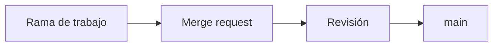

# Práctica 01 — La portada del proyecto

> README, licencia, guía de contribución, descripción, temas y avatar. Al terminar, alguien que no eres tú puede clonar `app` y arrancarlo sin preguntarte nada.

**Duración estimada**: 50 min
**Prerrequisitos**: Semana 03 completada · Teorías [01](../1-teoria/01-el-repositorio-como-producto.md), [02](../1-teoria/02-escribir-el-readme.md) y [03](../1-teoria/03-licencia-y-procedencia.md) leídas · Un clon local de `app` con el remoto a tu instancia

---

## Contexto

`app` tiene código, tests, historia firmada y una organización con permisos probados. Lo que no tiene es **portada**: quien llegue tiene que leer el `package.json` para saber qué hace y adivinar cómo se arranca.

Esta práctica deja los seis elementos que GitLab reconoce y muestra sin que se lo pidas. Cuatro de ellos son archivos del repositorio —y por tanto viajan al clonar, se revisan y se recuperan con `git`—, y dos son campos del proyecto.

Todo entra por commits firmados, como en la Semana 02. No hay atajo por la interfaz para el contenido del repositorio, y es a propósito: la documentación es código.

---

## Paso 0: Preparar el terreno

**Por qué**: los mismos cuatro valores hacen falta en todos los pasos. Definirlos una vez evita la mitad de los errores de copiar y pegar, y la otra mitad son las rutas sin codificar.

```bash
source ~/.bc-gitlab

export H="PRIVATE-TOKEN: $GITLAB_TOKEN"
export API="$GITLAB_URL/api/v4"
export P=$(printf '%s' "$PROYECTO" | jq -sRr @uri)   # ruta del proyecto, codificada
export NOMBRE="${PROYECTO##*/}"                       # app

echo "proyecto: $PROYECTO"
curl -s -H "$H" "$API/projects/$P" | jq -r '.path_with_namespace'
```

**Verifica**: la última línea imprime la ruta de tu proyecto. Si sale `null`, revisa `PROYECTO` en `~/.bc-gitlab`.

Y sitúate en tu clon local, con la rama al día:

```bash
cd /ruta/a/tu/clon/de/app
git switch main && git pull
```

---

## Paso 1: Mirar qué falta antes de escribir nada

**Por qué**: la lista de tareas de esta práctica la da la propia API. Cada `null` es un entregable pendiente, y volver a ejecutar esta línea al final es la verificación más rápida.

```bash
curl -s -H "$H" "$API/projects/$P?license=true" \
  | jq '{readme_url, license: .license.key, avatar_url, topics, description}'
```

```json
{
  "readme_url": null,
  "license": null,
  "avatar_url": null,
  "topics": [],
  "description": null
}
```

**Verifica**: guarda mentalmente cuántos `null` hay. Al final del paso 7 no puede quedar ninguno.

> [!NOTE]
> Si `readme_url` ya trae valor porque la Semana 01 creó un README de plantilla, no pasa nada: el paso 2 lo sustituye por uno que sirve.

---

## Paso 2: Escribir el README

**Por qué**: es la portada. Todo lo demás se enlaza desde aquí, y es lo único que se lee con seguridad.

Escríbelo con tu editor. Esta es la estructura mínima; adapta el dominio, el nombre de las funciones y los comandos a tu proyecto:

````markdown
# app — Plataforma Biblioteca

> Cálculo de multas y disponibilidad de préstamos. Librería en TypeScript,
> parte de la plataforma `plataforma-biblioteca`.

[[_TOC_]]

## Qué resuelve

El mostrador necesita responder tres preguntas sin abrir el sistema antiguo:
si un socio puede llevarse un libro, si el ejemplar está disponible y cuánto
debe si lo devuelve tarde.

## Arranque rápido

```bash
npm ci
npm test
```

```
Tests 12 passed (12)
```

## Estructura

```
src/       Las funciones del dominio
test/      Tests con el runner nativo de Node
docs/      Documentación que envejece con el código
```

## Cómo contribuir

Lee `CONTRIBUTING.md`. En resumen: rama desde `main`,
commits firmados y convencionales, y un merge request por cambio.

## Flujo del cambio



## Documentación

- Organización y permisos: `docs/organizacion.md`
- Decisiones de arquitectura: la wiki del proyecto, en `/-/wikis/home`

## Licencia

MIT. Ver `LICENSE`.
````

> [!NOTE]
> `npm ci` exige un `package-lock.json` en el repositorio. Si tu `app` todavía no lo tiene (la Semana 02 no instaló nada), créalo antes de verificar el arranque: `npm install`, y commit de `package-lock.json` con `git commit -S -m "build: fijar el árbol de dependencias"`. Sin él, `npm ci` termina con `EUSAGE` y el arranque del README no funciona en un clon limpio.

**Verifica**: antes de hacer commit, comprueba que tu instancia renderiza lo que crees. La API de Markdown lo dice sin gastar un commit:

```bash
curl -s --request POST "$API/markdown" -H "$H" \
  --data-urlencode "text=$(sed -n '/```mermaid/,/```/p' README.md)" \
  --data-urlencode "gfm=true" | jq -r '.html' | head -5
```

Si en la salida aparece `class="js-render-mermaid"`, el diagrama se va a renderizar.

---

## Paso 3: Poner el avatar sin subir nada

**Por qué**: GitLab detecta un `logo.png` en la raíz y lo usa como avatar del proyecto. Frente a subirlo por la interfaz gana en tres cosas: viaja al clonar, se revisa en un merge request y vuelve solo si restauras el repositorio.

Si no tienes un logo, sirve cualquier PNG cuadrado pequeño. Uno generado en el momento vale:

```bash
# 128x128, un color plano. Si no tienes ImageMagick, usa cualquier PNG que tengas.
command -v magick >/dev/null && magick -size 128x128 xc:'#FC6D26' logo.png
ls -l logo.png
```

**Verifica**: el archivo está en la **raíz** del repositorio y se llama exactamente `logo.png`, en minúsculas.

```bash
ls logo.png && file logo.png
# logo.png: PNG image data, 128 x 128
```

> [!IMPORTANT]
> El patrón que usa GitLab distingue mayúsculas: `logo.png` funciona y `Logo.png` no. Y guarda este archivo en mente para la práctica 04: cuando actives LFS, un patrón `*.png` demasiado amplio se lo llevaría y el avatar dejaría de verse.

---

## Paso 4: La licencia, desde la plantilla de tu instancia

**Por qué**: el texto tiene que ser el íntegro para que Licensee lo reconozca. Tu propia instancia lo sirve ya relleno, así que no hay motivo para copiarlo de internet.

**Con la interfaz**: en un repositorio sin licencia, la portada del proyecto ofrece un botón `Add LICENSE` que abre el mismo catálogo.

**Con la API**:

```bash
# Qué hay disponible
curl -s -H "$H" "$API/templates/licenses?popular=true" | jq -r '.[] | "\(.key)\t\(.name)"'

# El texto, con tu nombre y el del proyecto ya sustituidos
curl -s -H "$H" --get "$API/templates/licenses/mit" \
  --data-urlencode "project=$NOMBRE" \
  --data-urlencode "fullname=$(git config user.name)" \
  | jq -r '.content' > LICENSE

head -3 LICENSE
```

```
MIT License

Copyright (c) 2026 Tu Nombre
```

**Verifica**: el archivo se llama `LICENSE`, sin extensión, y empieza con el título de la licencia y el año.

Y declara la misma licencia donde también se lee:

```bash
# En package.json, con el identificador SPDX
jq '.license = "MIT"' package.json > package.json.tmp && mv package.json.tmp package.json
jq -r '.license' package.json
# MIT
```

---

## Paso 5: `CONTRIBUTING.md`

**Por qué**: GitLab lo reconoce por nombre y lo enlaza. Y responde la cuarta pregunta del recién llegado —"¿cómo propongo un cambio?"— sin que tenga que preguntarla.

Que describa **tu** flujo real, no uno ideal. Con lo que hay hasta ahora en el bootcamp:

```markdown
# Cómo contribuir

## El flujo

1. Rama desde `main`: `git switch -c feat/nombre-corto`
2. Commits **firmados** y con formato convencional (`feat:`, `fix:`, `docs:`)
3. Un merge request por cambio, con su descripción
4. La rama se borra al fusionar

## Requisitos de un commit

- Firmado con tu clave SSH de firma (Semana 02)
- Mensaje convencional, en inglés, en imperativo
- `npm test` en verde antes de empujarlo

## Licencia de lo que aportas

Al abrir un merge request aceptas que tu aportación se publique bajo la
licencia de este repositorio (MIT, ver `LICENSE`).

## Dónde está cada cosa

- Documentación que envejece con el código: `docs/`
- Decisiones de arquitectura y runbooks: la wiki del proyecto
```

**Verifica**: el archivo está en la raíz y se llama `CONTRIBUTING.md`.

---

## Paso 6: Descripción y temas

**Por qué**: son los dos campos que más rinden por lo poco que cuestan, y los únicos de esta práctica que **no** viven en el repositorio. Se ven en la lista de proyectos, en la búsqueda y en la API.

**Con la interfaz**: `Settings → General → Naming, topics, avatar`.

**Con la API**:

```bash
curl -s --request PUT "$API/projects/$P" -H "$H" \
  --data-urlencode "description=Calculo de multas y disponibilidad de prestamos de la biblioteca" \
  --data-urlencode "topics=biblioteca,typescript,bootcamp-gitlab" \
  | jq '{description, topics}'
```

```json
{
  "description": "Calculo de multas y disponibilidad de prestamos de la biblioteca",
  "topics": ["biblioteca", "typescript", "bootcamp-gitlab"]
}
```

**Verifica**: la descripción pasa de 30 caracteres y hay al menos tres temas. Los dos son requisitos del autograding.

```bash
curl -s -H "$H" "$API/projects/$P" | jq '{largo: (.description | length), temas: (.topics | length)}'
# { "largo": 62, "temas": 3 }
```

---

## Paso 7: Empujar todo en un commit firmado

**Por qué**: los cinco archivos son una sola unidad de cambio —la portada del proyecto— y así se leen mejor en la historia. Firmado, como todo lo que entra desde la Semana 02.

```bash
git add README.md LICENSE CONTRIBUTING.md logo.png package.json
git commit -S -m "docs: add project front page, license and contribution guide"
git push origin main
```

**Verifica**: el commit aparece como verificado y los cinco archivos están en la rama.

```bash
curl -s -H "$H" "$API/projects/$P/repository/tree?ref=main&per_page=100" \
  | jq -r '.[].name' | grep -E '^(README.md|LICENSE|CONTRIBUTING.md|logo.png)$'
```

---

## Paso 8: La prueba del clon limpio

**Por qué**: releer el README no detecta lo que falta, porque tú ya sabes lo que falta. Clonar en un directorio vacío y seguir **solo** lo escrito, sí.

```bash
cd $(mktemp -d)
git clone "$GITLAB_URL/$PROYECTO.git"
cd "$NOMBRE"
```

Ahora ejecuta únicamente los comandos del bloque de arranque de tu README, en orden, sin usar nada que sepas de memoria.

**Verifica**: llegaste hasta la salida esperada sin abrir ningún otro archivo. Si tuviste que improvisar en algún punto, ese es el hueco: vuelve al paso 2, arréglalo y repite. Es normal que la primera vez falte algo.

---

## ✅ Resultado

- [ ] `README.md` en la raíz, con `[[_TOC_]]`, arranque con salida esperada y un diagrama Mermaid
- [ ] `LICENSE` en la raíz, con el texto íntegro de la plantilla de tu instancia
- [ ] `package.json` declara el mismo identificador SPDX que `LICENSE`
- [ ] `CONTRIBUTING.md` en la raíz, con tu flujo real
- [ ] `logo.png` en la raíz, en minúsculas
- [ ] Descripción de más de 30 caracteres
- [ ] Al menos tres temas asignados
- [ ] Todo empujado en un commit firmado
- [ ] La prueba del clon limpio pasa sin improvisar

```bash
cd /ruta/a/bc-gitlab
./scripts/verificar-semana.sh 04
```

De las dieciséis comprobaciones, esta práctica cubre las seis primeras. Las demás llegan con las prácticas 02, 03 y 04.

---

## 🧯 Si algo sale mal

| Síntoma | Causa | Solución |
|---|---|---|
| `readme_url` sigue en `null` | El archivo no está en la raíz, o no se empujó a `main` | `GET /projects/:id/repository/tree?ref=main` y comprueba que `README.md` sale |
| `license` sale `null` con `LICENSE` presente | El texto no es el íntegro, o está retocado | Regenéralo con `GET /templates/licenses/mit`; no lo edites |
| `license` sale `null` y el archivo es correcto | Falta `?license=true` en la petición | Los campos de licencia solo se exponen con ese parámetro |
| `avatar_url` sigue en `null` | El archivo se llama `Logo.png`, o no está en la raíz | Renómbralo a `logo.png` exacto y vuelve a empujar |
| El avatar sale como un cuadro roto | El PNG está corrupto, o es un puntero de LFS | `file logo.png` tiene que decir *PNG image data* |
| `topics` vuelve vacío tras el `PUT` | Se envió `tag_list` en vez de `topics` | `tag_list` está deprecado; usa `topics` |
| El Mermaid se ve como texto | El bloque no abre con ```` ```mermaid ```` exacto | Comprueba el renderizado con `POST /markdown` y `gfm=true` |
| `[[_TOC_]]` no genera índice | Está en la misma línea que otro texto | Tiene que estar solo en su línea |
| El `push` es rechazado | `main` protegida o commit sin firmar | Revisa la Semana 02; el commit va con `-S` |
| El commit sale como *Unverified* | La clave de firma no está registrada con uso de firma | Semana 02, práctica 01 |

---

## 🔗 Navegación

| Anterior | Actual | Siguiente |
|---|---|---|
| [Semana 04](../README.md) | **Práctica 01** | [Práctica 02 — La wiki y el primer ADR](02-la-wiki-y-el-primer-adr.md) |
