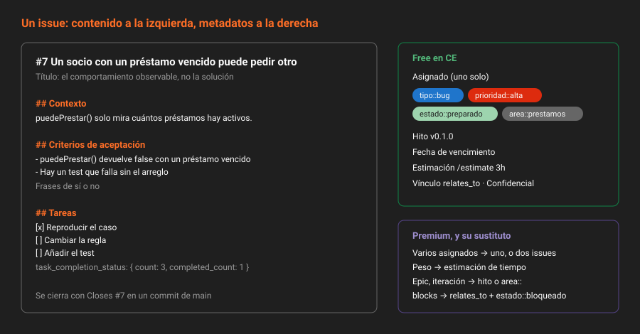

# El issue como unidad de trabajo

> Un issue es un contrato pequeño: dice qué problema hay, cuándo se considera resuelto y quién se ocupa. Si falta una de las tres cosas, es una nota.

## 🎯 Objetivos

- Reconocer cada campo de un issue y decir para qué sirve y quién lo lee
- Escribir un título que se entiende en un listado, sin abrir el issue
- Redactar criterios de aceptación que se pueden comprobar, y no solo leer
- Usar listas de tareas y leer su progreso por API
- Distinguir issue, tarea e incidente, y saber qué campos de un issue son de pago

---

## 1. Qué problema resuelve

Sin issues, el trabajo de un equipo vive en tres sitios: el chat, la memoria de quien lo pidió y una hoja de cálculo que alguien actualizó hace un mes. Ninguno de los tres responde a las preguntas que importan cuando el trabajo ya está en marcha:

- ¿Esto ya lo está haciendo alguien?
- ¿Qué significa "terminado" para esta tarea?
- ¿Por qué se decidió hacerlo así, y quién lo decidió?
- ¿Qué cambio de código lo resolvió?

Un issue contesta las cuatro **en el mismo sitio donde vive el código**. Esa es la ventaja de GitLab frente a un gestor de tareas aparte: el issue enlaza con el commit, el commit con la merge request, la merge request con el pipeline, y el pipeline con el despliegue. En la Semana 08 vas a medir cuánto tarda un cambio en entrar y en publicarse, y solo se puede porque cada cambio empezó en un issue.

> [!NOTE]
> Esta semana los issues los creas tú y los cierras tú. A partir de la Semana 06 cada issue se cerrará desde una merge request, y a partir de la Semana 07 no habrá otra forma de que el código entre en `main`. El backlog que escribes ahora es el que vas a consumir durante el resto de la fase.

---

## 2. Anatomía de un issue



| Campo | Para qué sirve | Quién lo lee | En CE |
|---|---|---|:--:|
| **Título** | Identificar el problema en un listado | Todo el mundo, sin abrir el issue | ✅ |
| **Descripción** | Contexto, criterios de aceptación, tareas | Quien lo va a resolver | ✅ |
| **Asignado** | Quién se ocupa **ahora** | El equipo, para no duplicar trabajo | ✅ uno solo |
| **Etiquetas** | Qué es y cómo de urgente | El triaje, los filtros, el tablero | ✅ |
| **Hito** | Para cuándo | La planificación | ✅ |
| **Fecha de vencimiento** | Un compromiso externo concreto | Quien depende del resultado | ✅ |
| **Confidencial** | Ocultarlo a quien no tiene rol Reporter | Seguridad, datos personales | ✅ |
| **Estimación y tiempo invertido** | Cuánto se esperaba y cuánto costó | La retrospectiva | ✅ |
| **Vínculos `relates_to`** | Issues relacionados | Quien investiga el contexto | ✅ |
| **Vínculos `blocks` / `is_blocked_by`** | Dependencias duras | La planificación | Premium |
| **Varios asignados** | Trabajo compartido | — | Premium |
| **Peso (*weight*)** | Tamaño relativo | La planificación | Premium |
| **Epic, iteración** | Agrupación y cadencia | La planificación de producto | Premium |
| **Estado de salud** | "En riesgo", "necesita atención" | La dirección | Ultimate |

Lo que es de pago se sustituye así en este bootcamp, y está en la tabla del [README raíz](../../../README.md):

| De pago | Sustituto en CE |
|---|---|
| Varios asignados | Un asignado y los demás mencionados en la descripción. Si de verdad son dos personas, son dos issues |
| Peso | Estimación de tiempo (`/estimate`), que es Free |
| Epic | Un hito, o una etiqueta `area::` que agrupa |
| Iteración | Un hito con fechas de inicio y fin cortas |
| `blocks` | Vínculo `relates_to` más una línea "Bloqueado por #N" en la descripción, y la etiqueta `estado::bloqueado` |

> [!IMPORTANT]
> En la API, un issue de CE **no tiene campo `weight`**. Si lo envías al crear un issue, se ignora en silencio. Es el patrón general: las features de pago no dan error en CE, simplemente no hacen nada. Cuando dudes, crea el issue y vuelve a leerlo.

---

## 3. El título

Un título se lee en un listado de cincuenta, entre otros cuarenta y nueve. Tiene que bastar para decidir si abrirlo.

| ❌ Mal | ✅ Bien | Por qué |
|---|---|---|
| Bug en multas | La multa se calcula sobre días naturales en vez de hábiles | Dice qué falla y cómo |
| Mejorar préstamos | Un socio con dos préstamos vencidos puede pedir un tercero | Describe el comportamiento, no la intención |
| Revisar | `estaDisponible` devuelve `true` para un libro dado de baja | Se entiende sin contexto |
| URGENTE!!! | (la urgencia va en la etiqueta `prioridad::`) | El título no es un canal de alarma |

La regla práctica: **el título describe el comportamiento observable**, no la solución. "Añadir validación de cupo" es una solución; "Se puede reservar una clase con el cupo lleno" es el problema. El primero obliga a quien lo resuelve a hacer lo que se dijo; el segundo le deja encontrar la mejor forma.

---

## 4. La descripción

La descripción tiene tres partes, y en ese orden:

1. **Contexto**: qué pasa, dónde, desde cuándo, y cómo se reproduce si es un fallo.
2. **Criterios de aceptación**: qué tiene que ser cierto para cerrar el issue.
3. **Tareas**: los pasos, si son más de uno.

### 4.1 Criterios de aceptación

Un criterio de aceptación es una frase que **se puede comprobar con un sí o un no**. Si no se puede, es una aspiración.

```markdown
## Criterios de aceptación

- `calcularMulta(3)` devuelve `0.75` con la tarifa por defecto
- Un préstamo devuelto en sábado no suma días de retraso
- El test `multa.test.ts` cubre los dos casos anteriores
```

Frente a:

```markdown
## Criterios de aceptación

- La multa se calcula bien
- El código queda limpio
```

El segundo bloque no permite cerrar nunca el issue con certeza, y por eso es peor que no tener ninguno: da la impresión de que hay un criterio.

### 4.2 Listas de tareas

Las casillas de Markdown en la descripción de un issue son **interactivas**: se marcan con un clic y GitLab lleva la cuenta.

```markdown
## Tareas

- [x] Reproducir con un préstamo devuelto en sábado
- [ ] Cambiar el cálculo a días hábiles
- [ ] Añadir el test
```

El listado de issues muestra "1 of 3 checklist items completed", y la API lo expone:

```bash
source ~/.bc-gitlab
H="PRIVATE-TOKEN: $GITLAB_TOKEN"; API="$GITLAB_URL/api/v4"
P=$(printf '%s' "$PROYECTO" | jq -sRr @uri)

curl -s -H "$H" "$API/projects/$P/issues/7" | jq '.task_completion_status'
```

```json
{ "count": 3, "completed_count": 1 }
```

> [!TIP]
> Una lista de tareas con más de siete casillas casi siempre son dos issues. Si las casillas se pueden repartir entre dos personas, sepáralas.

---

## 5. Tipos de issue

En GitLab 19 los issues son un caso particular de *work items*, y tienen tipo. Los que importan en CE:

| Tipo | Para qué | Cómo se crea |
|---|---|---|
| `issue` | El trabajo normal | Por defecto |
| `task` | Una subtarea hija de un issue | Desde el bloque *Child items* del issue, o `/add_child` |
| `incident` | Algo que está roto **en producción**, ahora | `issue_type=incident` o `/type incident` |

Los incidentes los usarás en la Semana 22. Las tareas hijas son una alternativa a la lista de casillas cuando cada paso necesita su propio asignado o su propia discusión.

> [!WARNING]
> El listado `GET /projects/:id/issues` devuelve **todos los tipos** mezclados: issues, tareas e incidentes. Si cuentas tu backlog sin filtrar, una tarea hija cuenta como un issue más. El autograding de esta semana filtra con `issue_type=issue`, y tus scripts deberían hacer lo mismo.

```bash
curl -s -H "$H" "$API/projects/$P/issues?issue_type=issue&state=all&per_page=100" | jq length
```

---

## 6. Cómo se crea

**Con la UI**: `Plan → Issues → New issue`. El desplegable *Description* ofrece las plantillas del proyecto (teoría [06](06-plantillas-de-descripcion.md)).

**Con la API**:

```bash
curl -s --request POST "$API/projects/$P/issues" -H "$H" \
  --data-urlencode "title=Un socio con dos préstamos vencidos puede pedir un tercero" \
  --data-urlencode "labels=tipo::bug,prioridad::alta" \
  --data-urlencode "description=## Contexto
puedePrestar() solo mira el número de préstamos activos, no si están vencidos.

## Criterios de aceptación
- puedePrestar() devuelve false si el socio tiene algún préstamo vencido" \
  | jq '{iid, title, labels, web_url}'
```

El campo que identifica al issue **dentro del proyecto** es `iid` (el `#7` que ves en la interfaz), no `id`, que es global a la instancia. Todas las rutas de la API de un issue usan el `iid`.

---

## 7. Antipatrones

| Antipatrón | Por qué duele | Qué hacer en su lugar |
|---|---|---|
| Issue-cajón: "Varios arreglos de préstamos" | Nunca se cierra, porque siempre queda algo | Un problema por issue |
| Título que es una solución | Ata a quien lo resuelve a una idea previa | Describir el comportamiento observable |
| Criterios que no se pueden comprobar | El issue se cierra por cansancio, no por acuerdo | Frases de sí o no |
| Asignar a alguien "para que lo vea" | El asignado deja de significar "lo está haciendo" | Mencionarlo con `@usuario` en un comentario |
| Datos personales reales en un issue público | Quedan en el historial aunque se editen | Issue confidencial, y datos de ejemplo |
| Cerrar sin comentario | Nadie sabe si se arregló, se descartó o se duplicó | Cerrar desde el commit, o con `/duplicate #N`, o explicándolo |
| Reabrir un issue viejo para un problema nuevo parecido | Mezcla dos historiales | Issue nuevo con `/relate #viejo` |

---

## 8. Trucos

- **El `iid` aparece en la URL**: `.../-/issues/7` es el `iid` 7. No necesitas buscar el `id` global.
- **Issue desde un enlace**: `.../-/issues/new?issue[title]=...&issue[description]=...` abre el formulario rellenado. Útil en un README o en un mensaje de error de tu propia app.
- **Confidencial desde el principio**: `confidential=true` en el `POST`. Hacerlo después no borra las notificaciones que ya salieron por correo.
- **Ver solo lo tuyo**: `GET /issues?scope=assigned_to_me&state=opened` (sin proyecto) lista lo que tienes asignado en toda la instancia.

---

## 📚 Recursos Adicionales

- [Issues](https://docs.gitlab.com/ee/user/project/issues/) — campos, tipos y acciones
- [API de issues](https://docs.gitlab.com/ee/api/issues.html) — `iid`, filtros y `task_completion_status`
- [Tareas](https://docs.gitlab.com/ee/user/tasks.html) — tareas hijas como *work items*

---

## ✅ Checklist de Verificación

- [ ] Sabes qué campos de un issue son Free y cuáles Premium, y con qué sustituyes cada uno
- [ ] Puedes reescribir un título-solución como un título-problema
- [ ] Tus criterios de aceptación se responden con sí o no
- [ ] Has leído `task_completion_status` de un issue por API
- [ ] Sabes por qué tus recuentos filtran con `issue_type=issue`

---

[Volver a la Semana 05](../README.md) · [Siguiente: Taxonomía de etiquetas →](02-taxonomia-de-etiquetas.md)
