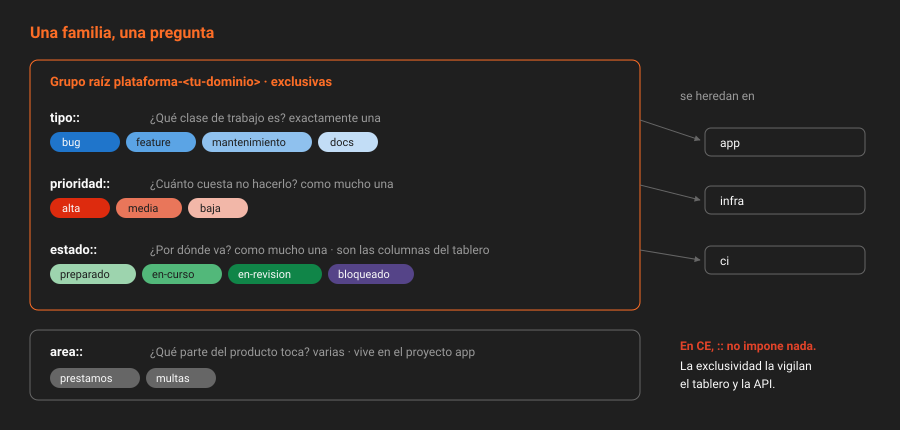

# Taxonomía de etiquetas

> Una etiqueta sola no significa nada. Lo que da valor es el sistema: pocas familias, cada una con una pregunta, y ninguna etiqueta que no pertenezca a alguna.

## 🎯 Objetivos

- Diseñar una taxonomía en familias, cada una con su pregunta y sus valores cerrados
- Explicar qué hace `::` en el nombre de una etiqueta en CE y qué añade Premium
- Decidir si una etiqueta va en el grupo raíz, en un subgrupo o en el proyecto
- Elegir colores y descripciones que sirvan de documentación
- Crear, listar, renombrar y promover etiquetas por API

---

## 1. Qué problema resuelve

Las etiquetas empiezan bien y se degradan solas. A los seis meses, cualquier proyecto sin una taxonomía tiene `bug`, `Bug`, `bugs`, `error`, `defecto`, `urgente`, `URGENTE`, `importante` y `revisar`. Nadie sabe cuál usar, así que cada uno crea la suya, y el filtro por etiqueta deja de devolver lo que buscas.

El fallo no es tener muchas etiquetas. Es que **las etiquetas no contestan preguntas**. `urgente` e `importante` intentan contestar la misma; `revisar` no contesta ninguna.

Una taxonomía resuelve eso con una regla: **cada etiqueta pertenece a una familia, y cada familia contesta una sola pregunta**.

---

## 2. Las familias



| Familia | Pregunta | Valores en este bootcamp | ¿Exclusiva? |
|---|---|---|:--:|
| `tipo::` | ¿Qué clase de trabajo es? | `bug`, `feature`, `mantenimiento`, `docs` | Sí |
| `prioridad::` | ¿Cuánto cuesta no hacerlo? | `alta`, `media`, `baja` | Sí |
| `estado::` | ¿Por dónde va? | `preparado`, `en-curso`, `en-revision`, `bloqueado` | Sí |
| `area::` | ¿Qué parte del producto toca? | Las de tu dominio: `area::prestamos`, `area::multas` | No |

Tres de las cuatro familias son **exclusivas**: un issue no puede ser a la vez un `bug` y una `feature`, ni tener prioridad alta y baja. La cuarta no: un cambio puede tocar préstamos y multas a la vez.

> [!NOTE]
> Fíjate en lo que **no** es una familia: `urgente` (eso es `prioridad::alta`), `revisar` (eso es `estado::en-revision`), `bloqueado` suelto (eso es `estado::bloqueado`), `v0.1.0` (eso es un hito, teoría [04](04-hitos.md)), `juan` (eso es el asignado). Si una etiqueta duplica un campo que el issue ya tiene, sobra.

### 2.1 Cuántos valores por familia

Pocos. Una familia con nueve valores obliga a pensar cada vez cuál poner, y la gente acaba poniendo el primero. Tres a cinco valores por familia es el rango que se usa sin consultar la documentación.

`prioridad::` en concreto funciona mejor con tres valores que con cinco. Con cinco, todo acaba en la del medio.

### 2.2 Qué significa cada valor

El valor tiene que estar definido **en la descripción de la etiqueta**, no en una página de la wiki que nadie abre. GitLab muestra la descripción al pasar el ratón por encima de la etiqueta, en cualquier sitio donde aparezca.

| Etiqueta | Descripción |
|---|---|
| `prioridad::alta` | Bloquea a un usuario o a otro trabajo. Se empieza antes que cualquier `media` |
| `prioridad::media` | Entra en el hito actual si cabe |
| `prioridad::baja` | Mejora deseable. Puede esperar un hito entero sin consecuencias |
| `estado::bloqueado` | Depende de algo externo. La descripción del issue dice de qué y desde cuándo |

> [!TIP]
> Escribe la descripción como criterio de decisión: "se usa cuando…". Una descripción que repite el nombre (`prioridad::alta` → "prioridad alta") no ayuda a nadie a elegir.

---

## 3. Los dos puntos dobles: `::`

### 3.1 Qué hace en Premium

En GitLab Premium, una etiqueta con `::` es una **etiqueta con ámbito** (*scoped label*): todo lo que va antes de los últimos `::` es el ámbito, y un issue solo puede tener **una** etiqueta por ámbito. Si un issue tiene `prioridad::alta` y le pones `prioridad::baja`, GitLab quita la primera automáticamente. Además, se pintan con dos colores, ámbito y valor.

### 3.2 Qué hace en CE

**Nada especial.** En CE, `prioridad::alta` es una etiqueta cuyo nombre contiene dos puntos. Se crea igual, se filtra igual, y un issue puede tener `prioridad::alta` y `prioridad::baja` a la vez sin que GitLab diga nada.

Esto se comprueba en el código de la propia instancia: el método `allows_scoped_labels?` de los issues devuelve `false` en CE, y la API de *work items* expone el campo `allows_scoped_labels` como `false`.

### 3.3 Entonces, ¿por qué usar `::` en CE?

Por tres razones, y la tercera es la que decide:

1. **Se lee como familia.** `tipo::bug` dice a qué pregunta contesta; `bug` no.
2. **Se filtra por prefijo.** `jq 'select(.name | startswith("tipo::"))'` encuentra la familia entera.
3. **Si algún día la instancia pasa a Premium, la exclusividad aparece sola**, sin renombrar ni una etiqueta. Con `tipo/bug` o `tipo-bug` habría que renombrar todas.

La exclusividad que CE no impone la sustituyes tú, de dos formas que se ven en la teoría [03](03-etiquetas-priorizadas-y-exclusividad.md): el tablero la impone al mover tarjetas, y una comprobación por API detecta las violaciones.

> [!WARNING]
> No mezcles separadores. Un proyecto con `tipo::bug` y `tipo:bug` y `tipo/feature` tiene tres familias para el ordenador y una para las personas. Elige `::` y no lo cambies.

---

## 4. Grupo o proyecto

Las etiquetas pueden vivir en un grupo o en un proyecto, y **las de un grupo se heredan** en todos sus subgrupos y proyectos.

| Dónde | Cuándo | Ejemplo |
|---|---|---|
| **Grupo raíz** `plataforma-<tu-dominio>` | La familia significa lo mismo en todos los proyectos | `tipo::`, `prioridad::`, `estado::` |
| **Subgrupo** | Solo tiene sentido en esa rama del árbol | `area::componentes` en `ci` |
| **Proyecto** | Solo existe en ese repositorio | `area::multas` en `app` |

La regla: **la taxonomía va en el grupo raíz; las áreas, donde vive el código que describen**. Si pones `tipo::bug` en `app` y otra vez en `infra`, tienes dos etiquetas distintas con el mismo nombre: el filtro de grupo las mezcla, y cambiar el color de una no cambia la otra.

> [!NOTE]
> Una etiqueta heredada del grupo no se puede editar ni borrar desde el proyecto; solo se puede **priorizar** (teoría [03](03-etiquetas-priorizadas-y-exclusividad.md)). Es justo lo que quieres: la taxonomía la mantiene quien tiene rol en el grupo raíz.

### 4.1 Promover una etiqueta

Si una etiqueta nació en el proyecto y resulta que sirve a todos, se **promueve** al grupo padre. Los issues y merge requests que la usaban la conservan, y las etiquetas homónimas de otros proyectos del grupo se fusionan en ella:

```bash
curl -s --request PUT "$API/projects/$P/labels/$LABEL_ID/promote" -H "$H" | jq '{id, name}'
```

---

## 5. Colores

El color no es decoración: es lo primero que se ve en el tablero, antes que el texto.

- **Un color por familia**, con variaciones de intensidad dentro de ella. Todas las `prioridad::` en la gama del rojo, todas las `tipo::` en la del azul.
- **El valor más urgente, el color más saturado.** `prioridad::alta` en rojo intenso; `prioridad::baja` en un rojo apagado.
- **`estado::bloqueado` en un color que no se parece a ninguno.** Tiene que saltar a la vista en el tablero.

| Familia | Gama sugerida | Ejemplo |
|---|---|---|
| `tipo::` | Azules | `#1F75CB`, `#5BA4E5`, `#8FC1EE`, `#C2DDF6` |
| `prioridad::` | Rojos | `#DD2B0E`, `#E9765A`, `#F2B7A8` |
| `estado::` | Verdes, y bloqueado en morado | `#108548`, `#52B87A`, `#9DD4AE`, `#554488` |
| `area::` | Grises | `#666666` |

---

## 6. Cómo se configura

**Con la UI**: `Grupo → Manage → Labels → New label`. El color se elige de la paleta o con el código hexadecimal.

**Con la API**, en el grupo raíz:

```bash
G=$(printf '%s' "${PROYECTO%%/*}" | jq -sRr @uri)

curl -s --request POST "$API/groups/$G/labels" -H "$H" \
  --data-urlencode "name=prioridad::alta" \
  --data-urlencode "color=#DD2B0E" \
  --data-urlencode "description=Bloquea a un usuario o a otro trabajo. Se empieza antes que cualquier media" \
  | jq '{id, name, color}'
```

Listar la taxonomía entera, por familia:

```bash
curl -s -H "$H" "$API/groups/$G/labels?per_page=100" \
  | jq -r 'sort_by(.name)[] | "\(.color)\t\(.name)"'
```

Renombrar no rompe nada: los issues apuntan al `id` de la etiqueta, no al nombre.

```bash
curl -s --request PUT "$API/groups/$G/labels/$LABEL_ID" -H "$H" \
  --data-urlencode "new_name=tipo::mantenimiento" | jq '.name'
```

---

## 7. Antipatrones

| Antipatrón | Por qué duele | Qué hacer en su lugar |
|---|---|---|
| Etiquetas sueltas sin familia | Nadie sabe cuándo usarlas, y se multiplican | Toda etiqueta pertenece a una familia |
| `urgente` **y** `prioridad::alta` | Dos etiquetas para la misma pregunta | Una familia por pregunta |
| La misma etiqueta creada en cada proyecto | Colores y descripciones divergen; el filtro de grupo las mezcla | Crearla en el grupo raíz, o promoverla |
| Una etiqueta por persona o por versión | Duplica el asignado o el hito | Usar el campo que ya existe |
| Etiquetas sin descripción | Cada uno las interpreta a su manera | Descripción con criterio de uso |
| Nueve valores de prioridad | Todo acaba en el del medio | Tres valores |
| Borrar una etiqueta en uso | Desaparece de todos los issues y del historial de filtros | Renombrarla o fusionarla; borrar solo con `open_issues_count` a cero |

---

## 8. Trucos

- **Cuántos issues usan cada etiqueta**: `GET /projects/:id/labels?with_counts=true` añade `open_issues_count`, `closed_issues_count` y `open_merge_requests_count`. Las que tienen todo a cero son candidatas a borrar.
- **Solo las del proyecto, sin las heredadas**: `include_ancestor_groups=false` en el listado de etiquetas del proyecto.
- **Suscribirse a una etiqueta**: `POST /projects/:id/labels/:label_id/subscribe`. Recibes aviso de cada issue que la lleve; es la forma de que quien mantiene `area::multas` se entere sin vigilar el tablero.
- **Referencia en Markdown**: `~"prioridad::alta"` en un comentario se convierte en un enlace al listado filtrado.

---

## 📚 Recursos Adicionales

- [Etiquetas](https://docs.gitlab.com/ee/user/project/labels.html) — grupo y proyecto, promoción, suscripción, y la sección de *scoped labels* marcada como Premium
- [API de etiquetas de proyecto](https://docs.gitlab.com/ee/api/labels.html) — `with_counts`, `include_ancestor_groups`, `promote`
- [API de etiquetas de grupo](https://docs.gitlab.com/ee/api/group_labels.html)

---

## ✅ Checklist de Verificación

- [ ] Cada familia de tu taxonomía contesta una sola pregunta, y sabes cuál
- [ ] Puedes explicar qué hace `::` en CE y qué cambiaría en Premium
- [ ] Sabes qué etiquetas van en el grupo raíz y cuáles en el proyecto
- [ ] Todas tus etiquetas tienen una descripción que dice cuándo se usan
- [ ] Has listado la taxonomía del grupo por API

---

[← Anterior: El issue como unidad de trabajo](01-el-issue-como-unidad-de-trabajo.md) · [Volver a la Semana 05](../README.md) · [Siguiente: Etiquetas priorizadas y exclusividad →](03-etiquetas-priorizadas-y-exclusividad.md)
