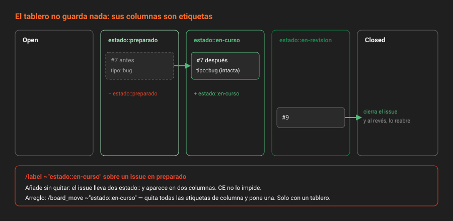

# Tableros

> Un tablero de GitLab no guarda nada. Es una vista de issues filtrada por etiquetas, y mover una tarjeta es cambiar una etiqueta. Entender eso evita la mitad de las sorpresas.

## 🎯 Objetivos

- Explicar de qué está hecho un tablero y por qué no tiene estado propio
- Predecir qué etiquetas cambian al mover una tarjeta entre dos columnas cualquiera
- Crear un tablero y sus listas por API, en el orden correcto
- Saber cuántos tableros puede tener un proyecto y un grupo en CE, y por qué importa tener uno
- Distinguir lo que es Free de lo que es Premium en los tableros

---

## 1. Qué problema resuelve

Un listado de issues contesta "¿qué hay?". No contesta "¿por dónde va cada cosa?" ni "¿dónde se está atascando el trabajo?". Para eso se inventaron los tableros kanban: columnas que representan etapas, y tarjetas que avanzan de izquierda a derecha.

Muchos equipos tienen el tablero en una herramienta aparte. El problema es que entonces el estado vive en dos sitios, el tablero y el issue, y se desincronizan en cuanto alguien olvida actualizar uno. En GitLab no pasa, porque **el tablero no tiene estado propio: lo lee de las etiquetas de los issues**.

---

## 2. Cómo funciona



### 2.1 De qué está hecho

Un tablero es una lista ordenada de **listas** (columnas). En CE hay tres clases:

| Lista | Qué muestra | Se puede quitar |
|---|---|:--:|
| **Open** | Issues abiertos que no están en ninguna lista de etiqueta | Sí (`hide_backlog_list`) |
| **De etiqueta** | Issues abiertos con esa etiqueta | Sí |
| **Closed** | Issues cerrados | Sí (`hide_closed_list`) |

Para tu taxonomía, las columnas de etiqueta son las de la familia `estado::`, en el orden del flujo:

**Open** → `estado::preparado` → `estado::en-curso` → `estado::en-revision` → **Closed**

Y `estado::bloqueado`, si la usas, como columna aparte al final o como etiqueta sin columna: un issue bloqueado no "avanza", está parado en la etapa en la que estaba.

### 2.2 Mover es reetiquetar

Es la regla que hay que tener en la cabeza. Al arrastrar una tarjeta:

| De | A | Qué hace GitLab con el issue |
|---|---|---|
| Open | `estado::en-curso` | Añade `estado::en-curso` |
| `estado::preparado` | `estado::en-curso` | Quita `estado::preparado`, añade `estado::en-curso` |
| `estado::en-revision` | Closed | Quita `estado::en-revision` y **cierra el issue** |
| Closed | `estado::en-curso` | **Reabre** el issue y añade la etiqueta |
| Cualquiera | Open | Quita la etiqueta de la columna de origen |

Y la inversa: **ponerle una etiqueta a un issue lo mueve de columna** sin tocar el tablero. Si un issue tiene a la vez `estado::preparado` y `estado::en-curso`, aparece **en las dos columnas**. Es la señal visual de que la exclusividad se ha roto (teoría [03](03-etiquetas-priorizadas-y-exclusividad.md)).

> [!IMPORTANT]
> Las etiquetas que no son columna no se tocan al mover. Un issue con `tipo::bug` y `prioridad::alta` conserva las dos de punta a punta del tablero.

### 2.3 El orden dentro de la columna

El orden vertical de las tarjetas es **manual** y se guarda en el issue (`relative_position`). No sigue la prioridad de las etiquetas. Es intencionado: el tablero refleja el orden en que el equipo decidió trabajar, que puede no coincidir con la prioridad declarada, y esa diferencia es información.

---

## 3. Cuántos tableros

Verificado contra el código de la instancia 19.2.4-ce.0:

| Dónde | Tableros en CE | Tableros en Premium |
|---|:--:|:--:|
| **Proyecto** | Varios | Varios |
| **Grupo** | Uno | Varios |

Que el proyecto admita varios no significa que convenga. La acción rápida `/board_move` **solo está disponible si el proyecto tiene exactamente un tablero**, porque con dos no sabría a cuál se refiere. Y dos tableros con columnas distintas sobre los mismos issues acaban reetiquetando en direcciones contrarias.

> [!WARNING]
> Abrir `Plan → Issue boards` en la UI **crea un tablero por defecto** si el proyecto no tiene ninguno. Si después creas otro por API, ya tienes dos, y `/board_move` desaparece del autocompletado sin aviso. Antes de crear, lista: `GET /projects/:id/boards | jq length`. Si ya hay uno, úsalo.

---

## 4. Lo que es de pago

| Feature | Tier | Qué hace | En CE |
|---|---|---|---|
| Listas de etiqueta | Free | Columna por etiqueta | ✅ |
| Varios tableros por proyecto | Free | — | ✅ |
| Varios tableros por **grupo** | Premium | — | Uno por grupo |
| Listas de **asignado** | Premium | Columna por persona | Filtro por asignado en el tablero |
| Listas de **hito** | Premium | Columna por hito | Filtro por hito en el tablero |
| Listas de **iteración** | Premium | Columna por sprint | — |
| **Límites WIP** | Premium | Máximo de tarjetas por columna | Comprobación por API (abajo) |
| **Tablero configurable** (alcance fijo por hito, etiqueta, asignado) | Premium | El tablero se guarda ya filtrado | Filtrar en la barra de búsqueda, o un enlace con el filtro en la URL |
| **Swimlanes** por epic | Premium | Filas horizontales | — |

El código de la API lo deja escrito: los parámetros de configuración del tablero están en un bloque vacío con el comentario *"Configurable issue boards are not available in CE/EE Core"*. En CE solo se pueden cambiar `name`, `hide_backlog_list` y `hide_closed_list`.

### 4.1 Un límite WIP sin Premium

El límite de trabajo en curso es la idea más útil de kanban: si la columna `estado::en-curso` tiene más de tres tarjetas, nadie empieza nada nuevo hasta terminar algo. Premium lo pinta en rojo. En CE se pregunta:

```bash
curl -s -H "$H" "$API/projects/$P/issues?state=opened&labels=estado::en-curso&per_page=100" \
  | jq 'length <= 3'
```

En la Semana 11 esto pasa a un pipeline programado.

---

## 5. Cómo se configura

**Con la UI**: `Plan → Issue boards`. Botón *New list* → *Label* → elige la etiqueta. Las columnas se reordenan arrastrando la cabecera.

**Con la API**, en tres pasos. El orden importa: las listas necesitan el `id` de la etiqueta, y las etiquetas tienen que existir antes.

```bash
source ~/.bc-gitlab
H="PRIVATE-TOKEN: $GITLAB_TOKEN"; API="$GITLAB_URL/api/v4"
P=$(printf '%s' "$PROYECTO" | jq -sRr @uri)

# 1. ¿Ya hay tablero?
curl -s -H "$H" "$API/projects/$P/boards" | jq -r '.[] | "\(.id)\t\(.name)"'

# 2. Si no hay ninguno, se crea
BID=$(curl -s --request POST "$API/projects/$P/boards" -H "$H" \
  --data-urlencode "name=Flujo" | jq -r '.id')

# 3. Una lista por etiqueta de estado, en el orden del flujo
for nombre in "estado::preparado" "estado::en-curso" "estado::en-revision"; do
  lid=$(curl -s -H "$H" "$API/projects/$P/labels?search=$nombre&per_page=100" \
        | jq -r --arg n "$nombre" '.[] | select(.name == $n) | .id')
  curl -s --request POST "$API/projects/$P/boards/$BID/lists" -H "$H" \
    --data-urlencode "label_id=$lid" | jq -r '"\(.position)\t\(.label.name)"'
done
```

El listado de etiquetas del proyecto incluye las del grupo por defecto, así que el `id` de una etiqueta heredada se encuentra igual.

Leer el tablero entero:

```bash
curl -s -H "$H" "$API/projects/$P/boards" \
  | jq -r '.[] | "\(.name): \([.lists[] | .label.name] | join(" → "))"'
# Flujo: estado::preparado → estado::en-curso → estado::en-revision
```

El campo `lists` de la API **solo contiene las listas de etiqueta**. Open y Closed no aparecen, porque no se pueden borrar como listas: se ocultan con los dos campos `hide_*`.

---

## 6. Antipatrones

| Antipatrón | Por qué duele | Qué hacer en su lugar |
|---|---|---|
| Columnas de `prioridad::` o `tipo::` | Mover una tarjeta cambia su prioridad o su tipo | Columnas solo de `estado::` |
| Columna "Hecho" con etiqueta | Un issue "hecho" pero abierto | La lista Closed: hecho es cerrado |
| Un tablero por persona | Reetiquetan los mismos issues en sentidos distintos | Un tablero, filtrado por asignado |
| Cambiar el estado reetiquetando a mano | Deja dos `estado::` puestos | Arrastrar, o `/board_move` |
| Ocho columnas de estado | Nadie sabe la diferencia entre la cuarta y la quinta | Tres o cuatro etapas reales |
| Tablero que nadie mira | El estado envejece y deja de ser verdad | Abrirlo al empezar cada sesión de trabajo |

---

## 7. Trucos

- **Un filtro en la URL es un tablero configurable gratis**: al filtrar el tablero por hito o etiqueta en su barra de búsqueda, el filtro queda en la URL del navegador. Esa URL es un tablero restringido que se guarda como marcador o se enlaza desde la wiki.
- **Crear un issue directamente en una columna**: el botón `+` de la cabecera de la lista crea el issue ya con esa etiqueta.
- **Ver cuántos issues hay en cada columna sin abrir el tablero**: `GET /projects/:id/labels?with_counts=true | jq -r '.[] | select(.name | startswith("estado::")) | "\(.open_issues_count)\t\(.name)"'`.
- **Mover una lista de posición por API**: `PUT /projects/:id/boards/:board_id/lists/:list_id` con `position`.

---

## 📚 Recursos Adicionales

- [Tableros de issues](https://docs.gitlab.com/ee/user/project/issue_board.html) — listas, movimiento, y las secciones Premium marcadas
- [API de tableros de proyecto](https://docs.gitlab.com/ee/api/boards.html) — tableros y listas
- [API de tableros de grupo](https://docs.gitlab.com/ee/api/group_boards.html) — el tablero único del grupo en CE

---

## ✅ Checklist de Verificación

- [ ] Puedes decir qué etiquetas cambian al mover una tarjeta entre dos columnas cualesquiera
- [ ] Sabes por qué una tarjeta puede aparecer en dos columnas a la vez, y qué significa
- [ ] Tu proyecto tiene un solo tablero, y sabes por qué
- [ ] Sabes qué partes del tablero son Premium y cómo se suplen
- [ ] Has leído las columnas de tu tablero por API

---

[← Anterior: Hitos](04-hitos.md) · [Volver a la Semana 05](../README.md) · [Siguiente: Plantillas de descripción →](06-plantillas-de-descripcion.md)
