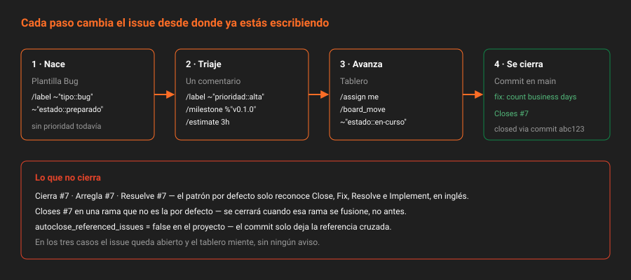

# Acciones rápidas y cierre automático

> El issue se mantiene al día solo si mantenerlo cuesta menos que olvidarlo. Las acciones rápidas y los patrones de cierre son lo que hace que cueste menos.

## 🎯 Objetivos

- Usar las acciones rápidas de CE para etiquetar, planificar, relacionar y estimar sin salir del comentario
- Saber qué acciones rápidas no existen en CE y por qué no dan error
- Cerrar un issue desde un commit, y explicar cuándo y por qué no se cierra
- Entender las referencias cruzadas que GitLab crea solo
- Registrar estimación y tiempo invertido, y leerlos por API

---

## 1. Qué problema resuelve

El estado de un issue se degrada porque actualizarlo exige ir a otro sitio. Terminas el cambio, haces el commit, y luego hay que abrir el navegador, buscar el issue, cambiar la etiqueta, poner el tiempo y cerrarlo. La mitad de las veces no se hace, y el tablero empieza a mentir.

GitLab ataca eso por dos lados:

- **Acciones rápidas**: comandos en el texto de un comentario o de una descripción, que cambian el issue al guardar.
- **Patrones de cierre**: una frase en el mensaje de commit que cierra el issue cuando el commit llega a la rama por defecto.

Con las dos, el issue se actualiza desde donde ya estás escribiendo.

---

## 2. Acciones rápidas

### 2.1 Cómo funcionan

Una línea que **empieza** por `/` en un comentario, en la descripción de un issue nuevo o en una plantilla. Al guardar, GitLab ejecuta el comando y **quita la línea** del texto. Si el comentario solo tenía acciones rápidas, no queda ningún comentario: queda una nota de sistema con lo que cambió.

```
Lo reproduzco con un préstamo devuelto en sábado.

/label ~"prioridad::alta"
/milestone %"v0.1.0"
/estimate 3h
```

Se pueden poner varias, una por línea. El autocompletado del editor las sugiere al escribir `/`.

### 2.2 Las que usarás en CE

Lista sacada de `lib/gitlab/quick_actions/` en la instancia 19.2.4-ce.0, filtrada a las útiles para issues:

| Acción | Qué hace |
|---|---|
| `/label ~"a" ~"b"` | Añade etiquetas |
| `/unlabel ~"a"` | Quita una etiqueta (sin argumento, todas) |
| `/relabel ~"a" ~"b"` | Sustituye todas las etiquetas por las indicadas |
| `/board_move ~"estado::en-curso"` | Mueve de columna. Solo con un tablero en el proyecto |
| `/milestone %"v0.1.0"` · `/remove_milestone` | Planifica o desplanifica |
| `/assign @usuario` · `/assign me` · `/unassign` | Asignado. En CE, uno solo |
| `/due 2026-12-01` · `/remove_due_date` | Fecha de vencimiento |
| `/estimate 3h` · `/remove_estimate` | Estimación |
| `/spend 1h30m` · `/remove_time_spent` | Tiempo invertido. Admite fecha: `/spend 1h 2026-11-10` |
| `/relate #12` · `/unlink #12` | Vínculo `relates_to` |
| `/duplicate #12` | Cierra este issue como duplicado de otro y los vincula |
| `/copy_metadata #12` | Copia etiquetas e hito de otro issue |
| `/confidential` | Lo marca confidencial |
| `/close` · `/reopen` | Cierra o reabre |
| `/title Nuevo título` | Cambia el título |
| `/type task` · `/type incident` | Cambia el tipo |
| `/add_child #15` · `/set_parent #12` | Jerarquía con tareas hijas |
| `/clone` · `/move <grupo>/<proyecto>` | Copia o traslada el issue a otro proyecto |
| `/subscribe` · `/todo` | Notificaciones y lista de pendientes propia |
| `/lock` · `/unlock` | Cierra la discusión a quien no es miembro |

### 2.3 Las que no existen en CE

`/weight`, `/epic`, `/iteration`, `/blocks`, `/blocked_by` y `/health_status` son de pago. En CE **no dan error**: el autocompletado no las ofrece, y si las escribes a mano la línea se queda en el comentario como texto. Es el mismo comportamiento que el campo `weight` en la API: lo que no existe se ignora.

> [!TIP]
> Si escribes una acción rápida y aparece tal cual en el comentario publicado, o no existe en tu tier o no tienes permiso para ejecutarla. Las acciones que cambian metadatos necesitan rol Reporter o superior en el proyecto.

---

## 3. Patrones de cierre



### 3.1 Cómo funcionan

Un commit cuyo mensaje contiene `Closes #12` **cierra el issue 12** cuando ese commit llega a la **rama por defecto**. Lo mismo vale para la descripción de una merge request, en el momento de fusionarla (Semana 06).

```bash
git commit -S -m "fix: count overdue days on business days only

Closes #7"
git push origin main
```

El patrón por defecto, copiado de `gitlab.rb.template` de la instancia, reconoce estos verbos y sus variantes:

| Verbo | Variantes |
|---|---|
| Close | `Close`, `Closes`, `Closed`, `Closing` |
| Fix | `Fix`, `Fixes`, `Fixed`, `Fixing` |
| Resolve | `Resolve`, `Resolves`, `Resolved`, `Resolving` |
| Implement | `Implement`, `Implements`, `Implemented`, `Implementing` |

Y acepta varios issues: `Closes #7, #9 and #12`.

> [!IMPORTANT]
> **Solo en inglés.** `Cierra #7`, `Arregla #7` o `Resuelve #7` no cierran nada: crean una referencia cruzada y el issue sigue abierto. Es coherente con la convención del bootcamp —mensajes de commit en inglés— pero es una trampa habitual en equipos hispanohablantes.

### 3.2 Cuándo no cierra

| Situación | Por qué |
|---|---|
| El commit está en una rama que no es la por defecto | Se cierra cuando esa rama se fusione, no antes |
| El verbo está en español | No coincide con el patrón |
| El proyecto tiene desactivado el cierre automático | `autoclose_referenced_issues` en `false` |
| Quien empuja no tiene permiso sobre el issue | El cierre se hace en nombre de quien empuja |
| Referencia a un issue de otro proyecto sin la ruta | `#7` es del mismo proyecto; para otro, `grupo/proyecto#7` |

El ajuste del proyecto se lee y se cambia por API:

```bash
curl -s -H "$H" "$API/projects/$P" | jq '.autoclose_referenced_issues'
# true
```

El patrón es configurable para toda la instancia en `gitlab.rb` con `gitlab_rails['gitlab_issue_closing_pattern']`. En el laboratorio **no se toca**: cambiarlo afecta a todos los proyectos, y un patrón en dos idiomas se presta a cerrar issues por accidente con frases normales.

### 3.3 Referencias cruzadas

Cualquier mención `#7` en un commit, una merge request o un comentario de otro issue deja una **nota de sistema** en el issue 7: "mentioned in commit abc123". No cierra nada, pero enlaza. Así un issue acumula solo el rastro de todo lo que se hizo por él, y en la Semana 08 ese rastro es lo que permite medir el tiempo de ciclo.

---

## 4. Control de tiempo

La estimación y el tiempo invertido son **Free**, y en este bootcamp sustituyen al peso, que es Premium.

| Unidad | Significa |
|---|---|
| `mo` | Mes (4 semanas) |
| `w` | Semana (5 días) |
| `d` | Día (8 horas) |
| `h` · `m` | Horas, minutos |

Con acciones rápidas, `/estimate 3h` y `/spend 1h30m`. Con la API:

```bash
curl -s --request POST "$API/projects/$P/issues/7/time_estimate" -H "$H" \
  --data-urlencode "duration=3h" | jq '.'

curl -s --request POST "$API/projects/$P/issues/7/add_spent_time" -H "$H" \
  --data-urlencode "duration=1h30m" | jq '.'
```

```json
{
  "time_estimate": 10800,
  "total_time_spent": 5400,
  "human_time_estimate": "3h",
  "human_total_time_spent": "1h 30m"
}
```

En la API los tiempos van **en segundos**. El listado de issues trae el mismo bloque en `time_stats`, así que sumar la estimación de un hito es una línea:

```bash
curl -s -H "$H" "$API/projects/$P/issues?milestone=v0.1.0&state=all&per_page=100" \
  | jq '[.[].time_stats.time_estimate] | add / 3600'
```

> [!NOTE]
> La estimación no es para controlar a nadie. Sirve para una cosa: comparar al final del hito lo estimado con lo invertido y aprender a estimar mejor. Si nunca haces esa comparación, no estimes.

---

## 5. Antipatrones

| Antipatrón | Por qué duele | Qué hacer en su lugar |
|---|---|---|
| `Cierra #7` en el commit | No cierra; el issue queda abierto y el tablero miente | `Closes #7` |
| `Closes #7` en un commit de una rama que nunca se fusiona | El issue no se cierra nunca | Cerrar desde lo que llega a `main` |
| Cerrar a mano y además poner `Closes` | Doble nota, y si el commit no llega, el issue ya estaba cerrado sin código | Una sola vía: el commit o la MR |
| `/label` para cambiar de prioridad | Quedan dos `prioridad::` | `/unlabel` y `/label` juntos |
| `/spend` acumulado a final de mes | El dato no sirve para nada | Registrar al terminar cada sesión |
| `/estimate` con "3" a secas | Interpretado como minutos o rechazado | Siempre con unidad: `3h` |

---

## 6. Trucos

- **Previsualizar una acción rápida**: la pestaña *Preview* del editor muestra lo que va a hacer ("Adds ~prioridad::alta label") antes de guardar.
- **Acciones rápidas en el `POST` de la API**: una `description` con `/label ~"tipo::bug"` al crear un issue por API también se ejecuta.
- **Ver quién cerró y cuándo**: `GET /projects/:id/issues/:iid | jq '{closed_at, closed_by: .closed_by.username}'`.
- **Notas de sistema por API**: `GET /projects/:id/issues/:iid/resource_label_events` devuelve cada alta y baja de etiqueta con fecha. Es el historial del tablero, y en la Semana 08 lo usarás para medir cuánto pasa un issue en cada columna.

---

## 📚 Recursos Adicionales

- [Acciones rápidas](https://docs.gitlab.com/ee/user/project/quick_actions.html) — la tabla completa, con el tier de cada una
- [Cierre automático de issues](https://docs.gitlab.com/ee/user/project/issues/managing_issues.html#closing-issues-automatically) — patrón, rama por defecto y ajuste del proyecto
- [Control de tiempo](https://docs.gitlab.com/ee/user/project/time_tracking.html) — unidades, informes y API

---

## ✅ Checklist de Verificación

- [ ] Has cambiado etiqueta, hito y estimación de un issue con un solo comentario
- [ ] Sabes por qué `/weight` no da error en CE aunque no exista
- [ ] Has cerrado un issue con `Closes #N` desde un commit en `main`
- [ ] Puedes explicar por qué `Cierra #N` no funciona
- [ ] Has leído `time_stats` por API y sabes que va en segundos

---

[← Anterior: Plantillas de descripción](06-plantillas-de-descripcion.md) · [Volver a la Semana 05](../README.md)
