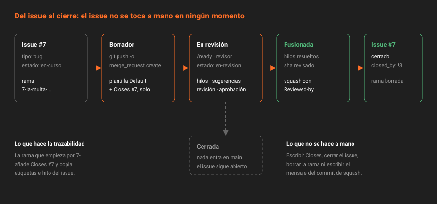

# La merge request como unidad de cambio

> Un commit dice qué cambió. Una merge request dice por qué, quién lo leyó, qué se discutió y qué issue queda resuelto. Es la unidad en la que un equipo acepta cambios, y la única que deja todo eso escrito en el mismo sitio.

## 🎯 Objetivos

- Describir de qué está hecha una merge request y qué guarda que un commit no guarda
- Recorrer su ciclo de vida: borrador, abierta, fusionada o cerrada
- Abrir una merge request desde un issue, desde la terminal con *push options* y por API
- Explicar qué hace GitLab con el issue cuando la merge request se fusiona
- Saber qué es de pago alrededor de una merge request y qué lo sustituye en CE

---

## 1. Qué problema resuelve

Hasta ahora has trabajado solo sobre `main`. Funciona mientras eres una persona con un repositorio. Deja de funcionar en cuanto aparece una segunda persona, por tres motivos:

- **Nadie ve el cambio antes de que esté dentro.** Un error en `main` lo hereda todo el que haga `pull`.
- **El porqué se pierde.** El mensaje del commit dice "fix: no cobrar domingos". No dice qué se discutió, qué alternativa se descartó ni quién lo dio por bueno.
- **El trabajo planificado y el código no se tocan.** El issue `#7` del backlog y el commit que lo resuelve viven en sitios distintos y nadie los une.

La merge request es la pieza que une las tres cosas: **una propuesta de fusionar una rama en otra**, con una conversación encima y un enlace al issue que la motiva.

---

## 2. Anatomía



| Pieza | Qué es | En la API |
|---|---|---|
| **Rama de origen** | Donde están los commits nuevos | `source_branch` |
| **Rama de destino** | Donde se quieren meter, casi siempre `main` | `target_branch` |
| **Título** | Una frase, como el título de un buen commit | `title` |
| **Descripción** | Qué, por qué, cómo se prueba, qué issue cierra | `description` |
| **Autor** | Quien la abre | `author` |
| **Asignado** | Quien la lleva hasta el final: casi siempre el autor | `assignees` |
| **Revisor** | Quien la lee y opina | `reviewers` |
| **Hilos** | Conversación, general o sobre líneas del diff | `discussions` |
| **Versiones** | Cada `push` a la rama crea una versión nueva del diff | `versions` |
| **Estado** | `opened`, `merged`, `closed` | `state` |
| **Por qué no se puede fusionar** | Una palabra | `detailed_merge_status` |

Dos campos se confunden siempre. El **asignado** es el responsable de que la merge request llegue a buen puerto: responde, corrige y la fusiona. El **revisor** es quien da su opinión. En un equipo pequeño, el asignado es el autor.

> [!NOTE]
> En CE una merge request admite **un asignado y un revisor**. Varios asignados y varios revisores son **Premium**. Verificado en el código de la 19.2.4: `allows_multiple_merge_request_reviewers?` devuelve `false` en CE. Si necesitas dos opiniones, la segunda persona comenta sin figurar como revisor, o se encadena: primero una, después otra.

---

## 3. Ciclo de vida

| Estado | Qué significa | Cómo se entra |
|---|---|---|
| **Borrador** | Visible, pero no lista: no se puede fusionar | Título que empieza por `Draft:`, o `/draft` |
| **Abierta** | Lista para revisar | `/ready`, o quitar `Draft:` del título |
| **Fusionada** | Los commits están en la rama de destino | Botón *Merge*, `/merge` o `PUT .../merge` |
| **Cerrada** | Se descartó sin fusionar | *Close*, o `/close` |

El borrador sirve para **enseñar trabajo a medias sin riesgo**: el diff, la conversación y el revisor ya funcionan, pero nadie puede pulsar *Merge* por error. Es el estado natural de una merge request recién abierta: la abres pronto, empujas commits, y la sacas de borrador cuando quieres opinión.

> [!IMPORTANT]
> Cerrar no es lo mismo que fusionar. Una merge request cerrada no mete nada en `main` y **no cierra su issue**. Si la cierras por error, se reabre; si la cierras porque el enfoque era malo, deja un comentario diciendo por qué, porque es la única documentación que va a quedar de esa decisión.

---

## 4. Tres formas de abrirla

### 4.1 Desde el issue

En la página de un issue, el botón **Create merge request** crea a la vez una rama y una merge request en borrador que ya cierra ese issue. El nombre de la rama sale del issue: número y título en minúsculas con guiones, como `7-la-multa-cuenta-los-domingos`.

Es la forma más trazable: no hay que acordarse de escribir `Closes #7`, porque GitLab lo pone solo.

> [!TIP]
> **El número delante del nombre de la rama es lo que hace la magia, no el botón.** Verificado en `MergeRequests::BuildService` de la 19.2.4: si la rama de origen empieza por `<número>-`, GitLab añade `Closes #<número>` al final de la descripción y copia las etiquetas y el hito del issue. Funciona igual con una rama que creas tú con `git switch -c 7-lo-que-sea`. Si el proyecto tiene desactivado el cierre automático (`autoclose_referenced_issues`), escribe `Related to #7` en su lugar.

### 4.2 Desde la terminal, con *push options*

Git permite mandar opciones al servidor al empujar. GitLab entiende un conjunto bajo `merge_request.`:

```bash
git push -u origin 7-la-multa-cuenta-los-domingos \
  -o merge_request.create \
  -o merge_request.target=main \
  -o merge_request.draft \
  -o merge_request.remove_source_branch
```

| Opción | Efecto |
|---|---|
| `merge_request.create` | Abre la merge request si no existe |
| `merge_request.target=<rama>` | Rama de destino |
| `merge_request.title="<texto>"` | Título; si falta, GitLab lo deduce de los commits o del issue |
| `merge_request.description="<texto>"` | Descripción |
| `merge_request.draft` | La abre en borrador |
| `merge_request.label="<etiqueta>"` | Añade una etiqueta (repetible) |
| `merge_request.milestone="<hito>"` | Asigna un hito |
| `merge_request.assign="<usuario>"` | Asigna |
| `merge_request.remove_source_branch` | Borra la rama al fusionar |
| `merge_request.squash` | Marca el squash |

La lista sale de `lib/gitlab/push_options.rb` de la instancia 19.2.4. No hay opción para el revisor: se asigna después, con `/assign_reviewer`.

### 4.3 Por API

```bash
curl -s --request POST "$API/projects/$P/merge_requests" -H "$H" \
  --data-urlencode "source_branch=7-la-multa-cuenta-los-domingos" \
  --data-urlencode "target_branch=main" \
  --data-urlencode "title=Draft: fix(multas): no cobrar los domingos" \
  --data-urlencode "description=Closes #7" \
  --data-urlencode "remove_source_branch=true" \
  | jq '{iid, web_url, draft, detailed_merge_status}'
```

Las tres vías no rellenan igual la merge request:

| Vía | Aplica la plantilla `Default` | Añade `Closes #N` si la rama empieza por `N-` |
|---|:--:|:--:|
| Botón del issue | ✅ | ✅ |
| Formulario *New merge request* de la UI | ✅ | ✅ |
| *Push options* | ✅ | ✅ |
| `POST /projects/:id/merge_requests` | ❌ | ❌ |

Las tres primeras pasan por `MergeRequests::BuildService`, que es quien hace las dos cosas. La API llama directamente al servicio de creación: lo que mandas es lo que queda.

---

## 5. Lo que pasa con el issue

Cuando una merge request **se fusiona en la rama por defecto**, GitLab cierra cada issue que su descripción nombra con un patrón de cierre (`Closes #7`, `Fixes #7`, `Resolves #7`): la misma regla de la Semana 05, aplicada a la descripción en vez de al commit. Y deja una nota en el issue con el enlace a la merge request.

Dos consultas lo hacen visible antes y después:

```bash
# Antes de fusionar: ¿qué va a cerrar?
curl -s -H "$H" "$API/projects/$P/merge_requests/$MR/closes_issues" | jq -r '.[] | "#\(.iid) \(.title)"'

# Después: ¿quién cerró este issue?
curl -s -H "$H" "$API/projects/$P/issues/7/closed_by" | jq -r '.[] | "!\(.iid) \(.title)"'
```

Si la primera devuelve una lista vacía, la merge request no va a cerrar nada. Es la comprobación que tienes que hacer antes de pulsar *Merge*.

Y mientras la merge request está abierta, el issue sigue abierto: en el tablero de la Semana 05 es el momento de la columna `estado::en-revision`.

---

## 6. Lo que es de pago

| Feature | Tier | En CE |
|---|---|---|
| Varios asignados o varios revisores | Premium | Uno de cada; la segunda opinión comenta sin ser revisor |
| Dependencias entre merge requests | Premium | Escribir "Depende de !12" en la descripción y no fusionar antes |
| Aprobaciones obligatorias | Premium | Aprobación opcional y hilos obligatorios (teoría [06](06-las-condiciones-para-fusionar.md)) |
| Revisores sugeridos por ML | Ultimate | Tú sabes quién conoce el código |
| Trenes de fusión | Premium | Rebase y fusión en orden, a mano |

---

## 7. Antipatrones

| Antipatrón | Por qué duele | Qué hacer en su lugar |
|---|---|---|
| Merge request sin issue | El cambio no responde a nada planificado | Abrirla desde el issue, o escribir `Closes #N` |
| Descripción vacía | El revisor adivina el porqué | La plantilla `Default` de la teoría 02 |
| Abrirla cuando ya está terminada | Las objeciones llegan cuando ya no hay ganas de cambiar nada | Abrirla pronto, en borrador |
| Una merge request con tres cambios | Imposible aprobar uno y rechazar otro | Una por cambio |
| Cerrar sin comentario | La decisión de descartar se pierde | Una línea con el porqué |

---

## 📚 Recursos Adicionales

- [Merge requests](https://docs.gitlab.com/ee/user/project/merge_requests/) — visión general
- [Crear merge requests](https://docs.gitlab.com/ee/user/project/merge_requests/creating_merge_requests.html) — desde issue, rama o terminal
- [Push options](https://docs.gitlab.com/ee/user/project/push_options.html) — la lista completa
- [API de merge requests](https://docs.gitlab.com/ee/api/merge_requests.html) — campos y estados

---

## ✅ Checklist de Verificación

- [ ] Sabes la diferencia entre asignado y revisor, y cuántos admite CE de cada uno
- [ ] Puedes abrir una merge request en borrador desde la terminal sin abrir el navegador
- [ ] Sabes qué consulta te dice qué issues va a cerrar una merge request antes de fusionarla
- [ ] Sabes por qué cerrar una merge request no cierra su issue

---

[Volver a la Semana 06](../README.md) · [Siguiente: Plantillas de merge request →](02-plantillas-de-merge-request.md)
