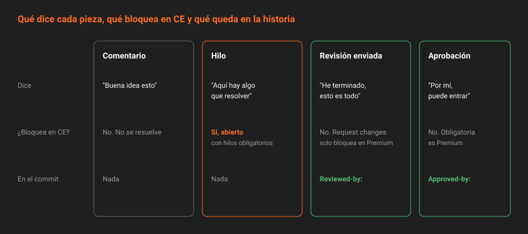

# La revisión en GitLab

> Revisar no es dejar comentarios: es llegar a un veredicto. GitLab tiene piezas para las dos cosas, y confundirlas produce merge requests con treinta comentarios sueltos y nadie que diga si se puede fusionar.

## 🎯 Objetivos

- Distinguir un comentario de un hilo, y un hilo general de uno sobre una línea del diff
- Hacer una revisión en borrador y enviarla de una vez, con resumen y veredicto
- Explicar qué deja rastro en la historia de Git y qué se queda solo en GitLab
- Usar la aprobación de CE sabiendo exactamente lo que garantiza y lo que no
- Revisar solo lo que cambió desde la última vez, y revisar en local cuando el diff no basta

---

## 1. Qué problema resuelve

Una revisión que se hace comentario a comentario tiene dos problemas. El autor recibe una notificación por cada uno y empieza a corregir antes de que el revisor termine, a veces en una dirección que el comentario siguiente contradice. Y al final nadie sabe si el revisor ha terminado y qué opina del conjunto.

GitLab separa tres cosas:

| Pieza | Responde a |
|---|---|
| **Hilo** | "Aquí hay algo que hay que resolver" |
| **Revisión** | "He terminado de leer, esto es todo lo que tengo" |
| **Aprobación** | "Por mí, esto puede entrar" |

---

## 2. Comentarios e hilos



Al escribir en una merge request hay dos botones, y la diferencia importa:

| Botón | Qué crea | Se puede resolver |
|---|---|:--:|
| **Comment** | Un comentario suelto | No |
| **Start thread** | Un hilo: una conversación que queda abierta hasta que alguien la resuelve | Sí |

Un comentario sobre una línea del diff es siempre un hilo. Los generales, depende del botón.

**Usa un hilo cuando esperas una acción**: un cambio, una respuesta, una decisión. Usa un comentario cuando no: un "buena idea esto" no tiene que quedar abierto bloqueando nada.

El ajuste del proyecto *All threads must be resolved* (`only_allow_merge_if_all_discussions_are_resolved`) es lo que convierte los hilos en una herramienta seria: con él activado, **un hilo abierto impide fusionar**. Es Free.

### 2.1 Quién resuelve

La convención que funciona: **resuelve quien abrió el hilo**, o el autor de la merge request cuando el cambio pedido es evidente y ya está empujado. Lo que no funciona es que el autor resuelva hilos con los que no está de acuerdo para poder fusionar: eso es hacer trampas al ajuste.

Cuando el autor no está de acuerdo, responde en el hilo con su argumento y deja que el revisor decida si lo resuelve.

### 2.2 Por API

```bash
# Hilo general
curl -s --request POST "$API/projects/$P/merge_requests/$MR/discussions" -H "$H" \
  --data-urlencode "body=¿Por qué domingo y no festivo? El issue habla de días de cierre." \
  | jq -r '.id'

# Resolverlo
curl -s --request PUT "$API/projects/$P/merge_requests/$MR/discussions/<id>" -H "$H" \
  --data-urlencode "resolved=true" | jq '.notes[0].resolved'

# Cuántos quedan abiertos
curl -s -H "$H" "$API/projects/$P/merge_requests/$MR/discussions?per_page=100" \
  | jq '[.[] | select(.notes[0].resolvable and (.notes[0].resolved | not))] | length'
```

Un hilo sobre una línea necesita, además, la **posición**: los tres SHA del diff y la línea. Lo verás en la práctica 03.

---

## 3. La revisión en borrador

En el diff, en vez de *Add comment now*, el botón **Start a review** guarda el comentario como **pendiente**: solo lo ves tú. Sigues leyendo, añades más, cambias de opinión y borras alguno. Cuando terminas, **Submit review** publica todos a la vez, con un resumen opcional y un veredicto:

| Veredicto | Significa |
|---|---|
| **Comment** | Comentarios sin opinión sobre el conjunto |
| **Approve** | Aprueba al enviar |
| **Request changes** | No debería fusionarse así |

El autor recibe **una** notificación con todo, y sabe que el revisor ha terminado.

Por API, la revisión en borrador son las *draft notes*:

```bash
# Comentario pendiente
curl -s --request POST "$API/projects/$P/merge_requests/$MR/draft_notes" -H "$H" \
  --data-urlencode "note=Falta un test para el sábado." | jq '.id'

# Enviar la revisión entera, con veredicto y resumen
curl -s --request POST "$API/projects/$P/merge_requests/$MR/draft_notes/bulk_publish" -H "$H" \
  --data-urlencode "reviewer_state=requested_changes" \
  --data-urlencode "note=Bien encaminado. Dos cosas antes de fusionar."
```

`reviewer_state` acepta `requested_changes` y `reviewed`, verificado en `lib/api/draft_notes.rb` de la 19.2.4. Desde un comentario, lo mismo es `/submit_review requested_changes`.

> [!IMPORTANT]
> **Solo una revisión enviada deja rastro en el commit.** La variable `%{reviewed_by}` de las plantillas de commit (teoría [05](05-estrategias-de-fusion.md)) se rellena con los autores de las revisiones enviadas, no con quien dejó comentarios sueltos. En el código: `reviewed_by_users` sale de la tabla de revisiones, que solo se escribe al hacer *Submit review*. Si quieres que tu revisor aparezca como `Reviewed-by:` en la historia, tiene que enviar una revisión.

> [!NOTE]
> En CE, *Request changes* **no bloquea** la fusión: no está entre las comprobaciones de fusión de la edición (teoría [06](06-las-condiciones-para-fusionar.md)). Es una señal para el autor. Lo que sí bloquea es el hilo que el revisor deja abierto.

---

## 4. La aprobación en CE

El botón **Approve** existe en CE y la API también:

```bash
curl -s --request POST "$API/projects/$P/merge_requests/$MR/approve" -H "PRIVATE-TOKEN: $T_REV" \
  | jq -r '.approved_by[].user.username'
```

Pero hay que saber exactamente lo que es en CE, verificado en `MergeRequestPolicy` de la 19.2.4:

- **Es opcional.** No hay número mínimo de aprobaciones: una merge request sin aprobar se fusiona igual. Las reglas de aprobación obligatoria son **Premium** (Semana 07).
- **Puede aprobar cualquier miembro del proyecto que pueda editar la merge request**, incluido su autor. Impedir que el autor apruebe lo suyo es un ajuste **Premium**.

Entonces, ¿para qué sirve? Para que la decisión quede **registrada y firmada por quien la toma**: quién dio el visto bueno, cuándo y sobre qué versión. Y para `%{approved_by}` en el commit. Lo que en CE garantiza que se ha revisado no es la aprobación, es el hilo obligatorio. En la Semana 07 un server hook exige `Approved-by:` en lo que entra a `main` y un script audita que la aprobación sea de alguien que no es el autor; en la Semana 09 ese script pasa a ser un job.

---

## 5. Revisar otra vez sin releerlo todo

Cada `push` a la rama crea una **versión** nueva del diff. En la pestaña *Changes*, el selector **Compare** permite comparar la versión 3 con la 2 en vez de con `main`: solo ves lo que el autor cambió desde tu última revisión.

```bash
curl -s -H "$H" "$API/projects/$P/merge_requests/$MR/versions" \
  | jq -r '.[] | "\(.id)\t\(.created_at)\t\(.head_commit_sha[:8])"'
```

Es lo que hace soportable una segunda ronda: el revisor no tiene que releer doscientas líneas para comprobar que se cambiaron tres.

---

## 6. Cuando el diff no basta

Hay cambios que no se entienden leyendo: un test que hay que ejecutar, un comportamiento que hay que probar. GitLab publica cada merge request como una referencia del repositorio:

```bash
git fetch origin merge-requests/12/head:mr-12
git switch mr-12
npm test
```

No hace falta saber el nombre de la rama de origen, y funciona igual si la merge request viene de un *fork*.

La vista *Blame* de GitLab también ayuda a revisar: dice quién tocó por última vez cada línea alrededor del cambio. Y sabe leer el `.git-blame-ignore-revs` de la Semana 02, para que un commit de formateo no tape al autor real.

---

## 7. Antipatrones

| Antipatrón | Por qué duele | Qué hacer en su lugar |
|---|---|---|
| Comentarios sueltos que en realidad piden cambios | Nada impide fusionar sin atenderlos | Hilo |
| Veinte comentarios publicados uno a uno | Veinte notificaciones y correcciones que se pisan | Revisión en borrador, enviada de una vez |
| El autor resuelve los hilos para poder fusionar | Convierte el ajuste en un trámite | Responde y deja resolver a quien lo abrió |
| Aprobarse a uno mismo | En CE se puede, y no significa nada | Aprobación de otra identidad |
| Releer la merge request entera en cada ronda | La segunda revisión tarda lo mismo que la primera | *Compare* entre versiones |

---

## 📚 Recursos Adicionales

- [Revisar merge requests](https://docs.gitlab.com/ee/user/project/merge_requests/reviews/) — revisión en borrador, veredictos y revisores
- [Hilos](https://docs.gitlab.com/ee/user/discussions/) — comentarios, hilos y resolución
- [API de discusiones](https://docs.gitlab.com/ee/api/discussions.html) — hilos generales y sobre el diff
- [API de draft notes](https://docs.gitlab.com/ee/api/draft_notes.html) — la revisión en borrador por API
- [API de aprobaciones](https://docs.gitlab.com/ee/api/merge_request_approvals.html) — qué endpoints existen en Free

---

## ✅ Checklist de Verificación

- [ ] Sabes cuándo usar un hilo y cuándo un comentario
- [ ] Sabes por qué una revisión enviada y diez comentarios sueltos no dejan el mismo rastro en la historia
- [ ] Puedes explicar qué garantiza una aprobación en CE y qué no
- [ ] Sabes revisar solo lo que cambió desde tu última revisión
- [ ] Puedes traerte una merge request a local sin saber su rama

---

[← Anterior: Plantillas de merge request](02-plantillas-de-merge-request.md) · [Volver a la Semana 06](../README.md) · [Siguiente: Sugerencias de código →](04-sugerencias-de-codigo.md)
