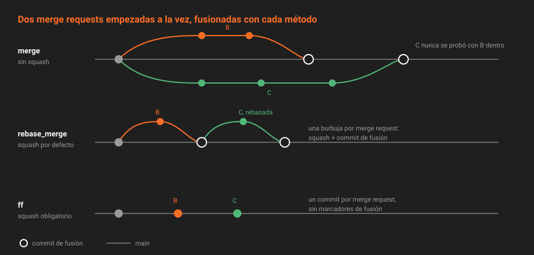

# Estrategias de fusión

> La forma en que entran los cambios en `main` decide cómo se lee la historia dentro de un año: si `git log` cuenta qué se hizo o cómo se tecleó, si `git bisect` encuentra un culpable o un commit de "wip", y si deshacer una merge request es un comando o una tarde.

## 🎯 Objetivos

- Explicar los tres métodos de fusión de GitLab y dibujar la historia que deja cada uno
- Combinarlos con las cuatro opciones de squash y predecir qué commits llegan a `main`
- Escribir plantillas para el commit de fusión y el de squash con las variables que existen
- Elegir una estrategia para tu proyecto y defenderla en un ADR

---

## 1. Qué problema resuelve

Una rama de trabajo acumula commits con distinta calidad: algunos cuentan un paso con sentido, otros son "arreglo el test" y "aplicar sugerencia". Al fusionar hay que decidir dos cosas independientes:

1. **¿Entran los commits uno a uno, o aplastados en uno?** Es el *squash*.
2. **¿Queda un commit de fusión que marca dónde entró la merge request, y se exige que la rama esté al día?** Es el *método de fusión*.

GitLab lo configura por proyecto, en `Settings → Merge requests`, y por API con `merge_method` y `squash_option`.

---

## 2. Los tres métodos



| Método (UI) | `merge_method` | Commit de fusión | Exige rama al día con `main` | Historia |
|---|---|:--:|:--:|---|
| *Merge commit* | `merge` | Siempre | No | Ramas que se cruzan |
| *Merge commit with semi-linear history* | `rebase_merge` | Siempre | **Sí** | Una línea, con "burbujas" por merge request |
| *Fast-forward merge* | `ff` | Nunca | **Sí** | Una línea recta |

Valores verificados en `lib/api/helpers/projects_helpers.rb` de la 19.2.4: `%w[ff rebase_merge merge]`.

### 2.1 `merge`: el de por defecto

Crea un commit de fusión aunque `main` haya avanzado. Nunca obliga a hacer rebase, y por eso es el más cómodo. Su precio es la historia: con tres merge requests abiertas a la vez, `git log --graph` es una trenza. Y la combinación que entra en `main` **nunca se probó como tal**: la rama se probó contra el `main` de hace dos días, no contra el de ahora.

### 2.2 `rebase_merge`: semilineal

Igual que el anterior, pero **solo se puede fusionar si la rama contiene el último commit de `main`**. Si no, la merge request queda en `need_rebase` hasta que alguien hace rebase (teoría [06](06-las-condiciones-para-fusionar.md)). Resultado: cada merge request es una burbuja que sale de la punta de `main` y vuelve a ella, y la historia se lee en línea.

Conserva el commit de fusión, que es un marcador útil: "aquí entró `!12`". Y garantiza que lo que se revisó es exactamente lo que queda en `main`, porque la rama ya contenía todo lo anterior.

### 2.3 `ff`: *fast-forward*

También exige la rama al día, y además **no crea commit de fusión**: `main` simplemente avanza hasta la punta de la rama. La historia es una línea recta sin marcadores. Los commits de la rama quedan en `main` con su SHA original.

---

## 3. Squash

`squash_option` decide si los commits de la rama se aplastan en uno al fusionar:

| UI | `squash_option` | Qué ve quien fusiona |
|---|---|---|
| *Do not allow* | `never` | Sin casilla de squash |
| *Allow* | `default_off` | Casilla desmarcada |
| *Encourage* | `default_on` | Casilla marcada |
| *Require* | `always` | Squash siempre, sin casilla |

### 3.1 Qué llega a `main`

| | Sin squash | Con squash |
|---|---|---|
| **`merge`** | Los N commits + un commit de fusión | Un commit de squash + un commit de fusión |
| **`rebase_merge`** | Los N commits rebasados + un commit de fusión | Un commit de squash + un commit de fusión |
| **`ff`** | Los N commits, tal cual | **Un solo commit** |

`ff` con squash obligatorio es la historia más simple que existe: un commit por merge request, en línea. `rebase_merge` con squash por defecto es casi igual, con el marcador de fusión añadido.

### 3.2 El precio del squash

- **Se pierden los pasos intermedios en `main`.** Si los commits de la rama contaban una historia útil (la Semana 02 te enseñó a escribirlos así), el squash la convierte en un solo mensaje. Los commits originales siguen en la merge request mientras GitLab la conserve, pero no en `git log`.
- **El commit de squash lo crea el servidor**: no lleva tu firma SSH. El de fusión tampoco.
- **`git bisect` encuentra la merge request culpable, no el commit culpable.** Casi siempre es suficiente: una merge request pequeña es un cambio pequeño.

La regla práctica: **squash por defecto** (`default_on`), y quien fusiona lo desmarca cuando los commits de la rama merecen quedarse.

---

## 4. Las plantillas del commit

El mensaje del commit de fusión y del de squash se pueden generar con una plantilla del proyecto: `merge_commit_template` y `squash_commit_template`. Algunas de las variables disponibles, de `Gitlab::MergeRequests::MessageGenerator` en la 19.2.4:

| Variable | Se convierte en |
|---|---|
| `%{title}` | Título de la merge request |
| `%{description}` | Descripción entera |
| `%{issues}` | `Closes #7 and #9`, o nada si no cierra issues |
| `%{reference}` / `%{local_reference}` | `grupo/app!12` / `!12` |
| `%{source_branch}` / `%{target_branch}` | Ramas |
| `%{url}` | Enlace a la merge request |
| `%{reviewed_by}` | Una línea `Reviewed-by: Nombre <correo>` por cada revisión **enviada** |
| `%{approved_by}` | Una línea `Approved-by: Nombre <correo>` por cada aprobación |
| `%{merged_by}` | `Nombre <correo>` de quien fusiona |
| `%{co_authored_by}` | `Co-authored-by:` por cada autor de commits distinto |
| `%{all_commits}` | Los mensajes de todos los commits |
| `%{first_commit}` | El mensaje del primer commit |

Una plantilla de squash que deja la historia trazable:

```text
%{title} (%{local_reference})

%{issues}

%{reviewed_by}
%{approved_by}
%{co_authored_by}
```

Produce, para la merge request `!3`:

```text
fix(multas): no cobrar los domingos (!3)

Closes #7

Reviewed-by: Revisor Biblioteca <revisor-biblioteca@example.com>
Approved-by: Revisor Biblioteca <revisor-biblioteca@example.com>
```

Las líneas vacías que dejan las variables sin valor se recortan. Y las líneas `Reviewed-by:` y `Approved-by:` son *trailers* de Git: `git log --format='%(trailers:key=Reviewed-by)'` las extrae.

> [!TIP]
> No uses `%{description}` en la plantilla de squash: arrastra al commit toda la plantilla de la merge request, casillas incluidas. El título y los *trailers* son lo que alguien va a leer en `git log` dentro de un año.

---

## 5. Cómo se elige

| Si tu equipo... | Elige |
|---|---|
| Quiere la historia más simple y revisa merge requests pequeñas | `ff` + squash `always` |
| Quiere historia en línea pero con un marcador por merge request | `rebase_merge` + squash `default_on` |
| Fusiona ramas largas con commits que importan, y tolera la trenza | `merge` + squash `default_off` |

Para este bootcamp se recomienda **`rebase_merge` con `default_on`**: historia legible, la garantía de que se fusiona lo que se revisó, y el commit de fusión como marcador para la Semana 08, cuando el changelog y las métricas se calculen por merge request. Pero la decisión es tuya y va en el **ADR-004**: la comprobación de la semana acepta `rebase_merge` y `ff`.

---

## 6. Antipatrones

| Antipatrón | Por qué duele | Qué hacer en su lugar |
|---|---|---|
| Dejar `merge` porque es el de por defecto | Historia en trenza y combinaciones nunca probadas | Decidirlo y escribirlo en un ADR |
| Squash con `%{description}` | El commit arrastra la plantilla de la merge request | Título, issues y *trailers* |
| Cambiar de estrategia cada mes | La historia mezcla tres estilos | Una, registrada; cambiarla exige otro ADR |
| `ff` sin squash con commits "wip" | La historia de `main` es un diario de trabajo | Squash, o limpiar la rama antes (Semana 02) |

---

## 📚 Recursos Adicionales

- [Métodos de fusión](https://docs.gitlab.com/ee/user/project/merge_requests/methods/) — los tres, con diagramas
- [Squash and merge](https://docs.gitlab.com/ee/user/project/merge_requests/squash_and_merge.html) — las cuatro opciones
- [Plantillas de commit](https://docs.gitlab.com/ee/user/project/merge_requests/commit_templates.html) — variables de los mensajes de fusión y squash

---

## ✅ Checklist de Verificación

- [ ] Puedes dibujar la historia de `main` tras tres merge requests con cada método
- [ ] Sabes qué commits llegan a `main` con `ff` y squash, y con `rebase_merge` sin squash
- [ ] Sabes por qué `%{reviewed_by}` puede salir vacío aunque alguien haya comentado
- [ ] Tienes una estrategia elegida y una frase que la defiende

---

[← Anterior: Sugerencias de código](04-sugerencias-de-codigo.md) · [Volver a la Semana 06](../README.md) · [Siguiente: Las condiciones para fusionar →](06-las-condiciones-para-fusionar.md)
