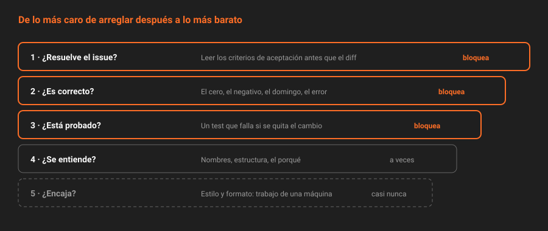

# El oficio de revisar

> Las herramientas de GitLab hacen posible revisar. No hacen que se revise bien. Esta teoría es sobre la parte que no está en ningún menú: qué mirar, en qué orden, cómo decirlo y cuánto código cabe en una revisión que alguien hace de verdad.

## 🎯 Objetivos

- Revisar en un orden que encuentra primero lo que más cuesta arreglar
- Escribir comentarios que dicen cuánto importan y qué se espera del autor
- Saber qué tamaño de merge request se puede revisar con atención
- Repartir las responsabilidades entre autor y revisor sin que ninguno cargue con las del otro

---

## 1. Qué problema resuelve

Una revisión puede fallar de dos formas opuestas. La primera: el revisor mira el diff durante treinta segundos, escribe "LGTM" y aprueba. La segunda: el revisor deja cuarenta comentarios sobre comas, nombres y espacios, y no ve que la función devuelve un resultado incorrecto los sábados.

Las dos tienen la misma causa: **revisar sin un orden**. Lo que salta a la vista en un diff son los detalles; lo que importa está en la lógica, y para verla hay que buscarla.

---

## 2. En qué orden



De lo más caro de arreglar después a lo más barato:

| Orden | Pregunta | Si falla |
|:--:|---|---|
| 1 | **¿Resuelve el issue?** Leer el issue y los criterios de aceptación antes que el diff | Todo lo demás sobra: el cambio no es el que hacía falta |
| 2 | **¿Es correcto?** Casos límite, errores, el sábado, el cero, el negativo | Un bug que llega a `main` |
| 3 | **¿Está probado?** Un test que fallaría sin el cambio | El bug vuelve en la próxima refactorización |
| 4 | **¿Se entiende?** Nombres, estructura, un comentario donde el porqué no es obvio | El siguiente que lo toque se equivoca |
| 5 | **¿Encaja?** Convenciones del proyecto, formato | Ruido; debería comprobarlo una máquina |

Los niveles 1 a 3 justifican bloquear la merge request. El 4 a veces. El 5 casi nunca: si una regla de estilo importa, la tiene que imponer un formateador en el pipeline (Semana 09), no una persona en cada revisión.

> [!TIP]
> Antes de leer el diff, **ejecuta los tests de la rama**: `git fetch origin merge-requests/<iid>/head:mr-<iid>` y `npm test`. Y después, rompe a propósito la línea que el cambio arregla y comprueba que algún test falla. Si ninguno falla, el punto 3 no se cumple, por muy bien que se lea el test.

---

## 3. Comentarios que se entienden

Un comentario de revisión tiene que dejar claras dos cosas: **qué opina el revisor** y **qué espera que haga el autor**. "¿Esto no debería ser `<=`?" no dice si es una pregunta, una sospecha o un error que bloquea.

La convención *Conventional Comments* lo resuelve con una etiqueta al principio:

| Etiqueta | Significa | ¿Bloquea? |
|---|---|:--:|
| `issue:` | Hay un problema concreto | Sí |
| `suggestion:` | Propuesta de mejora, con el motivo | Depende |
| `question:` | No lo entiendo; puede que esté bien | No, hasta la respuesta |
| `nitpick:` | Detalle menor, de gusto | No |
| `praise:` | Algo bien hecho, dicho en voz alta | No |
| `thought:` | Una idea para más adelante | No |

Y un decorador opcional entre paréntesis: `(blocking)` o `(non-blocking)`.

```text
issue (blocking): calcularMulta cuenta el domingo si el préstamo empieza en sábado.
Con inicio 2026-11-07 y 2 días de retraso devuelve 100 y debería devolver 50.

nitpick (non-blocking): `d` como nombre de variable se lee mal junto a `dias`.

praise: el test del sábado es justo el caso que se me habría escapado.
```

En GitLab, **lo que bloquea va en un hilo** (se queda abierto y, con el ajuste del proyecto, impide fusionar), y lo que no bloquea puede ir como comentario o como hilo que el autor resuelve al leerlo.

### 3.1 El tono

- **Sobre el código, no sobre la persona.** "Esta función no comprueba el cero", no "no has comprobado el cero".
- **Con el porqué.** "Usa `const`" es una orden. "`const` aquí evita que alguien reasigne el límite por error" es un argumento que el autor puede aceptar o discutir.
- **Preguntas cuando no estás seguro.** Si dudas, puede que el autor sepa algo que tú no.
- **Al menos un `praise:`** si hay algo bueno. No por cortesía: señala lo que hay que seguir haciendo.

---

## 4. El tamaño

Una revisión atenta tiene un límite. Con más de unas **cuatrocientas líneas cambiadas**, la atención cae y el revisor empieza a pasar páginas. No es una cifra exacta, pero el patrón se repite en todos los equipos: las merge requests grandes reciben menos comentarios por línea, no más.

| Tamaño | Qué pasa |
|---|---|
| Menos de 50 líneas | Se revisa entera, con calma, en minutos |
| 50-400 | Se revisa bien si el revisor se lo propone |
| Más de 400 | Se aprueba por cansancio |

La responsabilidad de que una merge request sea revisable es **del autor**: partirla antes de abrirla, no pedir al revisor que la parta.

```bash
# Tamaño de una merge request antes de pedir revisión
curl -s -H "$H" "$API/projects/$P/merge_requests/$MR/diffs?per_page=100" \
  | jq '[.[].diff | split("\n")[] | select(test("^[+-]") and (test("^(\\+\\+\\+|---)") | not))] | length'
```

---

## 5. Quién hace qué

| El autor | El revisor |
|---|---|
| Abre la merge request pequeña y con una sola idea | Revisa en un plazo acordado (en un equipo, el mismo día) |
| Rellena la plantilla y lee su propio diff antes de pedir revisión | Lee el issue antes que el diff |
| Responde a cada hilo: "hecho", o por qué no | Dice qué bloquea y qué no |
| No resuelve hilos con los que no está de acuerdo | Resuelve sus hilos cuando queda satisfecho |
| Fusiona, o pide que se fusione, cuando todo está resuelto | Envía la revisión con veredicto, no comentarios sueltos |

El fallo de reparto más común es que el revisor acaba **reescribiendo** la merge request a base de sugerencias. Si una revisión necesita más de cinco o seis sugerencias, lo que necesita es una conversación con el autor.

### 5.1 En este bootcamp

Trabajas solo, así que los dos papeles los haces tú: autor con tu identidad, revisor con `revisor-<dominio>`. Lo que tiene de útil es el **cambio de sombrero**. Revisar tu propio código como si fuera de otro es difícil, y la única forma de conseguirlo es dejar pasar tiempo entre escribirlo y revisarlo, y seguir el orden de la sección 2 como una lista.

---

## 6. Antipatrones

| Antipatrón | Por qué duele | Qué hacer en su lugar |
|---|---|---|
| "LGTM" en treinta segundos | Es una firma, no una revisión | El orden de la sección 2, aunque sea rápido |
| Cuarenta comentarios de estilo | Tapan el único que importa | Formateador en el pipeline; tú, la lógica |
| Comentarios sin decir si bloquean | El autor no sabe qué es obligatorio | `issue (blocking):` frente a `nitpick:` |
| Revisar sin ejecutar nada | Los tests pueden no probar lo que dicen | Traer la rama a local y ejecutarlos |
| MR de mil líneas "porque estaba todo relacionado" | Se aprueba por cansancio | Partirla antes de abrirla |
| Discutir en el hilo durante días | Bloquea y desgasta | Tras dos idas y vueltas, una llamada, y el resultado al hilo |

---

## 📚 Recursos Adicionales

- [Guía de code review de GitLab](https://docs.gitlab.com/ee/development/code_review.html) — cómo revisa el propio equipo de GitLab
- [Conventional Comments](https://conventionalcomments.org/) — la especificación de las etiquetas
- [Google Engineering Practices: code review](https://google.github.io/eng-practices/review/) — qué mirar y cómo escribir los comentarios

---

## ✅ Checklist de Verificación

- [ ] Sabes en qué orden revisar y por qué el estilo va al final
- [ ] Puedes escribir un comentario que dice si bloquea y qué esperas del autor
- [ ] Sabes cuántas líneas puedes revisar con atención
- [ ] Sabes qué responsabilidades son del autor y cuáles del revisor

---

[← Anterior: Las condiciones para fusionar](06-las-condiciones-para-fusionar.md) · [Volver a la Semana 06](../README.md)
