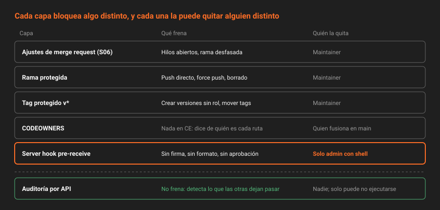

# De la convención a la regla

> En la Semana 06 se decidió cómo se trabaja. Esta semana se hace cumplir. Una regla que solo vive en `CONTRIBUTING.md` funciona mientras nadie tenga prisa.

---

## 🎯 Objetivos

- Distinguir una convención, una regla que GitLab aplica y una auditoría que detecta después
- Situar cada mecanismo de CE en su capa y decir quién puede desactivarlo
- Saber qué parte de la gobernanza de GitLab es de pago y con qué se sustituye en este bootcamp
- Explicar por qué la protección de una rama no basta, aunque sea lo primero que hay que hacer

---

## 1. Qué problema resuelve

Al terminar la Semana 06, `app` tiene un flujo serio: cada cambio nace de un issue, pasa por una merge request con la plantilla `Default`, lo revisa `revisor-<dominio>` y entra con squash y un commit que dice quién lo revisó. Pero mira lo que todavía se puede hacer:

```bash
echo "// arreglo rápido" >> src/prestamos.ts
git commit -am "arreglo"
git push origin main
```

Funciona. Eres Owner, `main` tiene la protección por defecto (Maintainers pueden empujar), y nada en GitLab sabe que tu `CONTRIBUTING.md` dice lo contrario. El commit entra sin issue, sin revisión, sin formato convencional y, si tu clon no firma, sin firma.

No hace falta mala fe. Basta un viernes por la tarde, un bug en producción y la sensación de que "esto es una línea". Cada atajo es razonable por separado; la suma es un `main` en el que nadie puede confiar.

La pregunta de esta semana es: **¿qué reglas puede imponer GitLab CE por sí mismo, cuáles no, y qué haces con estas últimas?**

---

## 2. Cómo funciona

### 2.1 Tres formas de que una regla exista

| Forma | Ejemplo | Cuándo actúa | Qué pasa si alguien la ignora |
|---|---|---|---|
| **Convención** | "Las ramas empiezan por el número del issue" en `CONTRIBUTING.md` | Nunca: depende de que la recuerdes | Nada. Nadie se entera |
| **Regla aplicada** | `main` con *Allowed to push: No one* | En el `push` o en la fusión, antes de que el cambio exista | El servidor rechaza el cambio |
| **Auditoría** | Un script que comprueba que cada MR fusionada tenga aprobación de otra persona | Después, cuando alguien la ejecuta | Queda registrado que pasó; el cambio ya está dentro |

Las tres son necesarias. La convención explica el porqué y cubre lo que no se puede automatizar. La regla aplicada cubre lo que se puede bloquear. La auditoría cubre lo que no se puede bloquear pero sí detectar.

El error típico es querer que todo sea una regla aplicada. Algunas cosas no se pueden bloquear en CE (lo verás en la [teoría 07](07-lo-que-no-se-puede-bloquear.md)), y otras no se deben: un hook que tarda diez segundos en cada `push` lo acaba desactivando alguien.

### 2.2 Las capas de CE, de la más blanda a la más dura



| Capa | Qué controla | Dónde se configura | Quién la puede quitar |
|---|---|---|---|
| Ajustes de merge request (S06) | Hilos resueltos, método de fusión, squash | `Settings → Merge requests` | Maintainer del proyecto |
| Rama protegida | Quién empuja, quién fusiona, si se puede forzar | `Settings → Repository → Protected branches` | Maintainer del proyecto |
| Tag protegido | Quién crea tags que coinciden con un patrón | `Settings → Repository → Protected tags` | Maintainer del proyecto |
| `CODEOWNERS` | Quién es dueño de cada ruta | Un archivo en el repositorio | Quien pueda fusionar en `main` |
| Server hook | Cualquier condición sobre los commits que llegan | El disco del servidor de Gitaly | **Solo un administrador con acceso a la máquina** |
| Auditoría por API | Lo que ya pasó | Un script, después un job (S09) | Nadie: solo puede dejar de ejecutarse |

La última columna es la importante. En CE, **un Maintainer puede quitar la protección de `main`** con un clic, y no hay un permiso aparte para impedirlo (eso es *Allowed to unprotect*, de **Premium**). `revisor-<dominio>` es Maintainer de `app` desde la Semana 03: puede desproteger `main`, empujar y volver a protegerla.

El server hook es la única capa que un Maintainer no puede tocar, porque no está en la base de datos de GitLab, sino en un directorio del servidor. Por eso esta semana lo usa para lo que más importa.

### 2.3 Lo que es de pago y lo que lo sustituye

| Feature | Tier | Qué hace | Sustituto en este bootcamp |
|---|---|---|---|
| Approval rules | **Premium** | Exigir N aprobaciones, de ciertos usuarios, para fusionar | Server hook que exige `Approved-by:` en lo que entra a `main` + auditoría |
| Code Owners approval | **Premium** | Exigir la aprobación del dueño de cada ruta tocada | `CODEOWNERS` + script `gobernanza` que lo comprueba |
| Push rules | **Premium** | Rechazar commits sin firma, mensajes con un formato, autores no verificados | Server hook `pre-receive` |
| *Allowed to unprotect* | **Premium** | Que solo ciertos roles puedan quitar una protección | El server hook, que no depende de la protección, y la auditoría que detecta el cambio |
| Push y merge por usuario o grupo | **Premium** | *Allowed to push: @ana* en lugar de un rol | Roles: el reparto de la Semana 03 |
| Ramas protegidas a nivel de grupo | **Premium** | Una regla para todos los proyectos del grupo | Protección por defecto del grupo (solo afecta a la rama por defecto de proyectos nuevos) |
| Status checks externos | **Ultimate** | Exigir que un servicio externo dé el visto bueno | Job de pipeline (S09-S10) |
| Merge trains | **Premium** | Probar cada MR sobre el resultado de las anteriores | Rebase obligatorio: `rebase_merge` o `ff` (S06) |

Lo de pago no es mejor por arte de magia: es lo mismo, con interfaz, sin mantenerlo tú, y con auditoría de quién cambió qué. Si una organización tiene diez equipos y cumplimiento normativo, Premium compensa. Para aprender, hacerlo a mano enseña exactamente qué está comprobando cada regla.

### 2.4 El orden importa

Proteger una rama sin haber decidido el flujo produce bloqueos que nadie entiende. Por eso esta semana viene después de la 06, y por eso el orden de las prácticas es:

1. **Proteger** `main` y los tags `v*`: lo barato, que cierra el agujero más grande.
2. **Nombrar dueños** con `CODEOWNERS` y escribir la auditoría que los comprueba.
3. **Instalar el hook** que se aplica aunque alguien quite la protección.
4. **Atacar tus propias reglas** con otra identidad, para saber cuál aguanta y cuál no.

---

## 3. Cómo se configura

Esta semana todo se hace por API con las variables de siempre:

```bash
source ~/.bc-gitlab
export H="PRIVATE-TOKEN: $GITLAB_TOKEN"
export API="$GITLAB_URL/api/v4"
export P=$(printf '%s' "$PROYECTO" | jq -sRr @uri)
```

Una foto del estado de gobernanza de `app` en una sola llamada por capa:

```bash
curl -s -H "$H" "$API/projects/$P/protected_branches" \
  | jq -r '.[] | "\(.name)  push=\([.push_access_levels[].access_level])  merge=\([.merge_access_levels[].access_level])  force=\(.allow_force_push)"'
curl -s -H "$H" "$API/projects/$P/protected_tags" \
  | jq -r '.[] | "\(.name)  create=\([.create_access_levels[].access_level])"'
curl -s -H "$H" "$API/projects/$P" \
  | jq '{merge_method, squash_option, only_allow_merge_if_all_discussions_are_resolved}'
```

Al empezar la semana lo normal es `main  push=[40]  merge=[40]` (la protección por defecto de la instancia; `force` depende de esa misma configuración) y ningún tag protegido.

En la UI, todo menos el hook está en `Settings → Repository` y `Settings → Merge requests`. El hook no tiene UI en CE: es justo lo que *Push rules* añade en Premium.

---

## 4. Antipatrones

| Antipatrón | Por qué duele | Qué hacer en su lugar |
|---|---|---|
| Confiar en que "aquí todos sabemos cómo se trabaja" | Funciona hasta el primer incidente con prisa, o la primera persona nueva | Convertir en regla lo que se pueda bloquear y en auditoría lo demás |
| Proteger `main` antes de tener un flujo por merge request | Nadie puede trabajar, y la protección se quita "un momento" | Primero el flujo (S06), después la protección (S07) |
| Creer que la rama protegida es inviolable | Cualquier Maintainer la desprotege en CE | Una capa que no dependa de la base de datos: el server hook |
| Bloquear todo con hooks | Hooks lentos o frágiles bloquean a todo el mundo y alguien los quita | Bloquear poco y claro; auditar el resto |
| Dar Maintainer a todo el equipo "para que no pidan permisos" | Todos pueden quitar las protecciones | Developer por defecto; Maintainer es un rol de administración |

---

## 5. Trucos

- **Escribe la regla antes de aplicarla.** Si no puedes explicarla en una frase en `CONTRIBUTING.md`, no está lista para ser un bloqueo.
- **Cada bloqueo con su mensaje.** "Rechazado" no enseña nada; "falta `Approved-by`: pide la aprobación de `revisor`" sí.
- **Una regla que no se audita se erosiona.** La [teoría 07](07-lo-que-no-se-puede-bloquear.md) monta la comprobación periódica que detecta cuándo alguien quitó una protección.

---

## 📚 Recursos Adicionales

- [Protected branches](https://docs.gitlab.com/user/project/repository/branches/protected/) — documentación oficial
- [Git server hooks](https://docs.gitlab.com/administration/server_hooks/) — el mecanismo libre que sustituye a *Push rules*
- [Feature comparison](https://about.gitlab.com/pricing/feature-comparison/) — qué está en cada tier

---

## ✅ Checklist de Verificación

- [ ] Sabes decir, para cada capa de la tabla 2.2, quién puede desactivarla en tu instancia
- [ ] Has sacado la foto de gobernanza de `app` con los tres comandos del apartado 3
- [ ] Puedes nombrar tres features de gobernanza de Premium y su sustituto en CE
- [ ] Entiendes por qué el server hook es la capa que se instala la última pero importa más

---

[Volver a la Semana 07](../README.md) · [Siguiente: Ramas protegidas →](02-ramas-protegidas.md)
