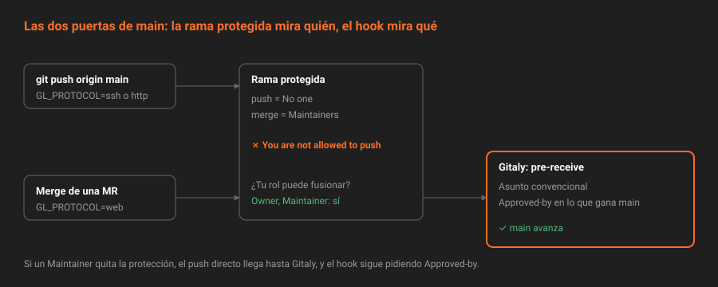

# Server hooks

> Un hook del servidor es un programa que Gitaly ejecuta antes de aceptar cualquier cambio en un repositorio, venga de un `git push`, de una fusión desde la UI o de la API. Es gratis, está en CE, y es lo que *Push rules* de Premium hace con formulario.

---

## 🎯 Objetivos

- Explicar qué hooks del servidor existen y en qué momento se ejecuta cada uno
- Saber qué recibe un hook: las referencias por la entrada estándar y la identidad por variables de entorno
- Instalar un hook en un repositorio concreto con `gitaly hooks set`, y saber cuándo usar uno global
- Hacer que el mensaje de rechazo llegue al usuario, tanto en la terminal como en la UI
- Medir el riesgo: un hook roto bloquea todos los cambios del repositorio

---

## 1. Qué problema resuelve

Las ramas protegidas deciden **quién** puede cambiar una referencia. No miran **qué** cambia: un Maintainer con permiso puede empujar commits sin firmar, con mensajes como "arreglo", o un merge de cualquier rama vieja. Y cualquier Maintainer puede quitar la protección.

GitLab Premium resuelve lo primero con *Push rules*: un formulario para exigir firma, un formato de mensaje o un autor verificado. En CE no existe. Pero lo que *Push rules* hace por dentro sí está: Git ejecuta hooks en el servidor antes de aceptar un cambio, y GitLab te deja poner los tuyos.

Lo segundo, que un Maintainer pueda desactivarlo, también se resuelve: el hook no está en la base de datos de GitLab sino en el disco del servidor. Para tocarlo hace falta una shell en la máquina, no un rol en el proyecto.

---

## 2. Cómo funciona

### 2.1 Los tres hooks que importan

| Hook | Cuándo | Puede rechazar | Uso típico |
|---|---|:--:|---|
| `pre-receive` | Una vez por `push`, antes de actualizar ninguna referencia | **Sí, todo el push** | Políticas: formato, firma, aprobación |
| `update` | Una vez por cada referencia del `push` | Sí, esa referencia | Políticas distintas por rama |
| `post-receive` | Después de actualizar | No | Notificaciones; GitLab ya hace las suyas |

Esta semana solo se usa `pre-receive`. Es atómico: si rechaza, no entra nada del `push`, aunque traiga cinco ramas y solo una falle.

### 2.2 Lo que recibe

Por la **entrada estándar**, una línea por referencia que el `push` quiere cambiar:

```
<sha-viejo> <sha-nuevo> <referencia>
```

| Caso | `sha-viejo` | `sha-nuevo` |
|---|---|---|
| Rama nueva | `0000…0000` | el commit |
| Rama que avanza | el commit anterior | el commit nuevo |
| Rama borrada | el commit anterior | `0000…0000` |

Los commits nuevos ya están en el servidor, pero en **cuarentena**: Git los ve y puede leerlos (`git log`, `git cat-file`), aunque ninguna rama los apunta todavía. Si el hook rechaza, se borran.

Por **variables de entorno**, quién y cómo:

| Variable | Valor |
|---|---|
| `GL_USERNAME` | Usuario de GitLab que hace el cambio |
| `GL_ID` | `user-<id>` o `key-<id>` |
| `GL_PROJECT_PATH` | `plataforma-biblioteca/app` |
| `GL_REPOSITORY` | `project-<id>`, `wiki-<id>`… |
| `GL_PROTOCOL` | `ssh`, `http` o **`web`** |

`GL_PROTOCOL=web` es la clave de esta semana. Significa que el cambio lo hace **GitLab**, no Git: fusionar una merge request, aplicar una sugerencia, el rebase del servidor, un commit desde la Web IDE o desde la API de archivos. Esos commits los escribe el servidor y no llevan tu firma. Un hook que exige firma tiene que distinguirlos.

### 2.3 Se ejecuta también en las fusiones



Un hook no es solo para `git push`. Cuando pulsas *Merge* en una merge request, GitLab escribe el commit de squash y el de fusión, y le pide a Gitaly que actualice `main`. Gitaly ejecuta el `pre-receive` igual que en un `push`.

Si el hook rechaza:

- Por la **API**, `PUT .../merge` devuelve `422 Branch cannot be merged`, y el campo `merge_error` de la merge request guarda `Something went wrong during merge pre-receive hook.` seguido de tu mensaje.
- Por la **API de commits**, `POST .../repository/commits` devuelve `400` con tu mensaje.
- En la **UI**, sale el mismo mensaje en el widget de la merge request.

### 2.4 Que el mensaje llegue

Por `git push`, todo lo que el hook escribe se ve en la terminal, con el prefijo `remote:`. Por la UI y la API no: GitLab **descarta las líneas del hook salvo las que empiezan por `GL-HOOK-ERR:`**, para no filtrar detalles internos. Por eso el hook de esta semana escribe así:

```bash
echo "GL-HOOK-ERR: nada entra en main sin una aprobación" >&2
exit 1
```

Sin el prefijo, el usuario de la UI solo ve un error genérico y no sabe qué hacer.

### 2.5 Dónde viven: por repositorio o globales

| Alcance | Cómo se instala | Cuándo |
|---|---|---|
| **Un repositorio** | `gitaly hooks set`, con un tarball que contiene `custom_hooks/pre-receive` | La política de un proyecto: **lo de esta semana** |
| **Todos los repositorios** | Un directorio en el disco, configurado como `custom_hooks_dir` de Gitaly, con subdirectorios `pre-receive.d/` | Políticas de toda la instancia, como bloquear secretos |

Desde GitLab 15.11 los hooks de un repositorio **no se copian a mano** en su directorio: se instalan con el comando de Gitaly, que los escribe de forma atómica y los incluye en los backups. Copiar a mano en `@hashed/.../custom_hooks/` es la forma antigua: no pasa por Gitaly, y con almacenamiento replicado (Praefect, Semana 23) solo llegaría a una de las réplicas.

```bash
docker exec -i gitlab /opt/gitlab/embedded/bin/gitaly hooks set \
  --storage default \
  --repository "@hashed/ab/cd/abcd….git" \
  --config /var/opt/gitlab/gitaly/config.toml < hooks.tar
```

La ruta del repositorio en el almacenamiento es el SHA-256 del id del proyecto:

```bash
ID=$(curl -s -H "$H" "$API/projects/$P" | jq -r .id)
HASH=$(printf '%s' "$ID" | sha256sum | cut -d' ' -f1)
echo "@hashed/${HASH:0:2}/${HASH:2:2}/$HASH.git"
```

Para quitar los hooks de un repositorio, el mismo comando con un tarball vacío.

### 2.6 Quién puede instalarlos

Solo quien tenga una shell en el servidor de Gitaly: en el laboratorio, `docker exec` en el contenedor `gitlab`. Ningún rol de GitLab, ni Owner ni administrador desde la UI, puede verlos o cambiarlos. Esa es su fuerza y su coste:

- **Fuerza**: un Maintainer que desprotege `main` sigue chocando con el hook.
- **Coste**: no hay interfaz. Si el hook está en un repositorio y en el servidor, las dos copias se desincronizan. Por eso esta semana el hook se **versiona** en `scripts/hooks/pre-receive`, entra por merge request y solo después se instala.

---

## 3. Cómo se configura

Probar antes de instalar, en local, sin GitLab: un repositorio desnudo con el hook en `hooks/` se comporta igual que el servidor.

```bash
PRUEBA=$(mktemp -d)
git init --bare "$PRUEBA/srv.git"
git show main:scripts/hooks/pre-receive > "$PRUEBA/srv.git/hooks/pre-receive"
chmod +x "$PRUEBA/srv.git/hooks/pre-receive"
git push "$PRUEBA/srv.git" HEAD:refs/heads/prueba
```

Instalar en `app`: el tarball tiene que contener el directorio `custom_hooks/`, y el hook, permiso de ejecución.

```bash
TMP=$(mktemp -d) && mkdir "$TMP/custom_hooks"
git show main:scripts/hooks/pre-receive > "$TMP/custom_hooks/pre-receive"
chmod +x "$TMP/custom_hooks/pre-receive"
tar -C "$TMP" -cf "$TMP/hooks.tar" custom_hooks
```

Comprobar lo instalado:

```bash
docker exec gitlab ls -l "/var/opt/gitlab/git-data/repositories/$RUTA/custom_hooks/"
```

---

## 4. Antipatrones

| Antipatrón | Por qué duele | Qué hacer en su lugar |
|---|---|---|
| Instalar un hook sin probarlo en local | Un error de sintaxis rechaza todos los cambios del repositorio, también las fusiones | Repositorio desnudo en local, y casos que pasan y que fallan |
| Mensajes sin `GL-HOOK-ERR:` | En la UI el usuario ve un error genérico | Prefijo en cada línea que deba verse |
| Exigir firma también a `GL_PROTOCOL=web` | Bloquea las fusiones, las sugerencias y el rebase del servidor, que GitLab no firma | Exigir firma solo a `ssh` y `http` |
| Llamar a la API de GitLab desde el hook | Lento, frágil, y un fallo de red bloquea los `push` | El hook solo mira los commits; lo que necesite la API va a la auditoría |
| Copiar el hook a mano en `custom_hooks/` | Forma obsoleta; no se replica ni se versiona | `gitaly hooks set` desde un archivo versionado |
| El hook solo en el servidor | Nadie sabe qué hace ni puede revisarlo | En el repositorio, por merge request, y después instalado |

---

## 5. Trucos

- **Mide lo que tarda.** `time git push` antes y después de instalarlo. Un hook que añade más de un segundo a cada `push` acaba desactivado por alguien con prisa.
- **El rechazo de un hook se reconoce** porque Git dice `(pre-receive hook declined)` y la línea de arriba empieza por `GL-HOOK-ERR:`. El de una rama protegida empieza por `GitLab:`.
- **Para emergencias**, quitar el hook es un comando: el `gitaly hooks set` con un tarball vacío. Escríbelo en el ADR, con quién puede ejecutarlo.

---

## 📚 Recursos Adicionales

- [Git server hooks](https://docs.gitlab.com/administration/server_hooks/) — instalación, hooks globales y variables
- [Git hooks — Pro Git](https://git-scm.com/book/en/v2/Customizing-Git-Git-Hooks) — `pre-receive`, `update` y `post-receive` en Git
- [githooks(5)](https://git-scm.com/docs/githooks) — la referencia de Git

---

## ✅ Checklist de Verificación

- [ ] Sabes qué recibe un `pre-receive` por la entrada estándar y por el entorno
- [ ] Sabes qué operaciones de GitLab llegan con `GL_PROTOCOL=web`
- [ ] Sabes por qué un mensaje sin `GL-HOOK-ERR:` no se ve en la UI
- [ ] Puedes calcular la ruta `@hashed` de `app` desde su id
- [ ] Sabes por qué el hook se versiona en el repositorio aunque se instale en el servidor

---

[← Anterior: CODEOWNERS en CE](04-codeowners-en-ce.md) · [Volver a la Semana 07](../README.md) · [Siguiente: Un hook de gobernanza →](06-un-hook-de-gobernanza.md)
