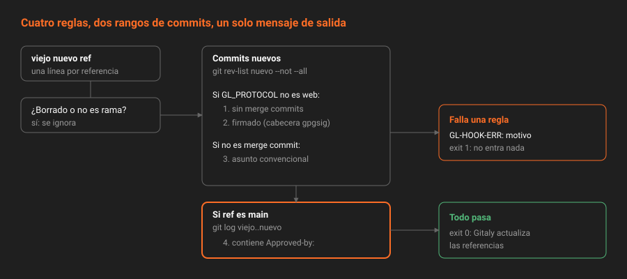

# Un hook de gobernanza

> Cuatro reglas en cuarenta líneas de bash: historia lineal, commits firmados, mensajes convencionales y nada en `main` sin aprobación. Cada una cierra una promesa de una semana anterior, y cada una tiene un límite que conviene conocer antes de confiar en ella.

---

## 🎯 Objetivos

- Leer el hook de `app` línea a línea y saber qué regla aplica cada bloque
- Explicar por qué unas reglas se aplican a todo y otras solo a lo que empuja una persona
- Entender cómo la plantilla del commit convierte una aprobación en algo que el hook puede ver
- Conocer los límites del hook: qué deja pasar y quién puede engañarlo

---

## 1. Qué problema resuelve

Tres semanas anteriores dejaron promesas pendientes:

| Semana | Promesa | Estado al empezar la S07 |
|:--:|---|---|
| S02 | Historia lineal y mensajes convencionales | Convención en `CONTRIBUTING.md` |
| S02 | Commits firmados | Hábito de cada clon (`commit.gpgsign`) |
| S06 | Nada entra en `main` sin revisión | La aprobación existe pero no bloquea |

Ninguna se puede imponer con una rama protegida, porque la protección mira quién empuja, no qué. Y ninguna de las *Push rules* de Premium está en CE. El hook las cumple las tres.

---

## 2. Cómo funciona

### 2.1 El hook completo



```bash
#!/bin/bash
# Política de entrada de app — ADR-005. La instala un administrador con `gitaly hooks set`.
export PATH=/opt/gitlab/embedded/bin:$PATH
CERO=0000000000000000000000000000000000000000
CONVENCIONAL='^(build|chore|ci|docs|feat|fix|perf|refactor|revert|style|test)(\(.+\))?!?: .+'

rechaza() { echo "GL-HOOK-ERR: $*" >&2; exit 1; }

while read -r viejo nuevo ref; do
  [ "$nuevo" = "$CERO" ] && continue                  # borrados: los gobiernan las protecciones
  case "$ref" in refs/heads/*) ;; *) continue ;; esac  # tags y refs internas: fuera

  nuevos=$(git rev-list "$nuevo" --not --all) \
    || rechaza "error interno leyendo $ref"           # solo lo nuevo; si Git falla, se rechaza

  for c in $nuevos; do
    corto=${c:0:8}
    padres=$(git rev-list --parents -n 1 "$c" | wc -w)

    if [ "$GL_PROTOCOL" != web ]; then                 # lo que empuja una persona
      [ "$padres" -gt 2 ] && rechaza "$corto es un merge commit: en $ref la historia es lineal, usa rebase"
      git cat-file commit "$c" | grep -q '^gpgsig' || rechaza "$corto no está firmado"
    fi

    if [ "$padres" -le 2 ]; then                       # los merge commits los escribe GitLab
      git log -1 --format=%s "$c" | grep -Eq "$CONVENCIONAL" \
        || rechaza "$corto: el asunto no sigue Conventional Commits"
    fi
  done

  if [ "$ref" = refs/heads/main ] && [ "$viejo" != "$CERO" ]; then   # lo que main gana, aunque ya esté en otra rama
    git log --format=%B "$viejo..$nuevo" | grep -q '^Approved-by: ' \
      || rechaza "nada entra en main sin una aprobación: falta Approved-by en $ref"
  fi
done
exit 0
```

### 2.2 Qué commits se miran

```bash
nuevos=$(git rev-list "$nuevo" --not --all)
```

"Los commits alcanzables desde el nuevo extremo que no estén ya en ninguna referencia". Dentro de un `pre-receive`, `--all` todavía no incluye lo que se está empujando, así que salen exactamente los commits que este `push` trae.

La alternativa obvia, `$viejo..$nuevo`, falla en un caso común: después de un rebase y un `--force-with-lease`, ese rango incluye commits de `main` que GitLab escribió sin firma, y el hook rechazaría tu rama por culpa de commits que no son tuyos. `--not --all` los excluye, porque ya están en `main`.

La regla de la aprobación usa la otra pregunta, y a propósito:

```bash
git log --format=%B "$viejo..$nuevo"
```

"Lo que `main` gana con este cambio", esté o no ya en otra rama. Con `--not --all`, alguien podría empujar primero una rama y después la misma rama a `main`: los commits ya no serían nuevos, el hook no vería nada que comprobar, y entrarían sin aprobación. Para firma y formato importa qué commits son nuevos; para la aprobación importa qué entra en `main`.

### 2.3 Las cuatro reglas

| Regla | Se aplica a | Por qué ese alcance |
|---|---|---|
| Sin merge commits | `ssh` y `http` | Los merge commits de `rebase_merge` los escribe GitLab al fusionar (`web`) y son la burbuja que se quiere. Los de una persona son `git merge main` en su rama: lo que la S02 prohibió |
| Firmado | `ssh` y `http` | GitLab no firma lo que escribe: squash, fusión, sugerencias, rebase del servidor. Exigirlo en `web` bloquearía todas las fusiones |
| Asunto convencional | Todo commit que no sea de fusión | El commit de squash usa el título de la merge request (`%{title}`): obliga a que el **título** sea convencional. El de sugerencias usa la plantilla de la S06, que ya empieza por `fix:` |
| `Approved-by:` | Lo que entra en `main` | Es lo que cambia esta semana: la aprobación pasa de opcional a necesaria |

### 2.4 Cómo llega la aprobación al hook

El hook no pregunta a la API quién aprobó. Lee los mensajes de los commits. Eso funciona porque las plantillas del commit de la Semana 06 incluyen `%{approved_by}`, que GitLab sustituye al fusionar por una línea por aprobación:

```
Approved-by: Revisor Biblioteca <revisor-biblioteca@example.com>
```

| Método de fusión | Commits que entran en `main` | Dónde está `Approved-by:` |
|---|---|---|
| `rebase_merge` con squash | Squash + fusión | Plantilla de squash (S06) |
| `rebase_merge` sin squash | Los de la rama + fusión | Plantilla de fusión (**esta semana**) |
| `ff` con squash | Squash | Plantilla de squash |
| `ff` sin squash | Los de la rama | En ninguno: **rechazado** |

Por eso la práctica 03 añade `%{approved_by}` a `merge_commit_template`: con squash por defecto casi siempre basta la de squash, pero si alguien desmarca la casilla, la fusión no debería fallar por un motivo que nadie entiende.

Con `ff` y sin squash no hay commit que GitLab escriba, así que no hay dónde poner la aprobación. Si usas `ff`, la regla en la práctica es "squash siempre": `squash_option=always`.

### 2.5 Lo que pasa en cada caso

| Situación | Resultado |
|---|---|
| `git push` de una rama con commits firmados y convencionales | Pasa |
| `git push` de una rama con un commit sin firmar | `GL-HOOK-ERR: 1a2b3c4d no está firmado` |
| `git push` de una rama con `git merge main` dentro | `GL-HOOK-ERR: … es un merge commit` |
| Merge request titulada "Arreglos varios" | La fusión falla: el squash no es convencional |
| Merge request sin aprobar | La fusión falla: falta `Approved-by` |
| Merge request aprobada por `revisor` | Pasa |
| Aplicar una sugerencia | Pasa: `web`, y la plantilla empieza por `fix:` |
| Empujar a `main` una rama que ya estaba en el servidor | La comprueba igual: falta `Approved-by` |
| Borrar una rama, crear un tag | El hook no los mira |

---

## 3. Sus límites

Un control que no conoces es un control en el que confías de más.

| Límite | Por qué | Quién lo cubre |
|---|---|---|
| **El autor puede aprobar lo suyo** | En CE la aprobación es de cualquier miembro con permiso para editar la MR, también el autor. El hook ve `Approved-by:`, no de quién | La auditoría: [teoría 07](07-lo-que-no-se-puede-bloquear.md) |
| **El trailer se puede escribir a mano** | `PUT .../merge` acepta `squash_commit_message` y `merge_commit_message`. Quien fusiona puede escribir un `Approved-by:` falso | La auditoría compara el trailer con las aprobaciones reales |
| **"Firmado" no es "firma válida"** | El hook comprueba que hay firma, no que sea de una clave registrada. Verificarla exigiría las claves públicas en el servidor | GitLab la verifica y la muestra (*Verified*); la auditoría de la S02 la lee |
| **El botón *Revert* de la UI** | Genera `Revert "feat: …"`, que no es convencional | Editar el mensaje a `revert: …` antes de confirmar |
| **Un administrador puede quitarlo** | Es un archivo en el servidor | Nada técnico: el ADR-005 dice quién puede y cuándo |

Los dos primeros son la razón de que esta semana tenga una auditoría además del hook. El hook impide el descuido; la auditoría detecta el engaño.

---

## 4. Antipatrones

| Antipatrón | Por qué duele | Qué hacer en su lugar |
|---|---|---|
| Un solo rango para todas las reglas | `$viejo..$nuevo` rechaza ramas rebasadas por commits ajenos; `--not --all` deja entrar en `main` lo que ya estaba en otra rama | `--not --all` para firma y formato, `$viejo..$nuevo` para lo que entra en `main` |
| Validar el asunto de los merge commits | `Merge branch 'x' into 'main'` no es convencional y bloquearía todas las fusiones con `rebase_merge` | Solo commits con un padre |
| Exigir la aprobación en todas las ramas | Las ramas de trabajo no se aprueban: se aprueba la merge request | Solo `refs/heads/main` |
| Mensajes que no dicen qué hacer | "rechazado" obliga a leer el hook | Qué falló, en qué commit, y la salida |
| Añadir reglas sin probar los casos que deben pasar | Se prueba que bloquea, no que deja trabajar | Una tabla de casos como la del apartado 2.5, en local, antes de instalar |

---

## 5. Trucos

- **Ver qué trailers lleva lo que ya está en `main`**: `git log -5 --format='%h %s%n%(trailers:key=Approved-by,key=Reviewed-by)'`.
- **El título de la MR es el asunto del squash.** Si el hook lo rechaza, edita el título (`PUT .../merge_requests/<iid>` con `title`) y vuelve a fusionar: no hace falta tocar la rama.
- **Una regla por bloque, con su comentario.** Cuando el hook crezca, cada regla tiene que poder quitarse sin entender las demás.

---

## 📚 Recursos Adicionales

- [Commit message templates](https://docs.gitlab.com/user/project/merge_requests/commit_templates/) — `%{approved_by}` y el resto de variables
- [Conventional Commits 1.0.0](https://www.conventionalcommits.org/es/v1.0.0/) — la especificación del formato
- [git-interpret-trailers](https://git-scm.com/docs/git-interpret-trailers) — cómo Git entiende las líneas `Clave: valor`

---

## ✅ Checklist de Verificación

- [ ] Sabes por qué el hook usa `--not --all` para unas reglas y `$viejo..$nuevo` para otra
- [ ] Sabes qué regla se aplica solo a `ssh` y `http`, y por qué
- [ ] Sabes por qué el título de una merge request tiene que ser convencional
- [ ] Puedes explicar dos formas de pasar el hook sin una aprobación real de otra persona
- [ ] Sabes qué configuración de squash necesitas si tu método es `ff`

---

[← Anterior: Server hooks](05-server-hooks.md) · [Volver a la Semana 07](../README.md) · [Siguiente: Lo que no se puede bloquear →](07-lo-que-no-se-puede-bloquear.md)
