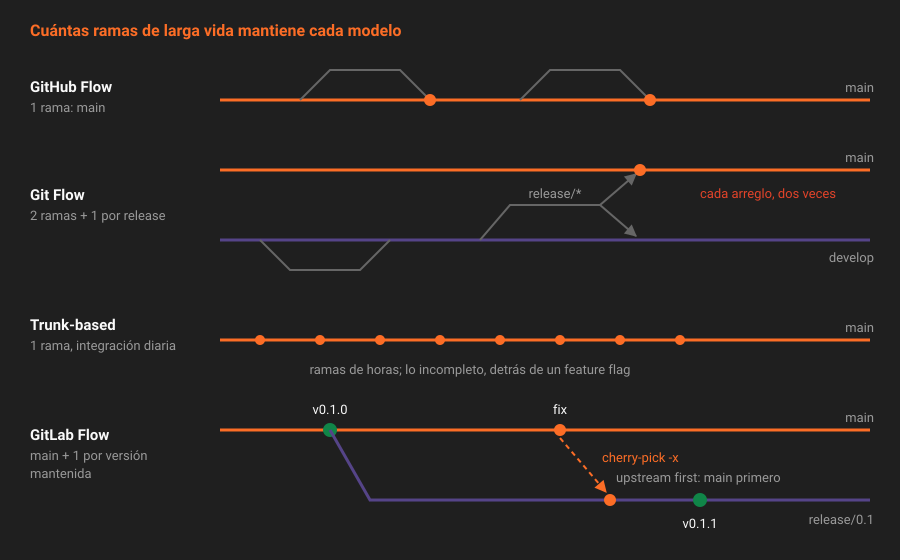

# Modelos de ramas

> Un modelo de ramas responde a una sola pregunta: ¿cuántas versiones de tu producto tienes que mantener vivas a la vez? Si la respuesta es "una", casi cualquier rama de larga vida sobra. Si es "varias", alguna hace falta, y conviene decidir cuál antes de necesitarla.

---

## 🎯 Objetivos

- Describir GitHub Flow, Git Flow, trunk-based development y GitLab Flow por las ramas que mantienen vivas
- Relacionar cada modelo con el tipo de producto que lo justifica: servicio desplegado, software instalado, librería
- Distinguir las dos variantes de GitLab Flow: ramas de entorno y ramas de release
- Elegir el modelo de `app` y escribir la decisión como ADR

---

## 1. Qué problema resuelve

Hasta la Semana 07, `app` ha tenido un modelo implícito: ramas cortas que salen de `main` y vuelven por merge request. Funciona mientras solo exista **una** versión: la de `main`.

El problema aparece el día que publicas la `v0.1.0`, alguien la usa, y encuentras un bug. En `main` ya hay dos funcionalidades a medias de la `0.2.0`. Tienes tres opciones:

1. Publicar `main` tal cual como `0.1.1`, con lo que esté a medias dentro.
2. Esperar a terminar la `0.2.0` y que quien usa la `0.1.0` conviva con el bug.
3. Tener una rama que represente la `0.1` y donde solo entre el arreglo.

La tercera es la única que no penaliza a nadie, y exige una rama de larga vida. Un modelo de ramas es la decisión, tomada **antes** de ese día, de qué ramas de larga vida existen y cómo se mueve un cambio entre ellas.

---

## 2. Cómo funciona

### 2.1 GitHub Flow

Una rama de larga vida: `main`. Cada cambio sale en una rama corta, vuelve por merge request y se despliega. Lo que hay en `main` es lo que hay en producción, o lo estará en minutos.

Encaja con **servicios con un único despliegue**: una web, una API interna. No hay "versión anterior" que mantener porque nadie la está ejecutando.

### 2.2 Git Flow

Cinco tipos de rama: `main` (lo publicado), `develop` (la integración), `feature/*`, `release/*` y `hotfix/*`. Cada release se prepara en su rama, se fusiona en `main` y en `develop`, y se etiqueta.

Nació en 2010 para software que se instala y se publica cada varios meses. Su coste es la doble integración: cada arreglo tiene que acabar en `main` **y** en `develop`, y las ramas `develop` y `main` divergen si alguien se olvida. Su propio autor añadió en 2020 una nota recomendando no usarlo para software que se entrega de forma continua.

### 2.3 Trunk-based development

Todo el mundo integra en `main` (el *trunk*) al menos una vez al día. Las ramas, si existen, duran horas. Lo que no está listo se esconde detrás de un *feature flag* (Semana 14) en vez de quedarse en una rama.

Es el modelo que la investigación DORA asocia con mejor rendimiento de entrega (teoría [06](06-metricas-dora.md)). Exige dos cosas que `app` todavía no tiene: un pipeline que pruebe cada commit (Semana 09) y flags para esconder lo incompleto.

### 2.4 GitLab Flow

GitLab Flow parte de GitHub Flow y le añade **ramas de larga vida solo cuando una necesidad concreta las pide**. Tiene dos variantes:

| Variante | Ramas de larga vida | Cuándo |
|---|---|---|
| Ramas de entorno | `main` → `pre-production` → `production` | Un servicio que no se despliega en cuanto se fusiona, por ventanas o por aprobaciones |
| Ramas de release | `main` y una `release/X.Y` por versión mantenida | Software que alguien instala o usa en una versión concreta |

La regla que comparten las dos se llama **upstream first**: un cambio entra siempre primero en `main`, y de ahí baja a las demás ramas. Nunca al revés. Un arreglo hecho solo en `release/0.1` reaparece como bug en la `0.2.0`, porque `main` nunca lo recibió.

### 2.5 La comparación

| | GitHub Flow | Git Flow | Trunk-based | GitLab Flow (release) |
|---|---|---|---|---|
| Ramas de larga vida | 1 | 2 + una por release | 1 | 1 + una por versión mantenida |
| Versiones vivas a la vez | 1 | Varias | 1 | Varias |
| Un arreglo se integra en | `main` | `main` y `develop` | `main` | `main`, y se copia a la release |
| Necesita CI para funcionar | Recomendable | Recomendable | Imprescindible | Recomendable |
| Coste principal | Ninguno mientras haya una versión | Doble integración y divergencia | Disciplina diaria y flags | Copiar arreglos y saber dónde |

### 2.6 El modelo de `app`

`app` es una librería de dominio: alguien la importa en una versión concreta, y esa persona necesita parches sin cambios de comportamiento. Por eso el bootcamp usa **GitLab Flow con ramas de release**:

- `main` es la integración. Todo entra ahí primero, por merge request.
- La `v0.1.0` se etiqueta en `main`. Cuando hace falta el primer parche, nace `release/0.1` desde ese tag.
- Un arreglo se fusiona en `main` y se copia a `release/0.1` con `cherry-pick -x` (teoría [05](05-ramas-de-release-y-cherry-pick.md)).
- La `v0.1.1` se etiqueta en `release/0.1`.

En la Semana 14 aparecen los entornos `staging` y `production`, pero se modelan como **entornos de GitLab**, no como ramas. Las ramas de entorno de GitLab Flow fueron la solución de cuando no había otra forma de saber qué estaba desplegado dónde.

---

## 3. Cómo se configura

Un modelo de ramas no es una opción de GitLab: es una decisión que se escribe y se hace cumplir con lo que ya conoces.

| Pieza del modelo | Dónde vive en GitLab |
|---|---|
| Qué ramas son de larga vida | Ramas protegidas: `main` y `release/*` (Semana 07) |
| Que nada entre sin revisión | `push` para nadie, fusión para Maintainers |
| Que las ramas cortas no se acumulen | *Delete source branch* activado por defecto en las merge requests (Semana 06) |
| Cómo se numera cada versión | Tags `v*` protegidos y SemVer (teoría [02](02-versionado-semantico.md)) |
| Por qué se eligió este modelo | El ADR-006 en la wiki |

El ADR es la parte que más se olvida y la que más falta hace: dentro de seis meses, alguien propondrá Git Flow "porque es el estándar", y la respuesta tiene que estar escrita con sus razones.

---

## 4. Antipatrones

| Antipatrón | Por qué duele | Qué hacer en su lugar |
|---|---|---|
| Git Flow en un servicio que se despliega varias veces al día | `develop` y `main` dicen lo mismo con días de retraso; cada arreglo se integra dos veces | GitHub Flow o trunk-based |
| Crear `release/*` "por si acaso" desde el primer día | Ramas que nadie mantiene y que alguien acaba usando por error | Crear la rama el día que hace falta el primer parche, desde el tag |
| Arreglar primero en la rama de release | La siguiente versión menor reintroduce el bug | *Upstream first*: `main` y luego `cherry-pick` |
| Ramas de entorno para saber qué está desplegado | Fusiones entre entornos que no son revisiones; historia ilegible | Entornos de GitLab (Semana 14) |
| Ramas de funcionalidad de semanas | Conflictos enormes y revisiones imposibles | Ramas de horas o de pocos días; lo que no está listo, detrás de un flag |
| El modelo solo en la cabeza de quien lo propuso | Cada persona nueva lo reinventa | ADR en la wiki y protecciones que lo hagan cumplir |

---

## 5. Trucos

- **Pregunta por las versiones vivas, no por el modelo.** "¿Cuántas versiones mantenemos a la vez?" decide más que cualquier debate sobre nombres de ramas.
- **Las ramas de release se nombran por `MAYOR.MENOR`, no por versión completa.** `release/0.1` contiene la `0.1.0`, la `0.1.1` y la `0.1.2`. Una rama `release/0.1.1` duraría un solo tag.
- **Un tag es más barato que una rama.** Mientras no haga falta un parche, la `v0.1.0` es solo un tag. La rama nace de él cuando la necesitas, y nace exactamente igual que si la hubieras creado el primer día.

---

## 📚 Recursos Adicionales

- [Introduction to GitLab Flow](https://about.gitlab.com/topics/version-control/what-is-gitlab-flow/) — las dos variantes y la regla *upstream first*
- [A successful Git branching model](https://nvie.com/posts/a-successful-git-branching-model/) — el artículo original de Git Flow, con la nota de 2020 de su autor
- [Trunk Based Development](https://trunkbaseddevelopment.com/) — el modelo explicado por quienes lo defienden

---

## ✅ Checklist de Verificación

- [ ] Sabes qué ramas de larga vida mantiene cada uno de los cuatro modelos
- [ ] Puedes explicar por qué Git Flow cuesta más en un servicio desplegado continuamente
- [ ] Sabes qué significa *upstream first* y qué pasa si no se respeta
- [ ] Sabes por qué `app` usa ramas de release y no ramas de entorno
- [ ] Sabes cuándo nace `release/0.1` y desde dónde

---

[Volver a la Semana 08](../README.md) · [Siguiente: Versionado semántico →](02-versionado-semantico.md)
