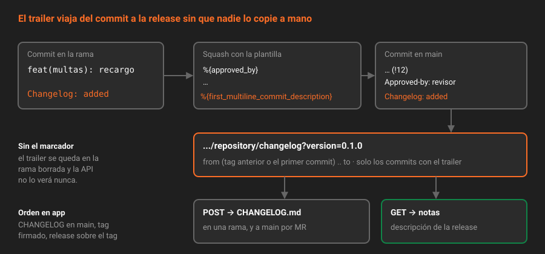

# El CHANGELOG generado

> Un CHANGELOG escrito a mano el día de la release es una lista de lo que alguien recuerda. Generado desde la historia, es la lista de lo que entró. GitLab CE trae el generador; lo que tienes que poner tú es una línea en cada commit que importa.

---

## 🎯 Objetivos

- Marcar un commit para el CHANGELOG con el trailer `Changelog:` y elegir su categoría
- Generar las notas de una versión con `GET .../repository/changelog` y escribirlas en `CHANGELOG.md` con `POST`
- Explicar cómo decide la API el rango de commits y por qué falla la primera vez
- Configurar categorías y plantilla en español con `.gitlab/changelog_config.yml`
- Conservar el trailer cuando la merge request se fusiona con squash

---

## 1. Qué problema resuelve

`git log v0.1.0..main` es demasiado: incluye cada `test:`, cada `chore:` y cada arreglo de un error que nunca llegó a publicarse. Un CHANGELOG escrito a mano es demasiado poco: depende de la memoria de quien publica.

GitLab resuelve el punto medio con una regla simple: **entra en el CHANGELOG el commit que lleva el trailer `Changelog:`**, y solo ese. Quien escribe el cambio decide, en el momento en que mejor lo sabe, si le importa a quien usa `app` y en qué categoría va.

La API es CE. No necesita runner ni pipeline: es una llamada.

---

## 2. Cómo funciona



### 2.1 El trailer

```
feat(multas): cobrar recargo por reincidencia

Changelog: added
```

El valor es la **categoría**. Por convención de GitLab: `added`, `fixed`, `changed`, `deprecated`, `removed`, `security`, `performance`, `other`. Cualquier otro valor también funciona: se usa tal cual como título de su sección.

Lo que aparece en el CHANGELOG es el **asunto del commit** (`feat(multas): cobrar recargo por reincidencia`), con un enlace al commit y otro a la merge request más antigua que lo contiene. Por eso el título de la merge request, que con squash es el asunto, tiene que entenderse sin contexto.

El tipo de Conventional Commits y la categoría no son lo mismo, aunque suelen ir juntos:

| Tipo | Categoría habitual | ¿Siempre? |
|---|---|---|
| `feat` | `added` | No: una función interna no le importa a nadie de fuera |
| `fix` | `fixed` | No: arreglar algo que no llegó a publicarse no es noticia |
| `perf` | `performance` | Casi siempre |
| `refactor`, `test`, `chore`, `ci` | Ninguna | Casi nunca. Un `refactor` que cambia un mensaje de error, sí: `changed` |

### 2.2 El rango

La API recorre los commits de `from..to` y se queda con los que tienen el trailer:

- **`to`**: por defecto, la punta de la rama (`branch`, que por defecto es la rama por defecto).
- **`from`**: si no lo pasas, busca el **tag anterior** a la versión pedida. Ordena los tags por SemVer con el `tag_regex` (por defecto acepta `v` delante) e **ignora los que tienen pre-release**. Para la `0.1.1`, encuentra `v0.1.0`.

La primera vez no hay tag anterior, y la API lo dice:

```
{"message":"Failed to generate the changelog: The commit start range is unspecified, and no previous tag could be found to use instead"}   # 422
```

Se arregla pasando `from` con el primer commit del repositorio, que queda **fuera** del rango:

```bash
PRIMERO=$(git rev-list --max-parents=0 origin/main)
```

Si un commit del rango revierte a otro (`This reverts commit <sha>` en su cuerpo, lo que escribe `git revert`), el revertido se omite. El revert solo aparece si lleva su propio trailer.

### 2.3 `GET` y `POST`

| | `GET .../repository/changelog` | `POST .../repository/changelog` |
|---|---|---|
| Qué hace | Devuelve las notas en `notes` | Inserta la sección en un archivo y hace un commit |
| Parámetros comunes | `version` (obligatorio), `from`, `to`, `date`, `trailer`, `config_file` | Los mismos |
| Parámetros propios | — | `branch`, `file` (por defecto `CHANGELOG.md`), `message` |
| Permiso | Leer el código | Poder hacer `push` a `branch` |

El `POST` contra `main` en `app` falla, porque nadie puede empujar a `main` desde la Semana 07:

```
{"message":"403 Forbidden - You are not allowed to commit a changelog on this branch"}
```

Es lo correcto: el CHANGELOG también entra por merge request. El flujo de `app` es crear una rama, hacer el `POST` contra ella y abrir la merge request. Dos detalles más:

- **El commit pasa por el hook.** Llega con `GL_PROTOCOL=web`, así que no necesita firma, pero sí un asunto convencional. El mensaje por defecto, `Add changelog for version 0.1.0`, se rechazaría: pasa `message=docs: changelog de la 0.1.0`.
- **Es idempotente.** Si `CHANGELOG.md` ya tiene una línea `## 0.1.0 `, el `POST` no hace nada. Corregir una sección se hace a mano, en una merge request.

Cada sección empieza por `## <versión> (<fecha>)` y se coloca en orden de versión, aunque el archivo ya tenga otras.

### 2.4 El squash se come el trailer

Con squash, los commits de la rama desaparecen y en `main` entra uno nuevo, construido con la plantilla de squash de la Semana 06:

```
%{title} (%{local_reference})

%{issues}

%{reviewed_by}
%{approved_by}
%{co_authored_by}
```

Ningún marcador copia el cuerpo de tus commits, así que `Changelog: added` se queda en la rama y no llega a `main`. La solución es un marcador más, al final:

```
%{reviewed_by}
%{approved_by}
%{co_authored_by}

%{first_multiline_commit_description}
```

`%{first_multiline_commit_description}` es el cuerpo del commit **más antiguo** de la merge request que tenga cuerpo. Si ninguno lo tiene, GitLab borra la línea y la línea en blanco anterior, y el mensaje queda como antes. Si lo tiene, ese cuerpo es el último párrafo del commit de squash, que es justo donde Git busca los trailers.

La consecuencia práctica: **el trailer va en el primer commit de la rama que tenga cuerpo**. Lo más sencillo es que cada merge request tenga un solo commit con cuerpo, el que explica el cambio, con el trailer en su última línea.

### 2.5 `changelog_config.yml`

Sin configuración, las secciones se titulan con el valor del trailer (`added`) y dicen `1 change`. Con `.gitlab/changelog_config.yml` en la rama por defecto, se cambia:

| Clave | Para qué |
|---|---|
| `categories` | Valor del trailer → título de la sección. El orden del mapa es el orden de las secciones |
| `template` | La plantilla de cada versión, con ``, `` y `{{ variable }}` |
| `date_format` | Formato `strftime` de la fecha de la cabecera |
| `tag_regex` | Qué tags son versiones. El de por defecto vale para `v0.1.0` |
| `include_groups` | Grupos cuyos miembros se citan como autores aunque sean del proyecto |

Por defecto, la configuración se lee de la rama por defecto, también cuando generas el CHANGELOG de `release/0.1`. El parámetro `config_file_ref` permite leerla de otra rama: así se prueba un cambio en el YAML antes de fusionarlo.

---

## 3. Cómo se configura

`.gitlab/changelog_config.yml` de `app`:

```yaml
---
date_format: "%Y-%m-%d"
categories:
  added: Añadido
  fixed: Corregido
  changed: Cambiado
  deprecated: Obsoleto
  removed: Eliminado
  security: Seguridad
  performance: Rendimiento
  other: Otros
template: |
  
  
  ### {{ title }} (1 cambio{{ count }} cambios)

  
  - [{{ title }}]({{ commit.web_url }})\
   por {{ author.reference }}\
   ([merge request]({{ merge_request.web_url }}))

  

  
  
  Sin cambios.
  
```

La `\` al final de una línea de la plantilla la une con la siguiente: así cada entrada queda en una sola línea de Markdown. `author.credit` solo es cierto para quien no es miembro del proyecto: en `app`, nadie.

Ver lo que saldría, sin tocar nada:

```bash
curl -s -G -H "$H" "$API/projects/$P/repository/changelog" \
  --data-urlencode "version=0.1.0" --data-urlencode "from=$PRIMERO" | jq -r .notes
```

---

## 4. Antipatrones

| Antipatrón | Por qué duele | Qué hacer en su lugar |
|---|---|---|
| Trailer `Changelog:` en todos los commits | El CHANGELOG vuelve a ser `git log` | Solo lo que le importa a quien usa la versión |
| Cambiar la plantilla de squash después de fusionar | Lo fusionado antes perdió el trailer para siempre | Plantilla primero, fusiones después |
| `POST` del CHANGELOG directo a `main` | `403`, y si alguien lo consigue, un cambio sin revisión | `POST` a una rama y merge request |
| Editar a mano una sección generada y volver a hacer `POST` | No pasa nada: el `POST` ve la cabecera y no toca el archivo | Correcciones a mano, en merge request, y asumir que ya no se regenera |
| Títulos de merge request como `Resolve "Bug 4"` | Es el texto que leerá quien use `app` | Título convencional que se entienda solo |
| Tags `v0.2.0-rc.1` como límite del CHANGELOG | La API los ignora para buscar el anterior | `from` explícito si quieres un CHANGELOG de una candidata |

---

## 5. Trucos

- **Qué commits entrarán**: `git log --format='%h %(trailers:key=Changelog,valueonly,separator=) %s' v0.1.0..main` y quédate con los que tienen valor.
- **Probar la plantilla sin publicar**: el `GET` usa `changelog_config.yml` de la rama por defecto; súbelo en una merge request y prueba con el `GET` antes de fusionar nada más.
- **Otro trailer**: el parámetro `trailer=Notas` cambia la palabra que busca la API, sin tocar los commits ya escritos con `Changelog:`.

---

## 📚 Recursos Adicionales

- [Changelogs](https://docs.gitlab.com/user/project/changelogs/) — trailers, configuración y plantillas
- [Repositories API: generate changelog data](https://docs.gitlab.com/api/repositories/#generate-changelog-data) — el `GET`
- [Repositories API: add changelog data to a changelog file](https://docs.gitlab.com/api/repositories/#add-changelog-data-to-a-changelog-file) — el `POST`
- [Commit templates](https://docs.gitlab.com/user/project/merge_requests/commit_templates/) — todos los marcadores de las plantillas de fusión y squash
- [`git interpret-trailers`](https://git-scm.com/docs/git-interpret-trailers) — qué cuenta como trailer para Git

---

## ✅ Checklist de Verificación

- [ ] Sabes qué commits entran en el CHANGELOG y cuál es su texto
- [ ] Sabes por qué la primera generación necesita `from`
- [ ] Sabes por qué el `POST` contra `main` devuelve `403` en `app`
- [ ] Sabes qué marcador conserva el trailer con squash y en qué commit tiene que ir
- [ ] Sabes de qué rama se lee `changelog_config.yml`

---

[← Anterior: Releases en GitLab](03-releases-en-gitlab.md) · [Volver a la Semana 08](../README.md) · [Siguiente: Ramas de release y cherry-pick →](05-ramas-de-release-y-cherry-pick.md)
