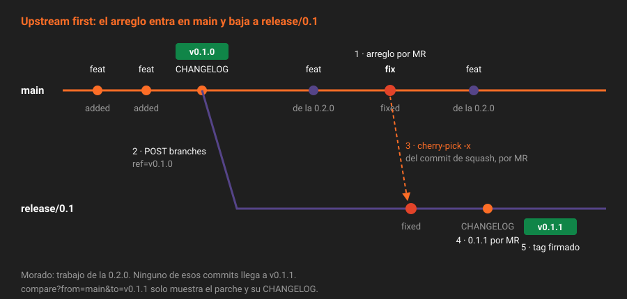

# Ramas de release y cherry-pick

> Un parche es la operación más delicada de un modelo de ramas: tiene que llevar el arreglo y nada más. La rama de release es el sitio donde "nada más" se puede garantizar, y `cherry-pick -x` es la forma de llevar el arreglo dejando constancia de dónde venía.

---

## 🎯 Objetivos

- Aplicar *upstream first*: arreglar en `main` y bajar el arreglo a la rama de release
- Crear una rama `release/X.Y` protegida desde un tag, y saber qué tres condiciones exige GitLab
- Llevar un commit con `git cherry-pick -x`, firmado, y saber cuál elegir cuando hay squash y commit de fusión
- Generar el CHANGELOG de un parche desde la rama de release
- Saber qué protege y qué no protege el hook de la Semana 07 en una rama de release

---

## 1. Qué problema resuelve

`v0.1.0` está publicada. En `main` ya hay una funcionalidad nueva de la `0.2.0`, y aparece un bug en `calcularMulta`. Quien usa la `0.1.0` necesita el arreglo, y no la funcionalidad nueva: un parche no puede cambiar el comportamiento (teoría [02](02-versionado-semantico.md)).

La rama de release resuelve eso: parte del tag `v0.1.0`, recibe **solo** el arreglo, y de ella sale `v0.1.1`.

---

## 2. Cómo funciona



### 2.1 *Upstream first*

El arreglo se hace **primero en `main`**, por merge request, como cualquier otro cambio. Después se copia a la rama de release. Nunca al revés.

Si el arreglo se hiciera solo en `release/0.1`, la `0.2.0`, que sale de `main`, volvería a tener el bug. Es el fallo más típico de las ramas de mantenimiento, y es silencioso: nadie lo ve hasta que alguien actualiza.

Hay una excepción legítima: el bug ya no existe en `main` porque el código cambió. Entonces el arreglo se escribe directamente contra la rama de release, y la merge request lo dice.

### 2.2 Crear la rama protegida

`release/0.1` nace desde el tag `v0.1.0`. Como `release/*` está protegida con `push` para nadie (práctica 01), GitLab aplica tres comprobaciones a la creación:

| Condición | Error si no se cumple |
|---|---|
| Poder **fusionar** en la rama: Maintainer o más | `You are not allowed to create protected branches on this project.` |
| Crearla por **web o API**, no con `git push` | `You can only create protected branches using the web interface and API.` |
| Que el commit de partida ya esté en **otra rama protegida** | `You can only use an existing protected branch ref as the basis of a new protected branch.` |

La tercera es la interesante: impide crear una rama protegida desde un commit que nadie revisó. `v0.1.0` apunta a un commit de `main`, así que la creación funciona:

```bash
curl -s --request POST "$API/projects/$P/repository/branches" -H "$H" \
  --data-urlencode "branch=release/0.1" --data-urlencode "ref=v0.1.0" \
  | jq '{name, protected, commit: .commit.short_id}'
```

### 2.3 `cherry-pick -x`

`git cherry-pick <sha>` aplica los cambios de un commit encima de la rama actual, en un commit nuevo. Con `-x` añade una línea al mensaje:

```
fix(multas): no cobrar multa con días de retraso negativos (!12)

Closes #7

Reviewed-by: Revisor <revisor@ejemplo.test>
Approved-by: Revisor <revisor@ejemplo.test>

Changelog: fixed
(cherry picked from commit 3f2a9c1e5b...)
```

Esa línea es la trazabilidad: desde `release/0.1` se llega al commit original de `main`, y de ahí a su merge request. Git la añade al bloque de trailers, así que `Changelog: fixed` sigue siendo un trailer válido.

**Qué commit elegir.** En `main` de `app` cada merge request entra como un commit de squash, y con `rebase_merge` además hay un commit de fusión:

| Commit | Elegirlo |
|---|---|
| El de squash (`squash_commit_sha` de la merge request) | **Sí**: un solo commit con todo el cambio y su trailer |
| El de fusión (`merge_commit_sha`) | No: tiene dos padres y `cherry-pick` exige `-m`, y trae un mensaje que no describe el cambio |
| Los commits originales de la rama | No: ya no existen en `main` |

```bash
SHA=$(curl -s -H "$H" "$API/projects/$P/merge_requests/$MR" | jq -r '.squash_commit_sha // .merge_commit_sha')
```

### 2.4 El parche pasa por las mismas reglas

El commit del `cherry-pick` es nuevo, así que el hook de la Semana 07 lo trata como cualquier otro:

- **Firma**: `cherry-pick` respeta `commit.gpgsign`. Si tu clon firma, el commit sale firmado.
- **Asunto convencional**: es el del commit original, que ya lo era.
- **`Approved-by:`**: el hook solo lo exige en `main`. En `release/0.1`, lo que obliga a pasar por merge request es la protección (`push` para nadie), no el hook.

El parche entra en `release/0.1` por merge request, igual que en `main`. La revisión es corta (el cambio ya se revisó en `main`), pero no es un trámite: hay que comprobar que el arreglo aplica igual sobre el código de la `0.1`, que puede ser distinto.

### 2.5 El CHANGELOG del parche

Mismo flujo que para la `0.1.0` (teoría [04](04-changelog-generado.md)), con la rama de release como base:

| | `0.1.0` | `0.1.1` |
|---|---|---|
| Rama para el `POST` | Una rama desde `main` | Una rama desde `release/0.1` |
| `from` | El primer commit (no hay tag anterior) | Sin `from`: la API encuentra `v0.1.0` |
| La merge request va a | `main` | `release/0.1` |

El `CHANGELOG.md` de `release/0.1` tiene las secciones `0.1.1` y `0.1.0`. El de `main` solo tiene la `0.1.0`: las secciones de los parches viven en su rama de release, y las notas completas de cada versión están en su release. Cuando generes la `0.2.0`, el arreglo volverá a aparecer, porque su commit original está en `main` después de `v0.1.0`. Es correcto: quien pasa de la `0.1.0` a la `0.2.0` también lo recibe.

### 2.6 Desde GitLab, sin terminal

Cada commit y cada merge request fusionada tienen un botón **Cherry-pick** que crea el commit en otra rama, o abre una merge request con él. Por API:

```bash
curl -s --request POST "$API/projects/$P/repository/commits/$SHA/cherry_pick" -H "$H" \
  --data-urlencode "branch=release/0.1" --data-urlencode "dry_run=true"
```

Con `dry_run=true` solo comprueba si aplica sin conflictos. Sin él, intentaría escribir directamente en `release/0.1` y la protección lo impediría. El mensaje que genera GitLab incluye la misma línea `(cherry picked from commit …)`. En `app` se usa la terminal porque el commit sale firmado con tu clave.

---

## 3. Cómo se configura

| Pieza | Configuración |
|---|---|
| Protección de `release/*` | `push_access_level=0`, `merge_access_level=40`, `allow_force_push=false` (práctica 01) |
| Creación de `release/0.1` | `POST .../repository/branches` con `ref=v0.1.0`, cuando haga falta el primer parche |
| El parche | Rama corta desde `release/0.1`, `git cherry-pick -x <sha>`, merge request a `release/0.1` |
| El tag | `git tag -s v0.1.1` sobre la punta de `release/0.1` tras fusionar el CHANGELOG |
| Cuántas ramas de release se mantienen | El ADR-006. En `app`, solo la última `MENOR` |

---

## 4. Antipatrones

| Antipatrón | Por qué duele | Qué hacer en su lugar |
|---|---|---|
| Arreglar solo en la rama de release | La siguiente `MENOR` reintroduce el bug | *Upstream first* |
| `cherry-pick` sin `-x` | Nadie sabe de dónde viene el commit ni si ya está en `main` | Siempre `-x` |
| Fusionar `main` en `release/0.1` "para ponerla al día" | Entra todo lo de la `0.2.0`: ya no es un parche | Solo `cherry-pick` de commits concretos |
| `cherry-pick` del commit de fusión | Pide `-m`, trae un mensaje sin contenido y a veces más cambios de los esperados | El commit de squash |
| Mantener todas las ramas de release para siempre | Cada arreglo se copia a N ramas, y alguna se olvida | Decidir en el ADR cuántas se mantienen |
| Tag del parche en `main` | `v0.1.1` llevaría lo que haya en `main` | Tag en la punta de `release/0.1` |

---

## 5. Trucos

- **¿Está este arreglo ya en la rama?**: `git log --grep "cherry picked from commit $SHA" origin/release/0.1`.
- **Qué lleva una versión que no está en `main`**: `GET .../repository/compare?from=main&to=v0.1.1 | jq -r '.commits[].title'`.
- **Extender el hook a las ramas de release** es una línea: `[ "$ref" = refs/heads/main ]` pasa a `case "$ref" in refs/heads/main|refs/heads/release/*)`. Hazlo con su merge request y su ADR, como cualquier cambio a las reglas.

---

## 📚 Recursos Adicionales

- [GitLab Flow: release branches](https://about.gitlab.com/topics/version-control/what-is-gitlab-flow/) — *upstream first* con ramas de release
- [Cherry-pick changes](https://docs.gitlab.com/user/project/merge_requests/cherry_pick_changes/) — el botón de GitLab y sus opciones
- [Commits API: cherry-pick a commit](https://docs.gitlab.com/api/commits/#cherry-pick-a-commit) — `branch`, `dry_run` y `message`
- [`git cherry-pick`](https://git-scm.com/docs/git-cherry-pick) — `-x`, `-m` y la resolución de conflictos

---

## ✅ Checklist de Verificación

- [ ] Sabes por qué el arreglo va primero a `main`
- [ ] Sabes las tres condiciones para crear `release/0.1` y qué error da cada una
- [ ] Sabes qué commit de `main` llevar con `cherry-pick` y por qué no el de fusión
- [ ] Sabes qué exige el hook a un commit de `release/0.1` y qué no
- [ ] Sabes de dónde saca la API el inicio del rango para la `0.1.1`

---

[← Anterior: El CHANGELOG generado](04-changelog-generado.md) · [Volver a la Semana 08](../README.md) · [Siguiente: Las métricas DORA →](06-metricas-dora.md)
