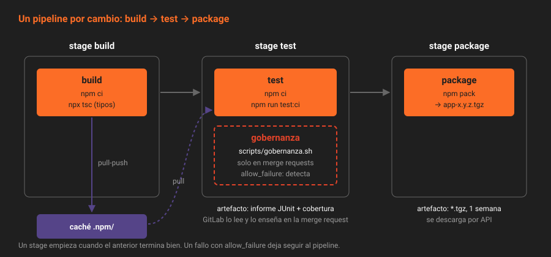

# Del commit al pipeline

> Hasta hoy, "los tests pasan" significaba "los pasé yo, en mi máquina, si me acordé". Un pipeline convierte esa frase en un hecho que cualquiera puede comprobar: el mismo comando, en un entorno limpio, para cada commit, con el resultado pegado a la merge request.

---

## 🎯 Objetivos

- Distinguir integración continua, entrega continua y despliegue continuo, y decir cuál empieza esta semana
- Nombrar las piezas de un pipeline de GitLab: pipeline, stage, job, runner
- Saber qué crea un pipeline y de qué tipo es cada uno
- Explicar por qué un pipeline en verde es la condición de fusión y no un adorno

---

## 1. Qué problema resuelve

`app` tiene tests desde la Semana 02. Pero nadie garantiza que se ejecuten: dependen de que quien abre la merge request se acuerde, de que su Node sea el bueno y de que no tenga en local un archivo que no subió. Y `revisor` no tiene forma de saber si se ejecutaron.

La **integración continua** (*continuous integration*, CI) resuelve eso con una regla: cada cambio que llega al servidor se construye y se prueba solo, en un entorno que nadie ha tocado, y el resultado queda escrito junto al cambio.

| Práctica | Qué se automatiza | En `app` |
|---|---|---|
| **Integración continua** | Construir y probar cada cambio | Esta semana |
| **Entrega continua** (*continuous delivery*) | Que cada cambio en `main` quede listo para publicarse con un clic | Fase 3 y Semana 14 |
| **Despliegue continuo** (*continuous deployment*) | Que se publique solo, sin clic | Semana 14, y solo si las métricas lo aguantan |

Las tres comparten siglas (CI/CD) y se confunden. La diferencia entre las dos últimas es una persona que pulsa un botón.

---

## 2. Cómo funciona

### 2.1 Las piezas

| Pieza | Qué es | En `app` |
|---|---|---|
| **Pipeline** | Todo lo que se ejecuta para un commit concreto | Uno por push o por merge request |
| **Stage** | Un grupo de jobs. Los stages van en orden; uno no empieza hasta que el anterior termina bien | `build`, `test`, `package` |
| **Job** | Un conjunto de comandos que se ejecuta en un entorno limpio | `build`, `test`, `package`, `gobernanza` |
| **Runner** | El programa que recoge jobs de GitLab y los ejecuta | El contenedor `gitlab-runner` del compose |

Los jobs de un mismo stage se ejecutan en paralelo si hay sitio (el runner del laboratorio ejecuta uno a la vez; ver la teoría 03). Si un job falla, los stages siguientes no se ejecutan, salvo que el job tenga `allow_failure: true`.

El diagrama de la semana muestra el pipeline que tendrá `app` el viernes:

### 2.2 Quién decide qué se ejecuta

**GitLab**, no el runner. Al recibir un push, GitLab lee `.gitlab-ci.yml` **del commit empujado**, decide qué jobs entran en el pipeline y los deja en cola. El runner pregunta cada pocos segundos si hay algo para él, recoge un job y devuelve el log y el resultado.

Dos consecuencias:

- **Cambiar el pipeline es cambiar un archivo del repositorio.** Va por merge request, con revisión, como el código. Esta semana `CODEOWNERS` lo pone en manos de `revisor`.
- **Una rama puede tener un pipeline distinto del de `main`.** La merge request que cambia `.gitlab-ci.yml` ya se ejecuta con la versión nueva, y así se prueba antes de fusionarla.

### 2.3 Qué crea un pipeline

| Origen (`CI_PIPELINE_SOURCE`) | Cuándo | Contra qué commit |
|---|---|---|
| `push` | Un push a una rama o un tag | El último commit empujado |
| `merge_request_event` | Al abrir una merge request o empujar a su rama | El último commit de la rama de origen |
| `web` | `Build → Pipelines → New pipeline` | La rama que eliges |
| `api` | `POST .../pipeline` | La `ref` que pasas |
| `schedule` | Un pipeline programado (Semana 11) | La rama del programa |

Sin reglas, un push a una rama con merge request abierta crearía **dos** pipelines: uno de rama y otro de merge request. El bloque `workflow:rules` de la teoría 02 deja solo uno. La Semana 10 lo explica entero.

### 2.4 Por qué el verde es la condición de fusión

Un pipeline que nadie mira no protege nada. Desde la Semana 06, `app` tenía preparado el ajuste *Pipelines must succeed* (`only_allow_merge_if_pipeline_succeeds`) pero no podía activarlo: sin pipeline, ninguna merge request se podía fusionar. Esta semana se activa, y a partir de ahí una merge request con el pipeline en rojo devuelve `405` al intentar fusionarla, y su `detailed_merge_status` es `ci_must_pass`.

Es **Free**. Lo único de pago cerca son las *Merge trains* (Premium), que prueban cada merge request contra el resultado de fusionar las anteriores.

---

## 3. Cómo se configura

Nada que activar: un archivo `.gitlab-ci.yml` en la raíz y un runner disponible bastan. La teoría 02 explica el archivo y la 03 el runner.

Lo que sí hay que saber antes de empezar: **si un proyecto no tiene `.gitlab-ci.yml`, GitLab no se queda quieto**. Con *Auto DevOps* activado en la instancia, que es el valor por defecto, crea en cada push un pipeline con jobs que adivinan el lenguaje. Auto DevOps es **Free** y vuelve en la Semana 25.

En `app` eso ya pasó, sin que lo vieras: el primer push creó un pipeline de Auto DevOps; como no había runner, al cabo de una hora GitLab descartó sus jobs (`stuck_pending_no_matching_runners`), el pipeline falló y GitLab desactivó Auto DevOps en el proyecto, que es lo que hace tras el primer fallo cuando nadie lo activó a mano. Lo que empujaste en la última hora puede seguir pendiente. La práctica 01 lo cancela y deja Auto DevOps desactivado de forma explícita antes de registrar el runner, para que no ejecute nada de eso de golpe.

---

## 4. Antipatrones

| Antipatrón | Por qué duele | Qué hacer en su lugar |
|---|---|---|
| "En mi máquina pasa" como argumento de revisión | Nadie puede reproducirlo | El resultado del pipeline en la merge request |
| Un pipeline que nadie exige | Se acostumbra el equipo a fusionar en rojo | *Pipelines must succeed* activado |
| Comandos en el pipeline que no existen en local | Si el pipeline falla, nadie sabe reproducirlo | Los mismos scripts de `package.json` en los dos sitios |
| Cambiar `.gitlab-ci.yml` directamente en `main` | El pipeline nuevo se estrena sin probar | Merge request: su pipeline ya usa la versión nueva |
| Confundir entrega y despliegue continuos | Se automatiza la publicación sin estar listos | Primero que `main` esté siempre publicable |

---

## 5. Trucos

- **De dónde viene un pipeline**: `GET .../pipelines?per_page=5 | jq -r '.[] | "\(.id) \(.source) \(.ref) \(.status)"'`.
- **El pipeline de una merge request**: `GET .../merge_requests/<iid> | jq .head_pipeline.status`.
- **Por qué no se puede fusionar**: `GET .../merge_requests/<iid> | jq -r .detailed_merge_status`. `ci_must_pass` es el pipeline; `ci_still_running`, que aún no ha terminado.

---

## 📚 Recursos Adicionales

- [CI/CD pipelines](https://docs.gitlab.com/ci/pipelines/) — tipos de pipeline, estados y vistas
- [Merge when pipeline succeeds](https://docs.gitlab.com/user/project/merge_requests/auto_merge/) — la fusión automática al pasar a verde
- [Pipelines must succeed](https://docs.gitlab.com/user/project/merge_requests/auto_merge/#require-a-successful-pipeline-for-merge) — el ajuste y sus excepciones
- [Continuous Integration](https://martinfowler.com/articles/continuousIntegration.html) — el artículo de referencia de Martin Fowler

---

## ✅ Checklist de Verificación

- [ ] Sabes qué separa entrega continua de despliegue continuo
- [ ] Sabes qué hace GitLab y qué hace el runner en un pipeline
- [ ] Sabes por qué un push con merge request abierta podría crear dos pipelines
- [ ] Sabes qué pasaba en `app` con cada push antes de tener `.gitlab-ci.yml`

---

[Volver a la Semana 09](../README.md) · [Siguiente: Anatomía de `.gitlab-ci.yml` →](02-anatomia-del-gitlab-ci-yml.md)
