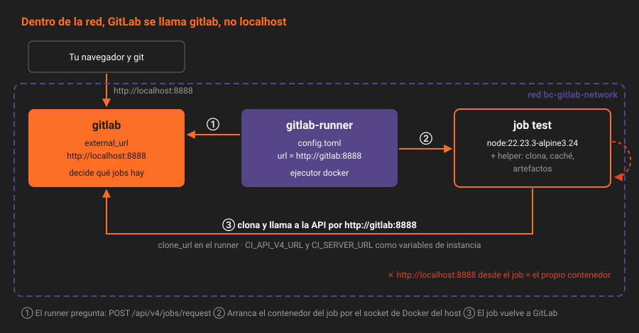

# El runner

> GitLab decide qué hay que ejecutar; no ejecuta nada. Lo hace un programa aparte, el runner, que puede vivir en otra máquina, en otra red o en otro continente. Esta semana vive en un contenedor al lado de tu instancia, y lo primero que vas a descubrir es que "al lado" no significa "en la misma red".

---

## 🎯 Objetivos

- Explicar qué hace el runner y qué hace GitLab en cada job
- Distinguir runners de instancia, de grupo y de proyecto
- Registrar un runner con el flujo de *authentication token*, sin *registration token*
- Leer el `config.toml` de un runner con el ejecutor Docker
- Entender por qué un job del laboratorio no llega a `localhost:8888`, y cómo se arregla

---

## 1. Qué problema resuelve

Ejecutar código arbitrario de cada merge request dentro del servidor de GitLab sería entregar el servidor a cualquiera que pueda abrir una merge request. Por eso la ejecución va aparte: el runner pide trabajo, lo ejecuta en un entorno desechable y devuelve el resultado. Si un job se come la CPU o rompe su contenedor, GitLab ni se entera.

---

## 2. Cómo funciona

### 2.1 Quién hace qué



1. GitLab recibe el push, lee `.gitlab-ci.yml` y deja los jobs en cola (`pending`).
2. El runner pregunta a GitLab cada pocos segundos (`POST /api/v4/jobs/request`) si hay un job para él. Nadie le avisa: la conexión la abre siempre el runner, y por eso puede estar detrás de un NAT.
3. GitLab le entrega un job: el script, las variables, la imagen y un `CI_JOB_TOKEN`.
4. El **ejecutor** (*executor*) del runner prepara el entorno. Con el ejecutor Docker, arranca un contenedor *helper* que clona el repositorio y gestiona caché y artefactos, y otro con la imagen del job que ejecuta el script.
5. El runner envía el log a trozos mientras el job avanza y, al terminar, el estado y los artefactos.

### 2.2 Tipos de runner

| Tipo | Quién lo crea | A quién sirve | Tier |
|---|---|---|:--:|
| **De instancia** (*instance runner*) | Un administrador | A todos los proyectos que no lo desactiven | Free |
| **De grupo** (*group runner*) | Owner del grupo | A todos los proyectos del grupo y sus subgrupos | Free |
| **De proyecto** (*project runner*) | Maintainer del proyecto | A ese proyecto, y a otros a los que se asigne | Free |

`app` usa uno **de proyecto**: es el único que se crea sin ser administrador ni Owner del grupo, y el que menos superficie expone. En la Semana 15 llega la flota: runners de grupo con etiquetas, uno protegido para `main` y otro para Docker dentro de Docker.

### 2.3 Los ejecutores

| Ejecutor | Dónde corre el job | Semana |
|---|---|:--:|
| `shell` | Directamente en la máquina del runner | 15, para entender por qué no |
| **`docker`** | En un contenedor nuevo por job | **09** |
| `docker-autoscaler`, `instance` | En máquinas que el runner crea y destruye | 15 |
| `kubernetes` | En un pod por job | 16 |

Con `docker`, cada job empieza en una imagen limpia. Lo que un job deja en disco desaparece con su contenedor, salvo lo que se guarda como artefacto o como caché (teorías 05 y 06).

### 2.4 El registro: de *registration token* a *authentication token*

Hasta GitLab 16.0, un runner se registraba con un *registration token* compartido por todo el proyecto: cualquiera que lo viera podía colgar runners del proyecto, y la configuración (etiquetas, protección) la decidía quien registraba. El flujo actual lo invierte:

1. El runner **se crea en GitLab** (`POST /user/runners` o `Settings → CI/CD → Runners → New project runner`). Ahí se deciden la descripción, las etiquetas y si acepta jobs sin etiquetas.
2. GitLab devuelve un **authentication token** con prefijo `glrt-`. Se ve una sola vez.
3. `gitlab-runner register` lo guarda en `config.toml`. Lo recibe con `--token` o, mejor, en la variable `CI_SERVER_TOKEN`, que no queda en el historial ni en `ps` (apartado 3). Desde ese momento, el runner es ese registro concreto.

El *registration token* está deprecado y en retirada, pero en una instalación nueva de 19.2 sigue permitido: `GET /application/settings | jq .allow_runner_registration_token` dice `true`. Se desactiva en la Semana 18, al endurecer la instancia. Si un tutorial te pide `--registration-token`, es anterior al flujo nuevo.

`POST /user/runners` exige un token con scope `create_runner` o `api`, y ser Maintainer del proyecto para `runner_type=project_type`.

### 2.5 `config.toml`

El runner del laboratorio lo guarda en el volumen `bc-gitlab-runner-config`. Lo que escribe `register` en la práctica 01, sin el token:

```toml
concurrent = 1                          # jobs a la vez en todo el runner

[[runners]]
  name = "docker-app"
  url = "http://gitlab:8888"            # cómo llega el runner a GitLab
  clone_url = "http://gitlab:8888"      # cómo llega el job a Git
  executor = "docker"
  [runners.docker]
    image = "alpine:3.24.2"             # si el job no dice `image`
    network_mode = "bc-gitlab-network"  # la red del compose
    volumes = ["/cache"]                # donde vive la caché local
    privileged = false
```

`concurrent = 1` explica por qué los jobs de un stage van de uno en uno en el laboratorio: hay sitio para uno. Con 16 GB es lo prudente; la Semana 15 lo sube.

El runner relee `config.toml` solo cuando cambia: no hace falta reiniciarlo.

### 2.6 El problema de `localhost`

La instancia tiene `external_url 'http://localhost:8888'`. Desde tu navegador, perfecto. Desde dentro de un contenedor, `localhost` es **el propio contenedor**: un job que intente `http://localhost:8888` no llega a nada.

GitLab construye con `external_url` varias de las variables que recibe cada job, y el job las usa sin saber de dónde salen:

| Lo que necesita el job | De dónde lo saca | Cómo se arregla en el laboratorio |
|---|---|---|
| Clonar el repositorio | `CI_REPOSITORY_URL` | `clone_url = "http://gitlab:8888"` en el runner |
| Llamar a la API | `CI_API_V4_URL` | Variable de instancia con `http://gitlab:8888/api/v4` |
| Enlaces a la instancia | `CI_SERVER_URL` | Variable de instancia con `http://gitlab:8888` |

`gitlab` resuelve porque los jobs se conectan a la red `bc-gitlab-network`, donde el contenedor de GitLab se llama así.

¿Por qué una variable de instancia y no el `environment` del `config.toml`? Porque las variables que manda GitLab con el job **pisan** las del runner: se probó, y el job seguía viendo `localhost`. Una variable CI/CD de instancia sí tiene más prioridad que la predefinida. Las variables de instancia son **Free** (`Admin → Settings → CI/CD → Variables`).

> [!NOTE]
> En producción esto no pasa: `external_url` es un nombre DNS que resuelve igual dentro y fuera, y nadie sobreescribe variables predefinidas. Es un arreglo del laboratorio, y por eso vive en la instancia y no en el `.gitlab-ci.yml` de `app`: el YAML sigue siendo el mismo que funcionaría en cualquier GitLab.

---

## 3. Cómo se configura

```bash
# 1. Crear el runner en GitLab
RT=$(curl -s --request POST "$API/user/runners" -H "$H" \
  --data "runner_type=project_type" --data "project_id=$PID" \
  --data-urlencode "description=docker-app" \
  --data "tag_list=docker" --data "run_untagged=true" | jq -r .token)

# 2. Registrarlo en el contenedor, sin el token en la línea de comandos
CI_SERVER_TOKEN="$RT" docker compose exec -e CI_SERVER_TOKEN gitlab-runner \
  gitlab-runner register --non-interactive \
  --url http://gitlab:8888 --clone-url http://gitlab:8888 \
  --executor docker --docker-image alpine:3.24.2 \
  --docker-network-mode bc-gitlab-network --name docker-app
unset RT
```

`register` lee el token de la variable `CI_SERVER_TOKEN`: así no queda en el historial ni en la lista de procesos.

---

## 4. Antipatrones

| Antipatrón | Por qué duele | Qué hacer en su lugar |
|---|---|---|
| Runner de instancia para un solo proyecto | Cualquier proyecto puede ejecutar en él | Runner de proyecto |
| `--registration-token` | Flujo deprecado, token compartido | `POST /user/runners` y `register` con `CI_SERVER_TOKEN` |
| El token `glrt-` en un archivo o en el chat | Cualquiera puede registrar otro runner con esa identidad | Directo de la API a `register`, y `unset` |
| Ejecutor `shell` en la máquina de GitLab | Un job puede leer los secretos de la instancia | Ejecutor `docker` |
| Runner más nuevo que el servidor | No soportado; palabras clave que el servidor no entiende | Misma serie: `alpine-v19.2.2` con `19.2.4` |
| Imagen por defecto `alpine:latest` en `config.toml` | Cambia sola en cada `pull` | Versión completa |

---

## 5. Trucos

- **¿Está vivo?**: `GET .../projects/$P/runners | jq -r '.[] | "\(.id) \(.description) \(.status)"'` tiene que decir `online`.
- **Qué versión ejecuta y desde dónde**: `GET /runners/<id>/managers | jq '.[] | {version, platform, status}'`.
- **El `config.toml` sin el token**: `docker compose exec gitlab-runner grep -vE '^\s*token' /etc/gitlab-runner/config.toml`.
- **Qué runner ejecutó un job**: `GET .../jobs/<id> | jq .runner.description`.

---

## 📚 Recursos Adicionales

- [GitLab Runner](https://docs.gitlab.com/runner/) — instalación, ejecutores y configuración
- [Migrating to the new runner registration workflow](https://docs.gitlab.com/ci/runners/new_creation_workflow/) — por qué cambió y qué se retira
- [Advanced configuration](https://docs.gitlab.com/runner/configuration/advanced-configuration/) — todas las claves de `config.toml`
- [User runners API](https://docs.gitlab.com/api/users/#create-a-runner-linked-to-a-user) — `POST /user/runners`
- [CI/CD variable precedence](https://docs.gitlab.com/ci/variables/#cicd-variable-precedence) — qué variable gana a cuál

---

## ✅ Checklist de Verificación

- [ ] Sabes quién abre la conexión entre GitLab y el runner, y por qué importa
- [ ] Sabes por qué `app` usa un runner de proyecto
- [ ] Sabes qué decide quien crea el runner y qué decide quien lo registra
- [ ] Sabes por qué el job no llega a `localhost:8888` y qué tres cosas lo arreglan

---

[← Anterior: Anatomía de `.gitlab-ci.yml`](02-anatomia-del-gitlab-ci-yml.md) · [Volver a la Semana 09](../README.md) · [Siguiente: La vida de un job →](04-la-vida-de-un-job.md)
