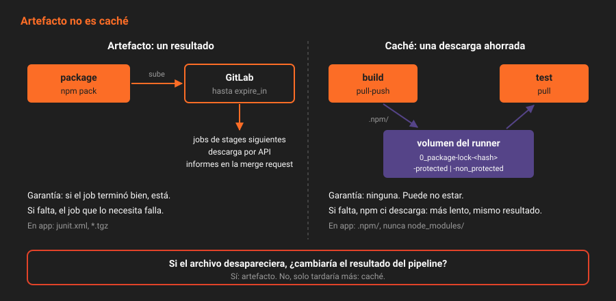

# Caché

> La caché es lo que el job **podría** volver a descargar de internet, guardado para no tener que hacerlo. Si desaparece, el job tarda más pero sale igual. Si un job depende de que esté, no es caché: es un artefacto mal declarado.

---

## 🎯 Objetivos

- Declarar una caché con `key:files`, `paths` y `policy`
- Explicar dónde vive la caché del runner del laboratorio y quién la ve
- Entender por qué una merge request no usa la caché de `main`
- Distinguir artefacto y caché por su función, no por su sintaxis
- Elegir qué cachear en un proyecto Node

---

## 1. Qué problema resuelve

Cada job de `app` empieza en un contenedor limpio y ejecuta `npm ci`, que descarga TypeScript y los tipos de Node: unos 40 MB. Tres jobs por pipeline, varios pipelines por merge request. La caché guarda lo descargado entre jobs y entre pipelines, para que el segundo `npm ci` salga del disco y no de la red.

---

## 2. Cómo funciona

### 2.1 Artefacto no es caché



| | Artefacto | Caché |
|---|---|---|
| **Para qué** | Pasar un **resultado** del pipeline | Acelerar una **descarga** que se puede repetir |
| **Dónde vive** | En GitLab | En el runner (o en un almacén compartido, Semana 15) |
| **Garantía** | Si el job terminó bien, está | Ninguna: puede no estar, y el job tiene que funcionar igual |
| **Quién lo recibe** | Los jobs de stages siguientes, y quien lo descargue | Los jobs con la misma clave, en el mismo runner |
| **Caduca** | `expire_in` | Cuando se borra o cambia la clave |
| **En `app`** | `junit.xml`, `*.tgz` | `.npm/` |

La pregunta que decide: **si este archivo desapareciera, ¿el pipeline daría otro resultado?** Si sí, es un artefacto.

### 2.2 Declarar

> Extracto del `.gitlab-ci.yml` de la teoría 02, que ya lleva `workflow:rules`.

```yaml
.npm:
  cache:
    key:
      files: [package-lock.json]
    paths: [.npm/]
    policy: pull
  before_script:
    - npm ci --cache .npm --prefer-offline --no-audit --no-fund

build:
  extends: .npm
  cache:
    policy: pull-push
```

| Clave | Qué hace |
|---|---|
| `key` | Qué caché usar. Con `files`, un hash del contenido de esos archivos: cambia el lockfile, cambia la clave |
| `paths` | Qué se guarda. Relativo al repositorio: `~/.npm` no vale |
| `policy` | `pull-push` (por defecto): descarga y sube. `pull`: solo descarga. `push`: solo sube |
| `fallback_keys` | Claves a probar si la principal no existe |
| `when` | Cuándo subirla: `on_success` (por defecto), `on_failure`, `always` |

En `app`, solo `build` sube la caché; `test` la lee. Subir la caché cuesta tiempo, y que tres jobs suban la misma es tiempo perdido.

### 2.3 Por qué `.npm/` y no `node_modules/`

`npm ci` **borra** `node_modules` antes de instalar: cachearlo no ahorra nada. Lo que sí ahorra es la caché de descargas de npm, que normalmente vive en `~/.npm`, fuera del repositorio y por tanto fuera del alcance de `cache:paths`. `--cache .npm` la mueve dentro, y `--prefer-offline` le dice a npm que use lo que tenga antes de preguntar al registro.

### 2.4 Dónde vive

El runner del laboratorio no tiene caché compartida (`[runners.cache]` está vacío en `config.toml`). Guarda cada caché como un zip en volúmenes Docker propios del runner (`docker volume ls | grep cache` los enseña, uno para ramas protegidas y otro para el resto), montados en `/cache` de cada job. El log lo dice:

```
Checking cache for 0_package-lock-b038a1c0…-protected...
No URL provided, cache will not be downloaded from shared cache server. Instead a local version of cache will be extracted.
Successfully extracted cache
```

Con un solo runner basta. Con varios, cada uno tendría su propia caché, y un job que cae en otro runner empieza en frío. La Semana 15 la mueve a SeaweedFS, compartida por toda la flota.

### 2.5 La clave completa, y por qué la merge request empieza en frío

La clave que se ve en el log tiene tres partes:

| Parte | De dónde sale |
|---|---|
| `0_` | Un contador del proyecto. `Build → Pipelines → Clear runner caches` lo sube, y todas las cachés anteriores dejan de usarse |
| `package-lock-b038a1c0…` | El hash de `key:files` |
| `-protected` o `-non_protected` | Si la rama del pipeline está protegida |

El sufijo es una medida de seguridad (`ci_separated_caches`, activada por defecto): una rama cualquiera no puede escribir una caché que luego use `main`. Si pudiera, cualquier Developer podría envenenar la caché con un paquete modificado y esperar a que `main` lo empaquetara.

La consecuencia práctica: el **primer** pipeline de una merge request no encuentra caché (`WARNING: Cache file does not exist`), porque `main` escribe en `-protected` y la merge request lee de `-non_protected`. Su `build` crea la suya, y los siguientes pipelines de cualquier rama no protegida ya la usan.

> [!NOTE]
> Comprobado en el código de 19.2.4: los pipelines de merge request usan `-non_protected` salvo que el proyecto proteja explícitamente los pipelines de merge request. Un administrador ve `-protected` en todas partes, porque el permiso de caché protegida se le concede siempre; si lo pruebas con la cuenta de `root`, no sacarás la conclusión correcta.

`cache:unprotect: true` junta las dos. No lo uses: deshace justo la protección del párrafo anterior.

### 2.6 Una caché que no está no es un error

```
WARNING: Cache file does not exist
Failed to extract cache
$ npm ci --cache .npm --prefer-offline --no-audit --no-fund
added 4 packages in 2s
```

El job sigue. Es la diferencia de contrato con el artefacto: un job cuyo artefacto de `dependencies` caducó o se borró falla con `missing_dependency_failure`; una caché que no encuentra nada, no.

---

## 3. Cómo se configura

En el job, como en el apartado 2.2. Para empezar de cero: `Build → Pipelines → Clear runner caches`. La caché distribuida (`[runners.cache]` con S3) se configura en el runner, en la Semana 15.

---

## 4. Antipatrones

| Antipatrón | Por qué duele | Qué hacer en su lugar |
|---|---|---|
| Cachear `node_modules/` con `npm ci` | `npm ci` lo borra: subes y bajas para nada | `.npm/` con `--cache .npm` |
| Una clave fija (`key: npm`) | Una caché vieja se arrastra aunque cambien las dependencias | `key:files: [package-lock.json]` |
| Pasar el resultado del build por caché | Si la caché no está, el job siguiente falla o, peor, usa uno viejo | Artefacto |
| Todos los jobs con `pull-push` | Cada job sube la misma caché | Uno sube, los demás `pull` |
| `cache:unprotect: true` | Una rama cualquiera escribe en la caché de `main` | Cachés separadas |
| Confiar en la caché para que el pipeline funcione sin red | La primera vez, o en otro runner, no hay | Que funcione sin caché; la caché solo acelera |

---

## 5. Trucos

- **¿Usó la caché?**: `GET .../jobs/<id>/trace | grep -E 'Checking cache|Successfully extracted|Failed to extract'`.
- **El efecto, en segundos**: compara `duration` del job `build` en un pipeline sin caché y en el siguiente.
- **Una caché por rama**, si un día hace falta: `key: "$CI_COMMIT_REF_SLUG"`. Para dependencias, la del lockfile es mejor: es la misma para todas las ramas con las mismas dependencias.

---

## 📚 Recursos Adicionales

- [Caching in GitLab CI/CD](https://docs.gitlab.com/ci/caching/) — claves, políticas, ejemplos por lenguaje y la diferencia con los artefactos
- [Cache keyword](https://docs.gitlab.com/ci/yaml/#cache) — todas las subclaves
- [`npm ci`](https://docs.npmjs.com/cli/commands/npm-ci) — por qué borra `node_modules` y qué hace con el lockfile
- [Runners cache configuration](https://docs.gitlab.com/runner/configuration/advanced-configuration/#the-runnerscache-section) — la caché compartida, para la Semana 15

---

## ✅ Checklist de Verificación

- [ ] Sabes decidir si un archivo es artefacto o caché con una sola pregunta
- [ ] Sabes por qué `app` cachea `.npm/` y no `node_modules/`
- [ ] Sabes por qué el primer pipeline de una merge request no tiene caché
- [ ] Sabes qué pasa si la caché no está

---

[← Anterior: Artefactos](05-artefactos.md) · [Volver a la Semana 09](../README.md) · [Siguiente: La gobernanza en el pipeline →](07-la-gobernanza-en-el-pipeline.md)
