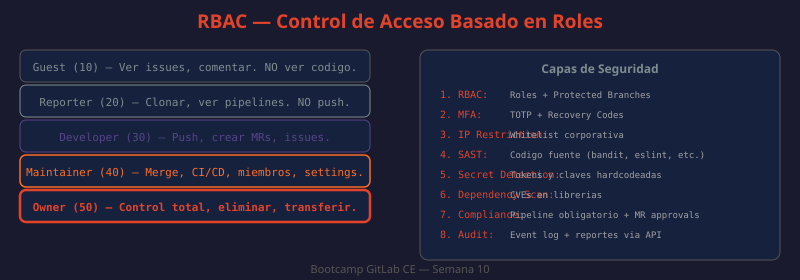

# 01 — RBAC en GitLab: Roles, Permisos y Control de Acceso

El control de acceso basado en roles (RBAC) es el mecanismo mediante el cual GitLab gestiona quién puede hacer qué en la plataforma. Cada usuario recibe un rol en cada grupo o proyecto al que pertenece, y ese rol determina exactamente qué operaciones puede ejecutar: desde leer código hasta eliminar la instancia completa.



---

## Niveles de acceso

GitLab define cinco roles numéricos que se aplican en tres contextos: instancia (Admin global), grupo, y proyecto. Los valores numéricos permiten comparaciones programáticas en la API.

| Rol | Valor | Proyecto | Grupo |
|-----|-------|----------|-------|
| Guest | 10 | Ver issues, dejar comentarios, descargar releases | Ver el grupo y sus proyectos públicos |
| Reporter | 20 | Clonar repo, ver pipelines, analytics, crear issues | Ver miembros del grupo |
| Developer | 30 | Push a ramas no protegidas, crear MRs, gestionar issues, ejecutar pipelines | Acceso completo al código de todos los proyectos |
| Maintainer | 40 | Merge a protected branches, gestionar CI/CD, añadir miembros, editar proyecto | Gestionar subgrupos, crear proyectos en el grupo |
| Owner | 50 | Eliminar proyecto, transferirlo, gestionar integraciones | Transferir grupo, eliminarlo, gestionar compliance |

```bash
# ¿QUÉ HACE?: Lista los miembros de un proyecto con sus niveles de acceso
# ¿POR QUÉ?: Permite auditar quién tiene acceso y con qué rol vía API
# ¿PARA QUÉ?: Automatizar revisiones periódicas de permisos
curl --header "PRIVATE-TOKEN: $GITLAB_TOKEN" \
  "http://localhost/api/v4/projects/$PROJECT_ID/members" | \
  jq '.[] | {name: .name, access_level: .access_level}'
# access_level 10=Guest, 20=Reporter, 30=Developer, 40=Maintainer, 50=Owner
```

---

## Permisos del Administrador de instancia

El rol `Admin` (administrador de instancia) no opera a nivel de proyecto o grupo: es un flag global que otorga acceso irrestricto a toda la instancia. Diferencias clave vs Owner:

| Capacidad | Owner | Admin |
|-----------|:-----:|:-----:|
| Eliminar un proyecto | ✅ (solo el suyo) | ✅ (cualquiera) |
| Ver todos los proyectos privados | ❌ | ✅ |
| Impersonar usuarios | ❌ | ✅ |
| Acceder al Admin Area | ❌ | ✅ |
| Modificar configuración de la instancia | ❌ | ✅ |
| Ver todos los pipelines | ❌ | ✅ |
| Gestionar runners globales | ❌ | ✅ |

```bash
# ¿QUÉ HACE?: Lista todos los usuarios con flag de administrador
# ¿POR QUÉ?: Los admins tienen acceso total — deben ser los mínimos necesarios
# ¿PARA QUÉ?: Auditar que solo las personas correctas tienen privilegios de admin
curl --header "PRIVATE-TOKEN: $GITLAB_TOKEN" \
  "http://localhost/api/v4/users?admins=true" | \
  jq '.[] | {id, name, username, admin}'
```

---

## Jerarquía de grupos y herencia de permisos

GitLab permite anidar grupos (grupos y subgrupos). Los permisos se heredan hacia abajo: un rol asignado en el grupo padre aplica automáticamente a todos los subgrupos y proyectos dentro de él.

```
acme-corp/                  ← Grupo raíz
├── engineering/            ← Subgrupo
│   ├── backend/            ← Proyecto
│   └── frontend/           ← Proyecto
└── devops/                 ← Subgrupo
    └── infrastructure/     ← Proyecto
```

Regla de herencia: **el rol efectivo en un proyecto es el mayor entre el rol heredado del grupo y el rol asignado directamente en el proyecto**.

Si un usuario es `Developer` en `acme-corp/` pero `Maintainer` en `acme-corp/engineering/backend/`, tiene rol `Maintainer` en ese proyecto específico.

```bash
# ¿QUÉ HACE?: Lista miembros heredados de un proyecto (incluyendo los del grupo padre)
# ¿POR QUÉ?: La herencia puede otorgar accesos no obvios a primera vista
# ¿PARA QUÉ?: Auditar el acceso efectivo, no solo el explícito
curl --header "PRIVATE-TOKEN: $GITLAB_TOKEN" \
  "http://localhost/api/v4/projects/$PROJECT_ID/members/all" | \
  jq '.[] | {name, username, access_level, membership_state}'
# /members → solo directos; /members/all → directos + heredados
```

---

## Protected Branches

Las ramas protegidas son el mecanismo más importante para controlar el flujo de código. Se configuran con patrones y restricciones separadas para push y merge.

```
Settings → Repository → Protected branches
```

| Configuración | Descripción |
|--------------|-------------|
| Allowed to push | Quién puede hacer push directo (Developer, Maintainer, No one) |
| Allowed to merge | Quién puede hacer merge via MR (Developer, Maintainer) |
| Allowed to force push | Quién puede reescribir el historial (off por defecto) |
| Code Owner Approval | Requiere aprobación del code owner antes de merge |

```bash
# ¿QUÉ HACE?: Crea una protected branch via API
# ¿POR QUÉ?: Automatiza la configuración estándar en proyectos nuevos
# ¿PARA QUÉ?: Garantizar que main siempre requiera MR + aprobación
curl --request POST \
  --header "PRIVATE-TOKEN: $GITLAB_TOKEN" \
  --header "Content-Type: application/json" \
  --data '{
    "name": "main",
    "push_access_level": 0,
    "merge_access_level": 40,
    "allow_force_push": false
  }' \
  "http://localhost/api/v4/projects/$PROJECT_ID/protected_branches"
# push_access_level 0 = nadie puede hacer push directo
# merge_access_level 40 = solo Maintainers pueden mergear
```

Patrones comunes:

```
main              → rama principal, push prohibido, merge solo Maintainers
develop           → rama de integración, push para Developers
release/*         → todas las release branches, merge solo Maintainers
hotfix/*          → hotfixes, pueden pushear Maintainers
```

---

## Protected Tags

Los tags protegidos controlan quién puede crear o eliminar tags. Crítico para proteger versiones de release:

```bash
# ¿QUÉ HACE?: Protege todos los tags que siguen semver
# ¿POR QUÉ?: Evita que un Developer cree un tag v1.0.0 no autorizado
# ¿PARA QUÉ?: Solo Maintainers pueden marcar releases oficiales
curl --request POST \
  --header "PRIVATE-TOKEN: $GITLAB_TOKEN" \
  --data "name=v*&create_access_level=40" \
  "http://localhost/api/v4/projects/$PROJECT_ID/protected_tags"
```

---

## Deploy Keys y Deploy Tokens

Para acceso de solo lectura desde sistemas externos (servidores de producción, CD externos), existen alternativas a los PAT personales:

**Deploy Keys**: clave SSH sin usuario asociado, solo da acceso de lectura (o read/write si se habilita explícitamente). Se registra en el sistema externo.

```bash
# ¿QUÉ HACE?: Añade una deploy key a un proyecto
# ¿POR QUÉ?: Mejor que un PAT personal: no expira con el usuario
# ¿PARA QUÉ?: Permitir que un servidor de producción clone el repo
curl --request POST \
  --header "PRIVATE-TOKEN: $GITLAB_TOKEN" \
  --data "title=prod-server-key&key=$(cat ~/.ssh/deploy_key.pub)&can_push=false" \
  "http://localhost/api/v4/projects/$PROJECT_ID/deploy_keys"
```

**Deploy Tokens**: token username+password para acceso al registry o repo sin clave SSH.

| | Deploy Key | Deploy Token | PAT |
|-|:----------:|:------------:|:---:|
| Asociado a usuario | ❌ | ❌ | ✅ |
| Expiración configurable | ❌ | ✅ | ✅ |
| Acceso a registry | ❌ | ✅ | ✅ |
| Acceso API completo | ❌ | ❌ | ✅ |

---

## Cuentas de servicio (Service Accounts)

Para automatizaciones y bots que necesitan interactuar con GitLab, lo correcto es usar una cuenta de servicio dedicada, no una cuenta personal:

- Nombre descriptivo: `ci-bot`, `deploy-automation`, `monitoring-reader`
- Rol mínimo necesario (principio de mínimo privilegio)
- PAT con scopes mínimos y fecha de expiración
- Sin acceso a UI (puede deshabilitarse desde Admin Area)

```bash
# ¿QUÉ HACE?: Crea un usuario de servicio via API (requiere admin)
# ¿POR QUÉ?: Las cuentas de servicio deben separarse de cuentas humanas
# ¿PARA QUÉ?: Revocar acceso de bot sin afectar al empleado que lo creó
curl --request POST \
  --header "PRIVATE-TOKEN: $ADMIN_TOKEN" \
  --data "email=ci-bot@company.local&name=CI Bot&username=ci-bot&password=SecurePass123!" \
  "http://localhost/api/v4/users"
```

---

## Visibilidad de proyectos y grupos

GitLab tiene tres niveles de visibilidad independientes del RBAC:

| Nivel | Descripción |
|-------|-------------|
| Private | Solo miembros con acceso explícito pueden ver el proyecto |
| Internal | Cualquier usuario autenticado en la instancia puede verlo |
| Public | Visible para cualquiera sin autenticación |

En instancias internas corporativas, lo recomendado es deshabilitar la creación de proyectos públicos desde Admin Area → Settings → General → Visibility and access controls.

---

## LDAP/SAML — referencia (GitLab CE)

GitLab CE soporta autenticación LDAP con sincronización básica de grupos. La configuración se realiza en `/etc/gitlab/gitlab.rb`:

```ruby
# ¿QUÉ HACE?: Configura LDAP para autenticación corporativa
# ¿POR QUÉ?: Permite login con credenciales del directorio corporativo (AD, OpenLDAP)
# ¿PARA QUÉ?: Centralizar gestión de usuarios sin crear cuentas locales en GitLab
gitlab_rails['ldap_enabled'] = true
gitlab_rails['ldap_servers'] = {
  'main' => {
    'label' => 'LDAP',
    'host' =>  'ldap.company.local',
    'port' => 389,
    'uid' => 'sAMAccountName',
    'bind_dn' => 'CN=gitlab-svc,OU=Service Accounts,DC=company,DC=local',
    'password' => 'LDAP_SERVICE_ACCOUNT_PASSWORD',
    'base' => 'OU=Employees,DC=company,DC=local',
    'user_filter' => '(memberOf=CN=GitLab Users,OU=Groups,DC=company,DC=local)'
  }
}
```

La sincronización de grupos LDAP a grupos GitLab (mapeo automático de roles) requiere GitLab EE. En CE, los usuarios se autentican vía LDAP pero los roles deben asignarse manualmente.

---

## API: gestión de membresías en lote

Para onboarding masivo de miembros, la API es más eficiente que la UI:

```bash
# ¿QUÉ HACE?: Script para añadir múltiples usuarios a un grupo con roles definidos
# ¿POR QUÉ?: La UI requiere añadir uno por uno — con API se automatizan onboardings
# ¿PARA QUÉ?: Configurar accesos para todo un equipo en segundos
#!/bin/bash
GITLAB_URL="http://localhost"
GROUP_ID="42"

declare -A MEMBERS=(
  ["alice"]="40"     # Maintainer
  ["bob"]="30"       # Developer
  ["carol"]="30"     # Developer
  ["dave"]="20"      # Reporter
)

for username in "${!MEMBERS[@]}"; do
  user_id=$(curl -s --header "PRIVATE-TOKEN: $GITLAB_TOKEN" \
    "$GITLAB_URL/api/v4/users?username=$username" | jq '.[0].id')
  
  curl --request POST \
    --header "PRIVATE-TOKEN: $GITLAB_TOKEN" \
    --data "user_id=$user_id&access_level=${MEMBERS[$username]}" \
    "$GITLAB_URL/api/v4/groups/$GROUP_ID/members"
  
  echo "Añadido: $username con nivel ${MEMBERS[$username]}"
done
```

---

## Mejores prácticas RBAC

- **Principio de mínimo privilegio**: asignar el rol más bajo que permita hacer el trabajo
- **Permisos por grupo, no por proyecto**: más fácil de auditar y mantener
- **Revisión trimestral de membresías**: identificar usuarios inactivos o con roles excesivos
- **Nunca usar Owner en proyectos**: usar Maintainer + Owner en el grupo
- **Cuentas de servicio separadas**: bots y CI no deben usar cuentas personales
- **Documentar la matriz de roles**: qué rol → qué puede hacer → quién tiene ese rol
- **Protected branches en todos los proyectos**: bloquear push directo a main desde día uno
- **Deploy keys para servidores**: no PAT personales en servidores de producción
