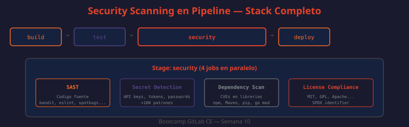

# 03 — Seguridad en Pipelines: SAST, Secret Detection y Dependency Scanning

GitLab integra herramientas de seguridad directamente en el pipeline CI/CD, permitiendo detectar vulnerabilidades antes de que lleguen a producción. En CE estas herramientas se activan incluyendo templates oficiales — no requieren licencia Enterprise para ejecutarse, aunque el dashboard centralizado de vulnerabilidades sí es EE.



---

## SAST (Static Application Security Testing)

SAST analiza el código fuente en busca de vulnerabilidades conocidas (OWASP Top 10, CWE) sin ejecutar la aplicación. Cada lenguaje usa un analizador especializado que conoce los patrones de vulnerabilidad del ecosistema.

### Analizadores por lenguaje

| Lenguaje | Analizador | Vulnerabilidades principales |
|----------|-----------|------------------------------|
| Python | Bandit | Inyección, deserialización insegura, crypto débil |
| JavaScript/TypeScript | ESLint Security | eval injection, prototype pollution, RegExp DoS |
| Java | SpotBugs + FindSecBugs | SQL injection, XXE, deserialization |
| Ruby | Brakeman | Rails-specific: SQL injection, mass assignment |
| Go | Gosec | Hardcoded creds, unsafe operations, crypto |
| PHP | PHPCS Security | SQL injection, XSS, file inclusion |
| C/C++ | Flawfinder | Buffer overflows, format strings |
| Kotlin | MobSF | Android-specific security issues |

### Habilitación básica

```yaml
# .gitlab-ci.yml
# ¿QUÉ HACE?: Incluye el template SAST oficial de GitLab
# ¿POR QUÉ?: GitLab detecta automáticamente el lenguaje y selecciona el analizador
# ¿PARA QUÉ?: Escanear código en cada push sin configuración adicional
stages:
  - test
  - security

include:
  - template: Security/SAST.gitlab-ci.yml
```

GitLab detecta automáticamente el lenguaje por los archivos presentes (ej: `requirements.txt` → Python/Bandit, `package.json` → JavaScript/ESLint).

### Configuración avanzada

```yaml
# ¿QUÉ HACE?: Configura SAST con exclusiones y variables de comportamiento
# ¿POR QUÉ?: Reducir falsos positivos excluyendo carpetas de test y vendored code
# ¿PARA QUÉ?: Pipeline más rápido con hallazgos más relevantes
include:
  - template: Security/SAST.gitlab-ci.yml

variables:
  SAST_EXCLUDED_PATHS: "spec,test,tests,tmp,vendor,node_modules"
  SAST_EXCLUDED_ANALYZERS: ""          # Excluir analizadores específicos si es necesario
  SEARCH_MAX_DEPTH: 4                   # Profundidad máxima de búsqueda
  SAST_BANDIT_EXCLUDED_PATHS: "tests/"  # Exclusión específica para Bandit
```

```yaml
# ¿QUÉ HACE?: Configura reglas para ejecutar SAST solo en MRs y rama main
# ¿POR QUÉ?: Ahorrar minutos de CI en ramas feature sin sacrificar la rama principal
# ¿PARA QUÉ?: Balance entre velocidad de desarrollo y seguridad
sast:
  rules:
    - if: $CI_PIPELINE_SOURCE == "merge_request_event"
    - if: $CI_COMMIT_BRANCH == $CI_DEFAULT_BRANCH
```

### Reporte y artifacts

```yaml
# Los artifacts se generan automáticamente al usar el template
# Ubicación: gl-sast-report.json
# ¿Para qué sirven?:
# - MR widget: muestra hallazgos directamente en el MR
# - Security → Vulnerability Report: historial de vulnerabilidades del proyecto
# - API: exportar para procesamiento externo
```

```bash
# ¿QUÉ HACE?: Descarga el reporte SAST de un pipeline via API
# ¿POR QUÉ?: Procesar el reporte en sistemas externos (DefectDojo, Jira, etc.)
# ¿PARA QUÉ?: Integrar hallazgos de seguridad en el flujo de gestión de vulnerabilidades
JOB_ID=$(curl -s --header "PRIVATE-TOKEN: $GITLAB_TOKEN" \
  "http://localhost/api/v4/projects/$PROJECT_ID/pipelines/$PIPELINE_ID/jobs" | \
  jq '.[] | select(.name == "semgrep-sast") | .id')

curl --header "PRIVATE-TOKEN: $GITLAB_TOKEN" \
  --output gl-sast-report.json \
  "http://localhost/api/v4/projects/$PROJECT_ID/jobs/$JOB_ID/artifacts/gl-sast-report.json"
```

---

## Secret Detection

Detecta secretos hardcodeados en el código fuente y en el historial completo de commits. Los secretos son la causa #1 de brechas de seguridad en entornos DevOps.

### Tipos de secretos detectados

| Categoría | Ejemplos |
|-----------|---------|
| Cloud providers | AWS Access Keys, GCP Service Account, Azure credentials |
| Repositorios | GitHub tokens, GitLab PATs, Bitbucket tokens |
| Mensajería | Slack webhooks, Discord tokens, Telegram bot tokens |
| Bases de datos | PostgreSQL URLs, MongoDB connection strings |
| Crypto | Claves privadas RSA/ED25519, certificados X.509 |
| APIs | Stripe keys, Twilio tokens, SendGrid API keys, JWT secrets |

### Habilitación

```yaml
# ¿QUÉ HACE?: Habilita Secret Detection con escaneo histórico
# ¿POR QUÉ?: Los secretos pueden estar en commits antiguos, no solo en el código actual
# ¿PARA QUÉ?: Detectar secretos que fueron commiteados y luego "eliminados" (siguen en git history)
include:
  - template: Security/Secret-Detection.gitlab-ci.yml

variables:
  SECRET_DETECTION_HISTORIC_SCAN: "true"   # Escanea TODO el historial de commits
  SECRET_DETECTION_LOG_OPTIONS: "--all"    # Incluye todas las ramas
```

**Nota importante**: `SECRET_DETECTION_HISTORIC_SCAN: "true"` solo se usa en el primer escaneo o cuando se sospecha de secretos históricos. En uso normal es `"false"` para no escanear el historial completo en cada push.

### ¿Qué hacer cuando se detecta un secreto?

```
1. REVOCAR el secreto inmediatamente (antes de cualquier otra acción)
2. Crear un nuevo secreto de reemplazo
3. Actualizar todas las referencias al secreto antiguo
4. Añadir el secreto al .gitignore o usar variables CI/CD en su lugar
5. (Opcional) Limpiar el historial git con git filter-repo si el repo es público
```

```bash
# ¿QUÉ HACE?: Elimina un secreto del historial git usando git filter-repo
# ¿POR QUÉ?: Un secreto "eliminado" con git rm sigue visible en el historial
# ¿PARA QUÉ?: Limpiar historial en repos públicos (en privados, revocar el token basta)
# ATENCIÓN: Reescribe el historial — coordinar con el equipo antes de ejecutar
pip install git-filter-repo
git filter-repo --path-glob '*.env' --invert-paths  # Elimina todos los .env del historial
git push --force-with-lease origin main
```

---

## Dependency Scanning

Analiza las dependencias del proyecto buscando CVEs conocidos en bases de datos públicas (NVD, OSV).

### Ecosistemas soportados

| Gestor | Archivo analizado |
|--------|------------------|
| npm/yarn | `package-lock.json`, `yarn.lock` |
| pip | `requirements.txt`, `Pipfile.lock` |
| Maven | `pom.xml` |
| Gradle | `build.gradle` |
| Bundler | `Gemfile.lock` |
| Go modules | `go.sum` |
| Composer | `composer.lock` |
| NuGet | `packages.lock.json` |

```yaml
# ¿QUÉ HACE?: Habilita Dependency Scanning
# ¿POR QUÉ?: Las vulnerabilidades en dependencias son tan peligrosas como las del código propio
# ¿PARA QUÉ?: Detectar Log4Shell, Spring4Shell, o cualquier CVE crítico en dependencias
include:
  - template: Security/Dependency-Scanning.gitlab-ci.yml

variables:
  DS_EXCLUDED_PATHS: "spec,test,tests"
  DS_MAX_DEPTH: 2  # Profundidad máxima para buscar archivos de lock
```

### Interpretar resultados

El reporte `gl-dependency-scanning-report.json` contiene:

```json
{
  "vulnerabilities": [
    {
      "id": "uuid",
      "name": "CVE-2021-44228",
      "description": "Apache Log4j2 JNDI injection",
      "severity": "Critical",
      "package": {"name": "log4j-core", "version": "2.14.0"},
      "solution": "Upgrade to log4j-core 2.17.1"
    }
  ]
}
```

```bash
# ¿QUÉ HACE?: Extrae vulnerabilidades críticas y altas del reporte
# ¿POR QUÉ?: Priorizar remediación de vulnerabilidades más graves primero
# ¿PARA QUÉ?: Triage rápido en pipelines de seguridad
cat gl-dependency-scanning-report.json | \
  jq '.vulnerabilities[] | select(.severity == "Critical" or .severity == "High") | 
      {name, severity, package: .location.dependency.package.name, fix: .solution}'
```

---

## Container Scanning

Para proyectos que generan imágenes Docker, Container Scanning analiza la imagen buscando CVEs en paquetes del sistema operativo base.

```yaml
# ¿QUÉ HACE?: Escanea la imagen Docker construida en el pipeline
# ¿POR QUÉ?: Una imagen con ubuntu:18.04 puede tener cientos de CVEs del SO base
# ¿PARA QUÉ?: Detectar vulnerabilidades antes de desplegar en producción
stages:
  - build
  - test

build-image:
  stage: build
  script:
    - docker build -t $CI_REGISTRY_IMAGE:$CI_COMMIT_SHA .
    - docker push $CI_REGISTRY_IMAGE:$CI_COMMIT_SHA

include:
  - template: Security/Container-Scanning.gitlab-ci.yml

variables:
  CS_IMAGE: $CI_REGISTRY_IMAGE:$CI_COMMIT_SHA
  CS_SEVERITY_THRESHOLD: "HIGH"  # Solo reportar HIGH y CRITICAL
```

---

## Seguridad de variables CI/CD

Las variables CI/CD a menudo contienen credenciales. Deben protegerse:

```yaml
# Variables protegidas: solo disponibles en protected branches/tags
# Variables enmascaradas: valor oculto en logs del pipeline
```

```
Settings → CI/CD → Variables
→ Nombre: DEPLOY_TOKEN
→ Valor: glpat-xxxxxxxxxxxx
→ Protected: ✅ (solo en main/release/*)
→ Masked: ✅ (valor oculto en logs)
→ Expand variable reference: ❌ (evitar expansión no deseada)
```

```bash
# ¿QUÉ HACE?: Lista variables CI/CD de un proyecto via API
# ¿POR QUÉ?: Auditar qué secretos están configurados y con qué alcance
# ¿PARA QUÉ?: Identificar variables no protegidas que deberían estarlo
curl --header "PRIVATE-TOKEN: $GITLAB_TOKEN" \
  "http://localhost/api/v4/projects/$PROJECT_ID/variables" | \
  jq '.[] | {key, protected, masked, environment_scope}'
```

---

## Pipeline de seguridad completo (CE)

```yaml
# ¿QUÉ HACE?: Pipeline completo con todos los escaneos de seguridad disponibles en CE
# ¿POR QUÉ?: Integrar todos los escaneos en un único pipeline optimizado
# ¿PARA QUÉ?: Cobertura completa: código fuente, dependencias, secretos e imagen

stages:
  - build
  - test
  - security
  - deploy

# Análisis estático del código fuente
include:
  - template: Security/SAST.gitlab-ci.yml
  - template: Security/Secret-Detection.gitlab-ci.yml
  - template: Security/Dependency-Scanning.gitlab-ci.yml
  - template: Security/Container-Scanning.gitlab-ci.yml

variables:
  SAST_EXCLUDED_PATHS: "spec,test,tests,vendor"
  SECRET_DETECTION_HISTORIC_SCAN: "false"
  DS_EXCLUDED_PATHS: "spec,test"
  CS_IMAGE: $CI_REGISTRY_IMAGE:$CI_COMMIT_SHA
  CS_SEVERITY_THRESHOLD: "MEDIUM"

# Job personalizado: falla el pipeline si hay vulnerabilidades críticas
security-gate:
  stage: security
  script:
    - |
      CRITICAL=$(cat gl-sast-report.json 2>/dev/null | \
        jq '[.vulnerabilities[] | select(.severity == "Critical")] | length' || echo 0)
      if [ "$CRITICAL" -gt "0" ]; then
        echo "FALLO: $CRITICAL vulnerabilidad(es) crítica(s) encontrada(s)"
        exit 1
      fi
      echo "Security gate: OK (0 críticas)"
  needs:
    - semgrep-sast
  rules:
    - if: $CI_PIPELINE_SOURCE == "merge_request_event"
  allow_failure: false
```

---

## DAST — referencia (GitLab Ultimate / Custom en CE)

DAST (Dynamic Application Security Testing) analiza la aplicación en ejecución simulando ataques reales HTTP. Es complementario a SAST: SAST analiza el código, DAST analiza el comportamiento en runtime.

En CE se puede integrar OWASP ZAP manualmente:

```yaml
# ¿QUÉ HACE?: Ejecuta OWASP ZAP como DAST manual en CE
# ¿POR QUÉ?: El template oficial de DAST requiere GitLab Ultimate
# ¿PARA QUÉ?: Detectar XSS, CSRF, y otras vulnerabilidades de runtime sin licencia EE
owasp-zap:
  stage: security
  image: ghcr.io/zaproxy/zaproxy:stable
  variables:
    TARGET_URL: "http://staging.company.local"
  script:
    - zap-baseline.py -t $TARGET_URL -r zap-report.html -x zap-report.xml
  artifacts:
    paths:
      - zap-report.html
      - zap-report.xml
    expire_in: 7 days
  allow_failure: true  # No bloquear el pipeline en falsos positivos
  rules:
    - if: $CI_COMMIT_BRANCH == "main"
```

---

## Mejores prácticas

- SAST y Secret Detection en cada push — no solo en MRs
- Bloquear merge si hay vulnerabilidades Critical via security gate
- `SECRET_DETECTION_HISTORIC_SCAN: "true"` al incorporar un repo existente, luego deshabilitar
- Variables CI/CD: siempre Protected + Masked para credenciales
- No usar `allow_failure: true` en security jobs críticos
- Actualizar imágenes de analizadores: GitLab gestiona actualizaciones automáticamente via los templates
- Revisar falsos positivos mensualmente y configurar exclusiones documentadas
- Container Scanning: usar imágenes base mínimas (distroless, alpine) para reducir superficie de ataque
