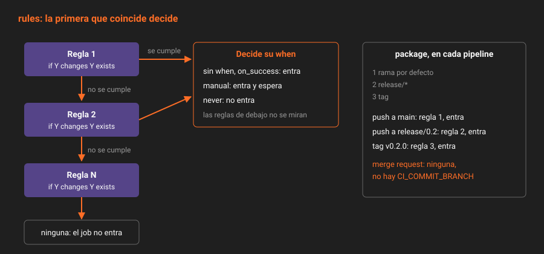

# `rules`: cuándo entra un job

> Un pipeline no ejecuta "el `.gitlab-ci.yml`": ejecuta los jobs que entran en él. `rules` decide qué jobs entran, uno por uno, cuando GitLab crea el pipeline. Si lo entiendes, una merge request de documentación deja de gastar runner. Si no lo entiendes, un job desaparece sin avisar y nadie sabe por qué.

---

## 🎯 Objetivos

- Leer una lista de `rules` como la lee GitLab: de arriba abajo, hasta la primera que coincide
- Usar `if`, `changes` y `exists`, y combinarlos en una misma regla
- Cambiar `when`, `allow_failure` y `variables` desde una regla
- Saber por qué `changes` solo es fiable en pipelines de merge request
- Reconocer los errores de `rules` que no dan ningún aviso

---

## 1. Qué problema resuelve

En la Semana 09, `build`, `test` y `package` se ejecutaban en todos los pipelines. Una merge request que corrige una errata en `CONTRIBUTING.md` instalaba dependencias, compilaba y empaquetaba: un par de minutos de runner para nada. Y `package` generaba un `.tgz` en cada merge request que nadie iba a descargar.

`rules` deja decidir, job por job, en qué pipelines tiene sentido cada uno.

---

## 2. Cómo funciona

### 2.1 La primera regla que coincide



Cuando GitLab crea un pipeline, evalúa las `rules` de cada job **en orden**. La primera regla cuyas condiciones se cumplen decide, y las demás no se miran. Si ninguna coincide, el job **no entra** en el pipeline.

```yaml
package:
  rules:
    - if: $CI_COMMIT_BRANCH == $CI_DEFAULT_BRANCH
    - if: $CI_COMMIT_BRANCH =~ /^release\//
    - if: $CI_COMMIT_TAG
  script:
    - npm pack
```

| Pipeline | Regla que coincide | ¿Entra? |
|---|---|:--:|
| Push a `main` | La primera | ✅ |
| Push a `release/0.2` | La segunda | ✅ |
| Tag `v0.2.0` | La tercera | ✅ |
| Merge request | Ninguna: `CI_COMMIT_BRANCH` no existe en un pipeline de merge request | ❌ |

Una regla sin `when` equivale a `when: on_success`: el job entra y se ejecuta si los stages anteriores no fallaron.

### 2.2 Las tres condiciones

| Condición | Pregunta | Ejemplo |
|---|---|---|
| `if` | ¿Esta expresión con variables es cierta? | `$CI_PIPELINE_SOURCE == "merge_request_event"` |
| `changes` | ¿Este cambio toca alguno de estos archivos? | `paths: [src/**/*]` |
| `exists` | ¿Existe alguno de estos archivos en el repositorio? | `[package.json]` |

Dentro de una misma regla, las condiciones se combinan con **Y**: tienen que cumplirse todas. Entre reglas distintas, la combinación es **O**: basta con que coincida una.

```yaml
.npm:
  rules:
    - if: $CI_PIPELINE_SOURCE == "merge_request_event"   # merge request Y
      changes:                                           # cambia el código
        paths: [src/**/*, package.json, package-lock.json, tsconfig.json, .gitlab-ci.yml]
    - if: $CI_PIPELINE_SOURCE != "merge_request_event"   # O cualquier otro pipeline
```

Es la regla que `build` y `test` heredan de `.npm` desde la práctica 01: en una merge request solo entran si cambia algo que puede romper el código; en `main`, en `release/*` y en los tags entran siempre.

### 2.3 Las expresiones de `if`

| Operador | Ejemplo | Nota |
|---|---|---|
| `==`, `!=` | `$CI_COMMIT_BRANCH == "main"` | Compara cadenas |
| `=~`, `!~` | `$CI_COMMIT_BRANCH =~ /^release\//` | Expresión regular RE2, entre barras |
| `&&`, `\|\|`, `()` | `$CI_COMMIT_TAG && $CI_COMMIT_REF_PROTECTED == "true"` | `&&` antes que `\|\|` |
| `$VAR` a solas | `$CI_COMMIT_TAG` | Cierto si existe y no está vacía |

Las variables predefinidas que más deciden:

| Variable | Existe en | Para qué |
|---|---|---|
| `CI_PIPELINE_SOURCE` | Todos | `push`, `merge_request_event`, `web`, `api`, `schedule`, `trigger`… |
| `CI_COMMIT_BRANCH` | Pipelines de rama, **no** de merge request ni de tag | La rama |
| `CI_COMMIT_TAG` | Pipelines de tag | El tag |
| `CI_DEFAULT_BRANCH` | Todos | `main`, sin escribirlo a mano |
| `CI_MERGE_REQUEST_TARGET_BRANCH_NAME` | Pipelines de merge request | A dónde va la merge request |
| `CI_COMMIT_REF_PROTECTED` | Todos | `"true"` si la ref es protegida |

### 2.4 `changes`: comparar con qué

`changes` necesita saber contra qué se compara. Y la respuesta depende del pipeline:

| Pipeline | Contra qué compara |
|---|---|
| Merge request | La rama de destino: todo lo que trae la merge request |
| Push a una rama existente | El push anterior de esa rama |
| Push de una rama nueva, tag, pipeline programado o lanzado a mano | **Nada**: `changes` es siempre cierto |

Por eso `.npm` solo usa `changes` en merge requests. En `main` sería una trampa: un push que mezcla dos commits compararía solo con el push anterior, y un pipeline lanzado a mano lo ejecutaría todo sin que nadie supiera por qué.

`changes:compare_to` fija la referencia (`compare_to: refs/heads/main`) para los pipelines de rama. `app` no lo necesita: en una rama con merge request abierta, `workflow:rules` solo deja nacer el pipeline de merge request.

### 2.5 Lo que una regla puede cambiar

| Clave en la regla | Efecto | Ejemplo en `app` |
|---|---|---|
| `when: never` | El job no entra, aunque coincida | `workflow:rules` (teoría 02) |
| `when: manual` | Entra, pero espera a que alguien lo lance | `deploy-production` |
| `when: always` | Se ejecuta aunque falle un stage anterior | — |
| `when: delayed` + `start_in` | Se ejecuta pasado un tiempo | — |
| `allow_failure: true` | Su fallo, o su espera, no bloquea el pipeline | `deploy-production` |
| `variables:` | Variables solo cuando esta regla coincide | — |

`when: manual` en una regla tiene una trampa: por defecto lleva `allow_failure: false`, y el pipeline se queda en estado `manual` esperando, no en `success`. Con *Pipelines must succeed* activado, eso bloquearía las fusiones. `deploy-production` lleva `allow_failure: true` en la misma regla: el pipeline termina en verde y el job queda disponible.

---

## 3. Cómo se configura

Antes de empujar, pregunta a GitLab qué jobs entrarían en un push a una rama:

```bash
jq -n --rawfile c .gitlab-ci.yml --arg ref main '{content: $c, dry_run: true, ref: $ref, include_jobs: true}' \
  | curl -s --request POST "$API/projects/$P/ci/lint" -H "$H" -H "Content-Type: application/json" -d @- \
  | jq '{valid, errors, jobs: [.jobs[]?.name]}'
```

`dry_run=true` simula la creación del pipeline para esa ref con tu YAML, `rules` incluidas. Solo simula pipelines de rama: el de una merge request se comprueba abriéndola.

---

## 4. Antipatrones

| Antipatrón | Por qué duele | Qué hacer en su lugar |
|---|---|---|
| `if: $CI_COMMIT_BRANCH == "main"` para "también en merge requests a `main`" | En una merge request `CI_COMMIT_BRANCH` no existe: el job no entra nunca | `CI_MERGE_REQUEST_TARGET_BRANCH_NAME` |
| `changes` en pipelines de rama | Siempre cierto en ramas nuevas y en pipelines manuales | Solo en la regla de merge request, o `compare_to` |
| Una regla general antes que la específica | Gana la primera; la específica no se evalúa nunca | De lo particular a lo general, `when: never` primero |
| `when: manual` sin `allow_failure: true` | El pipeline queda en `manual`, no en `success` | `allow_failure: true` en la misma regla |
| `rules` y `only`/`except` en el mismo job | Error de sintaxis | Solo `rules`; `only`/`except` es legado |
| `changes` sin `.gitlab-ci.yml` en la lista | Un cambio en el propio pipeline no lo prueba | Incluye `.gitlab-ci.yml` |

---

## 5. Trucos

- **Comparar ramas sin escribir `main`**: `$CI_COMMIT_BRANCH == $CI_DEFAULT_BRANCH`. Si algún día cambia la rama por defecto, el YAML sigue valiendo.
- **Un job que nunca entra y no sabes por qué**: comprueba con `dry_run` la ref concreta y lee `jobs`. Si no aparece, ninguna regla coincide.
- **Reutilizar reglas sin `extends`**: `rules: !reference [.npm, rules]` copia solo la lista de reglas de otro job.

---

## 📚 Recursos Adicionales

- [`rules`](https://docs.gitlab.com/ci/yaml/#rules) — referencia de `if`, `changes`, `exists` y lo que puede cambiar cada regla
- [Specify when jobs run with `rules`](https://docs.gitlab.com/ci/jobs/job_rules/) — ejemplos y errores comunes
- [CI/CD variable expressions](https://docs.gitlab.com/ci/jobs/job_rules/#cicd-variable-expressions) — operadores y precedencia
- [CI Lint API](https://docs.gitlab.com/api/lint/) — `dry_run` e `include_jobs`

---

## ✅ Checklist de Verificación

- [ ] Sabes qué pasa con un job cuando ninguna de sus reglas coincide
- [ ] Sabes por qué `package` no entra en una merge request
- [ ] Sabes contra qué compara `changes` en cada tipo de pipeline
- [ ] Sabes por qué `deploy-production` lleva `allow_failure: true`

---

[Volver a la Semana 10](../README.md) · [Siguiente: `workflow`: cuándo nace un pipeline →](02-workflow-cuando-nace-un-pipeline.md)
