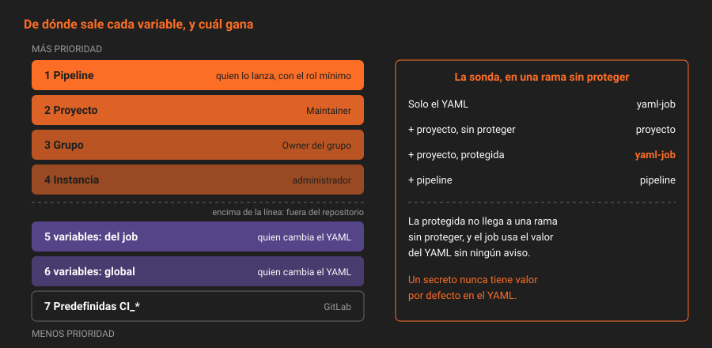

# Variables: de dónde salen y quién gana

> Un job recibe más de cien variables y no sabe de dónde viene ninguna. Unas las escribe GitLab, otras tú en el YAML, otras un Maintainer en la configuración del proyecto, otras quien lanza el pipeline. Cuando dos se llaman igual, gana una, y si no sabes cuál, un día el job usará un valor que nadie eligió.

---

## 🎯 Objetivos

- Enumerar los sitios de los que sale una variable y quién puede escribir en cada uno
- Predecir qué valor recibe un job cuando dos variables tienen el mismo nombre
- Decidir qué va al YAML y qué va a la configuración del proyecto
- Restringir quién puede pasar variables al lanzar un pipeline

---

## 1. Qué problema resuelve

En la Semana 09 sobreescribiste `CI_API_V4_URL` con una variable de instancia, y funcionó porque una variable de instancia gana a una predefinida. Ese mismo mecanismo permite que quien lanza un pipeline cambie `DEPLOY_URL` por la suya, o active `CI_DEBUG_TRACE` y vuelque todas las variables en el log. Saber quién gana es saber quién manda en tu pipeline.

---

## 2. Cómo funciona

### 2.1 Los sitios



| Sitio | Quién escribe | Visible en el repositorio | Para |
|---|---|:--:|---|
| Predefinidas `CI_*` | GitLab | — | El contexto: rama, commit, merge request |
| `variables:` global del YAML | Cualquiera que pueda cambiar el YAML | ✅ | Configuración común, no secreta |
| `variables:` de un job | Ídem | ✅ | Configuración de ese job |
| Instancia (`Admin → CI/CD → Variables`) | Administrador | ❌ | Lo que vale para toda la instancia |
| Grupo (`Settings → CI/CD → Variables`) | **Owner** del grupo | ❌ | Lo que comparten los proyectos del grupo |
| Proyecto (`Settings → CI/CD → Variables`) | **Maintainer** (`admin_cicd_variables`, Semana 03) | ❌ | Secretos del proyecto |
| Pipeline: al lanzarlo a mano, por API, programado o por trigger | Quien lo lanza, si tiene el rol mínimo | ❌ | Un valor para una ejecución |

Un Developer no puede leer las variables del proyecto por API (`403`) ni crear las de grupo. Un Maintainer de grupo tampoco crea variables de grupo: hace falta Owner. Comprobado en 19.2.4.

### 2.2 La precedencia

De más a menos prioridad, para lo que usa `app`:

1. Variables de pipeline (manual, API, programado, trigger)
2. Variables de proyecto
3. Variables de grupo (el subgrupo más cercano gana al padre)
4. Variables de instancia
5. `variables:` del job en el YAML
6. `variables:` global del YAML
7. Predefinidas

Lo comprobó la sonda del laboratorio con `X` definida en tres sitios:

```
YAML:     X: desde-yaml
Proyecto: X=desde-proyecto         →  el job ve desde-proyecto
Pipeline: X=desde-pipeline         →  el job ve desde-pipeline
```

La consecuencia que importa: **todo lo que no está en el YAML gana a lo que está en el YAML**. Una variable de proyecto con el mismo nombre que una del YAML la pisa sin que el YAML lo diga. Por eso la regla de `app` es no repetir nombres entre sitios.

### 2.3 Qué va al YAML y qué no

| Si la variable… | Va en | Ejemplo |
|---|---|---|
| No es secreta y es igual para todos | El YAML | `GIT_LFS_SKIP_SMUDGE` |
| No es secreta y cambia por entorno | El YAML, en el job o en `environment:url` | La URL de `staging` |
| Es secreta | Proyecto, protegida (teoría 04) | `DEPLOY_TOKEN` |
| Es un arreglo del laboratorio, no del proyecto | Instancia | `CI_API_V4_URL` (Semana 09) |

Lo que está en el YAML tiene historia, autor y revisión. Lo que está en la configuración del proyecto no tiene nada de eso: si no es secreto, no hay motivo para esconderlo.

### 2.4 Expansión

Una variable puede usar otras: `URL: "https://$CI_ENVIRONMENT_SLUG.app.example"`. GitLab la expande antes de entregarla. Si el valor lleva un `$` que no es una variable (una contraseña, una expresión), se marca como literal:

```yaml
variables:
  PATRON:
    value: "precio$"
    expand: false
```

En la configuración del proyecto, el equivalente es `raw=true` en la API (`Expand variable reference` desmarcado en la interfaz).

### 2.5 Variables al lanzar un pipeline

Un pipeline lanzado a mano o por API puede llevar variables, y esas ganan a todo. Quién puede hacerlo lo decide un ajuste del proyecto:

| `ci_pipeline_variables_minimum_override_role` | Quién puede pasar variables |
|---|---|
| `developer` | Developer o más. **Es el valor de un proyecto nuevo en 19.2.4** |
| `maintainer` | Maintainer o más |
| `owner` | Owner |
| `no_one_allowed` | Nadie, ni siquiera un administrador |

Con `developer`, cualquier Developer puede lanzar un pipeline con su propio valor de una variable que el YAML da por buena, o con `CI_DEBUG_TRACE=true` (teoría 07), en cualquier rama donde pueda ejecutar pipelines. En `main` ya no puede: lanzar un pipeline en una rama protegida exige poder fusionar en ella, y en 19.2.4 un Developer recibe `You do not have sufficient permission to run a pipeline on 'main'`. Esa es la primera barrera, y la pone la protección de ramas de la Semana 07. El ajuste es la segunda: si un día un Developer puede fusionar en alguna rama protegida (una `release/*`, por ejemplo), tampoco podrá cambiar las variables de sus pipelines. `app` lo sube a `maintainer`: sigue pudiendo depurar quien ya puede ver las variables.

```
{"base":["Insufficient permissions to set pipeline variables"]}
```

Es la respuesta de 19.2.4 cuando alguien sin el rol lo intenta. El ajuste afecta solo a las variables que se pasan al lanzar el pipeline; lanzar el pipeline sin variables sigue permitido.

Para los pipelines que se lanzan a mano, el YAML puede ofrecer un valor por defecto y una lista cerrada, que la interfaz muestra como desplegable:

```yaml
variables:
  ENTORNO:
    value: staging
    options: [staging, production]
    description: "A qué entorno va el pipeline manual"
```

---

## 3. Cómo se configura

```bash
# Qué variables tiene el proyecto, sin sus valores
curl -s -H "$H" "$API/projects/$P/variables" \
  | jq -r '.[] | "\(.key) \(.environment_scope) protected=\(.protected) masked=\(.masked) hidden=\(.hidden)"'

# Quién puede pasar variables al lanzar un pipeline
curl -s --request PUT "$API/projects/$P" -H "$H" \
  --data "ci_pipeline_variables_minimum_override_role=maintainer" \
  | jq '{ci_pipeline_variables_minimum_override_role, restrict_user_defined_variables}'
```

`restrict_user_defined_variables` es el interruptor antiguo; 19.2.4 lo pone en `true` solo al subir el rol mínimo por encima de `developer`.

---

## 4. Antipatrones

| Antipatrón | Por qué duele | Qué hacer en su lugar |
|---|---|---|
| La misma variable en el YAML y en el proyecto | El proyecto gana sin que el YAML lo diga | Un nombre, un sitio |
| URLs y opciones no secretas en la configuración del proyecto | Sin historia ni revisión | El YAML |
| Secretos en el YAML | Quedan en la historia de Git para siempre | Variable de proyecto protegida |
| `ci_pipeline_variables_minimum_override_role=developer` | Cualquier Developer cambia lo que el pipeline da por bueno en las ramas donde puede ejecutarlo | `maintainer` |
| Variables de grupo para un solo proyecto | Las heredan todos los proyectos del grupo | Variable de proyecto |

---

## 5. Trucos

- **Qué valor ganó**, sin imprimirlo: `echo "${#VAR}"` da la longitud, y basta para distinguir dos valores conocidos.
- **Las variables de grupo que hereda un proyecto**: `GET /groups/<id>/variables` en cada grupo de la ruta del proyecto.
- **Una variable solo para un job de una regla**: `rules: - if: ... variables: {X: "1"}`.

---

## 📚 Recursos Adicionales

- [CI/CD variables](https://docs.gitlab.com/ci/variables/) — sitios, tipos y atributos
- [CI/CD variable precedence](https://docs.gitlab.com/ci/variables/#cicd-variable-precedence) — la lista completa, con las políticas de Ultimate
- [Restrict pipeline variables](https://docs.gitlab.com/ci/variables/#restrict-pipeline-variables) — el rol mínimo
- [Project-level CI/CD variables API](https://docs.gitlab.com/api/project_level_variables/) — `environment_scope`, `raw`, `masked_and_hidden`

---

## ✅ Checklist de Verificación

- [ ] Sabes quién puede escribir en cada sitio de variables
- [ ] Sabes qué gana entre YAML, proyecto y pipeline, y lo has visto con una sonda
- [ ] Sabes qué variables de `app` van al YAML y cuáles no
- [ ] Sabes qué cambia `ci_pipeline_variables_minimum_override_role` y qué no

---

[← Anterior: `workflow`](02-workflow-cuando-nace-un-pipeline.md) · [Volver a la Semana 10](../README.md) · [Siguiente: Proteger, enmascarar, ocultar →](04-proteger-enmascarar-ocultar.md)
