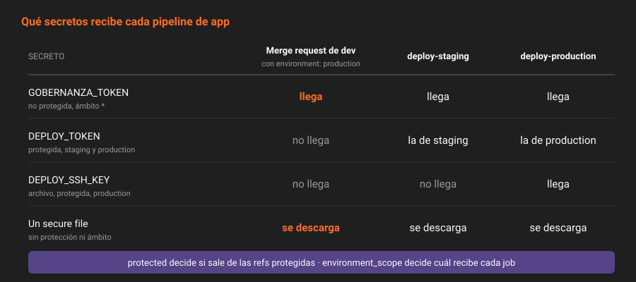

# Proteger, enmascarar, ocultar

> Una variable de proyecto tiene tres casillas que suenan a seguridad. Solo una decide si el secreto llega al job; las otras dos deciden quién lo ve después. Esta teoría separa las tres y responde la pregunta que dejó abierta la Semana 09: qué secretos llegan a una merge request.

---

## 🎯 Objetivos

- Explicar qué hace `protected`, qué hace `masked` y qué hace `hidden`, y qué no hace ninguno
- Decir qué recibe un pipeline de merge request, de `main`, de `release/*` y de un tag
- Saber qué valores se pueden enmascarar
- Aplicar la regla de `app`: toda variable secreta, protegida y enmascarada, con una excepción escrita

---

## 1. Qué problema resuelve

El pipeline de una merge request se ejecuta con el `.gitlab-ci.yml` **de la merge request**: el que acaba de escribir quien la abrió, antes de que nadie lo revise. Si ese pipeline recibe un secreto, quien abre la merge request tiene el secreto. No hace falta imprimirlo: basta con enviarlo a otro sitio.

`protected` es lo único que impide que llegue.

---

## 2. Cómo funciona

### 2.1 `protected`: si llega



Una variable protegida solo se entrega a pipelines que se ejecutan sobre una **ref protegida**: una rama o un tag protegido. En `app`, desde las Semanas 07 y 08:

| Pipeline | Ref | ¿Protegida? | ¿Recibe variables protegidas? |
|---|---|:--:|:--:|
| Push a `main` | `main` | ✅ | ✅ |
| Push a `release/0.2` | `release/0.2` | ✅ | ✅ |
| Tag `v0.2.0` | `v0.2.0` | ✅ | ✅ |
| Merge request desde `42-reglas` | `refs/merge-requests/N/head` | ❌ | ❌ |
| Push a `42-reglas` sin merge request | `42-reglas` | ❌ | ❌ |

Comprobado en 19.2.4 con la merge request de un Developer: `DEPLOY_TOKEN` llegó con longitud 0 y la variable de tipo archivo protegida, vacía. `GOBERNANZA_TOKEN`, no protegida, llegó entera.

Quién puede hacer que un pipeline corra sobre una ref protegida lo decide la protección de la rama: en `main` nadie empuja y solo los Maintainers fusionan. **Proteger una variable es delegar su seguridad en la protección de ramas y tags.** Si mañana alguien desprotege `main`, o protege `feat/*` "para que no la borren", los secretos llegan a donde no deben.

### 2.2 `masked`: si se ve en el log

Si el valor aparece en el log de un job, el runner lo sustituye por `[MASKED]`. Nada más:

- El job tiene el valor completo. Puede escribirlo en un archivo, enviarlo por `curl` o partirlo en dos `echo`.
- Solo se enmascara el valor exacto. Codificado en base64 o con un carácter cambiado, sale tal cual.

En 19.2.4, un valor se puede enmascarar si tiene **8 caracteres o más** y **una sola línea, sin espacios**. Si no, la API responde `400` con `{"value":["is invalid"]}`. Por eso una clave SSH, que tiene varias líneas, no se puede enmascarar: va como variable de tipo archivo (teoría 06).

### 2.3 `hidden`: si alguien lo vuelve a ver

Una variable oculta no se puede volver a leer: ni en la interfaz ni por la API (`value: null`), ni siquiera un Maintainer. Solo se sustituye. Se activa al crearla (`masked_and_hidden=true`) y no se desactiva.

Protege contra quien tiene acceso a la configuración del proyecto, no contra el pipeline: el job la recibe igual.

### 2.4 Las tres juntas

| Atributo | Protege contra | No protege contra |
|---|---|---|
| `protected` | Una merge request o una rama cualquiera | Quien puede fusionar en `main` o crear tags `v*` |
| `masked` | Alguien leyendo el log | El propio job |
| `hidden` | Alguien leyendo la configuración | El propio job |

La regla de `app`, que comprueba `checks.json`:

- **Toda variable del proyecto es protegida**, salvo `GOBERNANZA_TOKEN`, que tiene que llegar a las merge requests porque las audita. Su riesgo está escrito en el ADR-007 desde la Semana 09: lectura de un proyecto, Reporter, seis meses.
- **Toda variable de texto es enmascarada**. Las de tipo archivo no se pueden enmascarar.
- **Lo que no es secreto no es variable del proyecto**: va al YAML (teoría 03).

### 2.5 Ramas protegidas por comodín

`release/*` está protegida desde la Semana 08, así que una rama `release/0.2` recibe las variables protegidas. Es lo que quieres: `package` se ejecuta allí. Pero cualquiera que pueda crear una rama `release/...` crea una ref protegida. Quién puede crearlas lo dice `push_access_levels` de la protección: compruébalo antes de proteger una variable que importe.

```bash
curl -s -H "$H" "$API/projects/$P/protected_branches" \
  | jq -r '.[] | "\(.name) push=\([.push_access_levels[].access_level]) merge=\([.merge_access_levels[].access_level])"'
```

### 2.6 Merge requests desde un fork

El pipeline de una merge request que viene de un fork se ejecuta en el proyecto del fork, con las variables del fork: las del proyecto de destino no le llegan, protegidas o no.

---

## 3. Cómo se configura

```bash
openssl rand -hex 32 | tr -d '\n' \
  | curl -s --request POST "$API/projects/$P/variables" -H "$H" \
      --data "key=EJEMPLO" --data-urlencode "value@-" \
      --data "protected=true" --data "masked=true" \
  | jq '{key, protected, masked, value: (.value | length)}'
```

`value@-` lee de la entrada estándar: el valor no aparece en los argumentos del proceso. Las prácticas lo alimentan con `openssl rand` o con la respuesta de otra API, nunca con un valor escrito en la terminal.

Auditar el proyecto:

```bash
curl -s -H "$H" "$API/projects/$P/variables" \
  | jq -r '.[] | select(.protected | not) | .key'      # solo GOBERNANZA_TOKEN
```

---

## 4. Antipatrones

| Antipatrón | Por qué duele | Qué hacer en su lugar |
|---|---|---|
| `masked` como si fuera "seguro" | Solo protege el log | `protected` para que no llegue |
| Desproteger una variable "porque el job de la merge request la necesita" | Cualquiera que abra una merge request se la lleva | Que el job no la necesite, o que solo corra en refs protegidas |
| Proteger `feat/*` para "que no se borre" | Todas esas ramas reciben los secretos | Proteger solo lo que publica o despliega |
| Un secreto de varias líneas como variable de texto | No se puede enmascarar | Variable de tipo archivo |
| Leer una variable oculta "para comprobar que está bien" | No se puede, y no hace falta | Comprobar la longitud en un job |

---

## 5. Trucos

- **¿Esta ref es protegida?** En el job, `CI_COMMIT_REF_PROTECTED` vale `"true"` o `"false"`.
- **Un job que falla si no tiene su secreto**: `: "${DEPLOY_TOKEN:?no ha llegado}"` en la primera línea. Mejor un error claro que un despliegue con una credencial vacía.
- **Cambiar una variable oculta**: `PUT .../variables/<key>` con el valor nuevo; sigue oculta y enmascarada.

---

## 📚 Recursos Adicionales

- [Protect a CI/CD variable](https://docs.gitlab.com/ci/variables/#protect-a-cicd-variable) — qué refs reciben las protegidas
- [Mask a CI/CD variable](https://docs.gitlab.com/ci/variables/#mask-a-cicd-variable) — requisitos del valor
- [Hide a CI/CD variable](https://docs.gitlab.com/ci/variables/#hide-a-cicd-variable) — qué cambia y qué no
- [Pipeline security](https://docs.gitlab.com/ci/pipeline_security/) — el modelo de amenazas del pipeline

---

## ✅ Checklist de Verificación

- [ ] Sabes qué atributo decide si un secreto llega a un pipeline de merge request
- [ ] Sabes qué refs de `app` reciben variables protegidas y por qué
- [ ] Sabes qué valores se pueden enmascarar y qué hacer con los que no
- [ ] Sabes por qué `GOBERNANZA_TOKEN` es la única variable sin proteger

---

[← Anterior: Variables](03-variables-de-donde-salen.md) · [Volver a la Semana 10](../README.md) · [Siguiente: Entornos como ámbito →](05-entornos-como-ambito.md)
