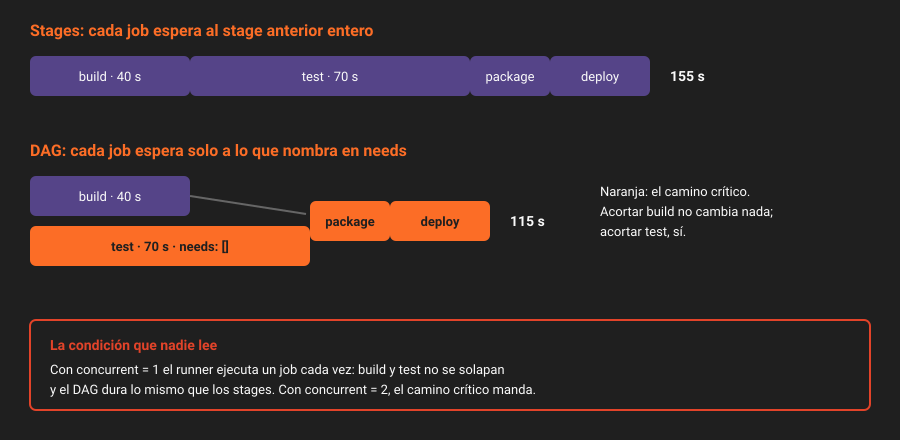

# De stages a DAG

> Un pipeline por stages es un tren: ningún job de `test` sale hasta que termina el último de `build`, aunque no use nada de él. `needs` dice a cada job a quién espera de verdad, y el pipeline se convierte en un grafo dirigido sin ciclos (DAG). Ahorra tiempo solo si hay runners libres para aprovecharlo.

---

## 🎯 Objetivos

- Explicar qué espera un job con y sin `needs`
- Escribir `needs` y `needs: []`, y predecir cuándo empieza cada job
- Encontrar el camino crítico de un pipeline y saber qué acortarlo cambia la duración
- Explicar por qué un DAG no acelera nada con `concurrent = 1`

---

## 1. Qué problema resuelve

El pipeline de `main` de `app`, desde la Semana 10:

| Stage | Jobs | Usa algo del anterior |
|---|---|---|
| `build` | `build` (`npx tsc`) | — |
| `test` | `test` (`npm run test:ci`) | No: hace su propio `npm ci` y ejecuta los tests sobre el código fuente |
| `package` | `package` (`npm pack`) | Sí: no se empaqueta lo que no compila ni pasa los tests |
| `deploy` | `deploy-staging`, `deploy-production` | Sí: no se despliega lo que no se ha empaquetado |

`test` espera a `build` solo porque está en un stage posterior. Si `build` tarda 40 segundos, cada pipeline pierde 40 segundos esperando algo que no necesita. En una merge request, `gobernanza` también espera a `build`, y es el job que dice si la merge request se puede fusionar.

---

## 2. Cómo funciona

### 2.1 Sin `needs`: el stage entero

Un job sin `needs` empieza cuando **todos** los jobs de los stages anteriores han terminado (con éxito, o fallado con `allow_failure: true`). Es el modelo de la Semana 09.

### 2.2 Con `needs`: solo lo que nombras

```yaml
package:
  stage: package
  needs: [build, test]
```

`package` empieza en cuanto `build` y `test` terminan bien. No mira el resto de su stage ni de los anteriores. Desde GitLab 14.2, un job puede incluso necesitar a otro **del mismo stage**: el stage pasa a ser una etiqueta para la vista del pipeline, no una barrera.

### 2.3 `needs: []`: nada

```yaml
test:
  stage: test
  needs: []
```

`test` empieza en cuanto se crea el pipeline, a la vez que `build`. Es la forma de decir "este job no depende de nadie". Sigue en el stage `test`, así que la vista por stages lo pinta en su columna.

| Escribes | El job empieza cuando |
|---|---|
| Nada | Terminan todos los jobs de los stages anteriores |
| `needs: [a, b]` | Terminan `a` y `b` |
| `needs: []` | Se crea el pipeline |

### 2.4 Si lo que necesitas falla

Si `build` falla, `package` no se ejecuta: queda en `skipped`. Igual que con stages. Lo que cambia es que `test` (con `needs: []`) **sí** se ejecuta aunque `build` haya fallado. Ves los dos fallos en el mismo pipeline, en lugar de arreglar uno, empujar y descubrir el segundo.

### 2.5 El camino crítico

La duración de un pipeline la fija su cadena más larga de jobs encadenados por `needs`: el **camino crítico**. Con `build` 40 s, `test` 70 s, `package` 20 s y `deploy-staging` 25 s:

| Modelo | Cuenta | Duración |
|---|---|:--:|
| Stages | 40 + 70 + 20 + 25 | 155 s |
| DAG | max(40, 70) + 20 + 25 | 115 s |

Acortar `build` ya no cambia nada: no está en el camino crítico. Acortar `test` sí. Esa es la pregunta útil de un DAG: **qué job, si fuera más rápido, acortaría el pipeline**.



### 2.6 La condición que nadie lee: runners libres

`needs` dice que `build` y `test` **pueden** ir a la vez. Que vayan depende de que haya dos huecos de runner. El runner de la Semana 09 tiene `concurrent = 1`: ejecuta un job cada vez. Con él, el DAG da el mismo pipeline que los stages, solo que en otro orden.

| `concurrent` | Stages | DAG |
|:--:|:--:|:--:|
| 1 | 155 s | ~155 s |
| 2 | 155 s | ~115 s |

En la práctica 01 lo mides con `concurrent = 1` y con `concurrent = 2`. La Semana 15 dimensiona la flota de verdad.

---

## 3. Cómo se configura

En `.gitlab-ci.yml`, con las reglas que ya tenía `app`:

```yaml
test:
  stage: test
  extends: .npm
  needs: []               # no usa nada de build

package:
  stage: package
  needs: [build, test]    # solo se empaqueta lo que compila y pasa los tests
```

Para ver el grafo: `Build → Pipelines → <pipeline>`, y en la barra de arriba del grafo, **Group jobs by → Job dependencies**. Con **Show dependencies** activado, las flechas son los `needs`.

Por API no hay un endpoint del grafo, pero sí las marcas de tiempo de cada job:

```bash
# Cuándo empezó y terminó cada job, relativo al pipeline: se ve quién esperó a quién.
curl -s -H "$H" "$API/projects/$P/pipelines/$PIPE/jobs?per_page=100" \
  | jq -r 'sort_by(.started_at) | .[] | "\(.name)\t\(.started_at[11:19])\t\(.finished_at[11:19])"'
```

Y la duración del pipeline separada de la cola:

```bash
curl -s -H "$H" "$API/projects/$P/pipelines/$PIPE" | jq '{duration, queued_duration}'
```

`duration` es el tiempo con algún job ejecutándose; `queued_duration`, lo que el pipeline esperó a un runner antes del primer job. Si comparas dos pipelines, compara `duration`: la cola depende de qué más había en el runner.

---

## 4. Antipatrones

| Antipatrón | Por qué duele | Qué hacer en su lugar |
|---|---|---|
| `needs` en todos los jobs "por si acaso" | Un grafo que nadie entiende y que no es más rápido | `needs` donde cambia el camino crítico o la información que llega antes |
| `needs: []` en un job que sí usa algo de otro | Empieza sin lo que necesita y falla, o peor, usa lo de un pipeline anterior de la caché | Nombra el job del que depende |
| Medir el DAG con `concurrent = 1` y concluir que no sirve | No había hueco para nada en paralelo | Mide con dos huecos o más |
| Quitar los stages porque "ya hay `needs`" | Los jobs sin `needs` vuelven a esperar a todo, y la vista pierde su orden | Los stages se quedan como orden de lectura |
| Encadenar `deploy-production` a `build` directamente | Despliega lo que no pasó los tests | Encadena por el job que garantiza la calidad: `package` |

---

## 5. Trucos

- **Qué jobs no tienen `needs`**: en el YAML fusionado de `ci/lint`, un job sin la clave `needs:` espera al stage entero. Es la lista que revisar.
- **El job que más espera**: el que tenga mayor diferencia entre su `created_at` y su `started_at`. Si es grande con el DAG, el cuello no es el YAML sino el runner.
- **`needs` y `when: manual`**: un job manual del que depende otro bloquea esa rama del grafo hasta que alguien lo lanza. Es lo que quieres para `deploy-production`.

---

## 📚 Recursos Adicionales

- [`needs`](https://docs.gitlab.com/ci/yaml/#needs) — la referencia, con sus límites
- [Make jobs start earlier with `needs`](https://docs.gitlab.com/ci/yaml/needs/) — el modelo DAG explicado por GitLab
- [Pipeline efficiency](https://docs.gitlab.com/ci/pipelines/pipeline_efficiency/) — camino crítico, cola y caché

---

## ✅ Checklist de Verificación

- [ ] Sabes cuándo empieza un job sin `needs`, con `needs: [a]` y con `needs: []`
- [ ] Sabes calcular el camino crítico de `app` con las duraciones de tu instancia
- [ ] Sabes por qué el DAG no acelera nada con `concurrent = 1`
- [ ] Sabes qué jobs de `app` no deben empezar sin otro, y por qué

---

[Volver a la Semana 11](../README.md) · [Siguiente: `needs`: artefactos y opcionales →](02-needs-artefactos-y-opcionales.md)
