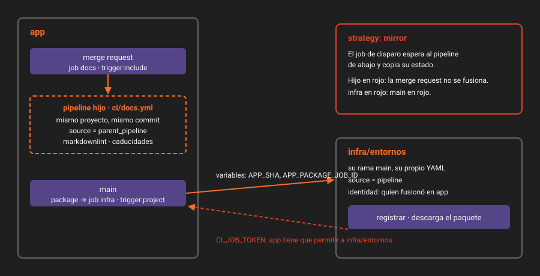

# Pipelines padre-hijo

> Un pipeline hijo es otro pipeline, del mismo proyecto y el mismo commit, que lanza un job del pipeline padre. Sirve para separar una parte del trabajo con sus propias reglas, sin que el `.gitlab-ci.yml` principal crezca hasta que nadie lo lea entero.

---

## 🎯 Objetivos

- Disparar un pipeline hijo con `trigger:include` y reflejar su estado con `strategy: mirror`
- Escribir el `workflow` de un hijo sabiendo que el del padre no se le aplica
- Predecir qué recibe un hijo: variables, reglas, `default`, y las variables de la merge request
- Decidir cuándo un hijo compensa frente a un job más en el padre

---

## 1. Qué problema resuelve

En `app` quieres revisar la documentación: un linter de Markdown y la comprobación de que ningún secreto de `docs/secretos.md` está a punto de caducar. Son jobs que solo tienen sentido cuando cambia un `.md`, que no tienen nada que ver con compilar, y que mañana pueden ser cinco. Dentro del padre, cada uno lleva su `rules` con `changes`, y el archivo mezcla dos asuntos.

Con un pipeline hijo, el padre tiene **un** job con **una** regla: "si cambia un `.md`, lanza `ci/docs.yml`". Lo que pasa dentro es asunto de `ci/docs.yml`.

---

## 2. Cómo funciona

### 2.1 El job de disparo

```yaml
docs:
  stage: test
  needs: []
  rules:
    - if: $CI_PIPELINE_SOURCE == "merge_request_event"
      changes:
        paths: ["**/*.md", ci/docs.yml]
  trigger:
    include: ci/docs.yml
    strategy: mirror
```

Un job con `trigger` no se ejecuta en un runner: GitLab lo resuelve creando otro pipeline. Por eso admite solo un subconjunto de palabras clave: `stage`, `needs`, `rules`, `variables`, `allow_failure`, `extends`, `resource_group`, `environment`, `trigger` y `when` (solo `on_success`, `on_failure`, `always` o `manual`). Un `script` o un `image` en él es un error.

### 2.2 `strategy`: qué estado tiene el job de disparo

| `strategy` | El job de disparo… | Uso |
|---|---|---|
| Sin `strategy` | Termina en verde en cuanto el hijo **se crea**, aunque falle después | Trabajo que no debe bloquear nada |
| `mirror` (GitLab 18.2) | Refleja el estado del hijo exactamente: espera a que termine | Lo normal: un hijo en rojo pone el padre en rojo |
| `depend` | Parecido, pero un job del hijo con `allow_failure: true` que falla cuenta como verde | Legado: la documentación recomienda `mirror` |

Sin `strategy`, un `markdownlint` en rojo no impediría fusionar: el padre ya estaría en verde. En `app` usas `mirror`.

### 2.3 El `workflow` del hijo es suyo

El `workflow:rules` del padre **no** se aplica al hijo: el hijo es otro archivo de configuración, y GitLab lo evalúa entero, con su propio `workflow`. Lo que cambia es el origen:

| Variable | En el hijo vale |
|---|---|
| `CI_PIPELINE_SOURCE` | Siempre `parent_pipeline` |
| `CI_MERGE_REQUEST_*` | Las de la merge request del padre, si el padre es de merge request |
| `CI_COMMIT_SHA`, `CI_COMMIT_REF_NAME` | Las mismas que el padre |

Si copias al hijo el `workflow` de `app`, la regla 1 (`merge_request_event`) no coincide nunca. En un pipeline de merge request no hay `CI_COMMIT_BRANCH`, así que tampoco la 3: el hijo no nace y el job de disparo falla. El `workflow` de un hijo es casi siempre una línea:

```yaml
workflow:
  rules:
    - if: $CI_PIPELINE_SOURCE == "parent_pipeline"
```

### 2.4 Qué recibe y qué no

| Del padre al hijo | ¿Llega? |
|---|:--:|
| Variables del proyecto, del grupo y de la instancia | ✅ Las mismas reglas: protegidas solo en refs protegidas |
| Variables del job de disparo (`variables:`) | ✅ |
| Variables del `.gitlab-ci.yml` del padre (globales) | ✅ Con `trigger:forward:yaml_variables`, activado por defecto |
| Variables con las que se lanzó el padre a mano o programado | ❌ Salvo `trigger:forward:pipeline_variables: true` |
| `default:` del padre (`image`, `interruptible`…) | ❌ El hijo pone el suyo |
| Jobs ocultos del padre (`.npm`, `.deploy`) | ❌ Son de otro archivo: inclúyelos (Semana 12) o repítelos |
| Artefactos de los jobs del padre | ❌ Por defecto |

La restricción de variables de pipeline de la Semana 10 **no** se aplica entre padre e hijo del mismo proyecto.

### 2.5 Límites

- **Profundidad**: dos niveles de hijos (padre → hijo → nieto). Un bisnieto es un error.
- **Pipelines descendientes**: hasta 1000 en una jerarquía, por defecto.
- **El mismo commit**: un hijo no puede ejecutar otra ref. Para eso está el multiproyecto (teoría 05).



---

## 3. Cómo se configura

`ci/docs.yml`, en el mismo repositorio:

```yaml
workflow:
  rules:
    - if: $CI_PIPELINE_SOURCE == "parent_pipeline"

default:
  interruptible: true

markdownlint:
  image: node:22.23.3-alpine3.24
  script:
    - npx --yes markdownlint-cli2@0.24.0 "**/*.md" "#node_modules"
```

Para verlo: el pipeline padre muestra el job `docs` con una flecha; al desplegarlo aparece el hijo dentro del grafo. Por API, el hijo no sale en la lista normal de pipelines:

```bash
# El job de disparo es un "bridge": tiene su propio endpoint y apunta al hijo.
curl -s -H "$H" "$API/projects/$P/pipelines/$PIPE/bridges" \
  | jq -c '.[] | {name, status, hijo: .downstream_pipeline.id}'

# Los hijos, solo si los pides por su origen.
curl -s -H "$H" "$API/projects/$P/pipelines?source=parent_pipeline&per_page=5" \
  | jq -r '.[] | "\(.id) \(.status) \(.ref)"'
```

---

## 4. Antipatrones

| Antipatrón | Por qué duele | Qué hacer en su lugar |
|---|---|---|
| Hijo sin `workflow` propio, copiando el del padre | El hijo no nace en las merge requests y el job de disparo falla | `if: $CI_PIPELINE_SOURCE == "parent_pipeline"` |
| `trigger` sin `strategy` | Un hijo en rojo no bloquea la fusión | `strategy: mirror` |
| Un hijo para cada job | Más pipelines que leer, más tiempo de creación, ninguna regla menos | Un hijo por asunto, con varios jobs |
| Partir el YAML en hijos para ordenarlo | Para ordenar está `include` (Semana 12), que no crea pipelines | Hijo solo si cambia **cuándo** se ejecuta o con qué reglas |
| Confiar en los jobs ocultos del padre dentro del hijo | `.npm` no existe en `ci/docs.yml` | Repítelo, o espera a los componentes |

---

## 5. Trucos

- **Lanzar el hijo a mano para depurarlo**: `when: manual` en una regla del job de disparo. El hijo no existe hasta que lo lanzas.
- **Ver el YAML del hijo tal como lo evaluó GitLab**: `POST .../ci/lint` con el contenido de `ci/docs.yml`. Sin `dry_run`, para que no simule un push que el `workflow` del hijo rechazaría.

---

## 📚 Recursos Adicionales

- [Downstream pipelines](https://docs.gitlab.com/ci/pipelines/downstream_pipelines/) — padre-hijo y multiproyecto en la misma página
- [`trigger:strategy`](https://docs.gitlab.com/ci/yaml/#triggerstrategy) — `mirror` y `depend`
- [Run child pipelines with merge request pipelines](https://docs.gitlab.com/ci/pipelines/downstream_pipelines/#run-child-pipelines-with-merge-request-pipelines)

---

## ✅ Checklist de Verificación

- [ ] Sabes por qué el `workflow` de `app` copiado al hijo lo deja sin nacer
- [ ] Sabes qué diferencia hay entre `mirror`, `depend` y ninguna `strategy`
- [ ] Sabes qué del padre no llega al hijo
- [ ] Sabes encontrar un pipeline hijo por API

---

[← Anterior: `needs`: artefactos y opcionales](02-needs-artefactos-y-opcionales.md) · [Volver a la Semana 11](../README.md) · [Siguiente: Pipelines hijos dinámicos →](04-pipelines-hijos-dinamicos.md)
