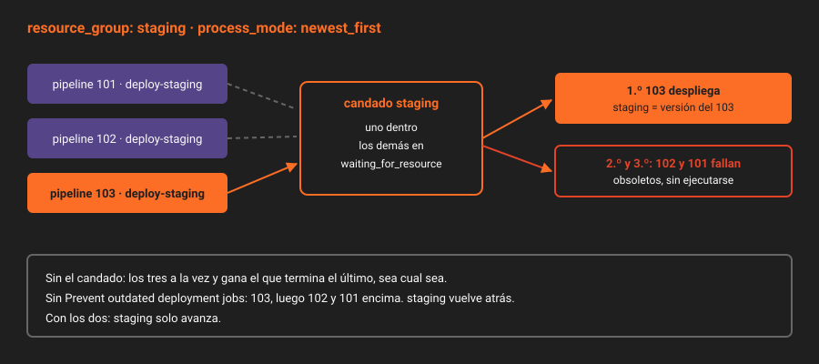

# `resource_group`

> Dos fusiones seguidas en `main` crean dos pipelines, y los dos llegan a `deploy-staging`. Si se ejecutan a la vez, el segundo puede terminar antes que el primero y `staging` acaba con la versión vieja. `resource_group` hace que los jobs que tocan el mismo recurso vayan de uno en uno, y su modo de proceso decide en qué orden.

---

## 🎯 Objetivos

- Explicar qué carrera evita `resource_group` y qué carrera no
- Elegir el modo de proceso de cada entorno y justificarlo
- Combinar `resource_group` con la protección contra despliegues obsoletos
- Leer por API qué job tiene el recurso y cuáles esperan

---

## 1. Qué problema resuelve

`interruptible: false` (Semana 10) impide que un commit nuevo corte un despliegue a la mitad. No impide que **dos** despliegues corran a la vez. Con un runner de `concurrent = 2` (práctica 01), es lo que pasa:

| Tiempo | Pipeline 101 (commit A) | Pipeline 102 (commit B) | `staging` tiene |
|:--:|---|---|:--:|
| 0 s | `deploy-staging` empieza | | — |
| 5 s | | `deploy-staging` empieza | — |
| 20 s | | termina | B |
| 30 s | termina | | **A** |

El commit más nuevo está en `main` y el viejo en `staging`. Nadie se entera hasta que alguien prueba en `staging` algo que "ya estaba arreglado".

---

## 2. Cómo funciona

### 2.1 Un candado por nombre

```yaml
deploy-staging:
  resource_group: staging
```

Todos los jobs **del mismo proyecto** con el mismo `resource_group` se excluyen entre sí, sean del pipeline que sean. Mientras uno lo tiene, los demás esperan en el estado `waiting_for_resource`, sin ocupar runner. El grupo se crea solo la primera vez que un job lo usa.

| Elige el nombre por | Ejemplo | Porque |
|---|---|---|
| El recurso que se toca | `staging`, `production` | `staging` y `production` sí pueden desplegarse a la vez |
| ❌ El job | `deploy-staging-job` | Si mañana otro job toca `staging`, no compartirá el candado |
| ❌ Uno global | `deploy` | Un despliegue a `staging` bloquearía uno a `production` |

### 2.2 El orden: cuatro modos

Cuando el recurso se libera y hay varios esperando, el **modo de proceso** decide quién pasa. Se cambia por API, no en el YAML.

| Modo | Pasa | Garantiza |
|---|---|---|
| `unordered` (por defecto) | El primero que esté listo | Exclusión, no orden |
| `oldest_first` | El job del pipeline más antiguo | Que se despliegue cada versión, en orden |
| `newest_first` | El job del pipeline más nuevo | Que la última versión llegue cuanto antes |
| `newest_ready_first` | El más nuevo de los que ya están esperando | Lo mismo, sin esperar a pipelines que aún no han llegado al job |

Con los dos últimos, cada job tiene que ser **idempotente**: desplegar la versión B y luego la A no puede romper nada, porque puede pasar.

### 2.3 La pieza que completa `newest_first`

Con `newest_first`, el despliegue de B pasa primero. Pero el de A sigue en cola, y cuando B termina, A se despliega encima: otra vez la versión vieja en `staging`. Lo que lo evita es un ajuste del proyecto: **Prevent outdated deployment jobs** (`Settings → CI/CD → General pipelines`), activado por defecto. Un job de despliegue más antiguo que el último despliegue correcto de ese entorno **falla sin ejecutarse**.

| `staging` | Modo | Despliegues obsoletos | Resultado con A y B en cola |
|---|---|---|---|
| ❌ | `unordered` | — | Orden aleatorio |
| ❌ | `oldest_first` | — | A, luego B. `staging` pasa por las dos |
| ✅ | `newest_first` | Prevenidos | B; A falla como obsoleto. `staging` termina en B y nunca vuelve atrás |

Para `staging`, que se despliega en cada fusión y solo importa la última, la tercera fila. Para `production`, manual, rara vez hay dos en cola: `oldest_first` o el modo por defecto bastan, y el candado ya impide que dos personas lancen a la vez.

El reintento manual de un despliegue viejo, que es como se hace un *rollback*, sigue permitido por un segundo ajuste del mismo bloque (*Allow job retries for rollback deployments*). La Semana 14 lo usa.

### 2.4 Un candado para un pipeline entero

Un job de disparo (teorías 03 y 05) también admite `resource_group`. Con `strategy: mirror`, el candado se mantiene **hasta que termina el pipeline de abajo**. Es la forma de que dos pipelines de `infra/entornos` disparados desde `app` no se pisen, aunque el despliegue sean varios jobs abajo.

### 2.5 Lo que no resuelve

| Carrera | ¿`resource_group`? |
|---|:--:|
| Dos despliegues al mismo entorno desde el mismo proyecto | ✅ |
| Dos proyectos distintos desplegando en el mismo servidor | ❌ El candado es por proyecto. Que despliegue uno solo (`infra/entornos`) |
| Una persona desplegando a mano desde su portátil | ❌ Que nadie despliegue a mano |



---

## 3. Cómo se configura

En el YAML, una línea por job. El modo, por API (Maintainer):

```bash
curl -s -H "$H" "$API/projects/$P/resource_groups" | jq -c '.[] | {key, process_mode}'

curl -s --request PUT "$API/projects/$P/resource_groups/staging" -H "$H" \
  --data "process_mode=newest_first" | jq -c '{key, process_mode}'

# Quién espera, en el orden en que pasará.
curl -s -H "$H" "$API/projects/$P/resource_groups/staging/upcoming_jobs" \
  | jq -r '.[] | "\(.id) \(.name) pipeline \(.pipeline.id) \(.status)"'
```

Y el ajuste de despliegues obsoletos:

```bash
curl -s -H "$H" "$API/projects/$P" | jq '{ci_forward_deployment_enabled, ci_forward_deployment_rollback_allowed}'
```

---

## 4. Antipatrones

| Antipatrón | Por qué duele | Qué hacer en su lugar |
|---|---|---|
| `resource_group` con el nombre del job | Otro job que toque el mismo entorno no comparte candado | El nombre del recurso |
| Un único `resource_group` para todos los entornos | `staging` bloquea `production` | Uno por entorno |
| `newest_first` con los despliegues obsoletos desactivados | El viejo pasa después del nuevo | Los dos juntos |
| Usar `resource_group` para limitar el uso del runner | Para eso está `concurrent` y `limit` (Semana 15) | Un candado por recurso externo |
| Despliegue no idempotente con `newest_first` | Desplegar fuera de orden lo rompe | Idempotente, u `oldest_first` |

---

## 5. Trucos

- **El estado que no esperabas**: un job en `waiting_for_resource` no está atascado en el runner, está en la cola del candado. `upcoming_jobs` dice quién tiene delante.
- **Liberar un candado tomado por un job colgado**: cancela el job. El recurso se libera al terminar, del modo que sea.
- **Un despliegue que falló "sin log"**: si su `failure_reason` habla de *forward deployment*, es la protección contra obsoletos haciendo su trabajo.

---

## 📚 Recursos Adicionales

- [Resource group](https://docs.gitlab.com/ci/resource_groups/) — los cuatro modos, con ejemplos
- [Resource groups API](https://docs.gitlab.com/api/resource_groups/)
- [Prevent outdated deployment jobs](https://docs.gitlab.com/ci/environments/deployment_safety/#prevent-outdated-deployment-jobs)

---

## ✅ Checklist de Verificación

- [ ] Sabes qué diferencia hay entre `interruptible: false` y `resource_group`
- [ ] Sabes qué modo usa `staging` y qué ajuste del proyecto lo completa
- [ ] Sabes por qué el candado de un job de disparo dura todo el pipeline de abajo
- [ ] Sabes qué carrera no resuelve un `resource_group`

---

[← Anterior: El job token entre proyectos](06-job-token-entre-proyectos.md) · [Volver a la Semana 11](../README.md) · [Siguiente: Pipelines programados →](08-pipelines-programados.md)
