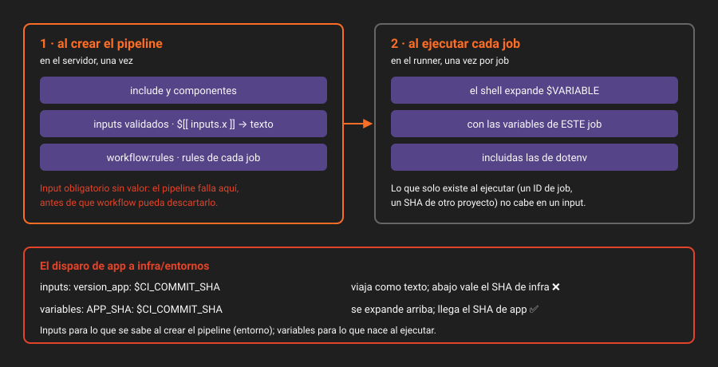

# `spec:inputs`: el contrato de un archivo

> Un archivo incluido que acepta parámetros necesita decir **cuáles**, de qué tipo y qué valores admite. `spec:inputs` es esa declaración, y `$[[ inputs.x ]]` es donde se usa cada uno. Se resuelve una vez, al crear el pipeline, y por eso es distinto de una variable en todo lo que importa.

---

## 🎯 Objetivos

- Declarar inputs con tipo, valor por defecto, lista cerrada y expresión regular
- Pasar inputs a un archivo con `include:inputs`
- Distinguir cuándo se sustituye `$[[ inputs.x ]]` y cuándo se expande `$VARIABLE`
- Reconocer los errores de validación y la trampa del YAML entre corchetes

---

## 1. Qué problema resuelve

Antes de los inputs, la forma de parametrizar un archivo incluido era una variable: el archivo usa `$NODE_IMAGE` y quien lo incluye define `NODE_IMAGE`. Funciona, pero:

| Con variables | Lo que pasa |
|---|---|
| No hay lista de parámetros | Para saber qué acepta el archivo hay que leerlo entero |
| No hay tipos | `COBERTURA: "ochenta"` llega al job y falla en mitad del script |
| Si falta una | El job se ejecuta con una cadena vacía |
| Todo se expande al ejecutar | No puedes usarla en un nombre de job, ni en `stage`, ni en `needs` |
| Se heredan | Una variable global del consumidor puede cambiar el archivo sin querer |

Un input falla **antes** de que exista el pipeline, con un mensaje que dice qué input y por qué.

---

## 2. Cómo funciona

### 2.1 La cabecera

```yaml
spec:
  inputs:
    imagen:
      description: Imagen de Node con la que se construye y se prueba
      default: node:22.23.3-alpine3.24
    cobertura:
      description: Porcentaje mínimo de cobertura
      type: number
      default: 80
    entorno:
      options: [staging, production]
    version:
      regex: ^[0-9]+\.[0-9]+\.[0-9]+$
---
test:
  image: $[[ inputs.imagen ]]
  script:
    - npm run test:ci -- --min=$[[ inputs.cobertura ]]
  rules:
    - if: $CI_PIPELINE_SOURCE == "merge_request_event"
    - if: $CI_COMMIT_BRANCH == $CI_DEFAULT_BRANCH
```

El archivo tiene **dos documentos YAML** separados por `---`: la cabecera y el contenido. Sin el separador, GitLab no sabe dónde acaba `spec`.

| Clave | Qué hace |
|---|---|
| `default` | Valor si nadie lo pasa. **Sin `default`, el input es obligatorio** |
| `type` | `string` (por defecto), `number`, `boolean` o `array` |
| `options` | Lista cerrada de valores |
| `regex` | Expresión que el valor tiene que cumplir |
| `description` | Lo que lee quien consume el archivo, también en el catálogo |
| `rules` | `options` y `default` distintos según el valor de otros inputs (desde 18.7) |

### 2.2 Los mensajes, literales

Así responde `ci/lint` en 19.2.4 a cada fallo, con el archivo delante:

| Error | Mensaje |
|---|---|
| Falta un obligatorio | `` `entorno` input: required value has not been provided `` |
| Tipo equivocado | `` `cobertura` input: provided value is not a number `` |
| Fuera de `options` | `` `entorno` input: `desarrollo` cannot be used because it is not in the list of allowed options `` |
| No cumple `regex` | `` `version` input: provided value does not match required RegEx pattern `` |
| Un input que no existe | `unknown input arguments: color` |

El último es el más útil: un error tipográfico en el nombre de un input no se ignora en silencio, como pasaría con una variable.

### 2.3 Pasarlos

```yaml
include:
  - local: ci/test.yml
    inputs:
      cobertura: 90
      entorno: staging
```

`include:inputs` vale para `local`, `project`, `remote` y `component`. Un input solo existe en el archivo que lo declara: si `ci/test.yml` incluye a su vez otro archivo, tiene que pasárselo explícitamente.

### 2.4 Cuándo se sustituye

`$[[ inputs.x ]]` se sustituye **al crear el pipeline**, en el servidor, como texto. Después se evalúan `workflow`, `rules` y todo lo demás. `$VARIABLE`, en cambio, la expande el shell del runner al ejecutar el job.



Consecuencias:

- **Un input puede ir donde una variable no**: en el nombre de un job (`"test-$[[ inputs.sufijo ]]":`), en `stage`, en `needs`, en `parallel`.
- **Un input no ve nada de lo que pasa al ejecutar**: ni `dotenv`, ni el ID de un job, ni el SHA de otro proyecto (teoría 07).
- **Si el input ocupa el valor entero, conserva su tipo**: `allow_failure: $[[ inputs.opcional ]]` con un `boolean` es un booleano; `needs: $[[ inputs.lista ]]` con un `array` es una lista. Dentro de una cadena más larga, siempre es texto.

### 2.5 La trampa de los corchetes

La plantilla se lee como YAML **antes** de sustituir. `$[[` dentro de una lista entre corchetes rompe la lectura:

```yaml
# ❌ did not find expected ',' or ']' while parsing a flow sequence
cache:
  key:
    files: [$[[ inputs.directorio ]]/package-lock.json]

# ✅ lista en bloque
cache:
  key:
    files:
      - $[[ inputs.directorio ]]/package-lock.json
```

### 2.6 Funciones

```yaml
script:
  - echo "rama $[[ inputs.rama | expand_vars | truncate(0,8) ]]"
```

| Función | Hace |
|---|---|
| `expand_vars` | Expande las variables que haya en el valor, con las mismas limitaciones que `include` (teoría 01, apartado 2.3) |
| `truncate(desde,largo)` | Corta el texto |
| `posix_escape` | Escapa el valor para usarlo en un shell sin que se ejecute lo que lleve dentro (desde 18.6) |
| `split('sep')` | Convierte un texto en lista (desde 19.2) |

Se aplican de izquierda a derecha, hasta tres por bloque. El orden importa: `truncate` antes de `expand_vars` corta el **nombre** de la variable, no su valor.

---

## 3. Cómo se configura

Prueba un archivo con inputs sin crear ningún pipeline: `ci/lint` con `content` y los inputs que quieras.

```bash
jq -n '{content: "include:\n  - local: ci/test.yml\n    inputs:\n      cobertura: ochenta\n",
        dry_run: true, ref: "main"}' \
  | curl -s --request POST "$API/projects/$P/ci/lint" -H "$H" -H "Content-Type: application/json" -d @- \
  | jq -r '.errors[]'
# `ci/test.yml`: `cobertura` input: provided value is not a number
```

`merged_yaml` enseña el resultado con los valores ya sustituidos: no queda ningún `$[[`.

---

## 4. Antipatrones

| Antipatrón | Por qué duele | Qué hacer en su lugar |
|---|---|---|
| Un input para cada clave del job | El contrato es tan grande como el job: nadie sabe qué importa | Inputs para lo que de verdad cambia entre consumidores |
| `type: string` para un número o un booleano | Llega `"80"` y no se valida | `type: number`, `type: boolean` |
| Un input de texto libre que acaba en un `script` | El valor se ejecuta como shell | `options`, `regex`, `type` o `posix_escape` |
| `$[[ ... ]]` dentro de `[ ]` | El archivo no se puede leer | Listas en bloque |
| Usar un input para algo que solo existe al ejecutar | Llega el texto, no el valor | Una variable (teoría 07) |
| Leer variables globales del consumidor en vez de declarar inputs | Contrato invisible y frágil | Inputs con `default` |

---

## 5. Trucos

- **Ver la cabecera de un componente sin abrir el repositorio**: en el catálogo, la pestaña `Components` lista cada input con su tipo, su `default` y su `description` (teoría 05).
- **Qué jobs salen con unos inputs concretos**: el mismo `ci/lint` con `include_jobs: true` lista los jobs resultantes. Con un input en el nombre del job, ves el nombre ya sustituido.

---

## 📚 Recursos Adicionales

- [CI/CD inputs](https://docs.gitlab.com/ci/inputs/) — tipos, funciones, `spec:inputs:rules`
- [`spec:inputs`](https://docs.gitlab.com/ci/yaml/#specinputs) en la referencia de `.gitlab-ci.yml`

---

## ✅ Checklist de Verificación

- [ ] Sabes qué hace obligatorio a un input
- [ ] Sabes qué errores da un input mal pasado y en qué momento
- [ ] Sabes por qué un input puede ir en el nombre de un job y una variable no
- [ ] Sabes por qué `[$[[ inputs.x ]]]` rompe el archivo

---

[← Anterior: `extends` y `!reference`](02-extends-y-reference.md) · [Volver a la Semana 12](../README.md) · [Siguiente: Componentes CI/CD →](04-componentes.md)
