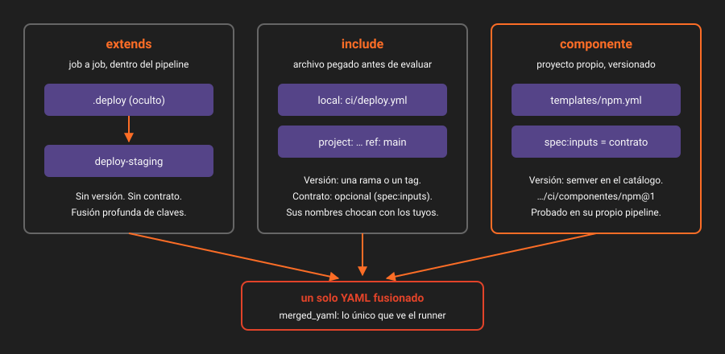

# Componentes CI/CD

> Un componente es un archivo de `templates/` en un proyecto dedicado, con `spec:inputs` como contrato y una versión como dirección. Es `include:project` con tres cosas que le faltaban: un contrato, una versión con significado y un sitio donde probarlo. **Es Free**: funciona igual en CE.

---

## 🎯 Objetivos

- Crear un proyecto de componentes con la estructura que GitLab exige
- Incluir un componente por ruta y versión, y entender qué hace `$CI_SERVER_FQDN` en esa ruta
- Escribir un componente que no dependa del proyecto que lo usa
- Resolver el caso de un componente que necesita un archivo, como un script

---

## 1. Qué problema resuelve

`.npm` vive en `app`. El día que `infra/entornos` o un segundo producto necesiten construir con npm, las opciones de la Semana 11 eran copiarlo (la tabla de "lo que espera" lo decía: "se copia, a sabiendas") o `include:project` contra `app`. La copia diverge en la primera corrección. `include:project` hace depender a todos de un proyecto que no se diseñó para eso: cualquier cambio en `app` puede romper a los demás, y nadie sabe qué parámetros acepta ni si se probó.



---

## 2. Cómo funciona

### 2.1 El proyecto

```
ci/componentes/
├── README.md               ← obligatorio para publicar; el catálogo lo enseña
├── .gitlab-ci.yml          ← prueba los componentes y publica versiones
├── templates/
│   ├── npm.yml             ← un componente: "npm"
│   └── gobernanza.yml      ← otro: "gobernanza"
├── scripts/
│   └── gobernanza.sh       ← no viaja con el componente (apartado 2.6)
└── tests/npm/              ← proyecto mínimo para probar "npm"
```

Cada componente es `templates/<nombre>.yml` o `templates/<nombre>/template.yml`. Los otros archivos de esa carpeta **no viajan** con él: el consumidor recibe solo el YAML. Todos los componentes del proyecto se versionan juntos, hasta 100 por proyecto. Si uno necesita otro ritmo de versiones, va a otro proyecto.

### 2.2 La dirección

```yaml
include:
  - component: $CI_SERVER_FQDN/plataforma-<tu-dominio>/ci/componentes/npm@1
    inputs:
      build: npx tsc
```

| Parte | Qué es |
|---|---|
| `$CI_SERVER_FQDN` | El host de tu instancia, con el puerto si no es el estándar: `localhost:8888` |
| `plataforma-<tu-dominio>/ci/componentes` | La ruta completa del proyecto |
| `npm` | El nombre del archivo en `templates/`, sin `.yml` |
| `@1` | La versión (teoría 06) |

El host **tiene que** ser el de la instancia: un componente solo se resuelve en la instancia donde vive. En el laboratorio, `CI_SERVER_FQDN` vale `localhost:8888` aunque `CI_SERVER_URL` apunte a `http://gitlab:8888` desde la Semana 09: si la sobrescribieras también, todos los componentes fallarían con `the component path is not supported`. Usa siempre la variable, nunca el host escrito a mano: el día que la instancia cambie de nombre, nadie tendrá que tocar el YAML.

### 2.3 Con los permisos de quién

Como `include:project` (teoría 01, apartado 2.2): el componente se lee con los permisos del usuario que crea el pipeline. Si `ci/componentes` es privado y ese usuario no tiene acceso, el pipeline no se crea. En este bootcamp todos los proyectos del grupo heredan los miembros del grupo raíz, así que no te pasará; en una organización real, sí.

### 2.4 El consumidor puede sobrescribir

Lo que trae un componente se fusiona con el archivo principal igual que un `include`: el consumidor puede redefinir claves de un job del componente.

```yaml
include:
  - component: $CI_SERVER_FQDN/plataforma-<tu-dominio>/ci/componentes/gobernanza@1

gobernanza:
  allow_failure: false        # aquí, que la gobernanza bloquee
```

Útil para una excepción. Peligroso como costumbre: cada sobrescritura es una dependencia de los nombres internos del componente, que no son parte de su contrato. Si una excepción se repite en dos consumidores, es un input que falta.

### 2.5 Un componente no sabe dónde va a vivir

El componente se fusiona con un pipeline que no conoce. Reglas:

| Regla | Por qué |
|---|---|
| Nada de `default`, `stages`, `workflow` ni `variables` globales | Afectarían a **todos** los jobs del consumidor |
| Jobs ocultos con nombres propios: `.componente-npm`, no `.npm` | Si el consumidor tiene un `.npm`, se fusionan sin aviso |
| Ningún `!reference` ni `extends` a algo del consumidor | Se rompe en el primer proyecto que no lo tenga |
| Cada job con sus `rules` completas | Incluida la de fuera de programados: no puede referenciar `.fuera-de-programados` de `app` |
| Cada job con sus `needs` | El consumidor no debería tener que saber qué espera a qué |
| `$CI_API_V4_URL` y `$CI_SERVER_FQDN`, nunca una URL escrita | Otra instancia, otra URL |

El `stage` es la excepción a medias: el componente pone uno, y el consumidor tiene que tenerlo en sus `stages`. Si varía entre consumidores, es un input.

### 2.6 Contexto del componente y archivos que necesita

`gobernanza` ejecuta `scripts/gobernanza.sh`. Ese script no puede viajar con el componente (apartado 2.1), y dejarlo en cada consumidor es volver a copiar. La solución es que el job lo **descargue** de `ci/componentes`, en la versión exacta del componente:

```yaml
spec:
  component: [sha]
---
gobernanza:
  script:
    - >
      curl --fail -sS -o gobernanza.sh --header "JOB-TOKEN: $CI_JOB_TOKEN"
      "$CI_API_V4_URL/projects/<ruta-de-componentes-codificada>/repository/files/scripts%2Fgobernanza.sh/raw?ref=$[[ component.sha ]]"
```

`spec:component` (disponible desde 18.7) da acceso a datos del propio componente:

| Valor | Con `npm@1` resuelto a `1.1.0` |
|---|---|
| `$[[ component.name ]]` | `npm` |
| `$[[ component.version ]]` | `1.1.0` |
| `$[[ component.reference ]]` | `1`, lo que escribió el consumidor |
| `$[[ component.sha ]]` | El SHA del commit de `1.1.0` |

Con `component.sha`, el script es exactamente el de esa versión: si mañana se publica `1.2.0`, un pipeline con `1.1.0` sigue descargando el script de `1.1.0`.

La descarga va con el job token **del proyecto consumidor**. Si `ci/componentes` es privado, eso necesita que el grupo esté en su lista de permitidos (Semana 11, teoría 06); sin ella, `curl` devuelve 403.

---

## 3. Cómo se configura

En la UI: `Settings → General → Visibility, project features, permissions` del proyecto dice si es un proyecto de catálogo (teoría 05). Para usar un componente no hace falta: basta con que exista el archivo en `templates/` en la versión que pides.

Qué componentes entraron en un pipeline, y desde qué commit:

```bash
curl -s -H "$H" "$API/projects/$P/ci/lint?ref=main" \
  | jq -c '.includes[] | select(.type == "component") | {location, blob}'
```

`location` es lo que escribiste (`…/npm@1`); `blob` lleva el SHA al que se resolvió.

---

## 4. Antipatrones

| Antipatrón | Por qué duele | Qué hacer en su lugar |
|---|---|---|
| El host de la instancia escrito en la ruta | Se rompe al mover la instancia | `$CI_SERVER_FQDN` |
| `default:` o `variables:` globales en un componente | Cambian jobs del consumidor que no son del componente | Configuración en cada job |
| `.npm` como job oculto del componente | Choca con el `.npm` del consumidor | Un prefijo propio |
| El script en cada consumidor y el YAML en el componente | Dos versiones del mismo comportamiento | El script en el proyecto de componentes, descargado en `component.sha` |
| Descargar el script de `main` | El componente `1.1.0` ejecuta código que nunca se publicó | `ref=$[[ component.sha ]]` |
| Un componente que lo hace todo con veinte inputs | Nadie entiende el contrato | Dos componentes pequeños |

---

## 5. Trucos

- **Usar un componente sin publicarlo**: `@main` o `@<SHA>` funcionan sin catálogo. Es como se prueba una rama del componente desde un consumidor antes de fusionarla.
- **Un `templates/<nombre>/` con más archivos**: solo viaja `template.yml`, pero la carpeta es buen sitio para la documentación y las pruebas de ese componente.

---

## 📚 Recursos Adicionales

- [CI/CD components](https://docs.gitlab.com/ci/components/) — estructura, versiones, contexto y buenas prácticas
- [CI/CD component examples](https://docs.gitlab.com/ci/components/examples/) — cómo probar un componente contra archivos de ejemplo

---

## ✅ Checklist de Verificación

- [ ] Sabes qué archivos de un proyecto de componentes viajan al consumidor y cuáles no
- [ ] Sabes por qué la ruta empieza por `$CI_SERVER_FQDN` y qué pasa si lo sobrescribes
- [ ] Sabes qué no debe tener un componente para no cambiar el pipeline de quien lo usa
- [ ] Sabes cómo un componente usa un script en la versión exacta en que se publicó

---

[← Anterior: `spec:inputs`](03-spec-inputs.md) · [Volver a la Semana 12](../README.md) · [Siguiente: El catálogo →](05-catalogo.md)
